# UGCX Backend Architecture

This document explains how the API in `apps/api` works. Each section has a diagram.
Diagrams use Mermaid. GitHub, VS Code (Markdown Preview Mermaid extension), and most Markdown viewers render them.

## 1. The big picture

The backend is one NestJS app. It is a **modular monolith**: one process, many feature modules.
The mobile app calls it over REST (`/api/v1`). PostgreSQL holds all data. Four outside services help.

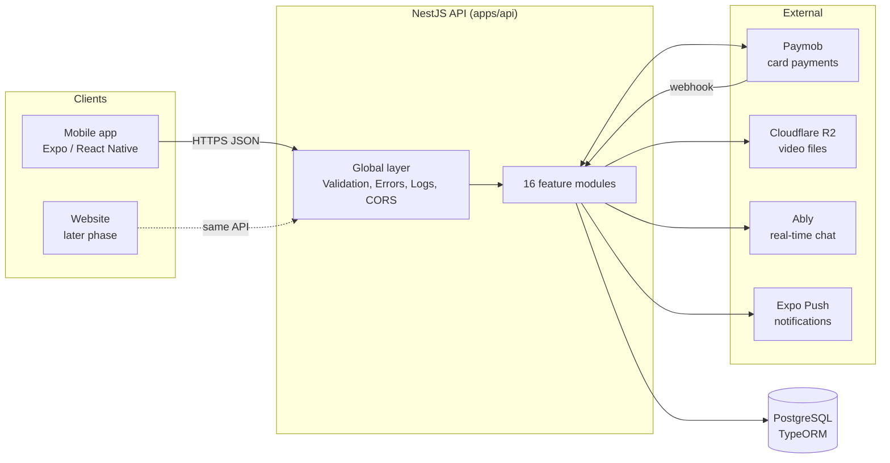

**Key idea:** the API never stores video bytes and never touches card data.
The app uploads video straight to R2. Paymob hosts the checkout page.

## 2. What happens when the API starts

`main.ts` builds the app and sets up rules that apply to every request.

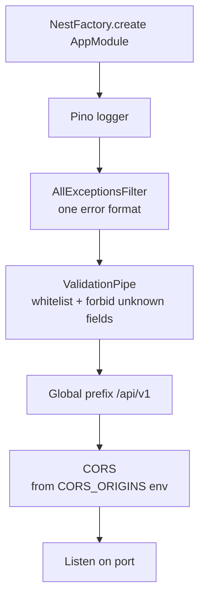

`AppModule` loads these first:

| Piece | Job |
|---|---|
| `ConfigModule` | Reads `.env`. `env.validation.ts` stops startup if a value is wrong. |
| `LoggerModule` (pino) | Structured logs. Pretty in dev, JSON in production. |
| `TypeOrmModule` | PostgreSQL connection. `synchronize: false`. Migrations run as a manual deploy step. |
| `ThrottlerModule` | Rate limit: 10 requests per minute. Used on auth, uploads, and `read-all`. |

## 3. Module map

Each folder in `src/modules` is one Nest module. Arrows mean "uses".

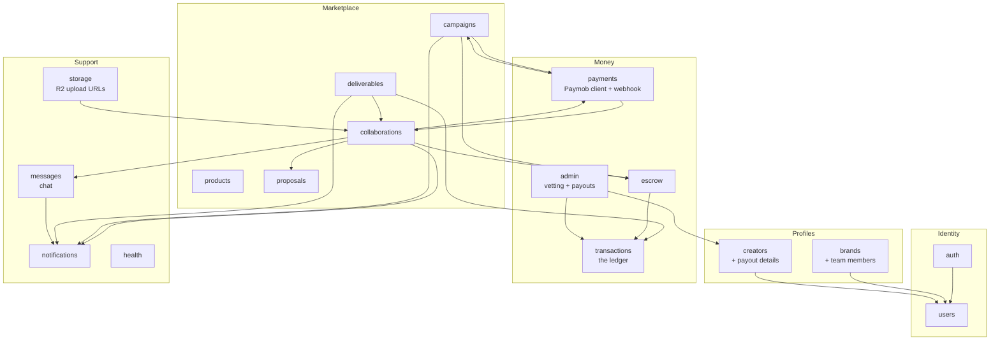

Note: `payments` and `collaborations` import each other. Nest solves this with `forwardRef`.

## 4. Anatomy of one request

Every endpoint follows the same path: **Controller → Service → Repository → Database**.

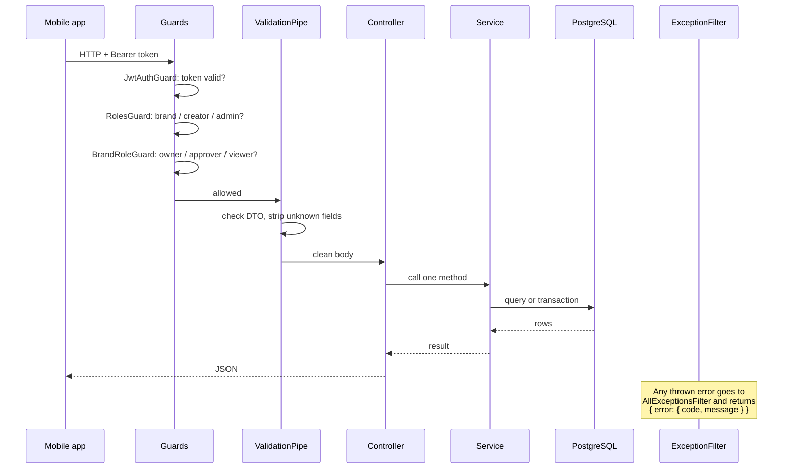

Rules the code follows:

- Controllers stay thin. They only call a service.
- Services hold business rules.
- Every write endpoint has a DTO checked with `class-validator`.
- Domain errors use `DomainErrorException` with a stable `code` such as `duplicate_proposal`.

## 5. Security layers (three guards)

Access uses two questions. First "what kind of user?" Second "what team role inside the brand?"

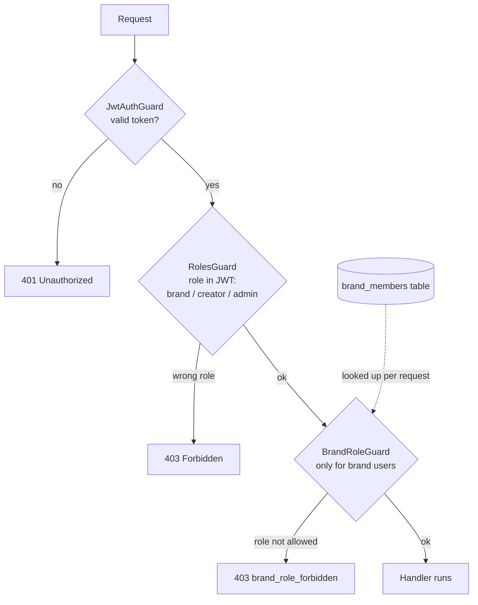

| Guard | Reads from | Checks |
|---|---|---|
| `JwtAuthGuard` | `Authorization` header | Token signature and expiry. Puts `{ userId, role }` on the request. |
| `RolesGuard` | `@Roles(...)` decorator | Coarse role: `brand`, `creator`, `admin`. |
| `BrandRoleGuard` | `@BrandRoles(...)` + `brand_members` table | Team role: `owner`, `approver`, `viewer`. |

The team role is **not** in the JWT. The guard reads it from the database on each request.
So a role change takes effect at once.

Example: `POST /campaigns/:id/escrow/checkout` needs `brand` + `owner`. An `approver` gets 403.

## 6. Authentication flow

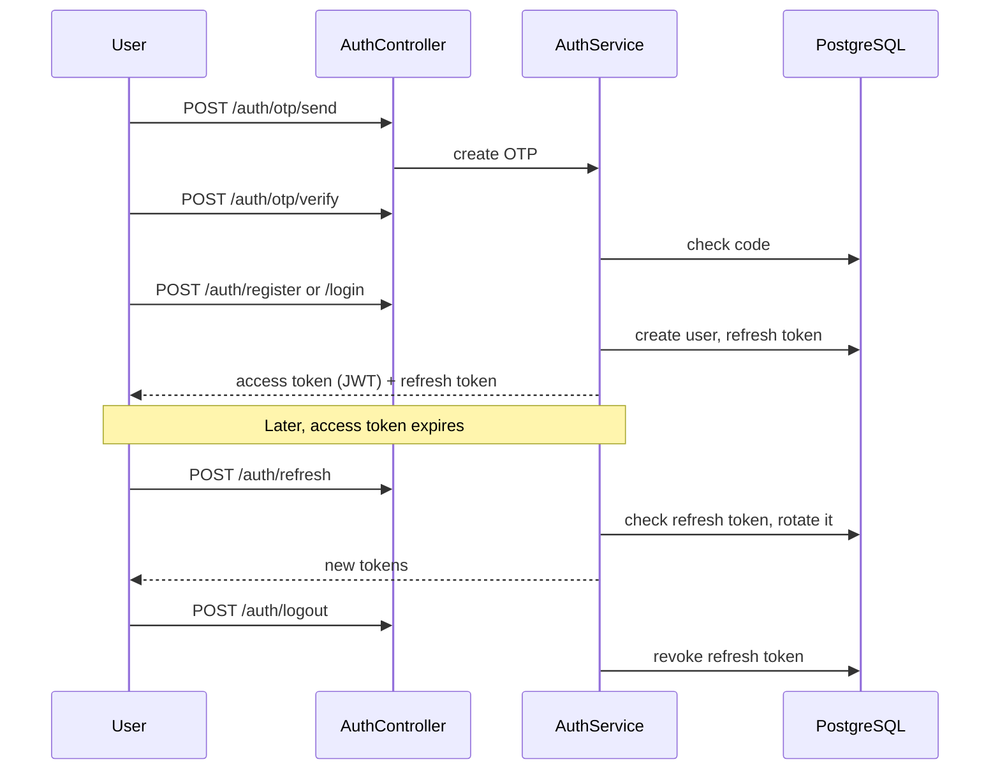

All `/auth` routes have a rate limit. Login uses a short-lived JWT plus a stored refresh token.

## 7. Data model

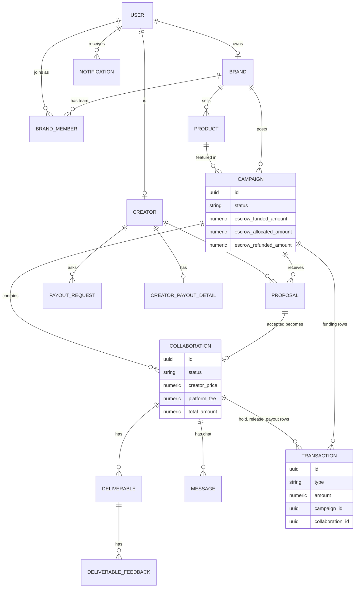

Facts that matter:

- **`transactions` is the only ledger.** Campaign rows carry `campaign_id`. Collaboration rows carry `collaboration_id`.
- Money is `numeric(10,2)` in the database. Code converts to integer cents in `common/utils/money.ts`. It never uses `parseFloat` on an amount.
- Ledger rows are never updated after insert.

## 8. State machines

### Campaign

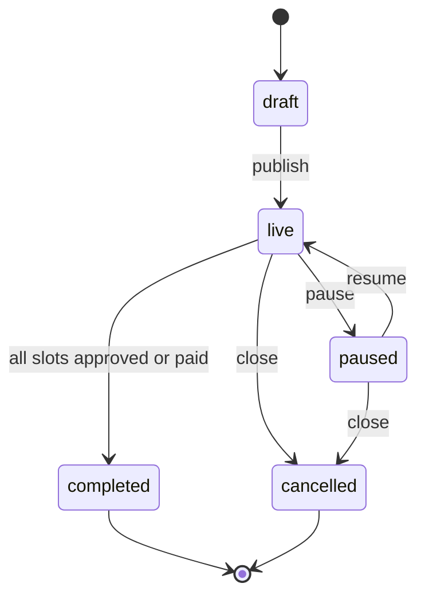

### Proposal

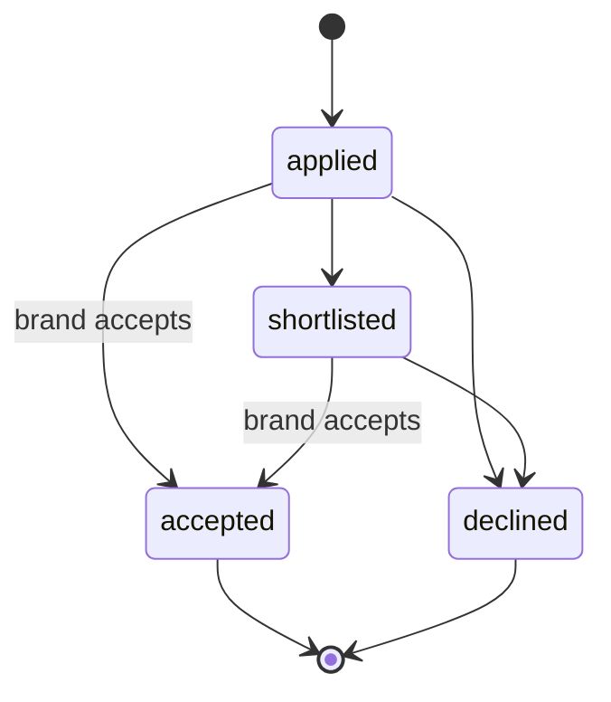

### Collaboration (the escrow state machine)

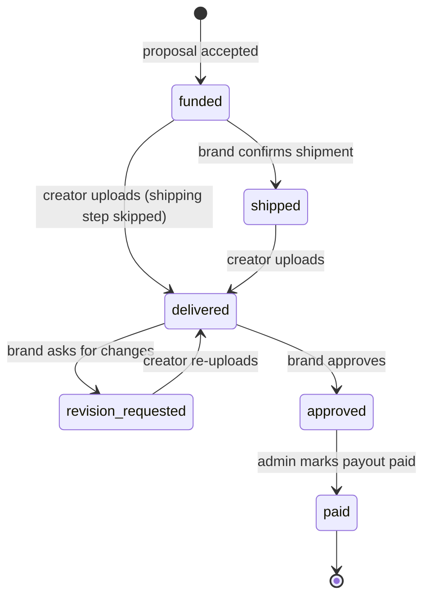

The enum also has `pending_payment`, `payment_failed`, and `cancelled` for the older per-collaboration payment path.

### Deliverable

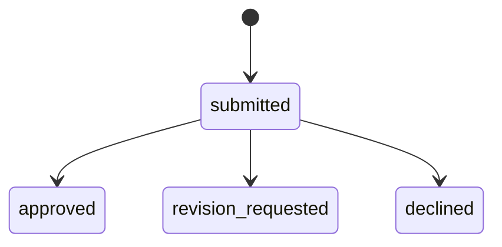

## 9. Money flow: campaign escrow

**Decision:** the brand funds the **campaign**, not each collaboration. Accepting a proposal takes money from the campaign balance. It raises no new charge.

Each campaign keeps three counters:

```
available = funded - allocated - refunded
```

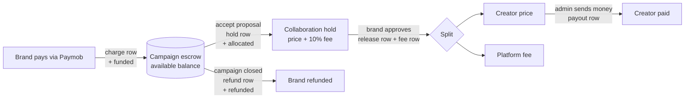

Ledger row types:

| Type | When | Amount |
|---|---|---|
| `charge` | Paymob webhook says funding worked | Amount the brand paid |
| `hold` | Brand accepts a proposal | Creator price + fee |
| `release` | Brand approves the deliverable | Full total (`price + fee`) |
| `fee` | Same moment as release | Platform fee |
| `payout` | Admin marks creator as paid | Creator price only |
| `refund` | Unused balance returned | Refunded amount |

Check that adds up: `release = payout + fee`.

## 10. Flow: fund a campaign (Paymob)

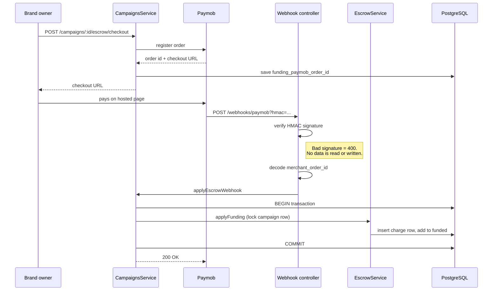

Safety rules:

- The webhook has **no JWT**. The HMAC signature is its login.
- A unique `paymob_reference` in the ledger makes replayed webhooks harmless.
- Campaign rows are locked (`pessimistic_write`) during money changes, so two requests cannot spend the same balance.

## 11. Flow: accept a proposal

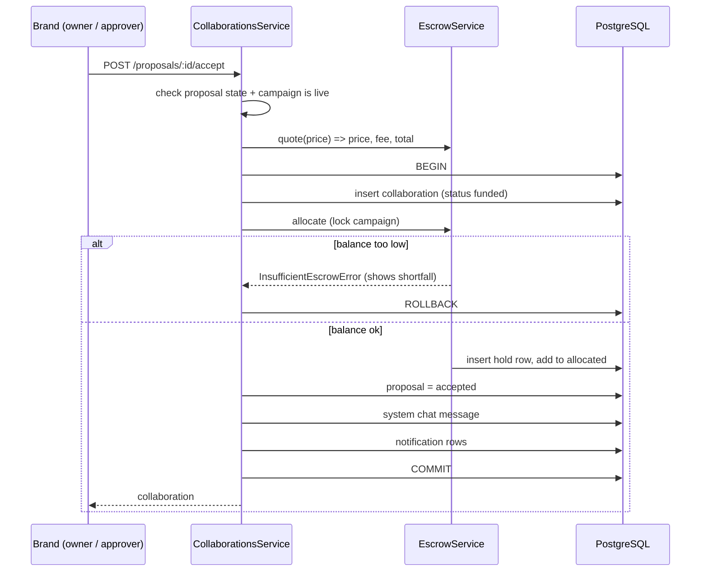

Everything runs in one database transaction. If any step fails, nothing is saved.

## 12. Flow: deliver, review, approve, pay

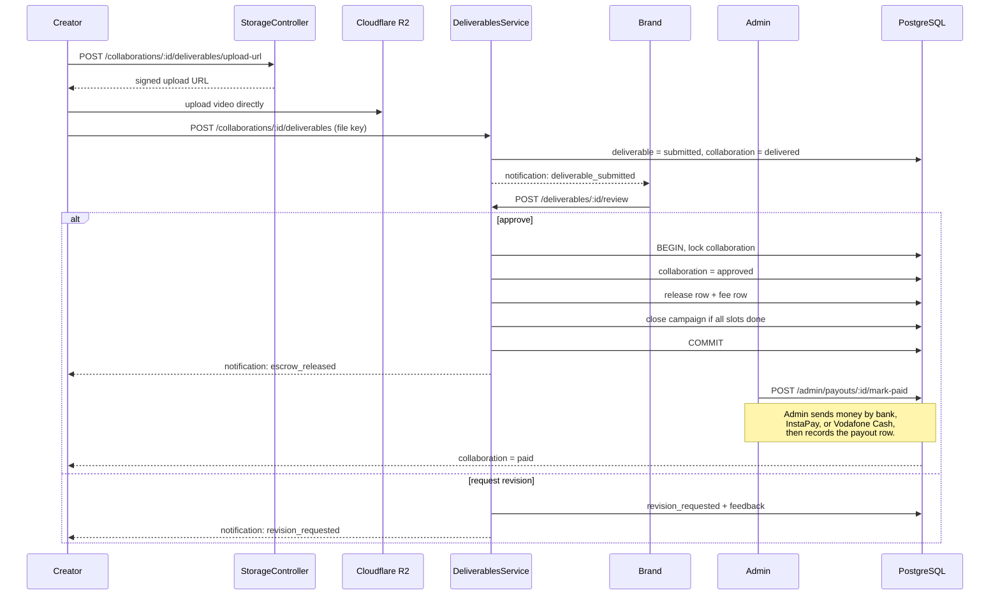

Payout is manual in this phase. Admin does the bank transfer, then records evidence in the API.
A unique index allows only one `payout` row per collaboration, so a double click cannot pay twice.

## 13. Notifications

One event, two copy strings (brand and creator), two recipients. The catalog is in `packages/shared-types`.

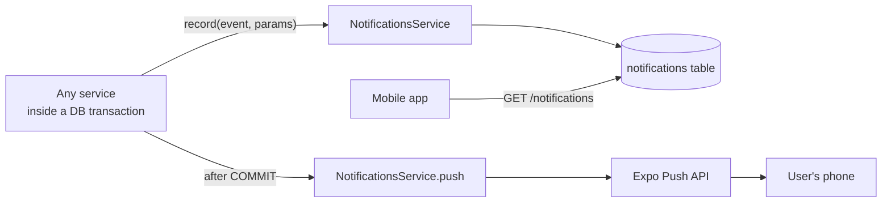

Design points:

- `record` saves rows **inside** the transaction. If the business step rolls back, so does the notification.
- `push` runs **after** commit, so a failed push cannot break the business action.
- `EVENT_AUDIENCE` maps each event to who gets it (`brand_team`, `brand_owner_approver`, `creator`).

Events: `brief_published`, `proposal_received`, `proposal_shortlisted`, `proposal_declined`, `escrow_funded`, `shipment_confirmed`, `deliverable_submitted`, `revision_requested`, `escrow_released`, `message_received`, `payout_sent`.

## 14. Chat

Messages live in the database. Ably delivers them in real time. The API issues short tokens so the app can connect to Ably.

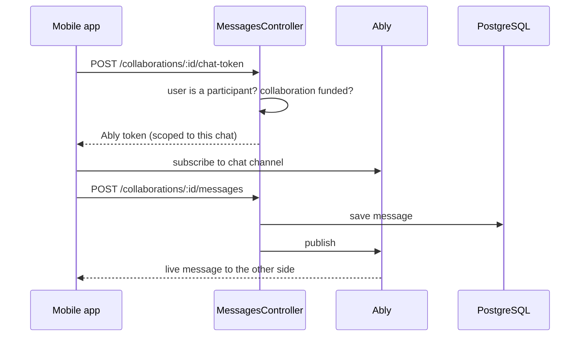

Chat opens only after a collaboration is funded. System messages (such as "escrow funded") use the same table.

## 15. Endpoint map by role

| Area | Brand | Creator | Admin | Public |
|---|---|---|---|---|
| `/auth/*` | | | | yes (rate limited) |
| `/health` | | | | yes |
| `/webhooks/paymob` | | | | signature only |
| `/brands/me*`, `/brands/me/members` | yes (team role) | | | |
| `/products` | yes | | | |
| `/campaigns` (create, publish, escrow) | yes (team role) | | | |
| `GET /campaigns` (browse) | | yes | | |
| `/campaigns/:id/proposals` | list | create | | |
| `/proposals/:id/accept` | yes | | | |
| `/collaborations/*` | yes | yes | | |
| `/deliverables`, `/collaborations/:id/deliverables` | review | submit | | |
| `/collaborations/:id/messages`, `/chats` | yes | yes | | |
| `/creators/me*` | | yes | | |
| `/notifications`, `/users/me/push-token` | yes | yes | yes | |
| `/admin/creators`, `/admin/payouts` | | | yes | |

## 16. Folder map

```
apps/api/src
├── main.ts                  App start, global pipes and filters
├── app.module.ts            Root module, imports all features
├── config/                  Env loading and validation
├── common/                  Shared code
│   ├── filters/             AllExceptionsFilter
│   ├── exceptions/          DomainErrorException
│   ├── utils/               money.ts, paginate.ts, duration.ts
│   ├── dto/                 Pagination DTO
│   └── enums/               niche, language, brand category
├── database/                Seeder
├── migrations/              Schema changes (run by hand at deploy)
└── modules/
    └── <feature>/
        ├── *.controller.ts  HTTP routes
        ├── *.service.ts     Business rules
        ├── *.module.ts      Wiring
        ├── dto/             Input checks
        └── entities/        Database tables
```

## 17. Rules to remember

1. Escrow funds at the **campaign**. Accepting a proposal never makes a second charge.
2. `transactions` is the **only** ledger.
3. Brand team roles are in `brand_members`, not in the JWT.
4. The notification catalog lives in `packages/shared-types/src/notifications.ts` only.
5. Money is `numeric(10,2)` in the database and integer cents in code.
6. Every money change runs inside a database transaction with a row lock.
7. Never add auth to the Paymob webhook. The HMAC check is its login.
