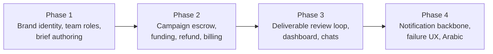

# Brand Flow Integration and Creator Sync: Overview

# Document Control

- **Version**: 2.0.0
- **Date Created**: 2026-09-18
- **Last Updated**: 2026-09-19
- **Status**: DONE
- **Supersedes**: version 1.0.0 of `plan_phase_1.md`, which assumed a greenfield repository
- **Owner**: Planner agent. Each phase hands to the `builder` agent.

---

# Executive Summary

- **Goal**: Deliver the 16 brand artboards as working product. Keep every creator view in sync with the same events.
- **Scope**: Brand flow plus creator sync. Every brand action has a creator consequence, and this plan specifies both sides.
- **Domains**: NestJS API, PostgreSQL with TypeORM, React Native Expo app, shared TypeScript types, Paymob, Cloudflare R2, Ably, Expo Push.
- **Entry condition**: The repository already runs the creator loop end to end. 15 API modules, 14 migrations, and 8 brand screens exist.
- **Exit condition**: A brand can set up, verify, post a brief, fund escrow, review proposals, accept, chat, review a deliverable, approve, refund, and manage a team. The creator sees each event in the feed, the work queue, the upload screen, the earnings ledger, and the notification list.
- **Depth**: Execution ready. Every task carries a build verdict, exact file paths, an API contract, data model deltas, test cases, and acceptance criteria.

---

# Current State Audit

The previous plan failed because it proposed work that already ships. This section records what the repository contains today. Read it before you write code.

## API modules that exist

| Path under `apps/api/src/modules/` | What it already does | Gap this plan fills |
|---|---|---|
| `auth` | JWT access and refresh, `send-otp`, `verify-otp`, `RolesGuard`, `Roles` decorator, `CurrentUser` | Brand OTP reuse. No brand team role check. |
| `brands` | `GET /brands/me`, `PATCH /brands/me`, one brand per user | No logo, category, document, verified flag, or team. |
| `campaigns` | Draft and live status, publish guard, creator browse filters | No title, budget, deliverable type, escrow, pause, or close. |
| `collaborations` | Accept proposal, Paymob checkout, webhook application, shipment, state helpers | Raises a fresh charge per accept. Must draw from campaign escrow instead. |
| `creators` | Profile, portfolio, payout details, home queue, earnings, ledger, payout request | Earnings roll up from collaboration status only, not from ledger rows. |
| `deliverables` | Register, list, review with approve, request revision, decline. `deliverable_feedback` table | No version number. No brand team role check on approve. |
| `messages` | Ably token, message list, message create, participant guard | No system message rows for escrow and shipment events. |
| `payments` | `paymob.client.ts`, `paymob-signature.ts` with a passing spec, `paymob-webhook.controller.ts` | No campaign level charge. No refund call. No webhook intent routing. |
| `products` | Product CRUD per brand | `campaigns.product_id` is NOT NULL, and the brief design has no product picker. |
| `proposals` | Create, list for campaign, list mine, shortlist, decline, `markAccepted` | No creator trust metrics for artboard 4d. |
| `storage` | R2 presigned PUT, generic module namespace, throttled | No logo or business document module value. |
| `transactions` | Escrow ledger with `hold`, `release`, `fee`, `payout`, unique indexes | `collaboration_id` is NOT NULL, so a campaign charge has nowhere to live. |
| `users` | Identity, locale, `expo_push_token`, `POST /users/me/push-token` | No notification table and no push send service. |
| `admin` | Creator vetting, payout queue, mark paid | Unchanged by this plan. |
| `health` | Liveness and database check | Unchanged by this plan. |

## Mobile code that exists

`apps/mobile/src/screens/brand/` holds `AcceptProposalScreen`, `BrandProfileScreen`, `CampaignsListScreen`, `CampaignWizardScreen`, `CollaborationDetailScreen`, `ProductFormScreen`, `ProductsListScreen`, and `ProposalsInboxScreen`. `apps/mobile/src/screens/shared/` holds `CollaborationChatScreen`, `NotificationsScreen`, and `SettingsScreen`. `navigation/BrandTabNavigator.tsx` renders three tabs today. The design and `DESIGN.md` both specify five tabs.

`apps/mobile/src/components/ui/` already provides `BottomActionBar`, `BottomSheet`, `Button`, `Card`, `EmptyState`, `ErrorState`, `FilterChip`, `Icon`, `LoadingState`, `QueryStateView`, `Screen`, `SectionHeader`, `SignatureCard`, `StatusBadge`, `SuccessPanel`, `SystemMessageCapsule`, `Text`, and `TextInput`. Build no new primitive that duplicates one of these.

`apps/mobile/src/hooks/api/` already provides `useAuth`, `useBrand`, `useCampaigns`, `useCollaborations`, `useCreator`, `useDeliverables`, `useHomeQueue`, `useMessages`, `useProducts`, `useProposals`, `usePushToken`, and `useStorage`.

## Defects the audit found

| ID | Defect | Evidence | Phase that fixes it |
|---|---|---|---|
| AUD-001 | `useRequestUploadUrl` in `useDeliverables.ts` calls `POST /collaborations/{id}/deliverables/upload-url`. That route does not exist. `StorageController` only exposes `POST /storage/upload-url`. | `apps/mobile/src/hooks/api/useDeliverables.ts` against `apps/api/src/modules/storage/storage.controller.ts` | Phase 3 |
| AUD-002 | `NotificationsScreen.tsx` renders a hard coded `SECTIONS` array. No notification API exists. | `apps/mobile/src/screens/shared/NotificationsScreen.tsx` | Phase 4 |
| AUD-003 | `uploadFileToPresignedUrl` skips the real upload when the URL contains `local-test-r2-account`. | `apps/mobile/src/hooks/api/useStorage.ts` | Phase 3 |
| AUD-004 | `CreatorsService.getLedger` returns raw hex colors such as `#10B981`. Those are not theme tokens. | `apps/api/src/modules/creators/creators.service.ts` | Phase 3 |
| AUD-005 | `CreatorsService.getHomeQueue` reads `c.campaign.product.name`. `product_id` becomes nullable in Phase 1, so this throws. | `apps/api/src/modules/creators/creators.service.ts` | Phase 1 |
| AUD-006 | i18n holds `status.campaign.closed` and `status.campaign.archived`. Neither value exists in `CampaignStatus`. | `apps/mobile/src/i18n/en.json` | Phase 1 |
| AUD-007 | `transactions.collaboration_id` is NOT NULL, so campaign escrow rows cannot be recorded. | `1735000000008-CreateTransactions.ts` | Phase 2 |

---

# Phase Map



| Phase | Title | Artboards | Tasks | Ships on its own because |
|---|---|---|---|---|
| 1 | Brand identity, team roles, and brief authoring | 3a, 4a, 3b, 4c, 4g, 4h empty | 14 | A brand sets up, verifies, invites a team, and writes briefs. No money moves. |
| 2 | Campaign escrow, funding, allocation, refund, and billing | 3c, 3d, 4d, 4e, 4f, 4h declined | 13 | A brand funds a brief, publishes, accepts a proposal, closes early, and reads a ledger. |
| 3 | Deliverable review loop, dashboard, and chats | 3e, 3f, 3g, 3h | 12 | A brand reviews video, approves, releases, or requests a revision. The creator sees both. |
| 4 | Notification event backbone, failure UX, and Arabic completion | 4b, 4h, creator 15 | 11 | Both roles receive push and in app notifications from one shared event catalog. |

Total task count is 50.

---

# Cross Cutting Decisions

| ID | Decision | Rationale | Alternatives considered | Side effect |
|---|---|---|---|---|
| DEC-001 | Escrow is funded at the campaign, not at the collaboration. | Artboard 3c funds escrow before publish. Artboard 4e shows "Escrow held" on the brief. Artboard 4f shows a refund for a cancelled brief. Artboard 3d states that accept "moves straight into a funded collaboration". | Keep the current charge at accept. Rejected because the brand would pay after the creator applies. That contradicts 3c and blocks the 4e refund. | `CollaborationsService.acceptProposal` changes from "charge Paymob" to "allocate from campaign escrow". |
| DEC-002 | Reuse the existing `transactions` table as the single ledger. Add a nullable `campaign_id`. Relax `collaboration_id` to nullable. | The module already owns idempotency indexes, money helpers, and a write only insert path. A second ledger would split the invariant across two tables. | A new `campaign_escrow_entries` table. Rejected because reconciliation would need a union query on every read. | One migration alters a financial table. Phase 2 states the backfill and the rollback. |
| DEC-003 | Money stays as `numeric(10,2)` strings in the database and integer cents in arithmetic, through `apps/api/src/common/utils/money.ts`. Currency stays `EGP`. | `toCents`, `centsToAmount`, and `calculateFeeCents` already exist with a passing spec. Paymob takes `amount_cents`. | Store integer cents in the column. Rejected because 14 migrations and 3 entities already use `numeric(10,2)`. | Every new money field uses the same column type and the same helper calls. |
| DEC-004 | Platform fee stays a configured rate applied to the creator price, read from `platformFeeRate` in `configuration.ts`. | `calculateFeeCents(priceCents, rate)` already implements it. `collaborations.platform_fee` already stores the result. | A fee on the campaign budget. Rejected because the fee must match the accepted price, not the posted range. | The brand funds the budget. The fee comes out of the allocation at accept time. |
| DEC-005 | Brand team membership lives in a new `brand_members` table. `brands.user_id` stays as the owner pointer. | Artboard 4g shows an owner, an approver, and a viewer on one brand. `brands.user_id` is UNIQUE, so a second user cannot join today. | Add a `brand_id` column to `users`. Rejected because a shared identity row must not carry a per brand role. | Every service that calls `BrandsService.findByUserId` must resolve membership. Phase 1 lists all call sites. |
| DEC-006 | Brand team authorization uses a new `BrandRoleGuard` and a `@BrandRoles()` decorator. Both run after `JwtAuthGuard` and `RolesGuard`. | `RolesGuard` reads `user.role` from the access token. The token only holds `brand`, `creator`, or `admin`. | Widen the JWT payload with the brand role. Rejected because a role change would need a token refresh to take effect. | One extra database read per guarded request. Phase 1 states the caching rule. |
| DEC-007 | The notification event catalog is defined once, in `packages/shared-types/src/notifications.ts`, and serves both roles. | Artboard 4b and creator screen 15 are two views of the same events. One catalog stops the copy from drifting. | Two separate catalogs. Rejected because one event would need two triggers. | Both clients read one enum. Phase 4 owns the catalog. |
| DEC-008 | Push delivery uses the Expo push API from a new `NotificationsService`. | `users.expo_push_token`, `update-push-token.dto.ts`, migration 12, and `usePushRegistration` all ship today. | A third party push provider. Rejected because the Expo pipeline is already wired end to end. | The API gains one outbound HTTP dependency with a timeout and a failure log. |
| DEC-009 | `campaigns.product_id` becomes nullable. | Artboard 3b collects a title, a deliverable type, a length, a language, a budget, and a shipping flag. It has no product picker. | Force a product before a brief. Rejected because it adds a step the design does not show. | `CreatorsService.getHomeQueue` must stop reading `campaign.product.name` without a null check. See AUD-005. |
| DEC-010 | `CampaignStatus` extends to `draft`, `live`, `paused`, `completed`, and `cancelled`. | Artboard 4c filters on All, Draft, Open, and Completed. Artboard 4e offers Pause and Close early. Artboard 4f names a cancelled brief. | Add `closed` and `archived`, which the i18n file already names. Rejected because no artboard shows either state. | Phase 1 removes the two stale i18n keys. See AUD-006. |
| DEC-011 | `VideoType` extends with `talking_head` and `try_on`. The existing five values stay. | Artboard 3b shows three chips: Talking head, Try-on, Unboxing. `unboxing` already exists. | Replace the enum. Rejected because live campaign rows already hold `testimonial`, `demo`, and `tutorial`. | The brief form shows three chips. The enum keeps seven values for older rows. |
| DEC-012 | Every new screen ships an English and an Arabic screenshot pair before its phase closes. | `DESIGN.md` RTL rule 6 makes this normative for `apps/mobile`. | Defer Arabic to a later pass. Rejected because retrofitting RTL is expensive. | Each phase definition of done names the screenshot pair. |

---

# Status Glossary

Use one name for one thing, in code, in copy, and in this document set.

## Campaign, named "brief" in brand facing copy

| Value | Brand label | Creator label | Meaning |
|---|---|---|---|
| `draft` | Draft | not visible | The brand is still writing. No escrow. |
| `live` | Open | Open | Escrow is funded. The brief is in the discovery feed. |
| `paused` | Paused | not visible | The brand stopped new proposals. Escrow stays held. |
| `completed` | Completed | not visible | Every slot reached `approved` or `paid`. |
| `cancelled` | Cancelled | not visible | The brand closed early. Unallocated escrow went back. |

## Proposal

| Value | Brand label | Creator label | Meaning |
|---|---|---|---|
| `applied` | New | Applied | The creator applied. (Creator label updated to Applied per web_ledger_mono/01_overview.md decision Q6) |
| `shortlisted` | Shortlisted | Shortlisted | The brand marked interest. No money moved. (Creator label updated to Shortlisted per web_ledger_mono/01_overview.md decision Q6) |
| `accepted` | Accepted | Accepted | Escrow is allocated and a collaboration exists. |
| `declined` | Declined | Declined | The brand declined, or an admin rejected the creator. |

## Collaboration

| Value | Meaning |
|---|---|
| `pending_payment` | Reserved for a top up charge only. See Phase 2. |
| `funded` | Escrow is allocated to this collaboration. |
| `payment_failed` | A top up charge failed. |
| `shipped` | The brand confirmed shipment. |
| `delivered` | The creator registered a deliverable. |
| `revision_requested` | The brand asked for a new cut. |
| `approved` | The brand approved. The ledger holds `release` and `fee`. |
| `paid` | An admin recorded the payout. |
| `cancelled` | The collaboration ended without approval. |

## Deliverable

| Value | Meaning |
|---|---|
| `submitted` | Waiting for brand review. |
| `revision_requested` | The brand asked for changes and left feedback. |
| `approved` | The brand approved this version. |
| `declined` | The brand rejected this version and left feedback. |

## Escrow, expressed as campaign counters

| Counter | Column | Meaning |
|---|---|---|
| Funded | `campaigns.escrow_funded_amount` | Sum of successful `charge` rows for this campaign. |
| Allocated | `campaigns.escrow_allocated_amount` | Sum of `hold` rows for collaborations under this campaign. |
| Refunded | `campaigns.escrow_refunded_amount` | Sum of `refund` rows for this campaign. |
| Available | derived | Funded minus allocated minus refunded. |

---

# Ledger Invariants

The builder must prove each invariant with a SQL query.

1. For one campaign, sum of `charge` minus sum of `refund` equals sum of `hold` plus available balance.
2. For one collaboration, sum of `release` equals `collaborations.total_amount`.
3. For one collaboration, sum of `release` equals sum of `payout` plus sum of `fee`.
4. A `hold` row never exceeds the campaign available balance at insert time.
5. `paymob_reference` is unique where it is not null.
6. A collaboration has at most one `payout` row.

Invariants 5 and 6 already hold. `1735000000008-CreateTransactions.ts` creates both partial unique indexes.

---

# Risks

| ID | Risk | Likelihood | Impact | Mitigation |
|---|---|---|---|---|
| RISK-001 | The Phase 2 change to `acceptProposal` breaks the creator loop that works today. | Medium | High | Phase 2 keeps `applyPaymentWebhook` and adds an intent field. The existing `collaborations.service.spec.ts` must keep passing. |
| RISK-002 | Altering `transactions.collaboration_id` to nullable weakens a financial constraint. | Low | High | Add a CHECK constraint so each row carries the correct parent for its type. Phase 2 names the constraint. |
| RISK-003 | Paymob has no sandbox credentials in this environment. | High | Medium | `env.validation.ts` keeps Paymob variables optional outside production. Phase 2 tests use a mocked `PaymobClient`. |
| RISK-004 | The membership refactor touches campaigns, products, proposals, collaborations, and deliverables at once. | Medium | High | Phase 1 keeps `findByUserId` as a thin wrapper over the new resolver, so no call site changes shape. |
| RISK-005 | Expo push tokens expire without notice, and a send fails silently. | Medium | Low | Phase 4 logs every non `ok` ticket status and clears a token on `DeviceNotRegistered`. |
| RISK-006 | A webhook replay double funds a campaign. | Low | High | The unique index on `paymob_reference` blocks the second insert. Phase 2 adds a test for the concurrent case. |
| RISK-007 | Two team members approve the same deliverable at the same time. | Low | High | Phase 3 takes a row lock on the collaboration inside the review transaction. |
| RISK-008 | Two accepts race for the last available escrow on one brief. | Low | High | Phase 2 takes a row lock on the campaign inside the allocation transaction. |

---

# Verification Commands

These are the real script names. `apps/api/package.json`, `apps/mobile/package.json`, `packages/shared-types/package.json`, and the root `package.json` define them.

```bash
# shared types
pnpm --filter @ugcx/shared-types lint
pnpm --filter @ugcx/shared-types typecheck
pnpm --filter @ugcx/shared-types build

# api
pnpm --filter api lint
pnpm --filter api typecheck
pnpm --filter api test
pnpm --filter api build

# mobile
pnpm --filter mobile lint
pnpm --filter mobile typecheck
pnpm --filter mobile test
pnpm --filter mobile build

# workspace wide
pnpm -r lint
pnpm -r build

# database
docker compose up -d db
pnpm --filter api migration:run
pnpm --filter api migration:revert
```

The root `package.json` defines only `dev`, `lint`, and `build`. It has no `test` script and no `typecheck` script. Do not invent one.

---

# Glossary

| Term | Meaning |
|---|---|
| Brief | The brand facing name for a campaign row. |
| Escrow | Money the brand paid that the platform holds until approval. |
| Allocation | A `hold` row that assigns campaign escrow to one collaboration. |
| Release | The ledger event that ends escrow custody on approval. |
| Payout | The ledger event an admin records after a real bank transfer. |
| Top up | A second Paymob charge when an accepted price exceeds the available escrow. |
| Event | One entry in the notification catalog, with a trigger, two recipients, and two copy strings. |
