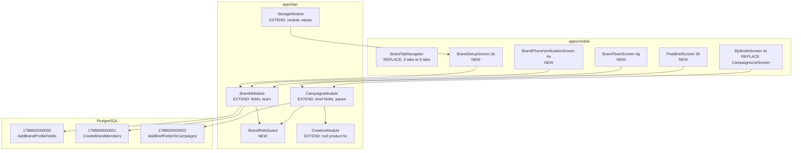
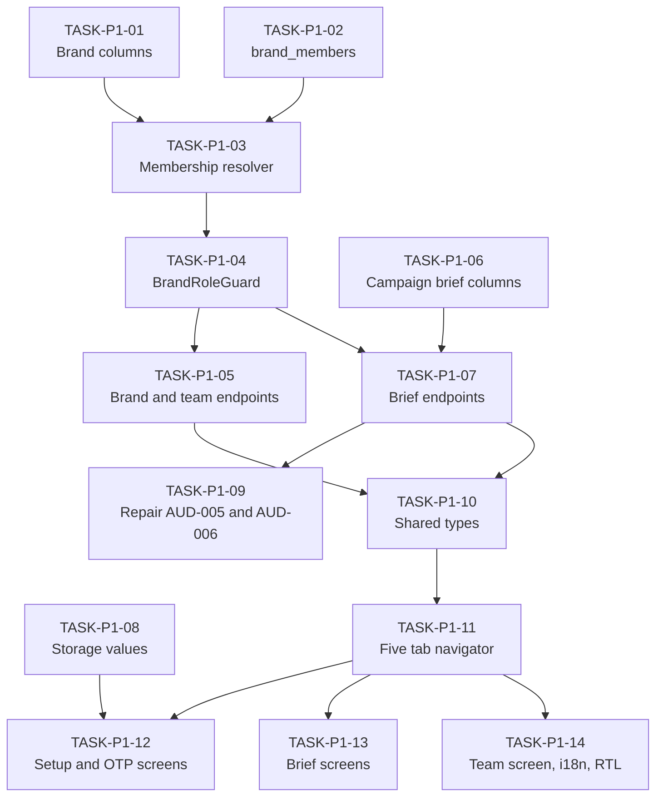
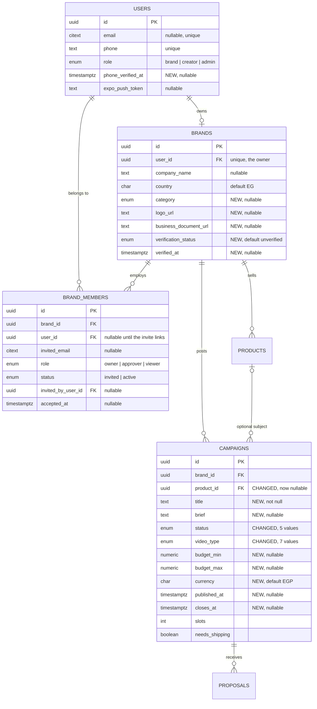
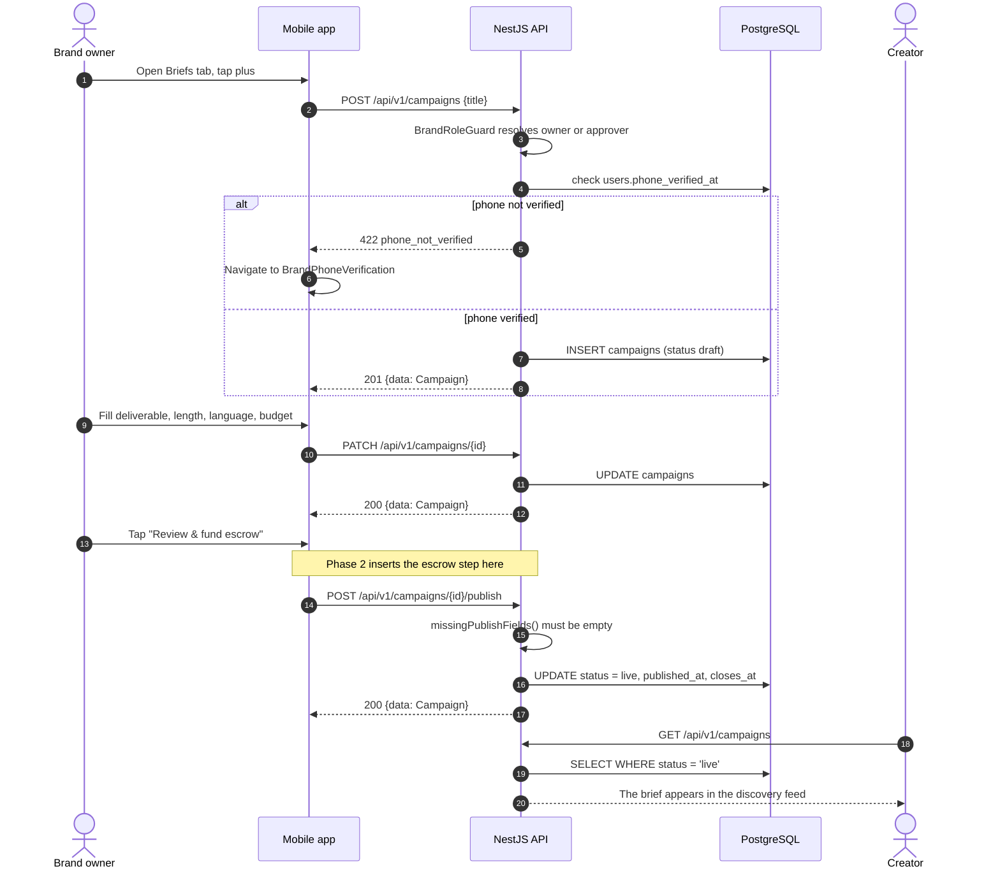
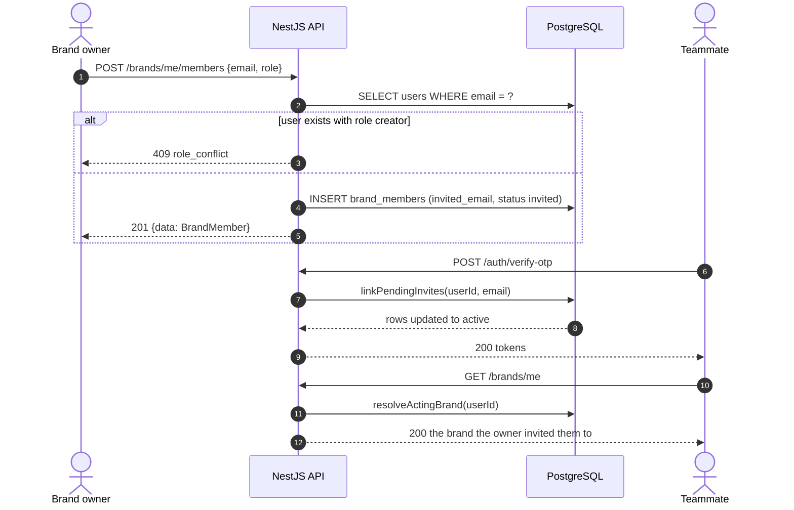

# Phase 1: Brand Identity, Team Roles, and Brief Authoring

# Document Control

- **Version**: 2.0.0
- **Date Created**: 2026-09-18
- **Last Updated**: 2026-09-19
- **Status**: DONE
- **Parent**: `operations/specs/brand_flow_integration/00_overview.md`
- **Artboards**: 3a brand setup, 4a phone verification, 3b post a brief, 4c my briefs, 4g team, 4h empty briefs
- **Task count**: 14

---

# Executive Summary

- **Goal**: Give a brand an identity, a team with roles, and a brief object that matches artboard 3b.
- **Why this ships alone**: No money moves in this phase. A brief still publishes through the existing publish endpoint. Phase 2 adds the escrow gate.
- **Entry condition**: `brands`, `campaigns`, `products`, `storage`, and `auth` modules run today. Migration `1788500000000-AuthOTP` is the latest applied migration.
- **Exit condition**: A brand user completes setup, verifies a phone, invites two teammates with distinct roles, writes a brief with a title and a budget, sees the brief in a filtered list, pauses it, and sees an empty state when no brief exists.
- **Creator sync in this phase**: The discovery feed shows the brief title, the budget range, and the deliverable type. A paused brief leaves the feed. A paused brief rejects new proposals.

---

# Requirements

## Functional Requirements

- **REQ-101**: THE SYSTEM SHALL let a brand store a logo URL, a category, and a business document URL.
- **REQ-102**: THE SYSTEM SHALL show a verified badge only when an admin sets the brand verification status to `verified`.
- **REQ-103**: THE SYSTEM SHALL record the time a brand user verified a phone number through the existing OTP endpoints.
- **REQ-104**: THE SYSTEM SHALL block brief creation until the brand user has a verified phone number.
- **REQ-105**: THE SYSTEM SHALL let a brand owner invite a teammate by email with the role `approver` or `viewer`.
- **REQ-106**: THE SYSTEM SHALL let a brand owner change a teammate role and remove a teammate.
- **REQ-107**: THE SYSTEM SHALL refuse every write endpoint under a brand to a member whose brand role is `viewer`.
- **REQ-108**: THE SYSTEM SHALL store a brief title, a deliverable type, a length in seconds, a language, a budget range, and a shipping flag.
- **REQ-109**: THE SYSTEM SHALL reject a brief whose minimum budget is greater than its maximum budget.
- **REQ-110**: THE SYSTEM SHALL list a brand's briefs filtered by All, Draft, Open, or Completed.
- **REQ-111**: THE SYSTEM SHALL return a proposal count with each brief in the list.
- **REQ-112**: THE SYSTEM SHALL let a brand pause a live brief and resume a paused brief.
- **REQ-113**: THE SYSTEM SHALL remove a paused brief from the creator discovery feed.
- **REQ-114**: THE SYSTEM SHALL reject a new proposal on a brief that is not live.
- **REQ-115**: THE SYSTEM SHALL show a brand a dedicated empty state when the brand has no brief.

### BDD Scenarios

```gherkin
Feature: Brand setup and brief authoring

  Scenario: Brand completes setup with a logo
    Given a signed in brand user with no company name
    When the brand uploads a logo and submits a name and a category
    Then the API stores the logo URL, the name, and the category
    And the brand profile response returns verification status "unverified"

  Scenario: Brand verifies a phone number before posting
    Given a signed in brand user with no verified phone
    When the brand requests a code and submits the six digit code
    Then the API sets a phone verified timestamp on the user
    And the brief creation endpoint stops returning "phone_not_verified"

  Scenario: Owner invites an approver
    Given a signed in brand owner
    When the owner invites "rana@glowlab.test" with the role "approver"
    Then the API creates a brand member row with status "invited"
    And the team list returns three members

  Scenario: Viewer cannot write
    Given a signed in brand member with the brand role "viewer"
    When the member sends a brief creation request
    Then the API answers 403 with the code "brand_role_forbidden"

  Scenario: Budget range validation
    Given a signed in brand owner with a verified phone
    When the owner submits a brief with a minimum of 4000 and a maximum of 2500
    Then the API answers 422 with the code "validation_error"
    And the details name the field "budgetMax"

  Scenario: Pausing a brief hides it from creators
    Given a live brief with two proposals
    When the brand pauses the brief
    Then the brief status becomes "paused"
    And the creator discovery feed no longer returns the brief
    And a new proposal on the brief is rejected with "campaign_not_open"
```

## Security Requirements

- **SEC-101**: THE SYSTEM SHALL resolve the acting brand from the access token and a `brand_members` row, never from a request parameter.
- **SEC-102**: THE SYSTEM SHALL answer 404, not 403, when a brand reads a campaign owned by another brand.
- **SEC-103**: THE SYSTEM SHALL answer 403 with the code `brand_role_forbidden` when a member has the wrong brand role.
- **SEC-104**: THE SYSTEM SHALL accept only an R2 public base URL prefix for a logo URL and a document URL.
- **SEC-105**: THE SYSTEM SHALL never return another member's email to a `viewer`.

## Constraints

- **CON-101**: `synchronize` is off. Every schema change needs an explicit migration file.
- **CON-102**: The migration timestamp series continues from `1788500000000`.
- **CON-103**: Existing campaign rows have a NOT NULL `product_id` and no title. The migration must backfill a title.
- **CON-104**: `brands.user_id` stays UNIQUE. The owner row in `brand_members` duplicates that pointer on purpose.

## Guidelines

- **GUD-101**: Keep controllers thin. Put the rule in the service or on the entity.
- **GUD-102**: Reuse `DomainErrorException` for every domain error. Do not throw a raw `HttpException`.
- **GUD-103**: Reuse `PaginationQueryDto` and `paginate` for every list endpoint.
- **GUD-104**: Reuse the UI primitives in `apps/mobile/src/components/ui/`.

## Patterns

- **PAT-101**: Guard plus reflector metadata, matching `RolesGuard` and `roles.decorator.ts`.
- **PAT-102**: Entity owned validation, matching `Campaign.missingPublishFields()`.
- **PAT-103**: React Query hook per resource, matching `apps/mobile/src/hooks/api/`.

---

# Dependencies

| ID | Name | Type | Version in repo | Purpose |
|---|---|---|---|---|
| DEP-101 | `@nestjs/common` | npm | ^10.0.0 | Guards, decorators, exceptions |
| DEP-102 | `typeorm` | npm | ^1.1.0 | Entities and migrations |
| DEP-103 | `class-validator` | npm | ^0.14.1 | DTO validation |
| DEP-104 | `@react-navigation/bottom-tabs` | npm | ^7.18.18 | Five brand tabs |
| DEP-105 | `@react-navigation/native-stack` | npm | ^7.18.10 | Brand stacks |
| DEP-106 | `@tanstack/react-query` | npm | ^5.102.8 | Data hooks |
| DEP-107 | `react-hook-form` | npm | ^7.87.0 | Brief and setup forms |
| DEP-108 | `expo-image-picker` | npm | ~57.0.15 | Logo selection |
| DEP-109 | `expo-document-picker` | npm | ~57.0.1 | Business document selection |
| DEP-110 | `react-i18next` | npm | ^17.0.12 | Translation |

Add no new package in this phase.

---

# Plan Details

## Impact on System Design



## Decisions

| ID | Decision | Rationale | Alternatives considered | Side effect |
|---|---|---|---|---|
| DES-P1-101 | Add `brand_members` with a composite unique index on `(brand_id, user_id)` and a second partial unique index on `(brand_id, invited_email)` where `user_id` is null. | An invite exists before the invited person has an account. The email must be unique per brand until the account links. | One row per accepted member only. Rejected because artboard 4g lists invited people. | Two indexes on one table. |
| DES-P1-102 | `BrandsService.findByUserId` keeps its signature and delegates to a new `resolveActingBrand`. | Nine call sites already depend on the signature. RISK-004. | Change every call site now. Rejected because it enlarges the blast radius. | A one line wrapper stays in the service. |
| DES-P1-103 | `BrandRoleGuard` reads the member row on every guarded request, with no cache. | Phase 1 scale is tens of brands. A stale cache would let a removed member act. | Cache in memory for 60 seconds. Rejected because correctness beats a read at this scale. | One extra indexed read per guarded request. |
| DES-P1-104 | The brief title is required to publish, not required to create. | Artboard 4c shows a draft named "Try-on haul, 3 pieces", so a draft already carries a title. Artboard 3b saves in one step. | Require the title on create. Rejected because the wizard saves a partial draft today. | `missingPublishFields()` gains three checks. |
| DES-P1-105 | Phone verification stores `users.phone_verified_at`, not a boolean. | A timestamp answers "when" as well as "whether", and costs the same. | A boolean column. Rejected because it loses the audit trail. | The response exposes a nullable ISO string. |
| DES-P1-106 | Brand verification uses a three value enum on `brands`, set by an admin. | Artboard 3a calls the document upload optional and promises a badge. Artboard 3h shows "Verified brand". | A boolean set by the upload itself. Rejected because a brand would self certify. | The admin review endpoint lands in a later phase. Phase 1 stores the state. |

## Constraints and Assumptions

| Type | ID | Description | Impact if wrong | Handling |
|---|---|---|---|---|
| Constraint | CON-P1-101 | Existing campaign rows have no title. | The NOT NULL migration fails. | Backfill with the product name, or with the literal `Untitled brief` when the product is null. |
| Constraint | CON-P1-102 | `campaigns.product_id` is NOT NULL today. | New briefs cannot save without a product. | Migration 3 drops the NOT NULL. |
| Assumption | ASM-P1-101 | An invited teammate signs up with the same email the owner typed. | The invite never links. | The invite links on first login by a case insensitive email match. The `users.email` column is `citext`, so the match is free. |
| Assumption | ASM-P1-102 | One brand needs at most a few members. | The team list would need pagination. | The team endpoint returns a plain array, capped at 50 rows. |

## Edge Cases

| ID | Scenario | Expected behavior | Handling |
|---|---|---|---|
| EDGE-P1-101 | The owner invites an email that already belongs to a creator account. | 409 with the code `role_conflict`. | Check `users.role` before the insert. |
| EDGE-P1-102 | The owner tries to change the owner role. | 422 with the code `cannot_change_owner`. | Guard the transition in the service. |
| EDGE-P1-103 | The owner tries to remove the last owner. | 422 with the code `last_owner`. | Count owner rows inside the delete transaction. |
| EDGE-P1-104 | A brand pauses a brief that is already paused. | 200 with no change. | Make the transition idempotent. |
| EDGE-P1-105 | A brand pauses a `draft` brief. | 422 with the code `invalid_state_transition`. | Use the transition table below. |
| EDGE-P1-106 | A logo upload finishes but the profile save fails. | The orphan object stays in R2. | Accept the orphan. A later cleanup job is out of scope. Log the object key. |
| EDGE-P1-107 | A creator opens a brief link after the brand paused it. | 404 from `GET /campaigns/{id}`. | `CampaignsService.findOne` already returns 404 for a non live campaign to a creator. Extend the check to cover `paused`. |
| EDGE-P1-108 | An old campaign row has a null title after the backfill. | Never happens. | The migration sets NOT NULL only after the backfill statement. |

---

# State Machines

## Campaign transitions, Phase 1 scope

| From | To | Actor | Guard |
|---|---|---|---|
| `draft` | `live` | brand owner or approver | `missingPublishFields()` is empty. Phase 2 adds the escrow guard. |
| `draft` | `cancelled` | brand owner | None. No escrow exists yet. |
| `live` | `paused` | brand owner or approver | None. |
| `paused` | `live` | brand owner or approver | None. |
| `live` | `completed` | system | Phase 3 sets this when every slot reaches `approved`. |
| `paused` | `completed` | system | Phase 3 sets this when every slot reaches `approved`. |
| `live` | `cancelled` | brand owner | Phase 2 adds the refund. |
| `paused` | `cancelled` | brand owner | Phase 2 adds the refund. |

Every other pair is invalid and returns 422 with the code `invalid_state_transition`.

## Brand member transitions

| From | To | Actor | Guard |
|---|---|---|---|
| none | `invited` | owner | The email is not already a member. |
| `invited` | `active` | system | A user with a matching email signs in. |
| `invited` | removed | owner | None. |
| `active` | `active` with a new role | owner | The target member is not an owner. |
| `active` | removed | owner | At least one owner remains. |

---

# Directory Map

```text
apps/
├── api/src/
│   ├── common/
│   │   └── enums/
│   │       └── brand-category.enum.ts            NEW
│   ├── migrations/
│   │   ├── 1788600000000-AddBrandProfileFields.ts   NEW
│   │   ├── 1788600000001-CreateBrandMembers.ts      NEW
│   │   └── 1788600000002-AddBriefFieldsToCampaigns.ts NEW
│   └── modules/
│       ├── auth/
│       │   └── auth.service.ts                   EXTEND
│       ├── brands/
│       │   ├── brands.controller.ts              EXTEND
│       │   ├── brands.service.ts                 EXTEND
│       │   ├── brands.service.spec.ts            NEW
│       │   ├── brands.module.ts                  EXTEND
│       │   ├── brand-members.controller.ts       NEW
│       │   ├── brand-members.service.ts          NEW
│       │   ├── brand-members.service.spec.ts     NEW
│       │   ├── decorators/
│       │   │   └── brand-roles.decorator.ts      NEW
│       │   ├── guards/
│       │   │   └── brand-role.guard.ts           NEW
│       │   ├── guards/
│       │   │   └── brand-role.guard.spec.ts      NEW
│       │   ├── dto/
│       │   │   ├── update-brand.dto.ts           EXTEND
│       │   │   ├── invite-member.dto.ts          NEW
│       │   │   └── update-member-role.dto.ts     NEW
│       │   └── entities/
│       │       ├── brand.entity.ts               EXTEND
│       │       └── brand-member.entity.ts        NEW
│       ├── campaigns/
│       │   ├── campaigns.controller.ts           EXTEND
│       │   ├── campaigns.service.ts              EXTEND
│       │   ├── campaigns.service.spec.ts         EXTEND
│       │   ├── dto/
│       │   │   ├── create-campaign.dto.ts        EXTEND
│       │   │   ├── update-campaign.dto.ts        EXTEND
│       │   │   └── list-brief-query.dto.ts       NEW
│       │   └── entities/
│       │       └── campaign.entity.ts            EXTEND
│       ├── creators/
│       │   └── creators.service.ts               EXTEND
│       ├── storage/
│       │   └── storage.controller.ts             EXTEND
│       └── users/
│           ├── users.service.ts                  EXTEND
│           └── entities/user.entity.ts           EXTEND
├── mobile/src/
│   ├── hooks/api/
│   │   ├── useBrand.ts                           EXTEND
│   │   ├── useBrandTeam.ts                       NEW
│   │   └── useCampaigns.ts                       EXTEND
│   ├── i18n/
│   │   ├── en.json                               EXTEND
│   │   └── ar.json                               EXTEND
│   ├── navigation/
│   │   ├── BrandTabNavigator.tsx                 REPLACE
│   │   └── types.ts                              EXTEND
│   └── screens/brand/
│       ├── BrandSetupScreen.tsx                  NEW
│       ├── BrandPhoneVerificationScreen.tsx      NEW
│       ├── PostBriefScreen.tsx                   NEW
│       ├── PostBriefScreen.validation.test.ts    NEW
│       ├── MyBriefsScreen.tsx                    NEW
│       ├── BrandTeamScreen.tsx                   NEW
│       ├── CampaignsListScreen.tsx               DELETE after MyBriefsScreen lands
│       └── CampaignWizardScreen.tsx              EXTEND
└── packages/shared-types/src/
    ├── brands.ts                                 EXTEND
    ├── brand-members.ts                          NEW
    ├── campaigns.ts                              EXTEND
    └── index.ts                                  EXTEND
```

---

# Task Sequence

Run the tasks in this order. Each task depends on the tasks above it.



---

# Directory Specifications

## TASK-P1-01: Brand profile columns

- **Verdict**: EXTEND. `apps/api/src/modules/brands/entities/brand.entity.ts` exists with `id`, `userId`, `companyName`, `country`, `createdAt`, and `updatedAt` only.
- **Files**: `apps/api/src/modules/brands/entities/brand.entity.ts`, `apps/api/src/modules/users/entities/user.entity.ts`, `apps/api/src/common/enums/brand-category.enum.ts` (NEW), `apps/api/src/migrations/1788600000000-AddBrandProfileFields.ts` (NEW).

### Data model

Table `brands`:

| Column | Type | Nullable | Default | Index |
|---|---|---|---|---|
| `logo_url` | text | yes | null | none |
| `category` | `brands_category_enum` | yes | null | none |
| `business_document_url` | text | yes | null | none |
| `verification_status` | `brands_verification_status_enum` | no | `'unverified'` | `idx_brands_verification_status` |
| `verified_at` | timestamptz | yes | null | none |

Table `users`:

| Column | Type | Nullable | Default | Index |
|---|---|---|---|---|
| `phone_verified_at` | timestamptz | yes | null | none |

New enum types:

- `brands_category_enum` with the values `beauty_personal_care`, `fashion`, `mom_baby`, `food_fmcg`, `home_lifestyle`, `other`. These match `Niche`, so artboard 3a's category maps one to one onto the creator niche vocabulary and the discovery filter keeps working.
- `brands_verification_status_enum` with the values `unverified`, `pending`, `verified`.

`apps/api/src/common/enums/brand-category.enum.ts` re exports `Niche` under the name `BrandCategory`. One vocabulary, two names is a smell, so define `BrandCategory = Niche` as a type alias and reuse the `Niche` enum object. Do not duplicate the six strings.

### Migration

File `apps/api/src/migrations/1788600000000-AddBrandProfileFields.ts`, class `AddBrandProfileFields1788600000000`.

1. Create the two enum types.
2. Add the five brand columns.
3. Add the one user column.
4. Create the verification status index.
5. In `down`, drop the columns, then drop both enum types.

### Test cases

`apps/api/src/modules/brands/brands.service.spec.ts` (NEW):

1. `updateByUserId` writes `logoUrl`, `category`, and `businessDocumentUrl`.
2. `updateByUserId` never writes `verificationStatus` from a DTO field.
3. `findByUserId` throws `NotFoundException` for an unknown user.

### Acceptance criteria

1. `pnpm --filter api migration:run` applies the migration with no error against a fresh database.
2. `pnpm --filter api migration:revert` removes both enum types and all six columns.
3. `GET /api/v1/brands/me` returns `verificationStatus` equal to `unverified` for an existing brand row.

---

## TASK-P1-02: Brand members table

- **Verdict**: NEW. No `brand_member` entity exists in the repository.
- **Files**: `apps/api/src/modules/brands/entities/brand-member.entity.ts` (NEW), `apps/api/src/migrations/1788600000001-CreateBrandMembers.ts` (NEW).

### Data model

Table `brand_members`:

| Column | Type | Nullable | Default | Notes |
|---|---|---|---|---|
| `id` | uuid | no | `gen_random_uuid()` | primary key |
| `brand_id` | uuid | no | none | references `brands(id)` on delete cascade |
| `user_id` | uuid | yes | null | references `users(id)` on delete cascade. Null until the invite links. |
| `invited_email` | citext | yes | null | Null for the owner row created from `brands.user_id`. |
| `role` | `brand_members_role_enum` | no | `'viewer'` | `owner`, `approver`, `viewer` |
| `status` | `brand_members_status_enum` | no | `'invited'` | `invited`, `active` |
| `invited_by_user_id` | uuid | yes | null | references `users(id)` on delete set null |
| `accepted_at` | timestamptz | yes | null | set when the invite links |
| `created_at` | timestamptz | no | `now()` | |
| `updated_at` | timestamptz | no | `now()` | |

Indexes and constraints:

| Name | Definition | Purpose |
|---|---|---|
| `idx_brand_members_brand_id` | `("brand_id")` | list a team |
| `idx_brand_members_user_id` | `("user_id")` | resolve the acting brand from a user |
| `uq_brand_members_brand_user` | unique `("brand_id","user_id")` where `user_id IS NOT NULL` | one membership per user per brand |
| `uq_brand_members_brand_email` | unique `("brand_id","invited_email")` where `invited_email IS NOT NULL` | one open invite per email per brand |
| `chk_brand_members_identity` | check `("user_id" IS NOT NULL OR "invited_email" IS NOT NULL)` | a row always identifies a person |

### Migration

File `apps/api/src/migrations/1788600000001-CreateBrandMembers.ts`, class `CreateBrandMembers1788600000001`.

1. Create both enum types.
2. Create the table.
3. Create the two plain indexes and the two partial unique indexes and the check constraint.
4. Backfill one `owner` row with status `active` for every existing brand, from `brands.user_id`.
5. In `down`, drop the table, then drop both enum types.

The backfill statement is the important one. Write it as a single `INSERT INTO brand_members (brand_id, user_id, role, status, accepted_at) SELECT id, user_id, 'owner', 'active', now() FROM brands;`.

### Test cases

`apps/api/src/modules/brands/brand-members.service.spec.ts` (NEW):

1. A second insert with the same `(brand_id, user_id)` raises a unique violation, and the service maps it to `member_already_exists`.
2. A second invite to the same email on the same brand maps to `invite_already_sent`.

### Acceptance criteria

1. After `migration:run` against a database that holds three brands, `SELECT count(*) FROM brand_members WHERE role = 'owner'` returns 3.
2. `migration:revert` drops the table and both enum types with no residue.

---

## TASK-P1-03: Brand membership resolution

- **Verdict**: EXTEND. `apps/api/src/modules/brands/brands.service.ts` exists with `findByUserId` and `updateByUserId`. Nine call sites depend on `findByUserId`.
- **Files**: `apps/api/src/modules/brands/brands.service.ts`, `apps/api/src/modules/brands/brands.module.ts`.

### Call sites that must keep working

| File | Method |
|---|---|
| `modules/campaigns/campaigns.service.ts` | `create`, `listMine`, `findOne`, `findOwned` |
| `modules/products/products.service.ts` | product ownership |
| `modules/proposals/proposals.service.ts` | `updateStatus` |
| `modules/collaborations/collaborations.service.ts` | `acceptProposal`, `findOwnedByBrand`, `listMine` |
| `modules/deliverables/deliverables.service.ts` | `review` |

Do not change any of these signatures in Phase 1. See DES-P1-102.

### New service methods

```ts
// apps/api/src/modules/brands/brands.service.ts
export interface ActingBrand {
  brand: Brand;
  memberRole: BrandMemberRole;
}

/** Resolves the brand a user acts for, plus that user's role inside it. */
async resolveActingBrand(userId: string): Promise<ActingBrand>;

/** Kept for the nine existing call sites. Delegates to resolveActingBrand. */
async findByUserId(userId: string): Promise<Brand>;
```

`resolveActingBrand` reads `brand_members` by `user_id` where `status = 'active'`, joins `brands`, and throws `NotFoundException('Brand profile not found')` when no row exists. The message text stays identical to today, so no existing test breaks.

### Linking an invite on sign in

- **Verdict**: EXTEND. `apps/api/src/modules/auth/auth.service.ts` exists.
- On a successful `verify-otp` or `login` for a user whose role is `brand`, call `BrandMembersService.linkPendingInvites(userId, email)`. That method updates every `invited` row whose `invited_email` matches the user email, sets `user_id`, sets `status = 'active'`, sets `accepted_at`, and clears `invited_email`.
- Run the link inside the same transaction as the token issue, so a failure does not leave a half linked row.

### Test cases

`apps/api/src/modules/brands/brands.service.spec.ts`:

1. `resolveActingBrand` returns the owner role for a user with an owner row.
2. `resolveActingBrand` returns the viewer role for a user with a viewer row.
3. `resolveActingBrand` throws `NotFoundException` for a user with only an `invited` row.
4. `findByUserId` returns the same brand object `resolveActingBrand` returns.

### Acceptance criteria

1. `pnpm --filter api test` passes with no change to `campaigns.service.spec.ts`, `proposals.service.spec.ts`, `collaborations.service.spec.ts`, or `deliverables.service.spec.ts`.
2. A viewer and an owner on the same brand both resolve to the same `brand.id`.

---

## TASK-P1-04: Brand role guard

- **Verdict**: NEW. `apps/api/src/modules/auth/guards/roles.guard.ts` guards the coarse `UserRole` only. There is no per brand guard.
- **Files**: `apps/api/src/modules/brands/guards/brand-role.guard.ts` (NEW), `apps/api/src/modules/brands/decorators/brand-roles.decorator.ts` (NEW), `apps/api/src/modules/brands/guards/brand-role.guard.spec.ts` (NEW).

### Design

Follow the exact shape of `roles.guard.ts`.

```ts
export const BRAND_ROLES_KEY = 'brandRoles';
export const BrandRoles = (...roles: BrandMemberRole[]) =>
  SetMetadata(BRAND_ROLES_KEY, roles);
```

`BrandRoleGuard`:

1. Read the metadata with `reflector.getAllAndOverride`.
2. Return true when the metadata is missing or empty.
3. Read `request.user`. Return true when `user.role` is not `brand`, because `RolesGuard` already decided that case.
4. Call `brandsService.resolveActingBrand(user.userId)`.
5. Throw `DomainErrorException(FORBIDDEN, 'brand_role_forbidden', 'Your team role does not allow this action')` when the member role is not in the list.
6. Attach the resolved `ActingBrand` to `request.actingBrand`, so a handler does not read it twice.

Order on a controller is `@UseGuards(JwtAuthGuard, RolesGuard, BrandRoleGuard)`.

### Endpoint to role matrix

| Endpoint | owner | approver | viewer |
|---|---|---|---|
| `GET /brands/me` | yes | yes | yes |
| `PATCH /brands/me` | yes | no | no |
| `GET /brands/me/members` | yes | yes | yes |
| `POST /brands/me/members` | yes | no | no |
| `PATCH /brands/me/members/{id}` | yes | no | no |
| `DELETE /brands/me/members/{id}` | yes | no | no |
| `POST /campaigns` | yes | yes | no |
| `PATCH /campaigns/{id}` | yes | yes | no |
| `POST /campaigns/{id}/publish` | yes | yes | no |
| `POST /campaigns/{id}/pause` | yes | yes | no |
| `POST /campaigns/{id}/resume` | yes | yes | no |
| `GET /campaigns/mine` | yes | yes | yes |
| `GET /campaigns/{id}` | yes | yes | yes |
| `GET /campaigns/{id}/proposals` | yes | yes | yes |
| `PATCH /proposals/{id}/status` | yes | yes | no |
| `POST /products` and `PATCH /products/{id}` | yes | yes | no |
| `POST /collaborations/{id}/confirm-shipment` | yes | yes | no |
| `POST /deliverables/{id}/review` | yes | yes | no |
| Escrow funding, added in Phase 2 | yes | no | no |
| Close early and refund, added in Phase 2 | yes | no | no |

Money movement belongs to the owner alone. Artboard 4g names the approver role "Can approve deliverables", so the approver may approve a deliverable but may not fund or refund.

### Test cases

`brand-role.guard.spec.ts`:

1. No metadata returns true without a database read.
2. An owner passes an `owner` only route.
3. A viewer on an `owner` route throws with the code `brand_role_forbidden` and status 403.
4. An approver on an `owner, approver` route passes.
5. A creator token passes through untouched, because `RolesGuard` owns that decision.

### Acceptance criteria

1. A `viewer` token receives 403 and the body `{"error":{"code":"brand_role_forbidden","message":"Your team role does not allow this action"}}` on `POST /campaigns`.
2. An `approver` token receives 201 on `POST /campaigns`.
3. `pnpm --filter api test` reports 5 passing cases in `brand-role.guard.spec.ts`.

---

## TASK-P1-05: Brand profile and team endpoints

- **Verdict**: EXTEND for `brands.controller.ts`. NEW for `brand-members.controller.ts` and `brand-members.service.ts`.
- **Files**: `apps/api/src/modules/brands/brands.controller.ts`, `apps/api/src/modules/brands/dto/update-brand.dto.ts`, `apps/api/src/modules/brands/brand-members.controller.ts` (NEW), `apps/api/src/modules/brands/brand-members.service.ts` (NEW), `apps/api/src/modules/brands/dto/invite-member.dto.ts` (NEW), `apps/api/src/modules/brands/dto/update-member-role.dto.ts` (NEW), `apps/api/src/modules/brands/brands.module.ts`.

### API contracts

#### PATCH /api/v1/brands/me

- **Auth**: `JwtAuthGuard`, `RolesGuard` with `@Roles(UserRole.BRAND)`, `BrandRoleGuard` with `@BrandRoles('owner')`.
- **Request DTO**: `UpdateBrandDto`, EXTEND the existing file.

| Field | Type | Rules |
|---|---|---|
| `companyName` | string | optional, `@IsString`, `@MaxLength(200)` |
| `country` | string | optional, `@IsString`, `@Length(2,2)` |
| `category` | enum | optional, `@IsEnum(Niche)` |
| `logoUrl` | string | optional, `@IsUrl({require_tld:false})`, `@Matches` the R2 public base URL prefix |
| `businessDocumentUrl` | string | optional, same rules as `logoUrl` |

- **Success**: 200, `{ "data": Brand }`. The `Brand` shape gains `category`, `logoUrl`, `businessDocumentUrl`, `verificationStatus`, and `verifiedAt`.
- **Errors**:

| Status | Code | Trigger |
|---|---|---|
| 400 | `validation_error` | A field fails a class validator rule. |
| 403 | `brand_role_forbidden` | The member role is `approver` or `viewer`. |
| 404 | `not_found` | No active membership for the user. |
| 422 | `invalid_media_origin` | A URL does not start with the R2 public base URL. |

#### GET /api/v1/brands/me/members

- **Auth**: `@Roles(UserRole.BRAND)`, `@BrandRoles('owner','approver','viewer')`.
- **Success**: 200, `{ "data": BrandMember[] }`, at most 50 rows, ordered by `role` then `created_at`.
- **Field masking**: for a `viewer` caller, replace `email` with `null` on every row except the caller's own row. SEC-105.

#### POST /api/v1/brands/me/members

- **Auth**: `@BrandRoles('owner')`.
- **Request DTO**: `InviteMemberDto`.

| Field | Type | Rules |
|---|---|---|
| `email` | string | required, `@IsEmail`, `@MaxLength(254)` |
| `role` | enum | required, `@IsIn(['approver','viewer'])` |

- **Success**: 201, `{ "data": BrandMember }` with `status` equal to `invited`.
- **Errors**:

| Status | Code | Trigger |
|---|---|---|
| 409 | `invite_already_sent` | An `invited` row already holds this email for this brand. |
| 409 | `member_already_exists` | A user with this email is already an active member. |
| 409 | `role_conflict` | A user with this email exists with `users.role` not equal to `brand`. EDGE-P1-101. |
| 422 | `cannot_invite_owner` | The request sets the role to `owner`. |

#### PATCH /api/v1/brands/me/members/{id}

- **Auth**: `@BrandRoles('owner')`.
- **Request DTO**: `UpdateMemberRoleDto` with one field `role`, `@IsIn(['approver','viewer'])`.
- **Success**: 200, `{ "data": BrandMember }`.
- **Errors**: 404 `not_found` when the member belongs to another brand. 422 `cannot_change_owner` per EDGE-P1-102.

#### DELETE /api/v1/brands/me/members/{id}

- **Auth**: `@BrandRoles('owner')`.
- **Success**: 204, empty body.
- **Errors**: 404 `not_found`. 422 `last_owner` per EDGE-P1-103.

### Test cases

`brand-members.service.spec.ts`:

1. `invite` creates a row with `status = 'invited'` and a null `user_id`.
2. `invite` with an existing creator email throws `role_conflict`.
3. `invite` with the role `owner` throws `cannot_invite_owner`.
4. `updateRole` on an owner row throws `cannot_change_owner`.
5. `remove` on the only owner throws `last_owner`.
6. `linkPendingInvites` sets `user_id`, `status`, and `accepted_at`, and clears `invited_email`.
7. `list` masks the email of another member for a viewer caller.

### Acceptance criteria

1. An owner invites two emails and `GET /brands/me/members` returns three rows.
2. A viewer calls `GET /brands/me/members` and every `email` field except the caller's own is `null`.
3. A delete of the only owner returns 422 with the code `last_owner`.

---

## TASK-P1-06: Campaign brief columns

- **Verdict**: EXTEND. `apps/api/src/modules/campaigns/entities/campaign.entity.ts` exists with 14 columns and a `missingPublishFields` method.
- **Files**: `apps/api/src/modules/campaigns/entities/campaign.entity.ts`, `apps/api/src/migrations/1788600000002-AddBriefFieldsToCampaigns.ts` (NEW).

### Data model

Table `campaigns`, new columns:

| Column | Type | Nullable | Default | Index |
|---|---|---|---|---|
| `title` | text | no after backfill | none | `idx_campaigns_title_trgm` is out of scope. No index. |
| `brief` | text | yes | null | none |
| `budget_min` | numeric(10,2) | yes | null | none |
| `budget_max` | numeric(10,2) | yes | null | none |
| `currency` | char(3) | no | `'EGP'` | none |
| `published_at` | timestamptz | yes | null | none |
| `closes_at` | timestamptz | yes | null | `idx_campaigns_closes_at` |

Table `campaigns`, changed columns:

| Column | Change | Reason |
|---|---|---|
| `product_id` | drop NOT NULL | DEC-009 |
| `status` | add `paused`, `completed`, `cancelled` to `campaigns_status_enum` | DEC-010 |
| `video_type` | add `talking_head`, `try_on` to `campaigns_video_type_enum` | DEC-011 |

Add a check constraint `chk_campaigns_budget_range` as `("budget_min" IS NULL OR "budget_max" IS NULL OR "budget_min" <= "budget_max")`. REQ-109 is then true at the database level, not only in a DTO.

### Migration

File `apps/api/src/migrations/1788600000002-AddBriefFieldsToCampaigns.ts`, class `AddBriefFieldsToCampaigns1788600000002`.

1. Run `ALTER TYPE "campaigns_status_enum" ADD VALUE IF NOT EXISTS 'paused';` and the same for `completed` and `cancelled`. Each `ALTER TYPE ... ADD VALUE` needs its own statement outside a transaction block in PostgreSQL versions before 12. State the minimum server version as PostgreSQL 14 in the migration comment.
2. Run the same pattern for `talking_head` and `try_on` on `campaigns_video_type_enum`.
3. Add `title` as nullable text.
4. Backfill: `UPDATE campaigns SET title = COALESCE((SELECT p.name FROM products p WHERE p.id = campaigns.product_id), 'Untitled brief') WHERE title IS NULL;`
5. Set `title` NOT NULL.
6. Add `brief`, `budget_min`, `budget_max`, `currency`, `published_at`, and `closes_at`.
7. Backfill `published_at` from `updated_at` where `status = 'live'`.
8. Drop NOT NULL from `product_id`.
9. Add the budget check constraint and the `closes_at` index.
10. In `down`, drop the constraint, the index, and the seven columns, then restore NOT NULL on `product_id`. Note in a comment that PostgreSQL cannot remove an enum value, so the two enum extensions are not reversible. State that this is safe, because no row uses the new values after the column drops.

### Entity changes

Extend `missingPublishFields()` with three more checks, following PAT-102:

```ts
if (!this.title) missing.push({ field: 'title', message: 'required before publish' });
if (!this.budgetMin) missing.push({ field: 'budgetMin', message: 'required before publish' });
if (!this.budgetMax) missing.push({ field: 'budgetMax', message: 'required before publish' });
```

Add two entity methods so the rule travels with the data:

```ts
canPause(): boolean;      // true only for CampaignStatus.LIVE
canResume(): boolean;     // true only for CampaignStatus.PAUSED
```

### Test cases

Extend `apps/api/src/modules/campaigns/campaigns.service.spec.ts`:

1. `missingPublishFields` names `title`, `budgetMin`, and `budgetMax` on a bare draft.
2. `missingPublishFields` returns an empty array when all seven fields are set.
3. `canPause` returns false for `draft` and true for `live`.

### Acceptance criteria

1. `migration:run` succeeds against a database seeded by `pnpm --filter api seed`.
2. `SELECT count(*) FROM campaigns WHERE title IS NULL` returns 0 after the migration.
3. An insert with `budget_min = 4000` and `budget_max = 2500` fails on `chk_campaigns_budget_range`.

---

## TASK-P1-07: Brief authoring and lifecycle endpoints

- **Verdict**: EXTEND. `campaigns.controller.ts` has `create`, `listMine`, `listLive`, `findOne`, `update`, and `publish` today. Add `pause`, `resume`, and a status filter on `listMine`. Add proposal counts.
- **Files**: `apps/api/src/modules/campaigns/campaigns.controller.ts`, `apps/api/src/modules/campaigns/campaigns.service.ts`, `apps/api/src/modules/campaigns/dto/create-campaign.dto.ts`, `apps/api/src/modules/campaigns/dto/update-campaign.dto.ts`, `apps/api/src/modules/campaigns/dto/list-brief-query.dto.ts` (NEW).

### API contracts

#### POST /api/v1/campaigns

- **Verdict**: EXTEND. The DTO today has one field, `productId`, and it is required.
- **Auth**: `@Roles(UserRole.BRAND)`, `@BrandRoles('owner','approver')`.
- **Request DTO**: `CreateCampaignDto`.

| Field | Type | Rules |
|---|---|---|
| `title` | string | optional, `@IsString`, `@MinLength(3)`, `@MaxLength(140)` |
| `productId` | string | optional, `@IsUUID`. Was required. DEC-009. |

- **Success**: 201, `{ "data": Campaign }` with `status` equal to `draft`.
- **Errors**:

| Status | Code | Trigger |
|---|---|---|
| 403 | `brand_role_forbidden` | The caller is a viewer. |
| 422 | `phone_not_verified` | `users.phone_verified_at` is null. REQ-104. |
| 404 | `not_found` | `productId` is set and does not belong to this brand. |

#### PATCH /api/v1/campaigns/{id}

- **Verdict**: EXTEND. `UpdateCampaignDto` gains five fields.

| Field | Type | Rules |
|---|---|---|
| `title` | string | optional, `@IsString`, `@MinLength(3)`, `@MaxLength(140)` |
| `brief` | string | optional, `@IsString`, `@MaxLength(4000)` |
| `budgetMin` | number | optional, `@IsNumber({maxDecimalPlaces:2})`, `@Min(100)` |
| `budgetMax` | number | optional, `@IsNumber({maxDecimalPlaces:2})`, `@Min(100)`, `@Max(1000000)` |
| `closesAt` | string | optional, `@IsISO8601`, must be in the future |

The existing fields stay. `videoType` now accepts `talking_head` and `try_on`.

- **Errors**: add 422 `validation_error` with `details[0].field = "budgetMax"` when `budgetMax < budgetMin`. Check this in the service, not only in the database, so the response carries a field name.
- **Errors**: add 422 `invalid_state_transition` when the campaign status is `completed` or `cancelled`.

#### GET /api/v1/campaigns/mine

- **Verdict**: EXTEND. Today it takes only `PaginationQueryDto`.
- **Request query DTO**: `ListBriefQueryDto extends PaginationQueryDto`.

| Field | Type | Rules |
|---|---|---|
| `status` | string | optional, `@IsIn(['all','draft','open','completed'])`, default `all` |

Mapping: `open` selects `live` and `paused`. `completed` selects `completed` and `cancelled`.

- **Success**: 200, the standard `paginate()` envelope. Each item is a `BriefListItem`.

```ts
interface BriefListItem extends Campaign {
  proposalCount: number;      // count of proposals with status applied or shortlisted
  acceptedCreatorName: string | null; // creator display name when a collaboration exists
  collaborationStatus: CollaborationStatus | null;
}
```

Artboard 4c needs all three. The row "Serum review · Nour H. · in review" needs the creator name and the collaboration status. The row "Baby wash routine · 8 proposals" needs the count.

Build the count with one `leftJoin` and a `loadRelationCountAndMap`, not a query per row. State an N plus 1 check in the review.

- **Success shape addition**: add a `counts` object beside `meta`, so the filter chips can show a badge without four requests.

```json
{ "data": [], "meta": {}, "links": {}, "counts": { "all": 12, "draft": 3, "open": 6, "completed": 3 } }
```

#### POST /api/v1/campaigns/{id}/pause

- **Verdict**: NEW route on an existing controller.
- **Auth**: `@Roles(UserRole.BRAND)`, `@BrandRoles('owner','approver')`.
- **Request body**: none. Declare an empty DTO so `forbidNonWhitelisted` rejects an unexpected body. Follow `AcceptProposalDto`.
- **Success**: 200, `{ "data": Campaign }` with `status` equal to `paused`.
- **Errors**:

| Status | Code | Trigger |
|---|---|---|
| 404 | `not_found` | The brief belongs to another brand. |
| 422 | `invalid_state_transition` | The status is not `live`. EDGE-P1-105. |

A pause on an already paused brief returns 200 with no change. EDGE-P1-104.

#### POST /api/v1/campaigns/{id}/resume

Same contract, with the guard `canResume()` and the target status `live`.

#### GET /api/v1/campaigns (creator feed)

- **Verdict**: EXTEND. The query already filters `status = 'live'`. That is correct and needs no change for REQ-113, because `paused` is a different value.
- Add `title`, `budgetMin`, `budgetMax`, and `videoType` to the selected columns, so artboard 06 can render the card.
- Add an optional `minBudget` query filter, because creator screen 06 shows a "2,000+" chip.

| Field | Type | Rules |
|---|---|---|
| `minBudget` | number | optional, `@IsNumber`, `@Min(0)`. Matches `budget_max >= :minBudget`. |

### Creator sync in this task

| Brand event | Creator consequence | Where |
|---|---|---|
| Brief published | The brief appears in `GET /campaigns` | `CampaignDiscoveryScreen` |
| Brief paused | The brief leaves the feed and a direct read returns 404 | `CampaignDetailScreen` |
| Brief paused | A new proposal returns `campaign_not_open` | `ProposalsService.create` already checks `status !== LIVE` |
| Budget range set | The card shows "EGP 2,500–4,000" | creator screen 06 and 08 |

`ProposalsService.create` needs no change. It already rejects any status other than `live`.

### Test cases

Extend `campaigns.service.spec.ts`:

1. `create` succeeds with no `productId`.
2. `create` throws `phone_not_verified` when the user has a null `phoneVerifiedAt`.
3. `update` throws `validation_error` with the field `budgetMax` when the maximum is below the minimum.
4. `pause` on a `draft` throws `invalid_state_transition`.
5. `pause` on a `paused` brief returns the same row with no save call.
6. `resume` on a `paused` brief sets `live`.
7. `listMine` with `status=open` includes `live` and `paused` and excludes `draft`.
8. `listLive` excludes a `paused` campaign.
9. `publish` sets `published_at` and `closes_at`, where `closes_at` is `published_at` plus 14 days when the brand did not set one.

### Acceptance criteria

1. `GET /campaigns/mine?status=open` returns only `live` and `paused` briefs.
2. The response carries a `counts` object whose `all` value equals the unfiltered total.
3. Each item carries a `proposalCount`, and the API issues at most 2 SQL statements for a 20 item page. Prove it with the Pino query log at debug level.
4. A paused brief returns 404 from `GET /campaigns/{id}` for a creator token.

---

## TASK-P1-08: Storage module values for logo and document

- **Verdict**: EXTEND. `apps/api/src/modules/storage/storage.controller.ts` exists with `ALLOWED_GENERIC_UPLOAD_TYPES` and an `@IsIn(['portfolio','verification','product','deliverable'])` rule.
- **Files**: `apps/api/src/modules/storage/storage.controller.ts`.

### Changes

1. Add `brand_logo` and `brand_document` to the `@IsIn` list.
2. Add `application/pdf` mapped to `pdf` to `ALLOWED_GENERIC_UPLOAD_TYPES`, because a business registration is a PDF. Restrict the PDF type to the `brand_document` module value only. A PDF must never be accepted for `deliverable`.
3. Add a per module size cap. A logo is 5 MB. A document is 10 MB. A video stays at the configured `MAX_UPLOAD_SIZE_MB`.

```ts
const MODULE_MAX_BYTES: Record<string, number> = {
  brand_logo: 5 * 1024 * 1024,
  brand_document: 10 * 1024 * 1024,
};
```

### API contract

#### POST /api/v1/storage/upload-url

- **Verdict**: EXTEND. Auth is `JwtAuthGuard` plus `ThrottlerGuard` at 5 requests per 60 seconds.
- **Errors**:

| Status | Code | Trigger |
|---|---|---|
| 400 | `bad_request` | The content type is not in the allow list. |
| 400 | `bad_request` | The file size exceeds the module cap. |
| 422 | `content_type_not_allowed_for_module` | A PDF requested for a module other than `brand_document`. |

### Test cases

There is no `storage.controller.spec.ts` today. Create one.

1. `brand_logo` with `image/png` returns an upload URL.
2. `brand_logo` with `application/pdf` throws `content_type_not_allowed_for_module`.
3. `brand_logo` at 6 MB throws on the size cap.
4. `deliverable` with `video/mp4` still returns an upload URL, so the creator path does not regress.

### Acceptance criteria

1. A logo upload URL key starts with `brand_logo/`.
2. The sixth request inside one minute returns 429.

---

## TASK-P1-09: Repair AUD-005 and AUD-006

- **Verdict**: EXTEND for the service, EXTEND for the translation files.
- **Files**: `apps/api/src/modules/creators/creators.service.ts`, `apps/mobile/src/i18n/en.json`, `apps/mobile/src/i18n/ar.json`, `apps/mobile/src/components/ui/StatusBadge.tsx`.

### AUD-005, null product in the home queue

`getHomeQueue` builds a title from `c.campaign.product.name`. After DEC-009 that relation can be null.

1. Change the title source to `c.campaign.title`, which is now NOT NULL.
2. Keep the `product` relation load, because the brief detail still uses it when present.
3. Add a test that a collaboration with a null `product_id` returns a task whose title uses the campaign title.

### AUD-006, stale status keys

1. Remove `status.campaign.closed` and `status.campaign.archived` from `en.json` and `ar.json`.
2. Add `status.campaign.paused`, `status.campaign.completed`, and `status.campaign.cancelled` to both files.
3. Extend the `campaign` block of `TONE_MAP` in `StatusBadge.tsx`:

| Status | background | text |
|---|---|---|
| `draft` | `surfaceStrong` | `body` |
| `live` | `signatureMint` | `ink` |
| `paused` | `signatureYellow` | `ink` |
| `completed` | `surfaceStrong` | `success` |
| `cancelled` | `dangerSurface` | `danger` |

`completed` uses `surfaceStrong` with `success` text, because artboard 4c draws that exact pill. Do not invent a new tone.

4. Extend `StatusBadge.test.tsx` with a case per new status.

### Acceptance criteria

1. `pnpm --filter mobile test` passes with a case for each of the five campaign statuses.
2. `grep -r "status.campaign.closed" apps/mobile/src` returns nothing.

---

## TASK-P1-10: Shared types

- **Verdict**: EXTEND `brands.ts`, `campaigns.ts`, and `index.ts`. NEW `brand-members.ts`.
- **Files**: `packages/shared-types/src/brands.ts`, `packages/shared-types/src/brand-members.ts` (NEW), `packages/shared-types/src/campaigns.ts`, `packages/shared-types/src/index.ts`.

### Schemas

```ts
// packages/shared-types/src/brands.ts  (EXTEND)
export type BrandVerificationStatus = 'unverified' | 'pending' | 'verified';

export interface Brand {
  id: string;
  userId: string;
  companyName: string | null;
  country: string;
  category: Niche | null;              // added
  logoUrl: string | null;              // added
  businessDocumentUrl: string | null;  // added
  verificationStatus: BrandVerificationStatus; // added
  verifiedAt: string | null;           // added
  createdAt: string;
  updatedAt: string;
}

export interface UpdateBrandRequest {
  companyName?: string;
  country?: string;
  category?: Niche;             // added
  logoUrl?: string;             // added
  businessDocumentUrl?: string; // added
}
```

```ts
// packages/shared-types/src/brand-members.ts  (NEW)
export type BrandMemberRole = 'owner' | 'approver' | 'viewer';
export type BrandMemberStatus = 'invited' | 'active';

export interface BrandMember {
  id: string;
  brandId: string;
  userId: string | null;
  email: string | null;   // null when masked for a viewer caller
  displayName: string | null;
  role: BrandMemberRole;
  status: BrandMemberStatus;
  acceptedAt: string | null;
  createdAt: string;
}

/** POST /api/v1/brands/me/members */
export interface InviteMemberRequest {
  email: string;
  role: Exclude<BrandMemberRole, 'owner'>;
}

/** PATCH /api/v1/brands/me/members/{id} */
export interface UpdateMemberRoleRequest {
  role: Exclude<BrandMemberRole, 'owner'>;
}
```

```ts
// packages/shared-types/src/campaigns.ts  (EXTEND)
export type CampaignStatus = 'draft' | 'live' | 'paused' | 'completed' | 'cancelled';
export type VideoType =
  | 'unboxing' | 'testimonial' | 'demo' | 'tutorial' | 'other'
  | 'talking_head' | 'try_on';

export interface Campaign {
  // existing fields stay unchanged
  title: string;              // added
  brief: string | null;       // added
  budgetMin: string | null;   // added, numeric(10,2) as a string
  budgetMax: string | null;   // added
  currency: string;           // added
  publishedAt: string | null; // added
  closesAt: string | null;    // added
  productId: string | null;   // was string
}

export interface BriefListItem extends Campaign {
  proposalCount: number;
  acceptedCreatorName: string | null;
  collaborationStatus: CollaborationStatus | null;
}

export interface BriefCounts {
  all: number; draft: number; open: number; completed: number;
}

export interface ListBriefsRequest {
  page?: number; perPage?: number;
  status?: 'all' | 'draft' | 'open' | 'completed';
}

export interface QueryCampaignsRequest {
  // existing fields stay
  minBudget?: number; // added
}
```

Money fields are strings, matching `Collaboration.creatorPrice` and DEC-003. Do not switch to `number`.

### Acceptance criteria

1. `pnpm --filter @ugcx/shared-types typecheck` passes.
2. `pnpm --filter @ugcx/shared-types build` emits `dist/brand-members.d.ts`.
3. `pnpm --filter api typecheck` and `pnpm --filter mobile typecheck` both pass with the new shapes.

---

## TASK-P1-11: Five tab brand navigator

- **Verdict**: REPLACE. `apps/mobile/src/navigation/BrandTabNavigator.tsx` renders three tabs: Campaigns, Products, Profile. The design and `DESIGN.md` both name five tabs.
- **Files**: `apps/mobile/src/navigation/BrandTabNavigator.tsx`, `apps/mobile/src/navigation/types.ts`.

### Tab set

Artboards 3d and 3g both draw the tab bar. 3g shows Dashboard, Briefs, Proposals, Chats, Profile in that order. 3d shows Briefs, Proposals, Chats, Dashboard, Profile. The two disagree. Follow 3g, because `DESIGN.md` already records the 3g order under "Brand Navigation Tabs". Record the conflict in the phase review note.

| Index | Tab | Icon from `Icon.tsx` | Stack root | Phase that fills it |
|---|---|---|---|---|
| 1 | Dashboard | `home` | `BrandDashboardScreen` | Phase 3. Phase 1 renders an `EmptyState` placeholder. |
| 2 | Briefs | `file-text` | `MyBriefsScreen` | Phase 1 |
| 3 | Proposals | `users` | `ProposalsInboxScreen` | Phase 1 reuses the existing screen |
| 4 | Chats | `message-circle` | `BrandChatsScreen` | Phase 3. Phase 1 renders an `EmptyState` placeholder. |
| 5 | Profile | `user` | `BrandProfileScreen` | Phase 1 extends the existing screen |

Products moves off the tab bar and into the Profile stack, because no artboard shows a Products tab. Do not delete `ProductsListScreen` or `ProductFormScreen`. Both still serve `campaigns.product_id`.

### Param lists

```ts
// apps/mobile/src/navigation/types.ts  (EXTEND)
export type BrandDashboardStackParamList = {
  BrandDashboard: undefined;
  Notifications: undefined;
};

export type BrandBriefsStackParamList = {
  MyBriefs: undefined;
  PostBrief: { campaignId?: string } | undefined;
  EditLiveBrief: { campaignId: string };          // Phase 2
  FundEscrow: { campaignId: string };             // Phase 2
  ProposalsInbox: { campaignId: string };
  CreatorProfilePreview: { proposalId: string };  // Phase 2
  CollaborationDetail: { collaborationId: string };
  CollaborationChat: { collaborationId: string };
  ReviewDeliverable: { deliverableId: string };   // Phase 3
};

export type BrandProposalsStackParamList = {
  ProposalsAcrossBriefs: undefined;
  ProposalsInbox: { campaignId: string };
  CreatorProfilePreview: { proposalId: string };  // Phase 2
};

export type BrandChatsStackParamList = {
  BrandChats: undefined;
  CollaborationChat: { collaborationId: string };
};

export type BrandProfileStackParamList = {
  BrandProfile: undefined;
  BrandSetup: undefined;
  BrandTeam: BrandTeamParams;
  BrandBilling: undefined;      // Phase 2
  ProductsList: undefined;
  ProductForm: { productId?: string } | undefined;
  Settings: undefined;
};

type BrandTeamParams = undefined;
```

Declare the Phase 2 and Phase 3 routes now, with a `// Phase N` comment, and register them only when the screen exists. A route name declared in a param list but not registered is a runtime error, so keep the two in step.

### Styling obligations

1. Match `CreatorTabNavigator.tsx`. It already sets `tabBarStyle` with `elevation: 0`, `shadowOpacity: 0`, a 1px `colors.hairline` top border, and `colors.canvas` background. Copy that block, do not invent a second style.
2. Labels come from `t('nav.*')`. Add `nav.dashboard`, `nav.briefs`, `nav.proposals`, `nav.chats` to both translation files.
3. `DESIGN.md` forbids a tab switch animation. Do not add one.
4. Wrap each stack in `ErrorBoundary`, matching the current file.

### Acceptance criteria

1. The brand tab bar shows five labels in the 3g order.
2. `pnpm --filter mobile typecheck` passes with the new param lists.
3. Switching tabs plays no animation.
4. A screenshot pair, English and Arabic, shows the tab order mirrored under RTL with no `row-reverse` in the source.

---

## TASK-P1-12: Brand setup and phone verification screens

- **Verdict**: NEW for both files. No `BrandSetupScreen` and no `BrandPhoneVerificationScreen` exist.
- **Files**: `apps/mobile/src/screens/brand/BrandSetupScreen.tsx` (NEW), `apps/mobile/src/screens/brand/BrandPhoneVerificationScreen.tsx` (NEW), `apps/mobile/src/hooks/api/useBrand.ts` (EXTEND).

### BrandSetupScreen, artboard 3a

Every element the artboard shows, and nothing more.

| Element | Copy | Component | Notes |
|---|---|---|---|
| Heading | "Set up your brand" | `AppText variant="displayMd" color="ink"` | 28/34 |
| Subheading | "Creators see this before they apply." | `AppText variant="body" color="muted"` | |
| Logo tile | placeholder text "logo" | `Card` 64 by 64, radius `md`, border `inputBorder` | Opens `expo-image-picker` |
| Logo action | "Upload logo" | `AppText variant="label" color="ink"` inside a `Pressable` | |
| Field 1 | label "Brand name" | `TextInput` with `label` | Maps to `companyName` |
| Field 2 | label "Category" | `BottomSheet` picker over `ChipSelect` | Maps to `category`, six `Niche` values |
| Field 3 | label "Business registration (optional)", body "Upload for a verified badge" | Dashed border `Card`, `expo-document-picker` | Maps to `businessDocumentUrl` |
| Primary action | "Continue" | `Button variant="primary" fullWidth` inside `BottomActionBar` | |

Layout: screen padding is `96 24 40`, because artboard 3a uses the auth hero rhythm. `DESIGN.md` allows `spacing.section` only on that pattern, and 3a matches it. Use `spacing.section` for the top pad.

States:

| State | Render |
|---|---|
| Loading profile | `LoadingState` |
| Profile read error | `ErrorState` with `onRetry` |
| Logo uploading | Disable the primary action. Show a progress percentage under the tile. |
| Upload failed | Inline `AppText color="danger"` under the tile, plus a "Try again" `Button variant="secondary"` |
| Submit failed | `parseApiError(error).message` under the primary action |

Upload flow: call `useRequestUploadUrl()` from `hooks/api/useStorage.ts` with `module: 'brand_logo'`, then `uploadFileToPresignedUrl`, then `useUpdateBrandProfile().mutateAsync({ logoUrl })`. Do not write a second upload helper.

i18n keys: `brand.setup.title`, `brand.setup.subtitle`, `brand.setup.uploadLogo`, `brand.setup.brandName`, `brand.setup.category`, `brand.setup.businessDocument`, `brand.setup.businessDocumentHint`, `brand.setup.continue`, `brand.setup.uploadFailed`.

RTL: use `marginStart` and `paddingStart` only. The logo tile and its label sit in a `flexDirection: 'row'` container, which mirrors on its own. Set no `textAlign`.

### BrandPhoneVerificationScreen, artboard 4a

| Element | Copy | Component |
|---|---|---|
| Heading | "Verify your number" | `AppText variant="displayMd"` |
| Subheading | "We sent a code to +20 10 •••• 4471" | `AppText variant="body" color="muted"` |
| Code boxes | six boxes, 38 by 48, radius `sm` | Reuse the OTP input from `apps/mobile/src/screens/auth/OnboardingOtpScreen.tsx` |
| Resend timer | "Resend code in 0:38" | `AppText variant="caption" color="muted"` |
| Primary action | "Continue", disabled at 45 percent opacity until six digits | `Button variant="primary" fullWidth` |

- **Verdict on the OTP input**: EXTEND. `OnboardingOtpScreen.tsx` already renders a six digit OTP flow against `POST /auth/send-otp` and `POST /auth/verify-otp`. Extract its input into `apps/mobile/src/components/forms/OtpInput.tsx` and use it in both places. Do not copy the code.
- The phone number mask shows the last four digits only. SEC rules forbid a full number in the copy.
- On success, the API sets `users.phone_verified_at`. The screen invalidates the `['brand','me']` query key and navigates to `PostBrief`.

### Hook changes

```ts
// apps/mobile/src/hooks/api/useBrand.ts  (EXTEND)
export function useBrandProfile();       // exists
export function useUpdateBrandProfile(); // exists, DTO widens
```

No new hook file is needed for setup.

### Test cases

`apps/mobile/src/screens/brand/BrandSetupScreen.test.tsx` (NEW), using `@testing-library/react-native`:

1. The continue action is disabled while `companyName` is empty.
2. A failed logo upload renders the retry action.
3. Submitting calls `updateBrandProfile` once with the three fields.

### Acceptance criteria

1. A brand completes setup and `GET /brands/me` returns the logo URL, the category, and the document URL.
2. The Arabic build renders the screen mirrored, with the logo tile on the reading start side.
3. `grep -nE "marginLeft|marginRight|paddingLeft|paddingRight|textAlign: '(left|right)'" apps/mobile/src/screens/brand/BrandSetupScreen.tsx` returns nothing.

---

## TASK-P1-13: Brief screens

- **Verdict**: NEW for `PostBriefScreen` and `MyBriefsScreen`. REPLACE for `CampaignsListScreen`, which `MyBriefsScreen` supersedes. EXTEND for `CampaignWizardScreen`, which keeps the multi step script and shipping detail the artboards do not cover.
- **Files**: `apps/mobile/src/screens/brand/PostBriefScreen.tsx` (NEW), `apps/mobile/src/screens/brand/PostBriefScreen.validation.test.ts` (NEW), `apps/mobile/src/screens/brand/MyBriefsScreen.tsx` (NEW), `apps/mobile/src/screens/brand/CampaignsListScreen.tsx` (DELETE at the end of the task), `apps/mobile/src/hooks/api/useCampaigns.ts` (EXTEND).

### PostBriefScreen, artboard 3b

| Element | Copy or values | Component |
|---|---|---|
| Header title | "New brief" | Stack header, 48 high, 1px `hairline` bottom border |
| Field: Title | label "Title" | `FormTextInput` |
| Field: Deliverable | label "Deliverable", three chips | `ChipSelect` with `Talking head`, `Try-on`, `Unboxing` mapped to `talking_head`, `try_on`, `unboxing` |
| Field: Length | label "Length" | `FormTextInput`, numeric, suffix "s" |
| Field: Language | label "Language" | `ChipSelect` with `ar` and `en`. Show "Egyptian Arabic" and "English". |
| Field: Budget range | label "Budget range (EGP)" | Two numeric `FormTextInput` fields in a row |
| Checkbox | "Ships product to creator" | 20 by 20 box, radius 4, border `inputBorder`. Maps to `needsShipping`. |
| Primary action | "Review & fund escrow" | `Button variant="primary" fullWidth` inside `BottomActionBar` |

The primary action navigates to `FundEscrow`, added in Phase 2. In Phase 1 it saves the draft and navigates to `MyBriefs`, and a `// Phase 2` comment marks the target. Do not ship a dead route.

Validation, with `react-hook-form` plus `zod` through `@hookform/resolvers`, matching `CampaignWizardScreen.validation.test.ts`:

| Field | Rule | Message key |
|---|---|---|
| `title` | 3 to 140 characters | `brand.brief.errors.title` |
| `videoType` | one of the three chips | `brand.brief.errors.deliverable` |
| `durationSeconds` | integer, 5 to 600 | `brand.brief.errors.length` |
| `language` | `ar` or `en` | `brand.brief.errors.language` |
| `budgetMin` | number, at least 100 | `brand.brief.errors.budgetMin` |
| `budgetMax` | number, at least `budgetMin` | `brand.brief.errors.budgetMax` |

Money entry: parse with `Number`, format for display with `Intl.NumberFormat('en-US')`, and send a string with two decimal places. `DESIGN.md` RTL rule 5 requires Latin digits in their own text run, so render the amount in a separate `AppText`, never inside a translated sentence.

### MyBriefsScreen, artboard 4c

| Element | Copy or values | Component |
|---|---|---|
| Header title | "My briefs" | Stack header |
| Header action | a 32 by 32 dark circle with a plus glyph | `Pressable` with `Icon name="plus" color="onPrimary"` |
| Filter chips | All, Draft, Open, Completed | `FilterChip` |
| Row | title, meta line, status pill | `PressableCard` plus `StatusBadge domain="campaign"` |
| Draft row | rendered at 70 percent opacity, meta "Not yet published" | `opacity: 0.7` |
| Empty state | icon, "No briefs yet", "Post your first brief to start getting proposals.", "New brief" | `EmptyState` with `icon`, `title`, `message`, `action` |

`EmptyState` already takes exactly those four props. Use it. Artboard 4h draws a line square placeholder, and `EmptyState` already renders a hairline card, so the motif matches.

Meta line rules, from artboard 4c:

| Condition | Meta text |
|---|---|
| A collaboration exists | `{creatorName} · {collaborationStatusLabel}` |
| Open with proposals | `{proposalCount} proposals` |
| Draft | "Not yet published" |
| Completed and paid | `{creatorName} · paid out` |

States: `QueryStateView` supplies loading, error, and empty. Pass a skeleton of three grey `Card` rows for the loading state, so the list does not jump.

### Hook changes

```ts
// apps/mobile/src/hooks/api/useCampaigns.ts  (EXTEND)
export function useMyBriefs(status: BriefStatusFilter);  // NEW, calls /campaigns/mine?status=
export function usePauseBrief();                         // NEW
export function useResumeBrief();                        // NEW
export function useMyCampaigns();                        // KEEP, other screens use it
```

`usePauseBrief` and `useResumeBrief` invalidate `['campaigns','mine']` and set `['campaigns', id]` on success, matching `usePublishCampaign`.

### Test cases

`PostBriefScreen.validation.test.ts`:

1. A title of two characters fails.
2. `budgetMax` below `budgetMin` fails and names `budgetMax`.
3. A duration of 4 fails and a duration of 5 passes.
4. A valid payload produces `budgetMin` and `budgetMax` as two decimal strings.

### Acceptance criteria

1. The Briefs tab shows four filter chips and switching a chip refetches with the new `status` value.
2. A brand with no brief sees the 4h empty state with the "New brief" action.
3. A draft row renders at 70 percent opacity and shows "Not yet published".
4. `CampaignsListScreen.tsx` is deleted, and no import of it remains. Prove it with `grep -r CampaignsListScreen apps/mobile/src`.

---

## TASK-P1-14: Team screen, translations, and RTL pass

- **Verdict**: NEW for `BrandTeamScreen` and `useBrandTeam`. EXTEND for the two translation files and `BrandProfileScreen`.
- **Files**: `apps/mobile/src/screens/brand/BrandTeamScreen.tsx` (NEW), `apps/mobile/src/hooks/api/useBrandTeam.ts` (NEW), `apps/mobile/src/screens/brand/BrandProfileScreen.tsx` (EXTEND), `apps/mobile/src/i18n/en.json`, `apps/mobile/src/i18n/ar.json`.

### BrandTeamScreen, artboard 4g

| Element | Copy or values | Component |
|---|---|---|
| Header title | "Team" | Stack header |
| Header action | "Invite", `colors.link`, 14/500 | `Pressable` with `AppText color="link"` |
| Row avatar | 36 by 36 circle, initials, tone from the member index | `Card` with a `radius.full` style |
| Row primary | "You" for the caller, otherwise the display name or the invited email | `AppText variant="body" color="ink"` |
| Row secondary | "Owner", "Can approve deliverables", "View only" | `AppText variant="caption" color="muted"` |
| Invited row | append " · invited" to the secondary line | |

The three role labels come straight from artboard 4g. Do not write "Approver" or "Viewer" in the UI. Keep the enum values `approver` and `viewer` in code and map to the artboard copy in i18n.

Invite sheet: `AppBottomSheet` over a 45 percent scrim, matching the creator apply sheet. Fields are an email `TextInput` and a two option `ChipSelect` for the role. The primary action is "Send invite".

Role change and remove: long press a row to open an action sheet with "Change role" and "Remove from team". Hide both actions when the caller is not an owner, and hide them on the caller's own row.

### Hook

```ts
// apps/mobile/src/hooks/api/useBrandTeam.ts  (NEW)
export function useBrandTeam();          // GET /brands/me/members
export function useInviteMember();       // POST /brands/me/members
export function useUpdateMemberRole();   // PATCH /brands/me/members/{id}
export function useRemoveMember();       // DELETE /brands/me/members/{id}
```

Every mutation invalidates `['brand','members']`.

### BrandProfileScreen changes, partial 3h

Phase 1 adds only the rows artboard 3h shows that this phase can fill.

| Row | Target | Phase |
|---|---|---|
| "Team members" with a count | `BrandTeam` | Phase 1 |
| "Payment methods" | placeholder, disabled at 45 percent opacity | Phase 2 |
| "Billing history" | placeholder, disabled at 45 percent opacity | Phase 2 |
| Language segmented control, English and العربية | `setAppLocale` from `i18n/index.ts` | Phase 1 |
| Verified brand pill | shown only when `verificationStatus === 'verified'` | Phase 1 |

The language control already has a home in `SettingsScreen.tsx`. Reuse the same `setAppLocale` call and the same reload prompt. Do not write a second implementation.

### Translation obligations

Add every key this phase introduces to both `en.json` and `ar.json`. No key ships English text inside `ar.json`. The list:

`nav.dashboard`, `nav.briefs`, `nav.proposals`, `nav.chats`, `brand.setup.*` (9 keys), `brand.verify.*` (5 keys), `brand.brief.*` (18 keys), `brand.briefs.*` (12 keys), `brand.team.*` (11 keys), `status.campaign.paused`, `status.campaign.completed`, `status.campaign.cancelled`.

Remove `status.campaign.closed` and `status.campaign.archived` from both files. See TASK-P1-09.

### RTL checklist, applied to every file this phase touches

1. No `marginLeft`, `marginRight`, `paddingLeft`, `paddingRight`, `left`, `right`, `borderLeftWidth`, or `borderRightWidth`.
2. No `textAlign: 'left'` and no `textAlign: 'right'`. `'center'` is allowed.
3. No `flexDirection: 'row-reverse'`.
4. `Icon` uses `directional` for the chevron and the back arrow only.
5. Amounts render in their own `AppText` node.
6. One English and one Arabic screenshot per new screen.

### Test cases

`apps/mobile/src/i18n/index.test.ts` (EXTEND):

1. Every key in `en.json` exists in `ar.json`.
2. No value in `ar.json` equals its `en.json` counterpart for the new brand keys.

### Acceptance criteria

1. An owner invites a teammate and the list grows by one row with the secondary line "Can approve deliverables · invited".
2. A viewer opens the team screen and sees no invite action and no long press menu.
3. The i18n parity test passes.
4. A lint script proves rule 1 and rule 2 across `apps/mobile/src/screens/brand/`.

---

# Schemas

## API request DTO summary

```ts
// apps/api/src/modules/brands/dto/invite-member.dto.ts
export class InviteMemberDto {
  @IsEmail() @MaxLength(254) email: string;
  @IsIn(['approver', 'viewer']) role: 'approver' | 'viewer';
}

// apps/api/src/modules/brands/dto/update-member-role.dto.ts
export class UpdateMemberRoleDto {
  @IsIn(['approver', 'viewer']) role: 'approver' | 'viewer';
}

// apps/api/src/modules/campaigns/dto/list-brief-query.dto.ts
export class ListBriefQueryDto extends PaginationQueryDto {
  @IsOptional() @IsIn(['all', 'draft', 'open', 'completed'])
  status: 'all' | 'draft' | 'open' | 'completed' = 'all';
}
```

## Error envelope

`AllExceptionsFilter` already produces this shape. Every new error follows it.

```json
{ "error": { "code": "brand_role_forbidden", "message": "Your team role does not allow this action", "details": [] } }
```

---

# Data Models



---

# Data Flow

## Brief creation through publish



## Team invite and link



---

# Definition of Done

Run every command. Read the whole output. Count the failures.

```bash
# 1. shared types compile and publish the new shapes
pnpm --filter @ugcx/shared-types lint
pnpm --filter @ugcx/shared-types typecheck
pnpm --filter @ugcx/shared-types build

# 2. api compiles, lints, and passes every spec
pnpm --filter api lint
pnpm --filter api typecheck
pnpm --filter api test
pnpm --filter api build

# 3. migrations apply and revert cleanly
docker compose up -d db
pnpm --filter api migration:run
pnpm --filter api migration:revert
pnpm --filter api migration:revert
pnpm --filter api migration:revert
pnpm --filter api migration:run

# 4. mobile compiles, lints, and passes every test
pnpm --filter mobile lint
pnpm --filter mobile typecheck
pnpm --filter mobile test

# 5. workspace wide
pnpm -r lint
pnpm -r build
```

Manual checks that no command can prove:

1. Capture one English screenshot and one Arabic screenshot for `BrandSetupScreen`, `BrandPhoneVerificationScreen`, `PostBriefScreen`, `MyBriefsScreen`, and `BrandTeamScreen`.
2. Confirm the tab bar plays no switch animation.
3. Confirm a viewer token receives 403 on `POST /campaigns`.
4. Confirm `SELECT count(*) FROM brand_members WHERE role='owner'` equals the brand count.

The phase is done when all five command groups exit 0 and all four manual checks pass. State the evidence in the pull request body.

---

# Rollback

Each migration reverts on its own. Revert in the reverse order of application.

1. `pnpm --filter api migration:revert` three times removes `1788600000002`, `1788600000001`, then `1788600000000`.
2. The enum values `paused`, `completed`, `cancelled`, `talking_head`, and `try_on` stay in the type. PostgreSQL cannot remove an enum value. This is safe, because the revert drops every column that could hold them, and the `status` column returns to a domain the old code already handles. Confirm with `SELECT DISTINCT status FROM campaigns` before you revert. Any row in `paused`, `completed`, or `cancelled` must move to `draft` or `live` first.
3. Revert the application code with `git revert` on the phase merge commit. The three new mobile screens have no other consumer.
4. `CampaignsListScreen.tsx` returns with the code revert, and the three tab navigator returns with it.

Data loss on rollback: the brand logo, the category, the document URL, the team rows, and every brief title. Warn the owner before a production rollback.

---

# Code Guidelines

- **clean-code**: Keep a service method under 30 lines. `acceptProposal` is already long, and this phase does not touch it.
- **security**: Validate every DTO field. Never trust a `brandId` from a request body. Mask a phone number to the last four digits in copy.
- **database**: Index every foreign key. Name every enum type with `enumName`. Write the `down` method before you write the `up` method.
- **frontend-patterns**: One hook per resource. Presentation components take data as props. `QueryStateView` owns loading, error, and empty.
- **api-patterns**: One envelope, `{ data }` or the `paginate()` shape. One error shape, through `DomainErrorException`.
