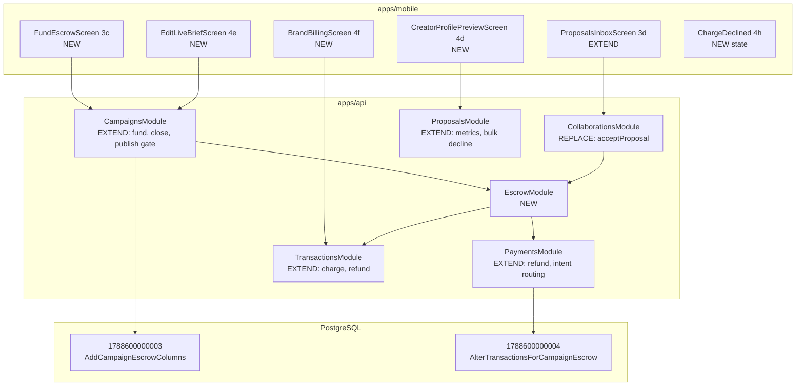
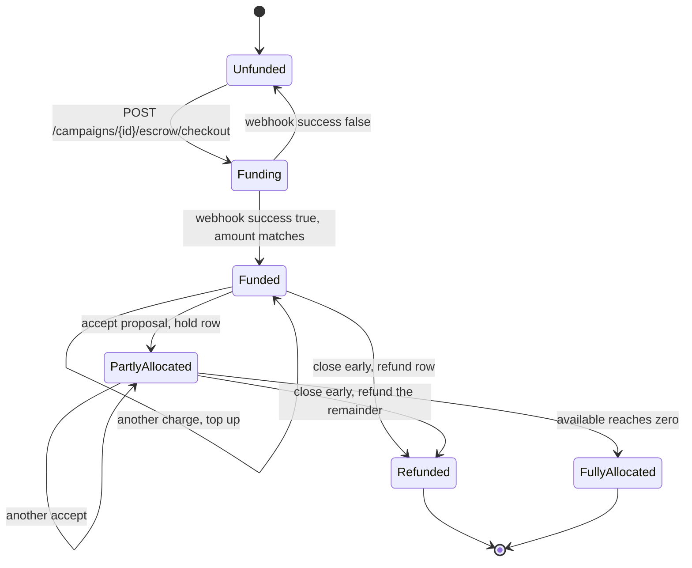
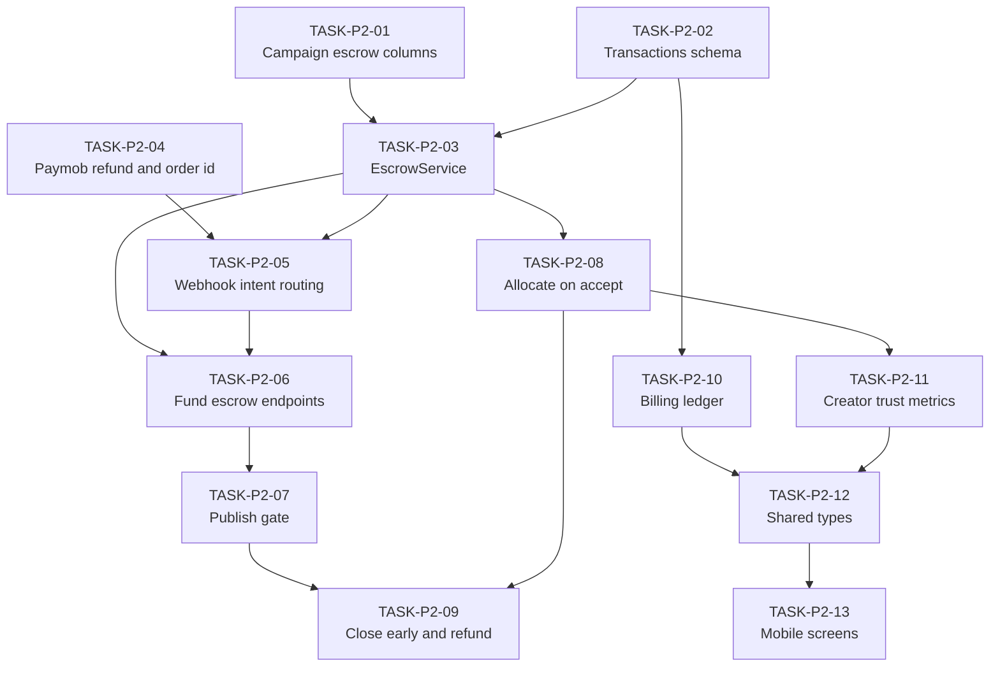
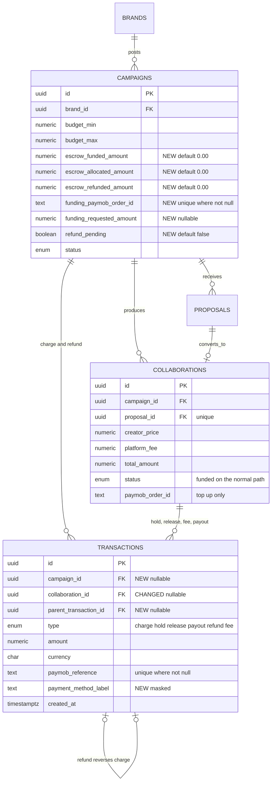
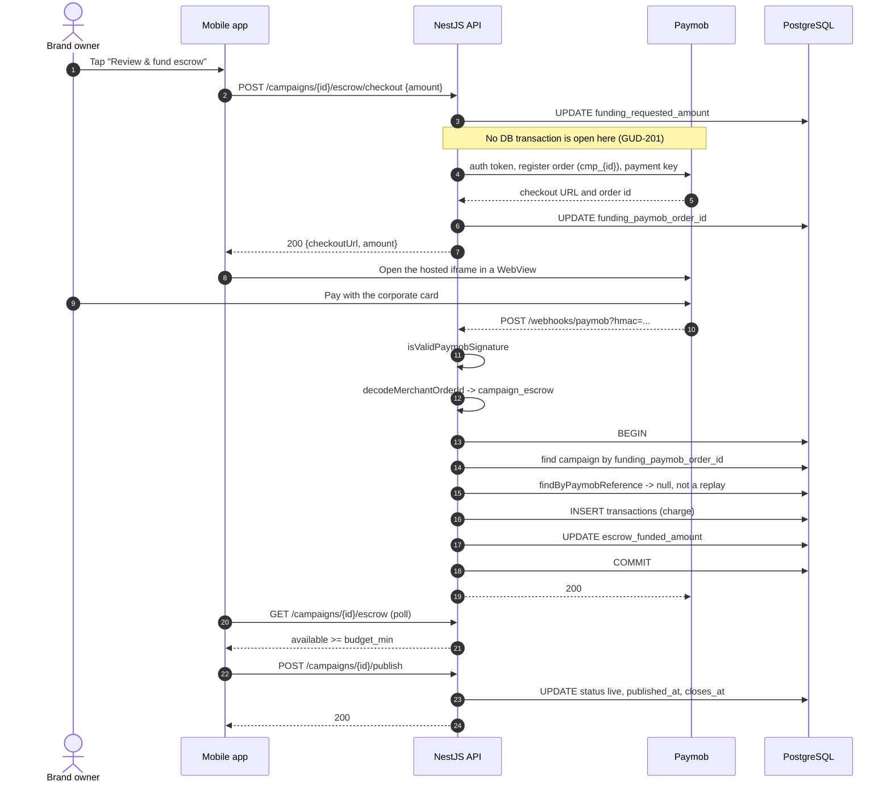
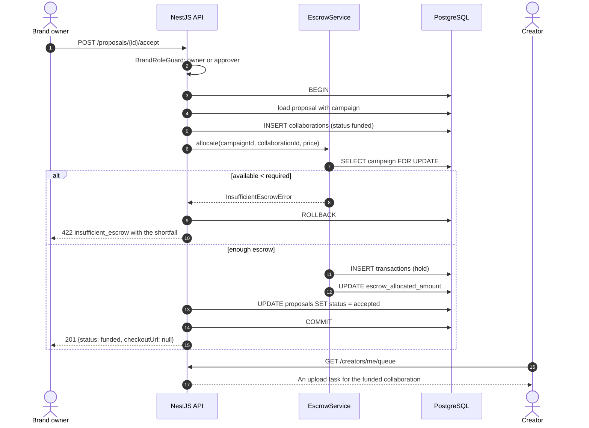
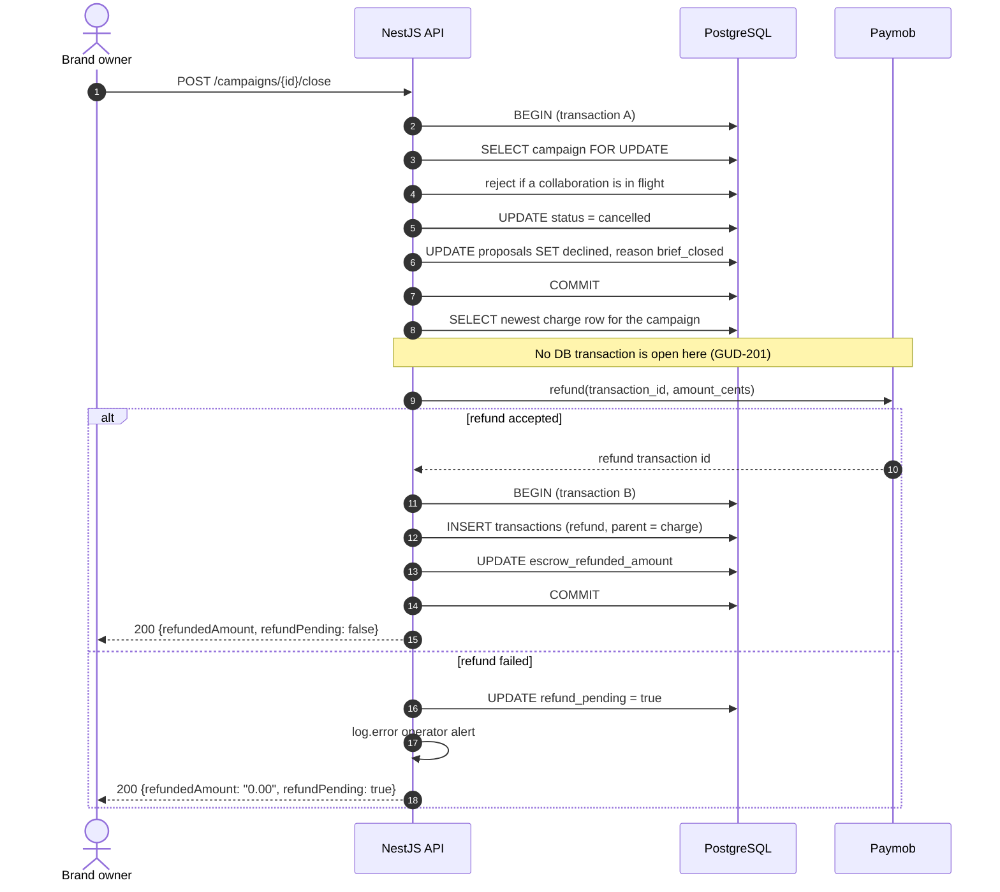

# Phase 2: Campaign Escrow, Funding, Allocation, Refund, and Billing

# Document Control

- **Version**: 2.0.0
- **Date Created**: 2026-09-18
- **Last Updated**: 2026-09-19
- **Status**: DONE
- **Parent**: `operations/specs/brand_flow_integration/00_overview.md`
- **Depends on**: Phase 1
- **Artboards**: 3c fund escrow, 3d review proposals, 4d creator profile preview, 4e edit a live brief, 4f billing and invoices, 4h charge declined
- **Task count**: 13

---

# Executive Summary

- **Goal**: Move escrow from the collaboration to the campaign, and make the money path match artboards 3c, 4e, and 4f.
- **Why this ships alone**: The phase ends with a complete money loop. A brand funds a brief, publishes, accepts a proposal with no second charge, closes early with a refund, and reads one ledger.
- **Entry condition**: Phase 1 shipped. `paymob.client.ts`, `paymob-signature.ts`, `paymob-webhook.controller.ts`, and the `transactions` ledger all exist and pass their specs.
- **Exit condition**: A campaign carries a funded escrow balance. An accept allocates from that balance with no new charge. An early close refunds the unallocated remainder through Paymob. `GET /brands/me/billing` returns the 4f ledger.
- **Creator sync in this phase**: A proposal accept lands the creator in a `funded` collaboration immediately, with no waiting state. An early close cancels every open proposal on the brief with a reason the creator can read.

---

# Requirements

## Functional Requirements

- **REQ-201**: THE SYSTEM SHALL let a brand owner fund a campaign escrow through a Paymob hosted checkout.
- **REQ-202**: THE SYSTEM SHALL compute a default funding amount as the midpoint of the budget range, rounded to the nearest whole unit.
- **REQ-203**: THE SYSTEM SHALL let a brand owner override the funding amount within the budget range.
- **REQ-204**: THE SYSTEM SHALL refuse to publish a brief whose available escrow is below the minimum budget.
- **REQ-205**: WHEN a signed Paymob webhook reports a successful campaign charge THE SYSTEM SHALL increase the campaign funded amount and record one `charge` ledger row.
- **REQ-206**: THE SYSTEM SHALL ignore a replayed Paymob webhook and answer 200.
- **REQ-207**: WHEN a brand accepts a proposal THE SYSTEM SHALL allocate the creator price plus the platform fee from the campaign available escrow.
- **REQ-208**: WHEN the available escrow is below the required allocation THE SYSTEM SHALL return the shortfall and offer a top up checkout.
- **REQ-209**: THE SYSTEM SHALL set a collaboration to `funded` at allocation time with no second card charge.
- **REQ-210**: THE SYSTEM SHALL let a brand owner close a live or paused brief early and refund the unallocated escrow.
- **REQ-211**: WHEN a brief closes early THE SYSTEM SHALL decline every proposal still in `applied` or `shortlisted` with the reason `brief_closed`.
- **REQ-212**: THE SYSTEM SHALL return a brand billing ledger with a lifetime spend total and one row per money movement.
- **REQ-213**: THE SYSTEM SHALL return creator trust metrics for a proposal: approval rate, average revisions, and jobs done.
- **REQ-214**: THE SYSTEM SHALL show the brand a declined charge state with a retry action.

### BDD Scenarios

```gherkin
Feature: Campaign escrow

  Scenario: Brand funds a brief and publishes it
    Given a draft brief with a budget range of 2500 to 4000 EGP
    When the brand opens the fund escrow screen
    Then the screen shows a default total of EGP 3,200
    When the brand confirms and the Paymob checkout succeeds
    And Paymob posts a signed webhook with a matching amount
    Then the campaign funded amount becomes 3200.00
    And the ledger holds one charge row for 3200.00
    And the brief publishes with the status "live"

  Scenario: Card declined during funding
    Given a draft brief waiting for escrow
    When the Paymob checkout fails
    Then the fund escrow screen shows "Charge declined"
    And the screen offers "Try again"
    And the brief stays in the status "draft"

  Scenario: Accepting a proposal allocates escrow
    Given a live brief with 3200.00 available escrow
    And a proposal priced at 2800.00 EGP
    When the brand accepts the proposal
    Then the API creates a collaboration with the status "funded"
    And the collaboration total amount is 3080.00
    And the campaign allocated amount is 3080.00
    And the ledger holds one hold row for 3080.00
    And the brand is never asked to pay again

  Scenario: Accepting a proposal above the available escrow
    Given a live brief with 1000.00 available escrow
    And a proposal priced at 2800.00 EGP
    When the brand accepts the proposal
    Then the API answers 422 with the code "insufficient_escrow"
    And the body carries a shortfall of 2080.00
    And the app offers a top up checkout for 2080.00

  Scenario: Closing a brief early refunds the remainder
    Given a live brief with 3200.00 funded and 3080.00 allocated
    When the brand closes the brief early
    Then the API asks Paymob to refund 120.00
    And the campaign refunded amount becomes 120.00
    And the ledger holds one refund row for 120.00
    And the brief status becomes "cancelled"
    And every open proposal becomes "declined" with the reason "brief_closed"

  Scenario: Webhook replay does not double fund
    Given a campaign already funded by Paymob transaction 991234
    When Paymob delivers the same signed webhook a second time
    Then the API answers 200
    And the campaign funded amount does not change
    And the ledger still holds exactly one charge row
```

## Security Requirements

- **SEC-201**: THE SYSTEM SHALL verify the Paymob HMAC signature before it reads or writes any row. `paymob-webhook.controller.ts` already does this. Keep it.
- **SEC-202**: THE SYSTEM SHALL restrict escrow funding, top up, and early close to the brand role `owner`.
- **SEC-203**: THE SYSTEM SHALL never log a Paymob auth token, an API key, or a payment key.
- **SEC-204**: THE SYSTEM SHALL mask a card to the last four digits in every response and every copy string.
- **SEC-205**: THE SYSTEM SHALL reject a webhook whose amount or currency does not match the expected charge. `applyPaymentWebhook` already does this. Extend the check to the campaign path.

## Constraints

- **CON-201**: No Paymob sandbox credential exists in this environment. RISK-003.
- **CON-202**: Paymob has no marketplace split. The platform charges in full and holds the funds as a ledger entry. `HLD.md` section 1.3 records this.
- **CON-203**: A Paymob refund needs the original transaction id. The `transactions.paymob_reference` column already stores it.
- **CON-204**: `transactions` rows are never updated after insert. Keep that rule.

## Guidelines

- **GUD-201**: Never hold a database transaction open across a Paymob HTTP call. `acceptProposal` already documents this rule. Follow it.
- **GUD-202**: Do arithmetic in integer cents through `money.ts`. Never add two `numeric` strings with `+`.
- **GUD-203**: Take a row lock before you read a balance you are about to change.

## Patterns

- **PAT-201**: Compensating action on an external failure, matching the current `acceptProposal` delete on a Paymob error.
- **PAT-202**: Idempotency at the database level, matching the partial unique index on `paymob_reference`.
- **PAT-203**: One ledger row per business event, matching `TransactionsService`.

---

# Dependencies

| ID | Name | Type | Version in repo | Purpose |
|---|---|---|---|---|
| DEP-201 | `typeorm` | npm | ^1.1.0 | Transactions and pessimistic locks |
| DEP-202 | Paymob Accept API | external | v1 | Order registration, payment key, refund |
| DEP-203 | `react-native-webview` | npm | 13.16.1 | The hosted checkout iframe |
| DEP-204 | `@tanstack/react-query` | npm | ^5.102.8 | The funding status poll |

`react-native-webview` is already a dependency. `AcceptProposalScreen` already opens a checkout URL. Reuse that path.

---

# Plan Details

## Impact on System Design



## Decisions

| ID | Decision | Rationale | Alternatives considered | Side effect |
|---|---|---|---|---|
| DES-P2-201 | Create a new `EscrowModule` that owns allocation and release against campaign counters. | `CampaignsService` and `CollaborationsService` both need the same balance arithmetic. A shared owner stops two copies. | Put the arithmetic in `CampaignsService`. Rejected because `CollaborationsService` would then import `CampaignsService` for money, which mixes two concerns. | One new module. `CollaborationsModule` and `CampaignsModule` both import it. |
| DES-P2-202 | Store escrow counters as three columns on `campaigns`, and treat the ledger as the source of truth. | A counter read is one row. A ledger sum is a scan. Phase 1 scale does not need the scan, and the counters keep the list endpoint fast. | Derive every balance from the ledger on read. Rejected because artboard 4c and 4e both show "Escrow held" in a list. | A reconciliation query must confirm the counters match the ledger. The definition of done includes it. |
| DES-P2-203 | The default funding amount is the midpoint of the budget range, rounded to the nearest whole EGP. | Artboard 3c states it, word for word: "Budget · midpoint of 2,500–4,000" over "EGP 3,200". | Fund the maximum. Rejected because the artboard shows the midpoint. | The brand may still overfund up to the maximum. |
| DES-P2-204 | The platform fee comes out of the allocation at accept time, not out of the funding. | `calculateFeeCents` already applies the rate to the creator price. A budget is a range, not a price. | Charge the fee at funding. Rejected because the fee would not match the accepted price. | A brand that funds the midpoint may face a small shortfall when it accepts a proposal at the top of the range. REQ-208 covers it. |
| DES-P2-205 | The webhook payload carries an intent, resolved from `merchant_order_id`. | One webhook endpoint serves two flows: a campaign charge and a collaboration top up. The current code assumes a collaboration. | Two webhook endpoints. Rejected because Paymob posts to one configured callback. | `merchant_order_id` becomes a prefixed string, for example `cmp_{uuid}` or `col_{uuid}`. |
| DES-P2-206 | Keep `CollaborationStatus.PENDING_PAYMENT` and `PAYMENT_FAILED` for the top up path only. | Removing a status value from a live enum is a breaking migration. The top up path needs both. | Remove both values. Rejected on migration cost and on the top up need. | The normal accept path skips both and lands on `funded` directly. |
| DES-P2-207 | Early close refunds through the Paymob refund API, against the original charge transaction id. | Artboard 4e promises "Close early & refund unspent escrow". Artboard 4f shows "Refund — cancelled brief". | Credit an internal balance. Rejected because no brand wallet exists. | A refund failure needs an operator path. See EDGE-P2-206. |
| DES-P2-208 | The billing ledger is one read only endpoint on the brands module. | Artboard 4f is a read only screen with a total and three rows. | A generic transactions endpoint. Rejected because it would expose creator prices from other brands if a filter were wrong. | The query joins through `campaigns.brand_id` and `collaborations.brand_id`. |

## Constraints and Assumptions

| Type | ID | Description | Impact if wrong | Handling |
|---|---|---|---|---|
| Constraint | CON-P2-201 | `transactions.collaboration_id` is NOT NULL. AUD-007. | A campaign charge cannot be recorded. | Migration 5 relaxes it and adds a check constraint. |
| Constraint | CON-P2-202 | `Collaboration.acceptProposal` is covered by `collaborations.service.spec.ts`. | A rewrite breaks a passing suite. | Rewrite the spec in the same commit. State which cases changed and why. |
| Assumption | ASM-P2-201 | Paymob refunds the full remainder to the original card within its own window. | A brand waits without a status. | The refund row records the Paymob refund transaction id. The billing row shows the date the platform requested it. |
| Assumption | ASM-P2-202 | One campaign has one funding charge in the common case. | A multi charge campaign complicates a refund. | Refund from the newest `charge` row backwards until the remainder is covered. Record one `refund` row per Paymob refund call. |

## Edge Cases

| ID | Scenario | Expected behavior | Handling |
|---|---|---|---|
| EDGE-P2-201 | Two team members accept two different proposals on the last available escrow at the same time. | One succeeds. One receives 422 `insufficient_escrow`. | `SELECT ... FOR UPDATE` on the campaign row inside the allocation transaction. RISK-008. |
| EDGE-P2-202 | The same brand taps accept twice on one proposal. | The second attempt returns 409 `collaboration_already_exists`. | The unique index on `collaborations.proposal_id` already enforces it. Keep the mapping. |
| EDGE-P2-203 | A Paymob webhook arrives for a campaign that no longer exists. | 200 with a warning log and no state change. | Mirror the current unknown order branch in `applyPaymentWebhook`. |
| EDGE-P2-204 | A webhook reports success with a refunded, voided, pending, or errored flag. | Ignore it and log. | The current code already checks all four flags. Reuse the same check for the campaign path. |
| EDGE-P2-205 | A webhook amount does not match the requested funding amount. | Ignore it and log a mismatch. | Compare `amount_cents` against the pending funding intent, not against the budget. |
| EDGE-P2-206 | The Paymob refund call fails during an early close. | The brief still closes. The refund is queued. | Set the campaign to `cancelled`, insert no `refund` row, and set `campaigns.refund_pending = true`. Log an operator alert. A retry endpoint is out of scope. |
| EDGE-P2-207 | The brand closes a brief that has an in flight collaboration. | 422 `collaboration_in_flight`. | Refuse the close while any collaboration under the brief sits between `funded` and `revision_requested`. |
| EDGE-P2-208 | The brand funds a brief, then edits the budget above the funded amount. | The publish gate blocks the publish until the brand funds the difference. | `REQ-204` compares available escrow against `budget_min`. |
| EDGE-P2-209 | A proposal is accepted at a price below the allocation, and the brief later completes. | The unallocated remainder stays on the campaign. | The brand closes the brief to recover it, or the remainder funds a second slot. |
| EDGE-P2-210 | The app loses the network right after the checkout succeeds. | The brand reopens the screen and sees the funded state. | Poll `GET /campaigns/{id}/escrow` on screen focus, matching the existing `useCollaboration({poll:true})` pattern. |

---

# State Machines

## Escrow, at the campaign level



`Unfunded`, `Funding`, `Funded`, `PartlyAllocated`, `FullyAllocated`, and `Refunded` are derived states, not a column. Derive them from the three counters.

| Derived state | Rule |
|---|---|
| Unfunded | `escrow_funded_amount = 0` |
| Funding | a pending funding intent row exists and no matching charge |
| Funded | funded greater than 0 and allocated equals 0 |
| PartlyAllocated | allocated greater than 0 and available greater than 0 |
| FullyAllocated | available equals 0 |
| Refunded | `escrow_refunded_amount` greater than 0 |

## Campaign transitions, full table for Phase 2

| From | To | Actor | Guard |
|---|---|---|---|
| `draft` | `live` | owner or approver | `missingPublishFields()` is empty AND available escrow is at least `budget_min` |
| `draft` | `cancelled` | owner | No escrow funded. No refund needed. |
| `live` | `paused` | owner or approver | None |
| `paused` | `live` | owner or approver | None |
| `live` | `cancelled` | owner | No collaboration between `funded` and `revision_requested`. Refund the remainder. |
| `paused` | `cancelled` | owner | Same guard as above |
| `live` | `completed` | system | Every slot reached `approved`. Phase 3 sets this. |
| `paused` | `completed` | system | Same. Phase 3 sets this. |
| `completed` | any | none | Terminal |
| `cancelled` | any | none | Terminal |

## Proposal transitions, full table

| From | To | Actor | Guard |
|---|---|---|---|
| none | `applied` | creator | The campaign is `live`. The creator is vetted. No existing proposal. |
| `applied` | `shortlisted` | owner or approver | None |
| `applied` | `declined` | owner or approver | None |
| `shortlisted` | `declined` | owner or approver | None |
| `applied` | `accepted` | system | Escrow allocation succeeded. CHANGED. It was "webhook funded" before. |
| `shortlisted` | `accepted` | system | Same. CHANGED. `acceptProposal` only allowed `applied` before. |
| `applied` or `shortlisted` | `declined` | system | The admin rejected the creator, reason `creator_rejected`. Exists today. |
| `applied` or `shortlisted` | `declined` | system | The brand closed the brief early, reason `brief_closed`. NEW. |
| `accepted` | any | none | Terminal |
| `declined` | any | none | Terminal |

The change that lets a `shortlisted` proposal be accepted is deliberate. Today `acceptProposal` throws `invalid_state_transition` for anything other than `applied`, which means a shortlist blocks an accept. Artboard 3d shows a brand shortlisting and then accepting.

## Collaboration transitions, Phase 2 scope

| From | To | Actor | Guard |
|---|---|---|---|
| none | `funded` | brand owner or approver | Allocation succeeded from campaign escrow. NEW normal path. |
| none | `pending_payment` | brand owner | Allocation short, top up checkout opened. |
| `pending_payment` | `funded` | system | Top up webhook success, amount matches. |
| `pending_payment` | `payment_failed` | system | Top up webhook success false. |
| `payment_failed` | `funded` | system | A later success for the same order. Exists today. |
| `funded` | `shipped` | brand owner or approver | `confirm-shipment`. Exists today. |
| `funded` | `cancelled` | owner | Only before any deliverable exists. |

---

# Directory Map

```text
apps/
├── api/src/
│   ├── migrations/
│   │   ├── 1788600000003-AddCampaignEscrowColumns.ts        NEW
│   │   └── 1788600000004-AlterTransactionsForCampaignEscrow.ts NEW
│   └── modules/
│       ├── campaigns/
│       │   ├── campaigns.controller.ts                      EXTEND
│       │   ├── campaigns.service.ts                         EXTEND
│       │   ├── campaigns.service.spec.ts                    EXTEND
│       │   ├── dto/fund-escrow.dto.ts                       NEW
│       │   ├── dto/close-brief.dto.ts                       NEW
│       │   └── entities/campaign.entity.ts                  EXTEND
│       ├── escrow/                                          NEW MODULE
│       │   ├── escrow.module.ts                             NEW
│       │   ├── escrow.service.ts                            NEW
│       │   ├── escrow.service.spec.ts                       NEW
│       │   └── escrow.errors.ts                             NEW
│       ├── payments/
│       │   ├── paymob.client.ts                             EXTEND
│       │   ├── paymob-webhook.controller.ts                 EXTEND
│       │   ├── paymob-webhook.controller.spec.ts            NEW
│       │   ├── merchant-order-id.ts                         NEW
│       │   └── merchant-order-id.spec.ts                    NEW
│       ├── collaborations/
│       │   ├── collaborations.service.ts                    REPLACE acceptProposal
│       │   └── collaborations.service.spec.ts               EXTEND
│       ├── proposals/
│       │   ├── proposals.controller.ts                      EXTEND
│       │   ├── proposals.service.ts                         EXTEND
│       │   └── proposals.service.spec.ts                    EXTEND
│       ├── transactions/
│       │   ├── transactions.service.ts                      EXTEND
│       │   ├── transactions.service.spec.ts                 NEW
│       │   └── entities/transaction.entity.ts               EXTEND
│       └── brands/
│           ├── brands.controller.ts                         EXTEND
│           └── billing.service.ts                           NEW
├── mobile/src/
│   ├── hooks/api/
│   │   ├── useEscrow.ts                                     NEW
│   │   ├── useBilling.ts                                    NEW
│   │   ├── useCampaigns.ts                                  EXTEND
│   │   └── useProposals.ts                                  EXTEND
│   ├── navigation/BrandTabNavigator.tsx                     EXTEND
│   └── screens/brand/
│       ├── FundEscrowScreen.tsx                             NEW
│       ├── EditLiveBriefScreen.tsx                          NEW
│       ├── BrandBillingScreen.tsx                           NEW
│       ├── CreatorProfilePreviewScreen.tsx                  NEW
│       ├── ProposalsInboxScreen.tsx                         EXTEND
│       └── AcceptProposalScreen.tsx                         REPLACE
└── packages/shared-types/src/
    ├── escrow.ts                                            NEW
    ├── billing.ts                                           NEW
    ├── campaigns.ts                                         EXTEND
    ├── proposals.ts                                         EXTEND
    └── index.ts                                             EXTEND
```

---

# Task Sequence



---

# Directory Specifications

## TASK-P2-01: Campaign escrow columns

- **Verdict**: EXTEND `campaign.entity.ts`. NEW migration.
- **Files**: `apps/api/src/modules/campaigns/entities/campaign.entity.ts`, `apps/api/src/migrations/1788600000003-AddCampaignEscrowColumns.ts` (NEW).

### Data model

Table `campaigns`, new columns:

| Column | Type | Nullable | Default | Index |
|---|---|---|---|---|
| `escrow_funded_amount` | numeric(10,2) | no | `'0.00'` | none |
| `escrow_allocated_amount` | numeric(10,2) | no | `'0.00'` | none |
| `escrow_refunded_amount` | numeric(10,2) | no | `'0.00'` | none |
| `funding_paymob_order_id` | text | yes | null | `uq_campaigns_funding_order` unique where not null |
| `funding_requested_amount` | numeric(10,2) | yes | null | none |
| `refund_pending` | boolean | no | `false` | `idx_campaigns_refund_pending` partial where true |

Check constraints:

| Name | Definition | Purpose |
|---|---|---|
| `chk_campaigns_escrow_non_negative` | `escrow_funded_amount >= 0 AND escrow_allocated_amount >= 0 AND escrow_refunded_amount >= 0` | No negative money |
| `chk_campaigns_escrow_balance` | `escrow_allocated_amount + escrow_refunded_amount <= escrow_funded_amount` | Invariant 1 at the database level |

`chk_campaigns_escrow_balance` is the single most valuable line in this phase. It makes an overspend impossible, whatever the application code does.

### Entity method

```ts
/** Available escrow in minor units. Reads only, never writes. */
availableEscrowCents(): number {
  return toCents(this.escrowFundedAmount)
    - toCents(this.escrowAllocatedAmount)
    - toCents(this.escrowRefundedAmount);
}

/** REQ-204: a brief may publish only when it can pay its own floor. */
canPublishWithEscrow(): boolean {
  if (!this.budgetMin) return false;
  return this.availableEscrowCents() >= toCents(this.budgetMin);
}
```

`missingPublishFields()` gains one entry when `canPublishWithEscrow()` is false: `{ field: 'escrow', message: 'fund the brief before publishing' }`.

### Migration

File `1788600000003-AddCampaignEscrowColumns.ts`, class `AddCampaignEscrowColumns1788600000003`.

1. Add the six columns with their defaults.
2. Add both check constraints.
3. Add the unique index and the partial index.
4. In `down`, drop the indexes, the constraints, then the columns.

No backfill is needed. Every existing campaign starts at zero.

### Test cases

Extend `campaigns.service.spec.ts`:

1. `availableEscrowCents` returns 12000 for funded 320.00, allocated 200.00, refunded 0.00.
2. `canPublishWithEscrow` returns false for funded 0.00 and a `budgetMin` of 2500.00.
3. `missingPublishFields` names `escrow` for an unfunded brief with every other field set.

### Acceptance criteria

1. An `UPDATE campaigns SET escrow_allocated_amount = 9999` on a campaign funded at 100.00 fails on `chk_campaigns_escrow_balance`.
2. `migration:revert` leaves the table as Phase 1 left it.

---

## TASK-P2-02: Transactions schema for campaign escrow

- **Verdict**: EXTEND `transaction.entity.ts`. NEW migration. This alters a financial table. Read RISK-002 before you start.
- **Files**: `apps/api/src/modules/transactions/entities/transaction.entity.ts`, `apps/api/src/migrations/1788600000004-AlterTransactionsForCampaignEscrow.ts` (NEW).

### Data model

Table `transactions`:

| Column | Change | Nullable | Notes |
|---|---|---|---|
| `campaign_id` | NEW uuid | yes | references `campaigns(id)` on delete cascade |
| `collaboration_id` | CHANGED | yes | was NOT NULL. AUD-007. |
| `parent_transaction_id` | NEW uuid | yes | references `transactions(id)`. Set on a `refund` row to point at the `charge` it reverses. |

New indexes and constraints:

| Name | Definition | Purpose |
|---|---|---|
| `idx_transactions_campaign_id` | `("campaign_id")` | the billing ledger query |
| `chk_transactions_parent` | see below | every row has exactly the right parent |

```sql
ALTER TABLE "transactions" ADD CONSTRAINT "chk_transactions_parent" CHECK (
  (type IN ('charge','refund') AND campaign_id IS NOT NULL)
  OR
  (type IN ('hold','release','payout','fee') AND collaboration_id IS NOT NULL)
);
```

A `hold` row carries both `campaign_id` and `collaboration_id`, because the allocation belongs to both. The constraint allows that.

### Migration

File `1788600000004-AlterTransactionsForCampaignEscrow.ts`, class `AlterTransactionsForCampaignEscrow1788600000004`.

1. Add `campaign_id` and `parent_transaction_id` as nullable.
2. Backfill `campaign_id` on every existing `hold`, `release`, `fee`, and `payout` row from its collaboration: `UPDATE transactions t SET campaign_id = c.campaign_id FROM collaborations c WHERE c.id = t.collaboration_id;`
3. Drop NOT NULL from `collaboration_id`.
4. Add the index and the check constraint. Add the constraint after the backfill, never before.
5. In `down`, drop the constraint, drop the index, delete every row where `collaboration_id IS NULL`, restore NOT NULL on `collaboration_id`, then drop both columns.

The delete in `down` destroys campaign escrow history. State that in the rollback section and in the migration comment.

### Service changes

```ts
// apps/api/src/modules/transactions/transactions.service.ts  (EXTEND)

/** REQ-205: recorded once a webhook confirms a campaign funding charge. */
async recordCharge(
  campaignId: string, amount: string, currency: string,
  paymobReference: string, manager: EntityManager,
): Promise<Transaction>;

/** REQ-210: recorded once Paymob confirms a refund of unallocated escrow. */
async recordRefund(
  campaignId: string, amount: string, currency: string,
  paymobReference: string, parentTransactionId: string, manager: EntityManager,
): Promise<Transaction>;

/** REQ-207: a hold now carries the campaign as well as the collaboration. */
async recordHold(
  collaborationId: string, campaignId: string, amount: string,
  currency: string, paymobReference: string | null, manager: EntityManager,
): Promise<Transaction>;  // CHANGED signature
```

`recordHold` changes shape. `paymobReference` becomes nullable, because the normal accept path has no Paymob transaction of its own. The unique index on `paymob_reference` is partial, so a null does not collide.

### Test cases

`transactions.service.spec.ts` (NEW):

1. `recordCharge` inserts one row with a `campaign_id` and a null `collaboration_id`.
2. `recordHold` inserts one row with both ids.
3. `recordRefund` sets `parent_transaction_id`.
4. `findByPaymobReference` finds a charge row by its reference.
5. Every insert logs one structured line. Assert with a Logger spy, matching the existing style.

### Acceptance criteria

1. An insert of a `charge` row with a null `campaign_id` fails on `chk_transactions_parent`.
2. An insert of a `release` row with a null `collaboration_id` fails on the same constraint.
3. After `migration:run` on a database with existing collaborations, `SELECT count(*) FROM transactions WHERE campaign_id IS NULL` returns 0.

---

## TASK-P2-03: EscrowService

- **Verdict**: NEW module. No escrow service exists. `CollaborationsService` computes the fee inline today.
- **Files**: `apps/api/src/modules/escrow/escrow.module.ts` (NEW), `apps/api/src/modules/escrow/escrow.service.ts` (NEW), `apps/api/src/modules/escrow/escrow.service.spec.ts` (NEW), `apps/api/src/modules/escrow/escrow.errors.ts` (NEW).

### Public surface

```ts
export interface AllocationResult {
  creatorPrice: string;
  platformFee: string;
  totalAmount: string;
  currency: string;
  holdTransactionId: string;
}

export interface EscrowShortfall {
  requiredCents: number;
  availableCents: number;
  shortfallCents: number;
}

@Injectable()
export class EscrowService {
  /** Computes the price split without touching the database. */
  quote(creatorPrice: string): { priceCents: number; feeCents: number; totalCents: number };

  /** Reads the three counters plus the derived available balance. */
  async getBalance(campaignId: string): Promise<EscrowBalance>;

  /**
   * REQ-207. Locks the campaign row, checks the balance, records one hold,
   * and increases escrow_allocated_amount. Runs inside the caller's manager.
   * Throws InsufficientEscrowError with the shortfall when the balance is short.
   */
  async allocate(
    campaignId: string, collaborationId: string, creatorPrice: string,
    currency: string, manager: EntityManager,
  ): Promise<AllocationResult>;

  /** REQ-205. Increases escrow_funded_amount and records one charge. */
  async applyFunding(
    campaignId: string, amount: string, currency: string,
    paymobReference: string, manager: EntityManager,
  ): Promise<void>;

  /** REQ-210. Records one refund and increases escrow_refunded_amount. */
  async applyRefund(
    campaignId: string, amount: string, currency: string,
    paymobReference: string, parentTransactionId: string, manager: EntityManager,
  ): Promise<void>;
}
```

### Allocation algorithm

Follow these steps exactly. The order matters.

1. Read the campaign with `manager.getRepository(Campaign).findOne({ where: { id }, lock: { mode: 'pessimistic_write' } })`. RISK-008 and EDGE-P2-201.
2. Convert `creatorPrice` with `toCents`.
3. Read `platformFeeRate` from `ConfigService`, default `0.1`.
4. Compute `feeCents` with `calculateFeeCents`.
5. Compute `totalCents` as `priceCents + feeCents`.
6. Compute `availableCents` with `campaign.availableEscrowCents()`.
7. If `totalCents > availableCents`, throw `InsufficientEscrowError` carrying the three cent values.
8. Insert one `hold` row with `centsToAmount(totalCents)`.
9. Increase `escrow_allocated_amount` by the same amount, using cent arithmetic and `centsToAmount`.
10. Save the campaign.

Never add two `numeric` strings with `+`. GUD-202.

### Error type

```ts
// apps/api/src/modules/escrow/escrow.errors.ts
export class InsufficientEscrowError extends DomainErrorException {
  constructor(public readonly shortfall: EscrowShortfall) {
    super(
      HttpStatus.UNPROCESSABLE_ENTITY,
      'insufficient_escrow',
      'This brief does not hold enough escrow for that price',
      [{ field: 'shortfall', message: centsToAmount(shortfall.shortfallCents) }],
    );
  }
}
```

The shortfall travels in `details`, so the app can label the top up action with an amount without a second request.

### Test cases

`escrow.service.spec.ts` (NEW). These are the highest value tests in the phase.

1. `quote('2800.00')` at a rate of 0.1 returns 280000, 28000, 308000.
2. `allocate` on a campaign funded at 3200.00 with a price of 2800.00 inserts a hold of 3080.00.
3. `allocate` increases `escrow_allocated_amount` to exactly 3080.00.
4. `allocate` on a campaign with 1000.00 available throws `InsufficientEscrowError` with a shortfall of 2080.00.
5. `allocate` requests a pessimistic write lock. Assert the `lock` option on the `findOne` mock.
6. `applyFunding` increases `escrow_funded_amount` and inserts one `charge` row.
7. `applyRefund` increases `escrow_refunded_amount` and links the parent transaction.
8. Cent rounding: a price of `0.05` at a rate of `0.1` produces a fee of `0.01`, not `0.005`.
9. The sum of the three counters never breaks invariant 1 after ten sequential allocations.

### Acceptance criteria

1. `pnpm --filter api test` reports 9 passing cases in `escrow.service.spec.ts`.
2. No method in `escrow.service.ts` performs floating point arithmetic on a money string. Prove it by grep for `parseFloat` inside the file, which must return nothing.

---

## TASK-P2-04: Paymob refund and merchant order id

- **Verdict**: EXTEND `paymob.client.ts`. It has `createCheckout`, `requestAuthToken`, `registerOrder`, `requestPaymentKey`, and a private `post` with a 10 second timeout. It has no refund method.
- **Files**: `apps/api/src/modules/payments/paymob.client.ts`, `apps/api/src/modules/payments/merchant-order-id.ts` (NEW), `apps/api/src/modules/payments/merchant-order-id.spec.ts` (NEW).

### Merchant order id encoding

```ts
// apps/api/src/modules/payments/merchant-order-id.ts
export type PaymentIntent = 'campaign_escrow' | 'collaboration_topup';

/** Encodes the intent into the merchant_order_id Paymob echoes back. */
export function encodeMerchantOrderId(intent: PaymentIntent, id: string): string;
// campaign_escrow  -> `cmp_${id}`
// collaboration_topup -> `col_${id}`

/** Decodes an echoed merchant_order_id. Returns null for an unknown prefix. */
export function decodeMerchantOrderId(
  value: string,
): { intent: PaymentIntent; id: string } | null;
```

A bare UUID with no prefix decodes as `collaboration_topup`, so every order created before this phase still routes correctly. State that in a comment and cover it with a test.

### Refund method

```ts
/**
 * REQ-210. Calls Paymob's void/refund endpoint against an existing
 * transaction id. Wraps every failure in PaymentProviderError, matching
 * the rest of this client.
 */
async refundTransaction(
  paymobTransactionId: string,
  amountCents: number,
): Promise<{ paymobRefundTransactionId: string }>;
```

Implementation notes:

1. Request an auth token with the existing private method.
2. POST to `/acceptance/void_refund/refund` with `auth_token`, `transaction_id`, and `amount_cents`.
3. Read `id` from the response body and return it as a string.
4. Reuse the same `post` helper, so the 10 second timeout and the error wrapping apply. Do not write a second HTTP path.
5. Never log the request payload. SEC-203. The existing `post` already follows this rule.

### `createCheckout` change

`createCheckout(amountCents, merchantOrderId, billingData)` keeps its signature. Callers now pass an encoded id. `CollaborationsService` passes `encodeMerchantOrderId('collaboration_topup', collaboration.id)`. `CampaignsService` passes `encodeMerchantOrderId('campaign_escrow', campaign.id)`.

### Test cases

`merchant-order-id.spec.ts` (NEW):

1. `encodeMerchantOrderId('campaign_escrow', 'abc')` returns `cmp_abc`.
2. `decodeMerchantOrderId('cmp_abc')` returns the campaign intent and `abc`.
3. `decodeMerchantOrderId('col_abc')` returns the top up intent and `abc`.
4. A bare UUID decodes as a top up, for backward compatibility.
5. An unknown prefix returns null.

`paymob.client.spec.ts` (NEW), with `fetch` mocked:

1. `refundTransaction` posts to the refund path with `amount_cents`.
2. A non `ok` response throws `PaymentProviderError`.
3. An abort throws `PaymentProviderError` and logs a timeout, with no payload in the log.

### Acceptance criteria

1. `pnpm --filter api test` reports 5 passing cases in `merchant-order-id.spec.ts`.
2. No test hits the real Paymob host. Confirm that `fetch` is mocked in every case.

---

## TASK-P2-05: Webhook intent routing

- **Verdict**: EXTEND `paymob-webhook.controller.ts`. It exists, verifies the HMAC, and calls `collaborationsService.applyPaymentWebhook` unconditionally.
- **Files**: `apps/api/src/modules/payments/paymob-webhook.controller.ts`, `apps/api/src/modules/payments/paymob-webhook.controller.spec.ts` (NEW), `apps/api/src/modules/campaigns/campaigns.service.ts`.

### Contract

#### POST /api/v1/webhooks/paymob

- **Auth**: none, by design. The HMAC query parameter is the authentication. The existing comment in the file says so. Do not add `JwtAuthGuard`.
- **Request**: the native Paymob "Transaction Processed" payload, typed by `PaymobWebhookPayload`.
- **Success**: 200 with an empty body, for every expected outcome including a replay, an unknown order, and a mismatch.
- **Errors**: 400 `invalid_signature` only. Every other case answers 200, so Paymob stops retrying.

### Routing logic

1. Verify the signature. Unchanged.
2. Read `transaction.order.merchant_order_id`. Paymob echoes the merchant order id on the order object.
3. Decode it.
4. On `campaign_escrow`, call `campaignsService.applyEscrowWebhook({...})`.
5. On `collaboration_topup` or a null decode, call `collaborationsService.applyPaymentWebhook({...})`. This is the current behavior and it must not regress.

Pass the same field set both ways: `paymobOrderId`, `paymobTransactionId`, `success`, `amountCents`, `currency`, `isRefunded`, `isVoided`, `pending`, `errorOccured`. The existing controller already forwards all nine. Reuse that list.

Add `merchant_order_id` to the `PaymobWebhookTransaction` interface under `order`. Do not add it to `HMAC_FIELD_ORDER`. That list is Paymob's documented signature field order, and changing it breaks every signature. The comment in `paymob-signature.ts` already warns about this.

### `applyEscrowWebhook` in CampaignsService

Mirror `applyPaymentWebhook` line for line, because the failure modes are identical.

```ts
async applyEscrowWebhook(params: {
  paymobOrderId: string; paymobTransactionId: string; success: boolean;
  amountCents: number; currency: string; isRefunded: boolean;
  isVoided: boolean; pending: boolean; errorOccured: boolean;
}): Promise<void>;
```

Steps inside one `dataSource.transaction`:

1. Find the campaign by `funding_paymob_order_id`. No row means a warning log and a return. EDGE-P2-203.
2. On success false, clear `funding_paymob_order_id` and `funding_requested_amount`, and return. The brief stays `draft`.
3. On success true, check `transactionsService.findByPaymobReference`. A hit means a replay. Log and return. REQ-206.
4. Reject on `isRefunded`, `isVoided`, `pending`, or `errorOccured`. EDGE-P2-204.
5. Compare `amountCents` against `toCents(campaign.fundingRequestedAmount)` and compare the currency. A mismatch means a warning log and a return. EDGE-P2-205.
6. Call `escrowService.applyFunding`.
7. Clear `funding_paymob_order_id` and `funding_requested_amount`.
8. Catch a unique violation on the ledger insert and treat it as a replay, matching the existing code.

### Test cases

`paymob-webhook.controller.spec.ts` (NEW):

1. A missing HMAC throws `invalid_signature` with status 400 and no service call.
2. A valid signature with a `cmp_` order id calls `applyEscrowWebhook` once.
3. A valid signature with a `col_` order id calls `applyPaymentWebhook` once.
4. A valid signature with a bare UUID calls `applyPaymentWebhook` once.
5. The controller answers 200 when the service resolves.

Extend `campaigns.service.spec.ts`:

6. A replayed transaction id leaves `escrow_funded_amount` unchanged and inserts no row.
7. An amount mismatch leaves `escrow_funded_amount` at zero.
8. A concurrent replay that raises a unique violation resolves without throwing.

### Acceptance criteria

1. The existing `paymob-signature.spec.ts` still passes with no change.
2. A replayed webhook body produces exactly one `charge` row. Prove it with a database count.
3. `pnpm --filter api test` reports 8 new passing cases across the two files.

---

## TASK-P2-06: Fund escrow endpoints

- **Verdict**: EXTEND `campaigns.controller.ts` and `campaigns.service.ts`. NEW DTO files.
- **Files**: `apps/api/src/modules/campaigns/campaigns.controller.ts`, `apps/api/src/modules/campaigns/campaigns.service.ts`, `apps/api/src/modules/campaigns/dto/fund-escrow.dto.ts` (NEW).

### API contracts

#### POST /api/v1/campaigns/{id}/escrow/checkout

- **Auth**: `JwtAuthGuard`, `RolesGuard` with `@Roles(UserRole.BRAND)`, `BrandRoleGuard` with `@BrandRoles('owner')`. SEC-202.
- **Request DTO**: `FundEscrowDto`.

| Field | Type | Rules |
|---|---|---|
| `amount` | number | optional. `@IsNumber({maxDecimalPlaces:2})`, `@Min(100)`. Defaults to the budget midpoint. REQ-202, REQ-203. |
| `method` | string | optional. `@IsIn(['card','bank_transfer'])`, default `card`. Artboard 3c shows both. |

- **Success**: 200.

```json
{ "data": { "campaignId": "...", "amount": "3200.00", "currency": "EGP", "checkoutUrl": "https://accept.paymob.com/api/acceptance/iframes/...", "paymobOrderId": "..." } }
```

- **Errors**:

| Status | Code | Trigger |
|---|---|---|
| 403 | `brand_role_forbidden` | The caller is not an owner. |
| 404 | `not_found` | The brief belongs to another brand. |
| 422 | `invalid_state_transition` | The status is `completed` or `cancelled`. |
| 422 | `validation_error` | `amount` falls outside `budgetMin` to `budgetMax`. `details[0].field` is `amount`. |
| 422 | `budget_not_set` | `budgetMin` or `budgetMax` is null. |
| 409 | `funding_in_progress` | `funding_paymob_order_id` is already set and less than 60 minutes old. |
| 502 | `payment_provider_error` | The Paymob call failed. |

- **Flow**, following GUD-201 and the documented pattern in `acceptProposal`:

1. Resolve the brief and check ownership.
2. Validate the amount.
3. Compute the default: `round((toCents(budgetMin) + toCents(budgetMax)) / 2 / 100) * 100`. Artboard 3c shows a whole number, EGP 3,200, for a 2,500 to 4,000 range. That is the midpoint rounded to the whole unit.
4. Write `funding_requested_amount` and clear `funding_paymob_order_id` in one short statement.
5. Call `paymobClient.createCheckout` with no database transaction open.
6. On failure, clear `funding_requested_amount` and throw 502.
7. On success, save `funding_paymob_order_id` in a second short statement.

The `bank_transfer` method returns the same hosted checkout URL. Paymob's iframe already offers the local methods the integration id enables. Do not build a second flow.

#### GET /api/v1/campaigns/{id}/escrow

- **Auth**: `@Roles(UserRole.BRAND)`, `@BrandRoles('owner','approver','viewer')`.
- **Success**: 200.

```json
{ "data": { "funded": "3200.00", "allocated": "3080.00", "refunded": "0.00", "available": "120.00", "currency": "EGP", "fundingInProgress": false, "refundPending": false } }
```

This endpoint backs the funding poll. EDGE-P2-210.

### Test cases

Extend `campaigns.service.spec.ts`:

1. `fundEscrow` with no amount uses the midpoint, rounded to the whole unit.
2. `fundEscrow` with an amount below `budgetMin` throws `validation_error` naming `amount`.
3. `fundEscrow` clears `funding_requested_amount` when the Paymob call throws, and rethrows a 502.
4. `fundEscrow` on a campaign with a fresh `funding_paymob_order_id` throws `funding_in_progress`.
5. `getEscrowBalance` returns the derived available amount as a two decimal string.

### Acceptance criteria

1. A checkout for a 2,500 to 4,000 brief returns `"amount": "3200.00"`.
2. A second checkout within a minute returns 409 `funding_in_progress`.
3. The Paymob request payload never appears in the Pino log at any level.

---

## TASK-P2-07: Publish gate on funded escrow

- **Verdict**: EXTEND `campaigns.service.ts`. `publish` exists and checks `missingPublishFields()` only.
- **Files**: `apps/api/src/modules/campaigns/campaigns.service.ts`.

### Change

`missingPublishFields()` gained the `escrow` entry in TASK-P2-01. `publish` needs no new branch. It already turns a non empty array into a 422 `validation_error` with `details`. That is exactly the response the app needs to route the brand to the fund screen.

Add two writes on a successful publish:

1. `published_at = now()`.
2. `closes_at = closes_at ?? published_at + interval '14 days'`.

Fourteen days is the default. Creator screen 08 shows "Closes in 4 days", so the field must exist and must count down. No artboard names the default, so record it as a decision the product owner may change. Make it a configuration value: `campaignDefaultOpenDays` in `configuration.ts`, read from `CAMPAIGN_DEFAULT_OPEN_DAYS` with a default of 14.

### Test cases

Extend `campaigns.service.spec.ts`:

1. `publish` on an unfunded brief throws `validation_error` whose details include the field `escrow`.
2. `publish` on a funded brief sets `status`, `published_at`, and `closes_at`.
3. `publish` does not overwrite a `closes_at` the brand already set.

### Acceptance criteria

1. An unfunded brief returns a 422 body whose `details` array holds `{"field":"escrow","message":"fund the brief before publishing"}`.
2. A funded brief publishes and appears in `GET /campaigns` for a creator token within one request.

---

## TASK-P2-08: Allocate escrow on accept

- **Verdict**: REPLACE the body of `CollaborationsService.acceptProposal`. The method exists and is 90 lines long. The Paymob call inside it moves to the top up path only.
- **Files**: `apps/api/src/modules/collaborations/collaborations.service.ts`, `apps/api/src/modules/collaborations/collaborations.service.spec.ts`, `apps/api/src/modules/collaborations/collaborations.controller.ts`.

### Why this is a replace and not an extend

Today the method charges the brand a fresh card payment at accept time and leaves the collaboration in `pending_payment` until a webhook lands. DEC-001 moves the money to publish time. The new method touches no external service on the normal path, which removes the whole compensating delete branch and the 502 translation from that path.

### New API contract

#### POST /api/v1/proposals/{id}/accept

- **Auth**: `@Roles(UserRole.BRAND)`, `@BrandRoles('owner','approver')`.
- **Request DTO**: `AcceptProposalDto`, still empty. Keep the file and the comment explaining why.
- **Success**: 201.

```json
{ "data": { "collaborationId": "...", "status": "funded", "creatorPrice": "2800.00", "platformFee": "280.00", "totalAmount": "3080.00", "currency": "EGP", "checkoutUrl": null } }
```

`checkoutUrl` stays in the response shape and is `null` on the normal path, so the app does not need two response types. It carries a URL only on the top up path.

- **Errors**:

| Status | Code | Trigger |
|---|---|---|
| 403 | `brand_role_forbidden` | The caller is a viewer. |
| 404 | `not_found` | The proposal belongs to another brand. |
| 409 | `collaboration_already_exists` | A collaboration already exists for the proposal. EDGE-P2-202. |
| 422 | `invalid_state_transition` | The proposal is not `applied` or `shortlisted`. CHANGED, `shortlisted` is now allowed. |
| 422 | `campaign_not_open` | The campaign is not `live`. NEW check. |
| 422 | `insufficient_escrow` | The available escrow is short. `details[0].message` carries the shortfall. REQ-208. |

### New flow

Everything below runs inside one `dataSource.transaction`. There is no external call, so GUD-201 is satisfied without splitting the work.

1. Resolve the acting brand from the request, set by `BrandRoleGuard`.
2. Load the proposal with its campaign relation.
3. Reject a cross brand proposal with 404.
4. Reject a status other than `applied` or `shortlisted`.
5. Reject a campaign whose status is not `live`.
6. Insert the collaboration with `status = 'funded'`, and the split from `escrowService.quote`.
7. Catch a unique violation on `proposal_id` and map it to 409.
8. Call `escrowService.allocate` with the same manager. It locks the campaign and inserts the `hold`.
9. Call `proposalsService.markAccepted` with the same manager.
10. Commit.

`InsufficientEscrowError` propagates from step 8 and rolls the whole transaction back, including the collaboration insert. That is correct. No compensating delete is needed.

### Top up path

When the app receives 422 `insufficient_escrow`, it may call a new endpoint.

#### POST /api/v1/campaigns/{id}/escrow/top-up

- **Auth**: `@BrandRoles('owner')`. SEC-202.
- **Request DTO**: `FundEscrowDto` with `amount` required, at least the shortfall.
- **Success**: 200, the same shape as `escrow/checkout`.
- The webhook routes to `applyEscrowWebhook` through the `cmp_` prefix, so no new webhook branch is needed.
- After funding lands, the brand retries the accept.

This keeps `CollaborationStatus.PENDING_PAYMENT` unused on the brand accept path. DES-P2-206 keeps the two values in the enum for a future direct top up, and for the existing rows.

### Creator sync in this task

| Brand event | Creator consequence | Where |
|---|---|---|
| Proposal accepted | The proposal row shows "Accepted" | creator screen 16, `MyProposalsScreen` |
| Proposal accepted | A `funded` collaboration appears in the work queue | creator screen 05, `CreatorHomeScreen`, `GET /creators/me/queue` |
| Proposal accepted | The escrow card shows the held amount | creator screen 09, `CollaborationStatusScreen` |
| Proposal accepted | Chat opens, because `funded` is in `CHAT_ELIGIBLE_STATUSES` | `CollaborationChatScreen` |
| Proposal accepted | `GET /creators/me/earnings` moves the price into `escrowBalance` | creator screen 12, `PayoutsScreen` |

`getEarnings` already counts `FUNDED` toward `escrowBalance`. No change is needed there. State that in the review so nobody rewrites a working method.

### Test cases

Rewrite `collaborations.service.spec.ts` for `acceptProposal`. Keep every other case.

1. A successful accept creates a collaboration with the status `funded`.
2. A successful accept calls `escrowService.allocate` exactly once.
3. A successful accept calls `paymobClient.createCheckout` zero times. Assert the call count.
4. A successful accept calls `proposalsService.markAccepted` once, with the same manager.
5. A `shortlisted` proposal is accepted. Previously it threw. State the change in the test name.
6. A `declined` proposal throws `invalid_state_transition`.
7. A campaign in `paused` throws `campaign_not_open`.
8. `InsufficientEscrowError` propagates with the code `insufficient_escrow`.
9. A unique violation on `proposal_id` maps to 409 `collaboration_already_exists`.
10. A viewer role never reaches the service. Covered in the guard spec.

### Acceptance criteria

1. Accepting a proposal at 2,800 on a brief funded at 3,200 returns `"status": "funded"` and `"checkoutUrl": null`.
2. The campaign `escrow_allocated_amount` reads `3080.00` right after the call.
3. The ledger holds exactly one `hold` row of `3080.00` with both a `campaign_id` and a `collaboration_id`.
4. `GET /creators/me/queue` for the accepted creator returns an upload task within one request.
5. The existing webhook tests in `collaborations.service.spec.ts` still pass unchanged.

---

## TASK-P2-09: Close early and refund

- **Verdict**: EXTEND `campaigns.controller.ts`, `campaigns.service.ts`, and `proposals.service.ts`. NEW DTO.
- **Files**: `apps/api/src/modules/campaigns/campaigns.controller.ts`, `apps/api/src/modules/campaigns/campaigns.service.ts`, `apps/api/src/modules/campaigns/dto/close-brief.dto.ts` (NEW), `apps/api/src/modules/proposals/proposals.service.ts`.

### API contract

#### POST /api/v1/campaigns/{id}/close

- **Auth**: `@Roles(UserRole.BRAND)`, `@BrandRoles('owner')`. SEC-202.
- **Request DTO**: `CloseBriefDto`.

| Field | Type | Rules |
|---|---|---|
| `reason` | string | optional, `@IsString`, `@MaxLength(280)`. Shown to the creator on a declined proposal. |

- **Success**: 200.

```json
{ "data": { "campaignId": "...", "status": "cancelled", "refundedAmount": "120.00", "refundPending": false, "declinedProposalCount": 7 } }
```

- **Errors**:

| Status | Code | Trigger |
|---|---|---|
| 403 | `brand_role_forbidden` | Not an owner. |
| 404 | `not_found` | Another brand's brief. |
| 422 | `invalid_state_transition` | The status is not `live` or `paused`. |
| 422 | `collaboration_in_flight` | A collaboration under the brief sits between `funded` and `revision_requested`. EDGE-P2-207. |

### Flow

Split the work around the Paymob call. GUD-201.

1. In transaction A: lock the campaign, check the state, check for in flight collaborations, set `status = 'cancelled'`, and call `proposalsService.declineAllOpenForCampaign(campaignId, 'brief_closed', manager)`. Commit.
2. Compute the refund amount as the available escrow. When it is zero, return with `refundedAmount` equal to `"0.00"` and stop.
3. Outside any transaction, find the newest `charge` row for the campaign and call `paymobClient.refundTransaction` with its `paymob_reference`.
4. On success, open transaction B and call `escrowService.applyRefund`, which inserts the `refund` row and increases the counter.
5. On failure, open transaction B and set `refund_pending = true`. Log an operator alert at error level. EDGE-P2-206.

The brief closes even when the refund fails. A brand that cannot close a brief because a gateway is down is a worse outcome than a queued refund.

### Bulk proposal decline

- **Verdict**: EXTEND. `ProposalsService.declineAllOpenForCreator` already exists and does exactly this shape of work for the admin vetting path. Copy its query builder pattern.

```ts
/** REQ-211: declines every open proposal on a closed brief. */
async declineAllOpenForCampaign(
  campaignId: string, reason: string, manager: EntityManager,
): Promise<number>;  // returns the affected row count
```

Set `decline_reason` to `brief_closed`. The column exists and the creator app already reads it.

### Creator sync in this task

| Brand event | Creator consequence | Where |
|---|---|---|
| Brief closed | The proposal shows "Declined" with the reason | creator screen 16, `MyProposalsScreen` |
| Brief closed | The brief leaves the discovery feed | creator screen 06, `CampaignDiscoveryScreen` |
| Brief closed | A direct brief read returns 404 | `CampaignDetailScreen` |

`CampaignsService.findOne` returns 404 to a creator for any status other than `live`. `cancelled` is covered by the same branch. Confirm it with a test rather than a new branch.

### Test cases

Extend `campaigns.service.spec.ts`:

1. `close` on a `draft` throws `invalid_state_transition`.
2. `close` with an in flight collaboration throws `collaboration_in_flight`.
3. `close` with 120.00 available calls `refundTransaction` with 12000 cents.
4. `close` with 0.00 available never calls Paymob.
5. A Paymob refund failure sets `refund_pending` and still returns status `cancelled`.
6. `close` declines every `applied` and `shortlisted` proposal and returns the count.

Extend `proposals.service.spec.ts`:

7. `declineAllOpenForCampaign` sets `decline_reason` to `brief_closed`.
8. `declineAllOpenForCampaign` leaves an `accepted` proposal untouched.

### Acceptance criteria

1. Closing a brief funded at 3,200 with 3,080 allocated calls the refund for exactly 120.00.
2. The ledger holds one `refund` row whose `parent_transaction_id` points at the `charge` row.
3. The campaign counters satisfy invariant 1 after the close. Prove it with the reconciliation query in the definition of done.
4. Seven open proposals become `declined` with the reason `brief_closed`.

---

## TASK-P2-10: Billing ledger

- **Verdict**: NEW service file. EXTEND `brands.controller.ts`.
- **Files**: `apps/api/src/modules/brands/billing.service.ts` (NEW), `apps/api/src/modules/brands/brands.controller.ts`, `apps/api/src/modules/brands/brands.module.ts`.

### API contract

#### GET /api/v1/brands/me/billing

- **Auth**: `@Roles(UserRole.BRAND)`, `@BrandRoles('owner','approver')`. A viewer sees no money. Artboard 4g calls the third role "View only", and billing is the one screen a viewer must not read.
- **Query**: `PaginationQueryDto`.
- **Success**: 200, the `paginate()` envelope, plus a `summary` object.

```json
{
  "data": [
    { "id": "...", "type": "charge", "label": "Escrow — Serum review", "campaignId": "...", "campaignTitle": "Serum review", "method": "Corporate card •• 4471", "amount": "-2800.00", "currency": "EGP", "createdAt": "..." },
    { "id": "...", "type": "refund", "label": "Refund — cancelled brief", "campaignId": "...", "campaignTitle": "Baby wash routine", "method": "Bank transfer", "amount": "+3000.00", "currency": "EGP", "createdAt": "..." }
  ],
  "meta": {}, "links": {},
  "summary": { "lifetimeSpend": "64900.00", "currency": "EGP" }
}
```

Artboard 4f shows exactly this: a dark lifetime spend card, then rows with a title, a method and date subtitle, and a signed amount. A charge is negative and rendered in `ink`. A refund is positive and rendered in `success`.

- **Rows included**: `charge` and `refund` only. A `hold` is an internal move, not a bank event, and the artboard does not show one. State this in a comment so nobody adds holds later.
- **Lifetime spend**: `sum(charge) - sum(refund)` across every campaign of the brand.
- **Method string**: build from the stored Paymob source data. Add a `payment_method_label` text column to `transactions` in migration `1788600000004`, filled at charge time with a masked string such as `Corporate card •• 4471`. SEC-204. Never store a full PAN.

Add that column to TASK-P2-02's column list. It is part of the same migration.

- **Errors**: 403 `brand_role_forbidden` for a viewer. 404 `not_found` when the user has no active membership.

### Query shape

One query. Join `transactions` to `campaigns` on `campaign_id`, filter `campaigns.brand_id`, filter the type in `('charge','refund')`, order by `created_at` descending. Compute the summary with a second aggregate query. Two statements per request, not one per row.

### Test cases

`billing.service.spec.ts` (NEW):

1. `list` returns only `charge` and `refund` rows.
2. `list` never returns a row from another brand.
3. A charge renders a negative amount string and a refund renders a positive one.
4. `lifetimeSpend` equals charges minus refunds.
5. A viewer role never reaches the service. Covered in the guard spec.

### Acceptance criteria

1. The ledger for a brand with two charges and one refund returns three rows and a correct lifetime spend.
2. A second brand's rows never appear. Prove it with a two brand fixture.
3. No response body contains more than four digits of a card number.

---

## TASK-P2-11: Creator trust metrics

- **Verdict**: EXTEND `proposals.controller.ts` and `proposals.service.ts`. NEW method only.
- **Files**: `apps/api/src/modules/proposals/proposals.controller.ts`, `apps/api/src/modules/proposals/proposals.service.ts`.

### API contract

#### GET /api/v1/proposals/{id}/creator-profile

- **Auth**: `@Roles(UserRole.BRAND)`, `@BrandRoles('owner','approver','viewer')`.
- **Success**: 200.

```json
{
  "data": {
    "creatorId": "...", "displayName": "Nour H.", "city": "Cairo",
    "niches": ["beauty_personal_care"],
    "approvalRate": 98, "averageRevisions": 1.2, "jobsDone": 32,
    "portfolio": [{ "id": "...", "mediaUrl": "...", "mediaType": "video" }],
    "proposal": { "id": "...", "price": "2800.00", "currency": "EGP", "deliveryDays": 3, "pitch": "..." }
  }
}
```

Artboard 4d shows an avatar with initials, a name, "Cairo · Beauty & personal care", three stat tiles reading 98%, 1.2, and 32, a portfolio grid of four tiles, and a sticky "Accept proposal · EGP 2,800" action. Every field above maps to one of those.

- **Errors**: 404 `not_found` when the proposal belongs to another brand. SEC-102.

### Metric definitions

Write these down in the service as comments. A metric with no definition drifts.

| Metric | Definition |
|---|---|
| `jobsDone` | Count of collaborations for the creator whose status is `approved` or `paid`. |
| `approvalRate` | `jobsDone` divided by the count of collaborations whose status is `approved`, `paid`, or `cancelled`, as a whole percentage. Returns 100 when the denominator is zero. |
| `averageRevisions` | Mean count of deliverables per finished collaboration whose status is `revision_requested`, rounded to one decimal place. Returns 0 when there is no finished collaboration. |

Compute all three in one grouped query. Do not run a query per metric.

Artboard 3d also shows a star rating and a job count on a proposal card. No rating table exists in the repository. Do not invent one. Render the job count and drop the star. Record the gap in the phase review note so the product owner can decide.

### Test cases

Extend `proposals.service.spec.ts`:

1. A creator with 32 approved and 0 cancelled collaborations returns an approval rate of 100.
2. A creator with 49 approved and 1 cancelled returns 98.
3. A creator with no finished collaboration returns 100 and 0.
4. `averageRevisions` rounds 1.24 to 1.2.
5. A cross brand proposal returns 404.

### Acceptance criteria

1. The endpoint issues at most 3 SQL statements. Prove it with the Pino query log at debug level.
2. The three stat values render on artboard 4d without a client side calculation.

---

## TASK-P2-12: Shared types

- **Verdict**: NEW `escrow.ts` and `billing.ts`. EXTEND `campaigns.ts`, `proposals.ts`, `collaborations.ts`, `transactions.ts`, and `index.ts`.
- **Files**: `packages/shared-types/src/escrow.ts` (NEW), `packages/shared-types/src/billing.ts` (NEW), and the five existing files.

### Schemas

```ts
// packages/shared-types/src/escrow.ts  (NEW)
export interface EscrowBalance {
  funded: string; allocated: string; refunded: string; available: string;
  currency: string; fundingInProgress: boolean; refundPending: boolean;
}

export type FundEscrowMethod = 'card' | 'bank_transfer';

/** POST /api/v1/campaigns/{id}/escrow/checkout and .../top-up */
export interface FundEscrowRequest { amount?: number; method?: FundEscrowMethod; }

export interface FundEscrowResponse {
  campaignId: string; amount: string; currency: string;
  checkoutUrl: string; paymobOrderId: string;
}

/** POST /api/v1/campaigns/{id}/close */
export interface CloseBriefRequest { reason?: string; }
export interface CloseBriefResponse {
  campaignId: string; status: 'cancelled'; refundedAmount: string;
  refundPending: boolean; declinedProposalCount: number;
}
```

```ts
// packages/shared-types/src/billing.ts  (NEW)
export type BillingEntryType = 'charge' | 'refund';

export interface BillingEntry {
  id: string; type: BillingEntryType; label: string;
  campaignId: string; campaignTitle: string;
  method: string; amount: string; currency: string; createdAt: string;
}

export interface BillingSummary { lifetimeSpend: string; currency: string; }
```

```ts
// packages/shared-types/src/collaborations.ts  (EXTEND)
/** POST /api/v1/proposals/{id}/accept, CHANGED in Phase 2 */
export interface AcceptProposalResponse {
  collaborationId: string;
  status: Extract<CollaborationStatus, 'funded' | 'pending_payment'>;
  creatorPrice: string; platformFee: string; totalAmount: string; currency: string;
  checkoutUrl: string | null;   // null on the normal path
}
```

The old `AcceptProposalResponse` pinned `status` to `'pending_payment'` and required `checkoutUrl`. Both change. `AcceptProposalScreen.tsx` reads both fields, which is why that screen is a REPLACE in TASK-P2-13.

```ts
// packages/shared-types/src/proposals.ts  (EXTEND)
export interface CreatorProfilePreview {
  creatorId: string; displayName: string | null; city: string | null;
  niches: Niche[]; approvalRate: number; averageRevisions: number; jobsDone: number;
  portfolio: { id: string; mediaUrl: string; mediaType: string }[];
  proposal: { id: string; price: string; currency: string; deliveryDays: number; pitch: string };
}
```

### Acceptance criteria

1. `pnpm --filter @ugcx/shared-types build` emits `escrow.d.ts` and `billing.d.ts`.
2. `pnpm --filter mobile typecheck` fails on the old `AcceptProposalScreen` until TASK-P2-13 lands. That failure is the proof the contract changed. Land both in one commit.

---

## TASK-P2-13: Mobile escrow, proposal, and billing screens

- **Verdict**: NEW for `FundEscrowScreen`, `EditLiveBriefScreen`, `BrandBillingScreen`, and `CreatorProfilePreviewScreen`. REPLACE for `AcceptProposalScreen`. EXTEND for `ProposalsInboxScreen`.
- **Files**: see the directory map above, plus `apps/mobile/src/hooks/api/useEscrow.ts` (NEW) and `apps/mobile/src/hooks/api/useBilling.ts` (NEW).

### FundEscrowScreen, artboard 3c

| Element | Copy | Component |
|---|---|---|
| Header title | "Fund escrow" | Stack header |
| Heading | "Fund escrow" | `AppText variant="displayMd"` |
| Subheading | "Held until you approve the final deliverable. Released to the creator on approval." | `AppText variant="body" color="muted"` |
| Amount card | kicker "TOTAL TO FUND", amount, sub "Budget · midpoint of 2,500–4,000" | `SignatureCard variant="dark"` |
| Method label | "Payment method" | `AppText variant="label" color="muted"` |
| Method option 1 | "Corporate card •• 4471", selected | `Card` with a 2px `ink` border and a filled radio |
| Method option 2 | "Bank transfer", unselected | `Card` with a 1px `borderStrong` border and an empty radio |
| Primary action | "Fund & publish brief" | `Button variant="primary" fullWidth` in `BottomActionBar` |

Screen padding is `96 24 40`, matching the artboard. Use `spacing.section` for the top pad.

Flow:

1. Call `useFundEscrow().mutateAsync({ amount, method })`.
2. Open `checkoutUrl` in a `WebView`. `AcceptProposalScreen.tsx` already does this. Extract the WebView checkout into `apps/mobile/src/components/PaymobCheckout.tsx` and use it in both screens. Do not copy the code.
3. Poll `GET /campaigns/{id}/escrow` every 3 seconds while the WebView is open, with a 90 second cap. `useCollaboration({poll:true})` already sets this pattern with `refetchInterval`.
4. On `funded` and enough available escrow, call `usePublishCampaign()` and navigate to `MyBriefs`.
5. On the 90 second cap, show a "Still processing" state with a manual refresh action.

Declined state, artboard 4h right panel:

| Element | Copy |
|---|---|
| Icon | a card glyph stroked in `danger` |
| Title | "Charge declined", color `danger` |
| Body | "Corporate card •• 4471 was declined. Try another method." |
| Action | "Try again" |

Render it with `ErrorState`, which already takes `message` and `onRetry`. Add an optional `title` and an optional `icon` prop to `ErrorState` rather than writing a new component. That is a small EXTEND to `apps/mobile/src/components/ui/ErrorState.tsx`.

### EditLiveBriefScreen, artboard 4e

| Element | Copy or values | Component |
|---|---|---|
| Header | the brief title, plus an "Open" pill | Stack header with `StatusBadge domain="campaign"` |
| Meta | "8 proposals · posted 2 days ago" | `AppText variant="caption" color="muted"` |
| Spec row 1 | "Budget range" and the value | hairline separated row |
| Spec row 2 | "Deliverable" and "45s · fixed price" | same |
| Spec row 3 | "Escrow held" and the allocated amount | same |
| Action 1 | "Pause brief", outline `borderStrong` | `Button variant="secondary" fullWidth` |
| Action 2 | "Close early & refund unspent escrow", outline and text in `danger` | `Button variant="secondary"` with a `danger` color override |

The close action opens a confirmation sheet that names the refund amount, taken from `GET /campaigns/{id}/escrow`. Never destroy money without showing the number.

When the brief is paused, action 1 reads "Resume brief".

### BrandBillingScreen, artboard 4f

| Element | Copy or values | Component |
|---|---|---|
| Header | "Billing" | Stack header |
| Total card | kicker "LIFETIME SPEND", amount | `SignatureCard variant="dark"` |
| Ledger | one bordered container with hairline separated rows | `Card` plus rows |
| Row | label, "method · relative date", signed amount | `AppText` nodes |
| Amount color | `ink` for a charge, `success` for a refund | |

Amounts render Latin digits in their own `AppText`. `DESIGN.md` RTL rule 5.

### CreatorProfilePreviewScreen, artboard 4d

| Element | Copy or values | Component |
|---|---|---|
| Avatar | 72 circle with initials, tone from the mint, yellow, or peach set | `Card` |
| Name | display name | `AppText variant="titleLg"` |
| Meta | "Cairo · Beauty & personal care" | `AppText variant="caption" color="muted"` |
| Stat tiles | 98% approval rate, 1.2 avg. revisions, 32 jobs done | three bordered `Card` tiles in a row |
| Portfolio | a two column grid of four tiles, 100 high | `Card` tiles |
| Sticky action | "Accept proposal · EGP 2,800" | `Button variant="primary" fullWidth` in `BottomActionBar` |

The amount inside the button label is a separate `AppText` run. Do not interpolate it into a translated string.

On an `insufficient_escrow` error, open a sheet that reads the shortfall from `error.details[0].message` and offers "Add EGP {shortfall} to escrow", which navigates to the top up flow.

### AcceptProposalScreen replace

The current screen waits on a `pending_payment` poll after a checkout. That state no longer occurs on the normal path. Replace the screen with a thin success confirmation that shows the funded split and routes to the collaboration. Keep the WebView poll path for the top up case only.

### ProposalsInboxScreen extend, artboard 3d

Add per row: an avatar with initials, a name, a job count, the pitch text clipped to two lines, and the price. Tapping a row opens `CreatorProfilePreview`. Keep the existing shortlist and decline actions.

### Hooks

```ts
// apps/mobile/src/hooks/api/useEscrow.ts  (NEW)
export function useEscrowBalance(campaignId: string | undefined, opts?: { poll?: boolean });
export function useFundEscrow(campaignId: string);
export function useTopUpEscrow(campaignId: string);
export function useCloseBrief(campaignId: string);

// apps/mobile/src/hooks/api/useBilling.ts  (NEW)
export function useBilling();
```

Every mutation invalidates `['campaigns','mine']` and `['escrow', campaignId]`.

### Test cases

1. `FundEscrowScreen.test.tsx`: the default amount renders as the midpoint returned by the API.
2. `FundEscrowScreen.test.tsx`: a failed funding renders the "Charge declined" state with a retry action.
3. `EditLiveBriefScreen.test.tsx`: the close confirmation names the refund amount.
4. `CreatorProfilePreviewScreen.test.tsx`: an `insufficient_escrow` error renders the shortfall in the sheet copy.

### Acceptance criteria

1. A brand funds a brief and the brief publishes without a second tap on publish.
2. A declined charge shows the 4h state, and the brief stays in `draft`.
3. The billing screen renders a negative charge in `ink` and a positive refund in `success`.
4. An English and an Arabic screenshot pair exists for all four new screens.
5. `grep -nE "marginLeft|marginRight|paddingLeft|paddingRight|textAlign: '(left|right)'" apps/mobile/src/screens/brand/` returns nothing.

---

# Schemas

## Escrow DTOs

```ts
// apps/api/src/modules/campaigns/dto/fund-escrow.dto.ts
export class FundEscrowDto {
  @IsOptional() @IsNumber({ maxDecimalPlaces: 2 }) @Min(100)
  amount?: number;

  @IsOptional() @IsIn(['card', 'bank_transfer'])
  method: 'card' | 'bank_transfer' = 'card';
}

// apps/api/src/modules/campaigns/dto/close-brief.dto.ts
export class CloseBriefDto {
  @IsOptional() @IsString() @MaxLength(280)
  reason?: string;
}
```

## Error code catalog added by this phase

| Code | Status | Meaning |
|---|---|---|
| `insufficient_escrow` | 422 | The available balance is below the required allocation. |
| `budget_not_set` | 422 | The brief has no budget range. |
| `funding_in_progress` | 409 | A funding checkout is already open. |
| `collaboration_in_flight` | 422 | The brief has active work and cannot close. |
| `campaign_not_open` | 422 | The brief is not `live`. Already used by `ProposalsService`. Reuse it. |
| `payment_provider_error` | 502 | Paymob failed. Already used. Reuse it. |

---

# Data Models



---

# Data Flow

## Fund escrow and publish



## Accept a proposal, allocation only



## Close early and refund



---

# Definition of Done

```bash
# 1. shared types
pnpm --filter @ugcx/shared-types lint
pnpm --filter @ugcx/shared-types typecheck
pnpm --filter @ugcx/shared-types build

# 2. api
pnpm --filter api lint
pnpm --filter api typecheck
pnpm --filter api test
pnpm --filter api build

# 3. migrations apply and revert
docker compose up -d db
pnpm --filter api migration:run
pnpm --filter api migration:revert
pnpm --filter api migration:revert
pnpm --filter api migration:run

# 4. mobile
pnpm --filter mobile lint
pnpm --filter mobile typecheck
pnpm --filter mobile test

# 5. workspace wide
pnpm -r lint
pnpm -r build
```

Reconciliation query. Run it against a seeded database after a full brand loop. It must return zero rows.

```sql
SELECT c.id, c.escrow_funded_amount, c.escrow_allocated_amount, c.escrow_refunded_amount
FROM campaigns c
WHERE c.escrow_funded_amount <> COALESCE(
        (SELECT sum(t.amount) FROM transactions t WHERE t.campaign_id = c.id AND t.type = 'charge'), 0)
   OR c.escrow_allocated_amount <> COALESCE(
        (SELECT sum(t.amount) FROM transactions t WHERE t.campaign_id = c.id AND t.type = 'hold'), 0)
   OR c.escrow_refunded_amount <> COALESCE(
        (SELECT sum(t.amount) FROM transactions t WHERE t.campaign_id = c.id AND t.type = 'refund'), 0);
```

Manual checks:

1. Fund a brief, accept a proposal, and confirm the brand is never asked to pay twice.
2. Replay a stored webhook body and confirm the funded amount does not change.
3. Close a brief early and confirm the refund row and the counter both move.
4. Confirm a viewer receives 403 on `GET /brands/me/billing`.
5. Capture an English and an Arabic screenshot for the four new screens.

The phase is done when all five command groups exit 0, the reconciliation query returns zero rows, and all five manual checks pass.

---

# Rollback

This phase touches money. Read the whole section before you revert.

1. Stop new funding first. Set `CAMPAIGN_FUNDING_ENABLED=false` if a flag exists, or take the two escrow routes out of the controller with a hotfix.
2. Export the escrow ledger before any revert: `COPY (SELECT * FROM transactions WHERE campaign_id IS NOT NULL) TO '/tmp/escrow_backup.csv' CSV HEADER;`
3. `pnpm --filter api migration:revert` twice removes `1788600000004` then `1788600000003`.
4. The `down` of `1788600000004` deletes every row where `collaboration_id IS NULL`. That destroys every campaign `charge` and `refund` row. Step 2 is the only copy. Do not skip it.
5. `git revert` the phase merge commit. `acceptProposal` returns to the charge at accept behavior. Any collaboration created by the new path already sits at `funded` and keeps working, because the old code reads `funded` in every downstream branch.
6. A collaboration created by the new path has a `hold` row whose `paymob_reference` is null. The old `applyPaymentWebhook` replay check reads that column and treats a null as no match. Confirm with a read before you revert in production.

Do not revert this phase while a Paymob refund is in flight. Wait for the webhook or the timeout.

---

# Code Guidelines

- **clean-code**: `acceptProposal` shrinks from 90 lines to under 40. That is the point of `EscrowService`. If it does not shrink, the split is wrong.
- **security**: The webhook route stays unauthenticated by design. Never add a guard. Never log a Paymob payload. Never store a full card number.
- **database**: Take the lock before you read the balance. Add the check constraint after the backfill. Write the `down` method first.
- **api-patterns**: Answer 200 to Paymob for every expected outcome, including a replay. Answer 400 only for a bad signature.
- **frontend-patterns**: One checkout component, used by both the funding flow and the top up flow.
