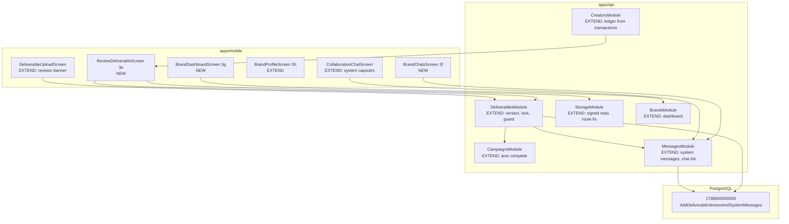
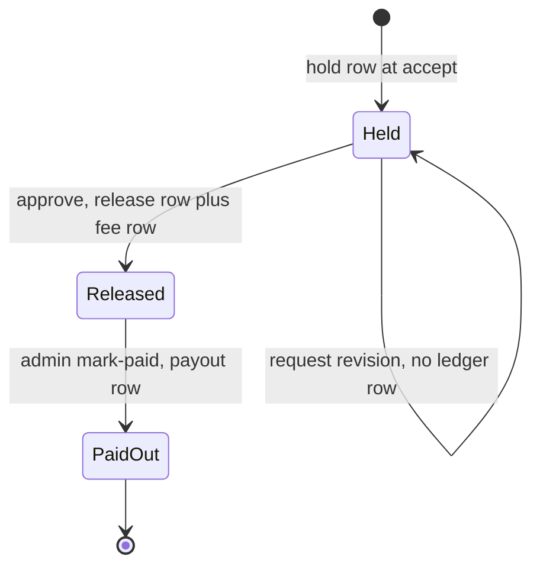
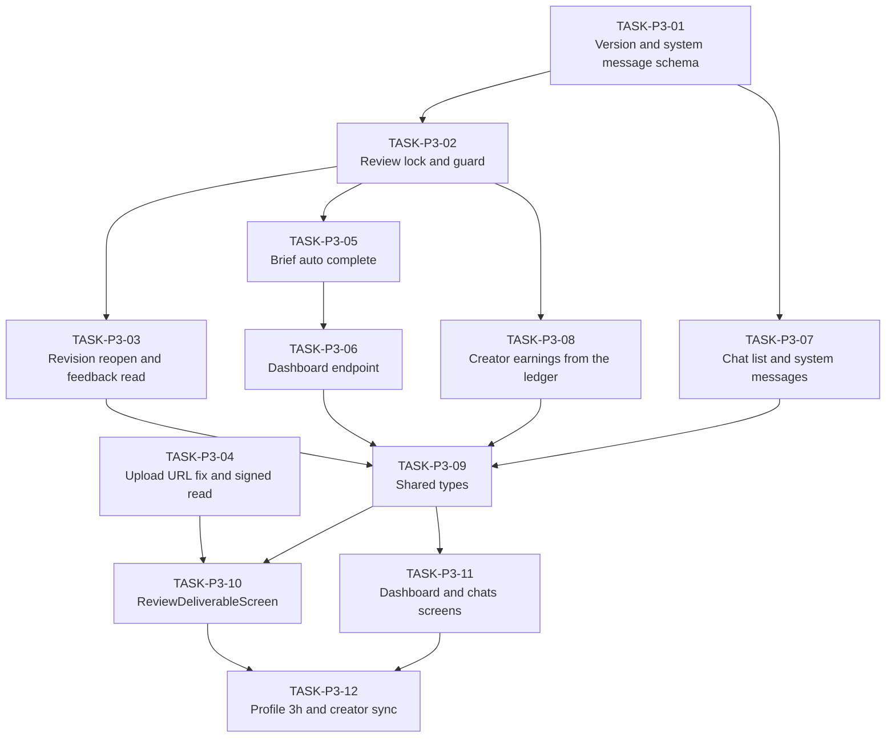
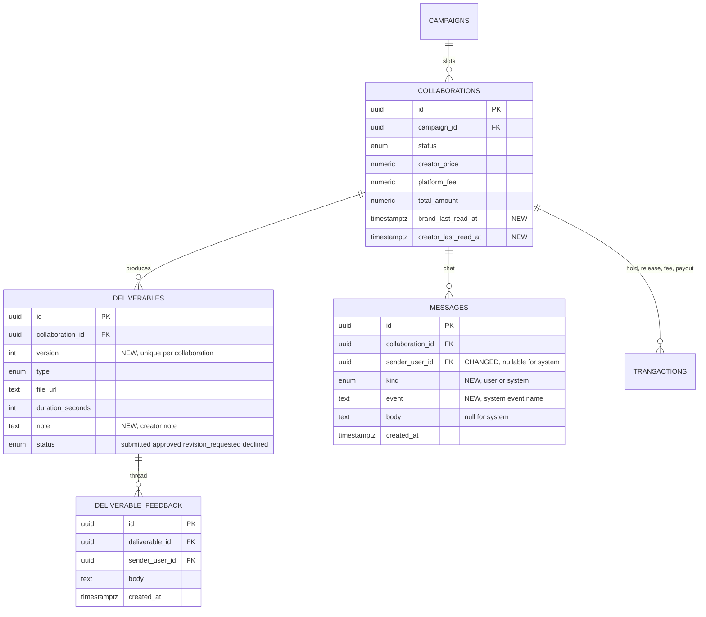
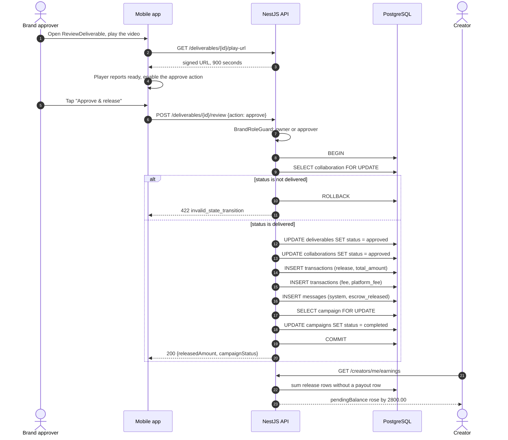
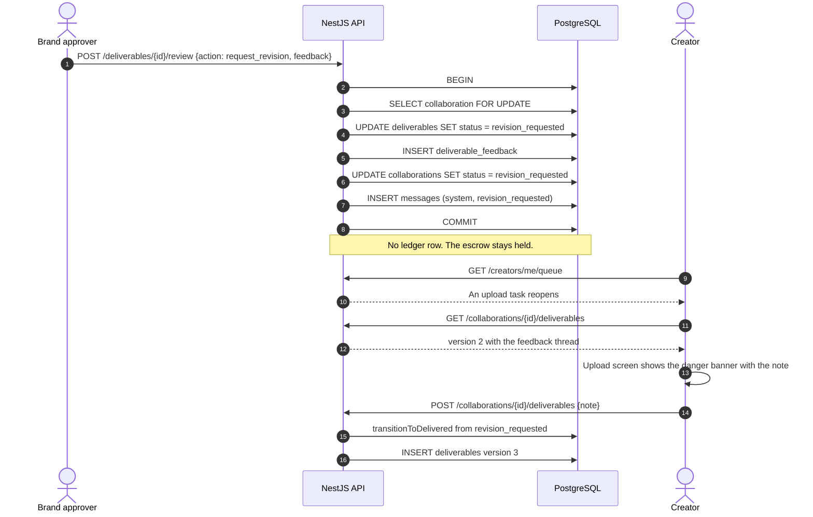

# Phase 3: Deliverable Review Loop, Dashboard, and Chats

# Document Control

- **Version**: 2.0.0
- **Date Created**: 2026-09-18
- **Last Updated**: 2026-09-19
- **Status**: DONE
- **Parent**: `operations/specs/brand_flow_integration/00_overview.md`
- **Depends on**: Phase 1 and Phase 2
- **Artboards**: 3e review deliverable, 3f chat with creator, 3g home campaign dashboard, 3h brand profile and settings
- **Task count**: 12

---

# Executive Summary

- **Goal**: Close the work loop. A brand watches a video, approves and releases escrow, or requests a revision that reopens the creator upload with a note.
- **Why this ships alone**: The phase ends with a complete delivery cycle. Money already moves in Phase 2. This phase spends it correctly and shows both sides the result.
- **Entry condition**: Phase 2 shipped. Escrow allocates at accept. `deliverables.service.ts` already registers, lists, and reviews. `messages` already runs Ably chat.
- **Exit condition**: A brand reviews a versioned deliverable, approves, and the ledger records a `release` and a `fee`. The creator sees the amount move from held to withdrawable. A revision reopens the creator upload with the brand note on screen.
- **Creator sync in this phase**: Approval moves the amount from `escrowBalance` to `pendingBalance` in `GET /creators/me/earnings`. A revision reopens `DeliverableUploadScreen` with the brand note in the danger banner that creator screen 10 already draws.

---

# Requirements

## Functional Requirements

- **REQ-301**: THE SYSTEM SHALL number every deliverable within its collaboration, starting at 1.
- **REQ-302**: THE SYSTEM SHALL let a brand owner or approver approve a submitted deliverable.
- **REQ-303**: WHEN a brand approves a deliverable THE SYSTEM SHALL record one `release` row and one `fee` row in the same transaction.
- **REQ-304**: THE SYSTEM SHALL refuse a second approval of the same collaboration.
- **REQ-305**: THE SYSTEM SHALL let a brand request a revision with a required note.
- **REQ-306**: WHEN a brand requests a revision THE SYSTEM SHALL reopen the creator upload and show the note.
- **REQ-307**: THE SYSTEM SHALL keep every feedback entry as a thread, not a single overwritten field.
- **REQ-308**: THE SYSTEM SHALL let a brand play the deliverable video inside the app.
- **REQ-309**: THE SYSTEM SHALL return a brand dashboard with month spend, month deliverable count, an attention count, and active briefs.
- **REQ-310**: THE SYSTEM SHALL list every collaboration chat a brand can open, with the last message and an unread count.
- **REQ-311**: THE SYSTEM SHALL write a system message into the chat for escrow funded, shipment confirmed, deliverable submitted, revision requested, and escrow released.
- **REQ-312**: WHEN every slot of a brief reaches `approved` or `paid` THE SYSTEM SHALL set the brief status to `completed`.
- **REQ-313**: THE SYSTEM SHALL return a creator earnings summary and ledger built from `transactions` rows, not from collaboration status alone.

### BDD Scenarios

```gherkin
Feature: Deliverable review

  Scenario: Brand approves and releases escrow
    Given a collaboration in the status "delivered" with a deliverable at version 2
    And a total amount of 3080.00 EGP with a platform fee of 280.00 EGP
    When a brand approver taps "Approve & release"
    Then the deliverable status becomes "approved"
    And the collaboration status becomes "approved"
    And the ledger holds one release row for 3080.00
    And the ledger holds one fee row for 280.00
    And the creator earnings move 2800.00 from held to withdrawable

  Scenario: Brand requests a revision
    Given a collaboration in the status "delivered"
    When the brand submits "Show the pump texture closer, otherwise great." as a revision note
    Then the deliverable status becomes "revision_requested"
    And the collaboration status becomes "revision_requested"
    And a feedback row stores the note
    And the creator upload screen shows the note in a danger banner
    And no ledger row is written

  Scenario: Double tap approve
    Given a collaboration already in the status "approved"
    When a second approve request arrives for the same deliverable
    Then the API answers 422 with the code "invalid_state_transition"
    And the ledger still holds exactly one release row

  Scenario: Two approvers race
    Given two brand approvers open the same deliverable
    When both tap approve within the same second
    Then exactly one request succeeds
    And the other receives 422 with the code "invalid_state_transition"

  Scenario: Viewer cannot approve
    Given a brand member with the brand role "viewer"
    When the member sends an approve request
    Then the API answers 403 with the code "brand_role_forbidden"

  Scenario: Last slot completes the brief
    Given a brief with one slot and one approved collaboration
    Then the brief status becomes "completed"
    And the brief appears under the "Completed" filter
```

## Security Requirements

- **SEC-301**: THE SYSTEM SHALL restrict deliverable approval and revision to the brand roles `owner` and `approver`.
- **SEC-302**: THE SYSTEM SHALL answer 404 when a deliverable belongs to another brand. The current code already does this.
- **SEC-303**: THE SYSTEM SHALL serve a deliverable video through a time limited signed read URL, never through a public bucket read.
- **SEC-304**: THE SYSTEM SHALL keep the brand contact details out of every creator facing chat response. Creator screen 11 states this rule.
- **SEC-305**: THE SYSTEM SHALL accept a deliverable file URL only when it starts with the collaboration prefix. The current code already does this with `startsWith`.

## Constraints

- **CON-301**: `apps/mobile/package.json` holds no video player package. Video playback needs one new dependency.
- **CON-302**: `deliverables` has no version column today. Existing rows need a backfill ordered by `created_at`.
- **CON-303**: The R2 bucket serves reads through `R2_PUBLIC_BASE_URL`. A signed read URL needs a new client method.
- **CON-304**: `messages.senderUserId` is NOT NULL, so a system message needs a sender or a nullable column.

## Guidelines

- **GUD-301**: Lock the collaboration row before you change its status inside a money transaction.
- **GUD-302**: One ledger insert per business event. Never update a `transactions` row.
- **GUD-303**: Reuse `SystemMessageCapsule` for a system chat message. It already exists.

## Patterns

- **PAT-301**: Pessimistic write lock inside a `dataSource.transaction`, matching the Phase 2 allocation.
- **PAT-302**: Append only feedback thread, matching `deliverable_feedback`.
- **PAT-303**: Aggregate read endpoint per screen, matching `GET /creators/me/queue`.

---

# Dependencies

| ID | Name | Type | Version | Purpose | New |
|---|---|---|---|---|---|
| DEP-301 | `expo-video` | npm | the version Expo SDK 57 pins | Deliverable video playback on artboard 3e | YES |
| DEP-302 | `ably` | npm | ^2.6.4 | Chat, already present | no |
| DEP-303 | `@aws-sdk/s3-request-presigner` | npm | ^3.899.0 | Signed read URL, already present | no |
| DEP-304 | `@tanstack/react-query` | npm | ^5.102.8 | Dashboard and chat list | no |

`expo-video` is the only new package in this phase. Add it with `pnpm --filter mobile add expo-video`, and let the Expo SDK resolve the version. Do not add `expo-av`. Expo deprecated it in favor of `expo-video`.

---

# Plan Details

## Impact on System Design



## Decisions

| ID | Decision | Rationale | Alternatives considered | Side effect |
|---|---|---|---|---|
| DES-P3-301 | Add a `version` integer to `deliverables`, unique per collaboration. | Artboard 3e shows "v2 · submitted 3h ago". Creator screen 10 names the file `glowlab-review-v2.mp4`. A version cannot be derived safely under concurrency. | Count rows at read time. Rejected because two uploads in the same second would both read the same count. | One unique index on `(collaboration_id, version)`. |
| DES-P3-302 | A system chat message uses a nullable `sender_user_id` plus a new `kind` column. | Creator screen 11 and artboard 3f both show centered capsules with no sender. A fake system user would leak into a participant check. | A synthetic system user row. Rejected because `requireParticipant` would need a special case. | `messages.sender_user_id` drops NOT NULL. |
| DES-P3-303 | Video playback uses a signed read URL with a 15 minute lifetime. | SEC-303. The bucket must not serve public reads of a paid deliverable. | A public CDN URL. Rejected because any holder of the URL could watch the video forever. | A new `createReadUrl` method on `R2StorageClient`, and a new endpoint. |
| DES-P3-304 | The brand dashboard is one aggregate endpoint, not four. | Artboard 3g draws one screen with four data groups. Four requests would show four loading states. | Four endpoints. Rejected on the loading experience. | One service method with three grouped queries. |
| DES-P3-305 | `CreatorsService.getEarnings` reads `transactions`, not collaboration status. | AUD-004. A status sum drifts from the ledger the moment a partial event exists. The ledger is the source of truth. | Keep the status sum. Rejected because Phase 2 made the ledger authoritative. | The method returns the same three fields, so `PayoutsScreen` needs no change. |
| DES-P3-306 | `CreatorsService.getLedger` returns a token name, not a hex color. | AUD-004. `#10B981` is not in `theme/tokens.ts`. The API must not choose a color. | Keep the hex values. Rejected because the API would own design. | The mobile side maps the token name to `colors`. |
| DES-P3-307 | The brief auto completes when the count of `approved` or `paid` collaborations reaches `slots`. | REQ-312. Artboard 4c shows a "Completed" filter and a row reading "Sara M. · paid out". | Manual completion by the brand. Rejected because no artboard shows a complete action. | The approval transaction gains one campaign read and a conditional write. |

## Constraints and Assumptions

| Type | ID | Description | Impact if wrong | Handling |
|---|---|---|---|---|
| Constraint | CON-P3-301 | `DeliverablesService.review` runs `requireDelivered`, which reads without a lock. | Two approvers could both pass the check. RISK-007. | Change `requireDelivered` to take a pessimistic write lock. |
| Constraint | CON-P3-302 | `messages.sender_user_id` is NOT NULL. | A system message cannot insert. | Migration 6 drops the NOT NULL and adds `kind`. |
| Assumption | ASM-P3-301 | A deliverable video is under 500 MB and plays over HTTPS range requests. | Playback stalls on a slow network. | The player shows a buffering state. No transcoding in Phase 1 scope. |
| Assumption | ASM-P3-302 | A brief has one slot in the common case. | The auto complete rule fires early on a multi slot brief. | Compare against `campaigns.slots`, never against 1. |

## Edge Cases

| ID | Scenario | Expected behavior | Handling |
|---|---|---|---|
| EDGE-P3-301 | Two approvers tap approve at the same instant. | One succeeds. One receives 422. | Pessimistic write lock on the collaboration inside the review transaction. |
| EDGE-P3-302 | The brand taps approve twice on one device. | The second attempt receives 422 `invalid_state_transition`. | The status is already `approved`, so `requireDelivered` throws. Also disable the button while the mutation runs. |
| EDGE-P3-303 | The creator uploads a third version after two revisions. | The version reads 3. The two earlier versions stay readable. | The unique index plus a `MAX(version) + 1` read inside the same locked transaction. |
| EDGE-P3-304 | A revision note is empty. | 400 `validation_error`. | `ReviewDeliverableDto` already requires feedback for a non approve action. Keep it. |
| EDGE-P3-305 | The video fails to load. | The screen shows a retry action and keeps the approve action disabled. | The brand must not approve a video that never played. |
| EDGE-P3-306 | The signed read URL expires while the brand watches. | The player shows an error. Tapping retry fetches a new URL. | A 15 minute lifetime covers a 60 second video with a wide margin. |
| EDGE-P3-307 | A brief has 3 slots and 2 approved collaborations. | The brief stays `live`. | Compare the count against `slots`. |
| EDGE-P3-308 | The brand declines rather than requests a revision. | The deliverable status becomes `declined` and the collaboration becomes `revision_requested`. | This is the current behavior. Keep it. Artboard 3e shows only two actions, so the mobile screen exposes approve and request revision. Decline stays an API only action for support use. |
| EDGE-P3-309 | The chat list holds a collaboration in `pending_payment`. | The row is hidden. | `isChatEligible` already excludes it. Reuse that method. |

---

# State Machines

## Deliverable transitions

| From | To | Actor | Guard |
|---|---|---|---|
| none | `submitted` | creator | The collaboration is `shipped` or `revision_requested`. The file URL matches the collaboration prefix. |
| `submitted` | `approved` | brand owner or approver | The collaboration is `delivered`, read under a write lock. |
| `submitted` | `revision_requested` | brand owner or approver | A non empty feedback note. |
| `submitted` | `declined` | brand owner or approver | A non empty feedback note. API only. |
| `approved` | any | none | Terminal. |
| `revision_requested` | any | none | Terminal for this version. The creator submits a new version instead. |
| `declined` | any | none | Terminal for this version. |

## Collaboration transitions, Phase 3 scope

| From | To | Actor | Guard |
|---|---|---|---|
| `shipped` | `delivered` | creator | A deliverable registers. Exists today. |
| `revision_requested` | `delivered` | creator | A new version registers. Exists today. |
| `delivered` | `approved` | brand owner or approver | Write lock held. Release and fee rows insert in the same transaction. |
| `delivered` | `revision_requested` | brand owner or approver | A feedback row inserts. No ledger row. |
| `approved` | `paid` | admin | Exists today, through `AdminPayoutsService`. |

## Escrow transitions triggered by approval



| Event | Ledger rows written | Counter change |
|---|---|---|
| Accept proposal | `hold` for `total_amount` | `escrow_allocated_amount` rises |
| Request revision | none | none |
| Approve | `release` for `total_amount`, `fee` for `platform_fee` | none. The money left escrow custody, not the campaign. |
| Admin mark paid | `payout` for `creator_price` | none |

The campaign counters do not move on approval. A `hold` stays allocated for the life of the brief. That keeps invariant 1 stable and matches artboard 4e, which shows "Escrow held: EGP 1,800" for a brief with an active collaboration.

---

# Directory Map

```text
apps/
├── api/src/
│   ├── migrations/
│   │   └── 1788600000005-AddDeliverableVersionAndSystemMessages.ts  NEW
│   └── modules/
│       ├── brands/
│       │   ├── brands.controller.ts               EXTEND
│       │   ├── dashboard.service.ts               NEW
│       │   └── dashboard.service.spec.ts          NEW
│       ├── campaigns/
│       │   └── campaigns.service.ts               EXTEND
│       ├── creators/
│       │   ├── creators.service.ts                EXTEND
│       │   └── creators.service.spec.ts           EXTEND
│       ├── deliverables/
│       │   ├── deliverables.controller.ts         EXTEND
│       │   ├── deliverables.service.ts            EXTEND
│       │   ├── deliverables.service.spec.ts       EXTEND
│       │   └── entities/deliverable.entity.ts     EXTEND
│       ├── collaborations/
│       │   └── collaborations.service.ts          EXTEND
│       ├── messages/
│       │   ├── messages.controller.ts             EXTEND
│       │   ├── messages.service.ts                EXTEND
│       │   ├── messages.service.spec.ts           NEW
│       │   ├── system-message.ts                  NEW
│       │   └── entities/message.entity.ts         EXTEND
│       └── storage/
│           ├── storage.controller.ts              EXTEND
│           └── r2-storage.client.ts               EXTEND
├── mobile/src/
│   ├── components/
│   │   └── VideoPlayer.tsx                        NEW
│   ├── hooks/api/
│   │   ├── useDeliverables.ts                     EXTEND, fixes AUD-001
│   │   ├── useDashboard.ts                        NEW
│   │   ├── useChats.ts                            NEW
│   │   └── useStorage.ts                          EXTEND, fixes AUD-003
│   ├── navigation/BrandTabNavigator.tsx           EXTEND
│   └── screens/
│       ├── brand/
│       │   ├── ReviewDeliverableScreen.tsx        NEW
│       │   ├── BrandDashboardScreen.tsx           NEW
│       │   ├── BrandChatsScreen.tsx               NEW
│       │   ├── BrandProfileScreen.tsx             EXTEND
│       │   └── CollaborationDetailScreen.tsx      EXTEND
│       ├── creator/
│       │   ├── DeliverableUploadScreen.tsx        EXTEND
│       │   └── PayoutsScreen.tsx                  EXTEND
│       └── shared/
│           └── CollaborationChatScreen.tsx        EXTEND
└── packages/shared-types/src/
    ├── deliverables.ts                            EXTEND
    ├── messages.ts                                EXTEND
    ├── dashboard.ts                               NEW
    └── index.ts                                   EXTEND
```

---

# Task Sequence



---

# Directory Specifications

## TASK-P3-01: Deliverable version and system message schema

- **Verdict**: EXTEND `deliverable.entity.ts` and `message.entity.ts`. NEW migration.
- **Files**: `apps/api/src/modules/deliverables/entities/deliverable.entity.ts`, `apps/api/src/modules/messages/entities/message.entity.ts`, `apps/api/src/migrations/1788600000005-AddDeliverableVersionAndSystemMessages.ts` (NEW).

### Data model

Table `deliverables`:

| Column | Type | Nullable | Default | Index |
|---|---|---|---|---|
| `version` | int | no after backfill | none | `uq_deliverables_collaboration_version` unique on `("collaboration_id","version")` |
| `note` | text | yes | null | none |

`note` holds the creator note that creator screen 10 collects under "Note for the brand (optional)". It exists in the design and has no column today.

Table `messages`:

| Column | Change | Nullable | Default | Notes |
|---|---|---|---|---|
| `sender_user_id` | CHANGED | yes | null | Null for a system message. DES-P3-302. |
| `kind` | NEW `messages_kind_enum` | no | `'user'` | `user`, `system` |
| `event` | NEW text | yes | null | The notification event name for a system message. Phase 4 reuses it. |

Check constraint `chk_messages_sender`: `(kind = 'user' AND sender_user_id IS NOT NULL) OR (kind = 'system' AND sender_user_id IS NULL)`.

### Migration

File `1788600000005-AddDeliverableVersionAndSystemMessages.ts`, class `AddDeliverableVersionAndSystemMessages1788600000005`.

1. Add `version` as nullable int and `note` as nullable text on `deliverables`.
2. Backfill the version with a window function:

```sql
UPDATE deliverables d SET version = s.rn
FROM (
  SELECT id, row_number() OVER (PARTITION BY collaboration_id ORDER BY created_at, id) AS rn
  FROM deliverables
) s
WHERE s.id = d.id;
```

3. Set `version` NOT NULL and create the unique index.
4. Create `messages_kind_enum`, add `kind` with the default `user`, add `event`.
5. Drop NOT NULL from `messages.sender_user_id`.
6. Add the check constraint, after step 5.
7. In `down`, drop the constraint, drop `kind` and `event`, drop the enum, restore NOT NULL on `sender_user_id` after deleting every system row, then drop the unique index, `version`, and `note`.

The `down` deletes system messages. Note that in the rollback section.

### Test cases

Extend `deliverables.service.spec.ts`:

1. A first registration sets `version` to 1.
2. A second registration on the same collaboration sets `version` to 2.
3. A unique violation on `(collaboration_id, version)` maps to 409 `duplicate_version`.

### Acceptance criteria

1. After `migration:run` against a database with three deliverables on one collaboration, the versions read 1, 2, and 3, ordered by `created_at`.
2. An insert of a `system` message with a sender fails on `chk_messages_sender`.

---

## TASK-P3-02: Review lock, brand role guard, and release

- **Verdict**: EXTEND `deliverables.service.ts` and `deliverables.controller.ts`. The `review` method already approves, releases, and records a fee. This task adds the lock, the guard, and the version aware response.
- **Files**: `apps/api/src/modules/deliverables/deliverables.service.ts`, `apps/api/src/modules/deliverables/deliverables.controller.ts`, `apps/api/src/modules/collaborations/collaborations.service.ts`.

### What already works, do not rewrite it

`DeliverablesService.review` already does the following, correctly:

1. Loads the deliverable with its collaboration relation.
2. Answers 404 for a cross brand deliverable.
3. Opens a `dataSource.transaction`.
4. Calls `requireDelivered`, which throws `invalid_state_transition` for any other status.
5. On approve: sets the deliverable to `approved`, sets the collaboration to `approved`, records a `release` for `total_amount`, and records a `fee` for `platform_fee`.
6. On revision or decline: sets the deliverable status, inserts a `DeliverableFeedback` row, and sets the collaboration to `revision_requested`.

REQ-303 is already satisfied. Do not add a second release path.

### What changes

1. **Lock**. `CollaborationsService.requireDelivered` reads with `manager.getRepository(Collaboration).findOne({ where: { id } })`. Add `lock: { mode: 'pessimistic_write' }`. That single option closes EDGE-P3-301 and RISK-007. Add a comment naming both.
2. **Guard**. Add `@BrandRoles('owner','approver')` to the `review` route. SEC-301.
3. **Response**. Return the deliverable version and the released amount, so artboard 3e can show a confirmation without a refetch.

### API contract

#### POST /api/v1/deliverables/{id}/review

- **Verdict**: EXTEND. The route exists.
- **Auth**: `JwtAuthGuard`, `RolesGuard` with `@Roles(UserRole.BRAND)`, `BrandRoleGuard` with `@BrandRoles('owner','approver')`.
- **Request DTO**: `ReviewDeliverableDto`, unchanged. `action` is `approve`, `request_revision`, or `decline`. `feedback` is required unless the action is `approve`.
- **Success**: 200.

```json
{ "data": { "id": "...", "version": 2, "status": "approved", "collaborationStatus": "approved", "releasedAmount": "3080.00", "creatorAmount": "2800.00", "platformFee": "280.00", "currency": "EGP", "campaignStatus": "completed" } }
```

`releasedAmount`, `creatorAmount`, `platformFee`, and `campaignStatus` are new. `campaignStatus` reflects TASK-P3-05.

- **Errors**:

| Status | Code | Trigger |
|---|---|---|
| 400 | `validation_error` | `feedback` is missing for a non approve action. |
| 403 | `brand_role_forbidden` | The caller is a viewer. |
| 404 | `not_found` | The deliverable belongs to another brand. |
| 422 | `invalid_state_transition` | The collaboration is not `delivered`. Covers a double approve and the loser of a race. |

### Test cases

Extend `deliverables.service.spec.ts`:

1. `requireDelivered` is called with a `pessimistic_write` lock. Assert the option on the mock.
2. Approve records exactly one `release` and one `fee`. Assert both call counts.
3. Approve returns `releasedAmount`, `creatorAmount`, and `platformFee`.
4. Approve on an `approved` collaboration throws `invalid_state_transition`.
5. Request revision records zero ledger rows. Assert `recordRelease` and `recordFee` are never called.
6. Request revision inserts one `DeliverableFeedback` row with the brand user id.
7. A viewer never reaches the service. Covered in the guard spec.

### Acceptance criteria

1. Two concurrent approve requests produce exactly one `release` row. Prove it with a database count after a scripted race.
2. `pnpm --filter api test` reports 6 passing cases in the review block.
3. The ledger satisfies invariant 3 for the collaboration after the admin marks it paid.

---

## TASK-P3-03: Revision reopen and feedback thread

- **Verdict**: EXTEND. `deliverable_feedback` exists and `review` already writes to it. No read endpoint exists.
- **Files**: `apps/api/src/modules/deliverables/deliverables.controller.ts`, `apps/api/src/modules/deliverables/deliverables.service.ts`.

### API contract

#### GET /api/v1/collaborations/{id}/deliverables

- **Verdict**: EXTEND. The route exists and returns a plain array ordered by `created_at` descending.
- Add the feedback thread and the version to each item.

```json
{ "data": [ { "id": "...", "version": 2, "type": "ready_ad", "fileUrl": "...", "durationSeconds": 62, "status": "submitted", "note": "Re-shot the middle.", "feedback": [ { "id": "...", "body": "Show the pump texture closer, otherwise great.", "senderRole": "brand", "createdAt": "..." } ], "createdAt": "..." } ] }
```

`senderRole` is `brand` or `creator`, derived from `users.role`. Never return the sender email or the sender name to the other side. SEC-304.

Load the feedback with one `leftJoinAndSelect`, not a query per deliverable.

### Creator sync in this task

Creator screen 10 already draws a revision banner with a `hasRevision` prop and hard coded copy. Wire it to real data.

| Brand event | Creator consequence | Where |
|---|---|---|
| Revision requested | The collaboration returns to `revision_requested`, so the upload reopens | `CollaborationStatusScreen` |
| Revision requested | The banner reads "Revision {n} requested" with the brand note | `DeliverableUploadScreen` |
| Revision requested | The home queue shows an upload task again | `GET /creators/me/queue` |
| Revision requested | The escrow stays held, so the earnings screen does not change | `PayoutsScreen` |

The banner title uses the revision count, which equals the count of deliverables in the status `revision_requested` on this collaboration. Compute it on the client from the list the endpoint already returns. Do not add an endpoint for a count.

`CollaborationsService.transitionToDelivered` already allows `revision_requested` as a source state. No change is needed. State that in the review.

### Test cases

Extend `deliverables.service.spec.ts`:

1. `listForCollaboration` returns the feedback array ordered oldest first.
2. `listForCollaboration` returns `senderRole` and never a sender email.
3. A creator caller and a brand caller receive the same feedback bodies.

### Acceptance criteria

1. A brand requests a revision and the creator upload screen shows the exact note text within one refetch.
2. The response body for a collaboration with two deliverables and three feedback rows costs at most 2 SQL statements.

---

## TASK-P3-04: Upload URL route and signed read URL

- **Verdict**: EXTEND. This task fixes AUD-001 and AUD-003 and adds SEC-303.
- **Files**: `apps/api/src/modules/storage/storage.controller.ts`, `apps/api/src/modules/storage/r2-storage.client.ts`, `apps/mobile/src/hooks/api/useDeliverables.ts`, `apps/mobile/src/hooks/api/useStorage.ts`.

### AUD-001, the missing route

`useDeliverables.ts` calls `POST /collaborations/{id}/deliverables/upload-url`. `StorageController` exposes only `POST /storage/upload-url`, and `R2StorageClient.createUploadUrl(collaborationId, ...)` exists but nothing calls it. Two fixes are possible. Choose the first.

1. **Add the route.** `R2StorageClient.createUploadUrl` already namespaces the key as `collaborations/{id}/{uuid}.{ext}`, which is the exact prefix `DeliverablesService.register` checks with `startsWith`. The generic route produces `deliverable/{uuid}.{ext}`, which fails that check. The collaboration scoped route is the correct one, and the client already calls it.

Add to `StorageController`:

#### POST /api/v1/collaborations/{id}/deliverables/upload-url

- **Auth**: `JwtAuthGuard`, `RolesGuard` with `@Roles(UserRole.CREATOR)`, plus an ownership check through `CollaborationsService.findOwnedByCreator`.
- **Request DTO**: `RequestUploadUrlDto` with `contentType` and `fileSize`.
- **Success**: 200, `{ "data": { "uploadUrl": "...", "fileUrl": "..." } }`.
- **Errors**: 400 `bad_request` for an unsupported type or an oversized file. 404 `not_found` for a collaboration the creator does not own. 422 `invalid_state_transition` when the collaboration is not `shipped` or `revision_requested`.
- Restrict the content type to the three video types. A deliverable is a video. Reject an image.

This route belongs in the storage module, beside the generic one, because both share `R2StorageClient` and the throttler.

### AUD-003, the mocked upload

Remove the `local-test-r2-account` branch from `uploadFileToPresignedUrl`. A silent success in production would register a file URL for an object that does not exist. Replace it with an environment check that throws a clear error in development when R2 is not configured.

### SEC-303, the signed read URL

Add to `R2StorageClient`:

```ts
/**
 * DES-P3-303: a time limited GET URL for a deliverable object. The bucket
 * serves no public reads, so this is the only way a brand plays the video.
 */
async createReadUrl(fileUrl: string, ttlSeconds = 900): Promise<string>;
```

Derive the object key by stripping `publicBaseUrl` from `fileUrl`. Reject a `fileUrl` that does not start with `publicBaseUrl`, using the same origin check `DeliverablesService.register` already applies.

#### GET /api/v1/deliverables/{id}/play-url

- **Auth**: `JwtAuthGuard`, `@Roles(UserRole.BRAND, UserRole.CREATOR)`. Either participant may watch.
- **Success**: 200, `{ "data": { "url": "...", "expiresInSeconds": 900 } }`.
- **Errors**: 404 `not_found` for a non participant.

### Test cases

`storage.controller.spec.ts` (NEW or EXTEND from Phase 1):

1. The collaboration scoped route returns a `fileUrl` that starts with the collaboration prefix.
2. The route rejects `image/png`.
3. The route returns 404 for another creator's collaboration.
4. `createReadUrl` rejects a URL outside `publicBaseUrl`.
5. `createReadUrl` returns a URL that carries an expiry query parameter.

### Acceptance criteria

1. A creator uploads a deliverable and `DeliverablesService.register` accepts the returned `fileUrl` with no prefix error.
2. `grep -n "local-test-r2-account" apps/mobile/src` returns nothing.
3. A play URL fetched twice returns two different signed URLs.

---

## TASK-P3-05: Brief auto complete

- **Verdict**: EXTEND `campaigns.service.ts` and the approval path in `deliverables.service.ts`.
- **Files**: `apps/api/src/modules/campaigns/campaigns.service.ts`, `apps/api/src/modules/deliverables/deliverables.service.ts`.

### Design

Add to `CampaignsService`:

```ts
/**
 * REQ-312: sets the brief to completed when every slot is done. Runs
 * inside the approval transaction, so a partial state never exists.
 * Returns the resulting status so the review response can report it.
 */
async completeIfAllSlotsDone(
  campaignId: string, manager: EntityManager,
): Promise<CampaignStatus>;
```

Steps:

1. Lock the campaign row for update.
2. Count collaborations on the campaign whose status is `approved` or `paid`.
3. When the count is at least `campaign.slots` and the status is `live` or `paused`, set `completed`.
4. Return the resulting status.

Call it from the approve branch of `DeliverablesService.review`, with the same manager, right after `markApproved`.

The lock order matters. The review transaction locks the collaboration first, then the campaign. Phase 2 allocation locks the campaign only. Two locks in a fixed order cannot deadlock. Write that order in a comment in both files.

### Test cases

Extend `campaigns.service.spec.ts`:

1. A one slot brief with one approved collaboration becomes `completed`.
2. A three slot brief with two approved collaborations stays `live`.
3. An already `cancelled` brief never becomes `completed`.
4. The method takes a pessimistic write lock.

### Acceptance criteria

1. Approving the last deliverable on a one slot brief returns `"campaignStatus": "completed"` in the review response.
2. The brief moves under the "Completed" filter on `MyBriefsScreen` with no extra request.

---

## TASK-P3-06: Brand dashboard endpoint

- **Verdict**: NEW service file. EXTEND `brands.controller.ts`.
- **Files**: `apps/api/src/modules/brands/dashboard.service.ts` (NEW), `apps/api/src/modules/brands/dashboard.service.spec.ts` (NEW), `apps/api/src/modules/brands/brands.controller.ts`.

### API contract

#### GET /api/v1/brands/me/dashboard

- **Auth**: `@Roles(UserRole.BRAND)`, `@BrandRoles('owner','approver','viewer')`. A viewer may read the dashboard. Artboard 3g shows no money movement action.
- **Success**: 200.

```json
{
  "data": {
    "brandName": "Glow Lab",
    "logoUrl": null,
    "month": { "spend": "18400.00", "deliverableCount": 6, "currency": "EGP" },
    "attention": { "briefsNeedingProposalReview": 2, "deliverablesAwaitingReview": 1 },
    "activeBriefs": [
      { "id": "...", "title": "Serum review", "meta": "Nour H. · in escrow", "status": "live", "collaborationStatus": "delivered", "proposalCount": 0 },
      { "id": "...", "title": "Baby wash routine", "meta": "Open · 8 proposals", "status": "live", "collaborationStatus": null, "proposalCount": 8 }
    ],
    "activeBriefCount": 3
  }
}
```

Every field maps to an element of artboard 3g:

| Artboard element | Field |
|---|---|
| "Glow Lab" heading and the avatar | `brandName`, `logoUrl` |
| "THIS MONTH" dark card, "EGP 18,400 spent" | `month.spend` |
| "6 deliverables" | `month.deliverableCount` |
| Cream banner "2 briefs need proposal review" | `attention.briefsNeedingProposalReview` |
| "Active briefs (3)" | `activeBriefCount` |
| Each row | `activeBriefs[]` |

### Definitions

| Field | Definition |
|---|---|
| `month.spend` | Sum of `charge` minus sum of `refund` on this brand's campaigns, within the current calendar month in Africa/Cairo. |
| `month.deliverableCount` | Count of deliverables in the status `approved` on this brand's collaborations, within the current month. |
| `briefsNeedingProposalReview` | Count of `live` briefs with at least one proposal in `applied`. |
| `deliverablesAwaitingReview` | Count of collaborations in the status `delivered`. |
| `activeBriefs` | Briefs in `live` or `paused`, ordered by `updated_at` descending, capped at 5. |

Use a fixed time zone. A month boundary computed in UTC gives a Cairo brand the wrong number for two hours every month. Read the zone from a new configuration value `reportingTimeZone`, default `Africa/Cairo`.

- **Errors**: 404 `not_found` when the user has no active membership.

### Test cases

`dashboard.service.spec.ts` (NEW):

1. `month.spend` excludes a charge from the previous month.
2. `month.spend` subtracts a refund in the same month.
3. `briefsNeedingProposalReview` ignores a `paused` brief.
4. `deliverablesAwaitingReview` counts only the status `delivered`.
5. `activeBriefs` caps at 5 rows.
6. The month boundary uses `Africa/Cairo`, not UTC.

### Acceptance criteria

1. The endpoint issues at most 4 SQL statements. Prove it with the Pino query log at debug level.
2. A brand with no brief receives `activeBriefCount` equal to 0 and an empty array, not a 404.

---

## TASK-P3-07: Chat list and system messages

- **Verdict**: EXTEND `messages.controller.ts`, `messages.service.ts`, and `message.entity.ts`. NEW `system-message.ts`.
- **Files**: `apps/api/src/modules/messages/messages.controller.ts`, `apps/api/src/modules/messages/messages.service.ts`, `apps/api/src/modules/messages/system-message.ts` (NEW), `apps/api/src/modules/messages/messages.service.spec.ts` (NEW).

### System message catalog

Artboard 3f shows two capsules: "Escrow funded · EGP 2,800" and "📦 Shipment marked delivered". Creator screen 11 shows the same pattern. Define five events. Phase 4 reuses the same names for notifications, so pick them once.

| Event name | Trigger | Brand capsule copy | Creator capsule copy |
|---|---|---|---|
| `escrow_funded` | Escrow allocates at accept | `Escrow funded · EGP {total}` | `Escrow funded · EGP {creatorPrice}` |
| `shipment_confirmed` | `confirm-shipment` succeeds | `Shipment marked sent` | `Shipment marked sent` |
| `deliverable_submitted` | A deliverable registers | `{creatorName} submitted v{version}` | `You submitted v{version}` |
| `revision_requested` | A revision review lands | `You requested a revision` | `{brandName} requested a revision` |
| `escrow_released` | An approval lands | `Escrow released · EGP {total}` | `Escrow released · EGP {creatorPrice}` |

Two copy strings per event, because the brand sees the total and the creator sees the price. The fee is the platform's business, and the creator never sees it.

Store one row with `kind = 'system'`, `event` set to the event name, and `body` set to a JSON payload of the interpolation values. Render the copy on the client from the translation file, keyed by `chat.system.{event}`. That keeps the copy translatable and keeps a stored string from freezing in English.

```ts
// apps/api/src/modules/messages/system-message.ts
export type SystemMessageEvent =
  | 'escrow_funded' | 'shipment_confirmed' | 'deliverable_submitted'
  | 'revision_requested' | 'escrow_released';

export interface SystemMessagePayload {
  event: SystemMessageEvent;
  params: Record<string, string | number>;
}
```

`MessagesService.createSystemMessage(collaborationId, payload, manager)` inserts the row inside the caller's transaction, so a system message never exists without the event that caused it.

Call sites:

| Caller | Event |
|---|---|
| `EscrowService.allocate` through `CollaborationsService.acceptProposal` | `escrow_funded` |
| `CollaborationsService.confirmShipment` | `shipment_confirmed` |
| `DeliverablesService.register` | `deliverable_submitted` |
| `DeliverablesService.review`, revision branch | `revision_requested` |
| `DeliverablesService.review`, approve branch | `escrow_released` |

### API contract

#### GET /api/v1/collaborations/{id}/messages

- **Verdict**: EXTEND. The route exists and returns the `paginate()` envelope.
- Add `kind`, `event`, and `params` to each item. A `user` message keeps `senderUserId` and `body`. A `system` message carries a null `senderUserId` and a null `body`.

#### GET /api/v1/chats

- **Verdict**: NEW route. `MessagesController` is mounted at `collaborations/:id`, so this route needs its own controller path. Add it to `MessagesController` with an explicit full path, or add a second controller. Prefer a second controller named `ChatsController` in the same module, because the existing controller binds a path parameter.
- **Auth**: `@Roles(UserRole.BRAND, UserRole.CREATOR)`.
- **Success**: 200, the `paginate()` envelope.

```json
{ "data": [ { "collaborationId": "...", "counterpartName": "Nour H.", "counterpartInitials": "NH", "campaignTitle": "Serum review", "lastMessagePreview": "Sounds great, sample is on the way today.", "lastMessageAt": "...", "unreadCount": 2, "collaborationStatus": "delivered" } ] }
```

- Only chat eligible collaborations appear. Reuse `CollaborationsService.isChatEligible`. EDGE-P3-309.
- `unreadCount` needs a read marker. Add `messages.read_at` per participant, or a simpler `collaborations.brand_last_read_at` and `collaborations.creator_last_read_at` pair. Choose the pair. It is two columns and one write per screen open, against a join table and one write per message. Add both columns to migration `1788600000005`.

#### POST /api/v1/collaborations/{id}/read

- **Auth**: `@Roles(UserRole.BRAND, UserRole.CREATOR)`.
- Sets the caller's read timestamp to now.
- **Success**: 204.

### Test cases

`messages.service.spec.ts` (NEW):

1. `createSystemMessage` inserts a row with a null sender and the event name.
2. `createSystemMessage` runs inside the caller's manager. Assert the repository comes from the manager.
3. `list` returns a system message with a null `body` and a populated `params`.
4. `listChats` excludes a `pending_payment` collaboration.
5. `listChats` computes `unreadCount` from the caller's read timestamp.
6. A non participant receives 403 from `requireParticipant`. This already works. Keep the test.

### Acceptance criteria

1. Accepting a proposal writes exactly one `escrow_funded` system message.
2. The chat list for a brand with three eligible collaborations returns three rows and at most 2 SQL statements.
3. The creator and the brand see different copy for the same `escrow_released` event, and the creator never sees the fee.

---

## TASK-P3-08: Creator earnings from the ledger

- **Verdict**: EXTEND `creators.service.ts`. `getEarnings` and `getLedger` exist and both read collaboration status. AUD-004.
- **Files**: `apps/api/src/modules/creators/creators.service.ts`, `apps/api/src/modules/creators/creators.service.spec.ts`.

### getEarnings

Keep the three field response shape, so `PayoutsScreen` needs no change to its data contract.

| Field | Old definition | New definition |
|---|---|---|
| `escrowBalance` | Sum of `creatorPrice` for collaborations in `funded`, `shipped`, `delivered`, or `revision_requested` | Sum of `creator_price` for collaborations with a `hold` row and no `release` row |
| `pendingBalance` | Sum of `creatorPrice` for collaborations in `approved` | Sum of `creator_price` for collaborations with a `release` row and no `payout` row |
| `clearedBalance` | Sum of `creatorPrice` for collaborations in `paid` | Sum of `payout.amount` |

The new definitions read the ledger, which Phase 2 made authoritative. The old definitions would drift the moment a status and a ledger row disagree.

Return the amounts as two decimal strings, not JavaScript numbers. `getEarnings` returns `parseFloat` results today, which reintroduces float arithmetic on money. Fix that. GUD-202 and DEC-003.

Creator screen 12 draws "READY TO WITHDRAW", "Held in escrow", and "Paid out to date". Map `pendingBalance` to ready to withdraw, `escrowBalance` to held in escrow, and `clearedBalance` to paid out to date.

### getLedger

Replace the collaboration walk with a `transactions` read.

| Ledger row source | Title | Amount sign | Status label | Status token |
|---|---|---|---|---|
| `hold` | `Held · {brandName}` | unsigned | `In escrow` | `muted` |
| `release` | `Released · {brandName}` | plus | `Withdrawable` | `success` |
| `payout` | `Payout · {method}` | minus | `Paid` | `success` |

Return a token name, not a hex color. DES-P3-306. The mobile side maps `muted` and `success` to `colors.muted` and `colors.success`.

Never return a `fee` row to a creator. The platform fee is not the creator's business.

Format the amount as a two decimal string. Let the client format the thousands separator with `Intl.NumberFormat`, so an Arabic build can choose its own digit rendering. The API must not call `toLocaleString`.

### Creator sync in this task

| Brand event | Creator consequence | Where |
|---|---|---|
| Approve | The amount moves from held in escrow to ready to withdraw | creator screen 12, `PayoutsScreen` |
| Approve | A `Released · {brand}` row appears in the ledger | `PayoutsScreen` |
| Admin mark paid | The amount moves to paid out to date | `PayoutsScreen` |

### Test cases

Extend `creators.service.spec.ts`:

1. A collaboration with a `hold` and no `release` counts toward `escrowBalance`.
2. A collaboration with a `release` and no `payout` counts toward `pendingBalance`.
3. A `payout` row counts toward `clearedBalance` at the payout amount, not the creator price.
4. `getLedger` never returns a `fee` row.
5. `getLedger` returns `statusToken`, and never a string starting with `#`.
6. Every amount is a string with exactly two decimal places.

### Acceptance criteria

1. `grep -nE "#[0-9A-Fa-f]{6}" apps/api/src/modules/creators/creators.service.ts` returns nothing.
2. `grep -n "parseFloat" apps/api/src/modules/creators/creators.service.ts` returns nothing.
3. Approving a deliverable moves the exact creator price from held to withdrawable within one refetch.

---

## TASK-P3-09: Shared types

- **Verdict**: EXTEND `deliverables.ts` and `messages.ts`. NEW `dashboard.ts`.
- **Files**: `packages/shared-types/src/deliverables.ts`, `packages/shared-types/src/messages.ts`, `packages/shared-types/src/dashboard.ts` (NEW), `packages/shared-types/src/creators.ts`, `packages/shared-types/src/index.ts`.

```ts
// deliverables.ts  (EXTEND)
export interface DeliverableFeedbackEntry {
  id: string; body: string; senderRole: 'brand' | 'creator'; createdAt: string;
}

export interface Deliverable {
  // existing fields stay
  version: number;                      // added
  note: string | null;                  // added
  feedback: DeliverableFeedbackEntry[]; // added
}

export interface ReviewDeliverableResponse {
  id: string; version: number;
  status: DeliverableStatus;
  collaborationStatus: CollaborationStatus;
  releasedAmount: string | null;
  creatorAmount: string | null;
  platformFee: string | null;
  currency: string;
  campaignStatus: CampaignStatus;
}

export interface PlayUrlResponse { url: string; expiresInSeconds: number; }
```

```ts
// messages.ts  (EXTEND)
export type MessageKind = 'user' | 'system';

export type SystemMessageEvent =
  | 'escrow_funded' | 'shipment_confirmed' | 'deliverable_submitted'
  | 'revision_requested' | 'escrow_released';

export interface Message {
  // existing fields stay
  kind: MessageKind;                            // added
  event: SystemMessageEvent | null;             // added
  params: Record<string, string | number> | null; // added
  senderUserId: string | null;                  // CHANGED, was string
}

export interface ChatListItem {
  collaborationId: string; counterpartName: string; counterpartInitials: string;
  campaignTitle: string; lastMessagePreview: string | null;
  lastMessageAt: string | null; unreadCount: number;
  collaborationStatus: CollaborationStatus;
}
```

```ts
// dashboard.ts  (NEW)
export interface BrandDashboard {
  brandName: string | null; logoUrl: string | null;
  month: { spend: string; deliverableCount: number; currency: string };
  attention: { briefsNeedingProposalReview: number; deliverablesAwaitingReview: number };
  activeBriefs: DashboardBriefRow[];
  activeBriefCount: number;
}

export interface DashboardBriefRow {
  id: string; title: string; meta: string;
  status: CampaignStatus;
  collaborationStatus: CollaborationStatus | null;
  proposalCount: number;
}
```

```ts
// creators.ts  (EXTEND)
export interface CreatorEarnings {
  escrowBalance: string;   // CHANGED, was number
  pendingBalance: string;  // CHANGED, was number
  clearedBalance: string;  // CHANGED, was number
  currency: string;        // added
}

export type LedgerStatusToken = 'muted' | 'success';

export interface CreatorLedgerEntry {
  id: string; title: string; meta: string;
  amount: string; sign: '+' | '-' | '';
  status: string; statusToken: LedgerStatusToken; // CHANGED, was statusColor hex
}
```

### Acceptance criteria

1. `pnpm --filter @ugcx/shared-types build` emits `dashboard.d.ts`.
2. `pnpm --filter mobile typecheck` fails on `PayoutsScreen` until TASK-P3-12 updates it. Land both together.

---

## TASK-P3-10: Review deliverable screen

- **Verdict**: NEW screen. NEW `VideoPlayer` component. EXTEND `useDeliverables.ts`.
- **Files**: `apps/mobile/src/screens/brand/ReviewDeliverableScreen.tsx` (NEW), `apps/mobile/src/components/VideoPlayer.tsx` (NEW), `apps/mobile/src/hooks/api/useDeliverables.ts`.

### Artboard 3e element by element

| Element | Copy or values | Component | Token |
|---|---|---|---|
| Header | "{creatorName} · {campaignTitle}" | Stack header, 48 high | 1px `hairline` bottom border |
| Video surface | 220 high, a play glyph centered | `VideoPlayer` | `colors.surfaceDark`, `radius.md` |
| Version line | "v2 · submitted 3h ago" | `AppText variant="caption" color="muted"` | |
| Escrow pill | "In escrow" | `StatusBadge` | `surfaceStrong` with `muted` text |
| Feedback card | "v1 feedback: \"{body}\"" | `Card tone="cream"` | `colors.signatureCream`, `radius.md` |
| Note label | "Add a note (optional)" | `AppText variant="label" color="muted"` | |
| Note field | 60 high, placeholder "Looks great, approved." | `TextInput multiline` | `inputBorder`, `radius.sm` |
| Action 1 | "Request revision" | `Button variant="secondary"` | 1px `borderStrong`, `radius.lg` |
| Action 2 | "Approve & release" | `Button variant="primary"` | `colors.primary`, `radius.lg` |

The two actions sit in one `BottomActionBar` with a 12 gap, each taking half the width. `DESIGN.md` names this exact layout under "Brand deliverable review spec". Follow it.

The feedback card shows the newest feedback entry for the previous version. Show nothing when the deliverable is version 1.

### VideoPlayer component

```tsx
// apps/mobile/src/components/VideoPlayer.tsx
interface Props {
  deliverableId: string;
  aspect?: '16:9' | '9:16';
  onReady?: () => void;
  onError?: (message: string) => void;
}
```

1. Fetch the play URL with `useDeliverablePlayUrl(deliverableId)`.
2. Render `expo-video`'s `VideoView` with a `useVideoPlayer` source.
3. Show a `LoadingState` while the URL loads.
4. Show `ErrorState` with a retry action on a player error. EDGE-P3-305.
5. Keep the approve action disabled until `onReady` fires. A brand must not approve a video that never played.

The play glyph in the artboard is the poster state. `expo-video` renders its own control, so use `nativeControls` and let the platform draw it. Do not build a custom control bar.

### Note versus feedback

Artboard 3e labels the field "Add a note (optional)". The API requires feedback for a revision. Reconcile it in the UI: the note is optional when the brand approves, and required when the brand requests a revision. When the brand taps "Request revision" with an empty note, focus the field and show the inline error `brand.review.errors.noteRequired`. Do not send a request that the API will reject.

### Hooks

```ts
// apps/mobile/src/hooks/api/useDeliverables.ts  (EXTEND)
export function useDeliverablePlayUrl(deliverableId: string | undefined); // NEW
export function useReviewDeliverable(collaborationId: string);            // exists, response widens
export function useRequestUploadUrl(collaborationId: string);             // exists, route fixed
```

`useReviewDeliverable` already invalidates the collaboration and the deliverable list. Add an invalidation of `['campaigns','mine']` and `['brand','dashboard']`, because an approval can complete a brief and changes the dashboard counts.

### Navigation

Register `ReviewDeliverable` in `BrandBriefsStackParamList`. `CollaborationDetailScreen` already renders a deliverable review block inline. Replace that block with a navigation action to the new screen, so one review path exists.

### Test cases

`ReviewDeliverableScreen.test.tsx` (NEW):

1. The approve action is disabled until the player reports ready.
2. Tapping "Request revision" with an empty note shows the inline error and sends no request.
3. A successful approval shows the released amount in the confirmation.
4. The version line renders `v2` for a deliverable at version 2.
5. No feedback card renders for version 1.

### Acceptance criteria

1. A brand plays a 60 second video and approves. The ledger holds one `release` and one `fee`.
2. The approve action stays disabled during the mutation, so a double tap is impossible on the client as well as on the server.
3. An English and an Arabic screenshot pair exists. The two action buttons mirror under RTL with no `row-reverse`.

---

## TASK-P3-11: Dashboard and chats screens

- **Verdict**: NEW for both screens. EXTEND `BrandTabNavigator.tsx` to register them in place of the Phase 1 placeholders.
- **Files**: `apps/mobile/src/screens/brand/BrandDashboardScreen.tsx` (NEW), `apps/mobile/src/screens/brand/BrandChatsScreen.tsx` (NEW), `apps/mobile/src/hooks/api/useDashboard.ts` (NEW), `apps/mobile/src/hooks/api/useChats.ts` (NEW), `apps/mobile/src/screens/shared/CollaborationChatScreen.tsx` (EXTEND).

### BrandDashboardScreen, artboard 3g

| Element | Copy or values | Component | Token |
|---|---|---|---|
| Header row | brand name, plus a 40 avatar with initials | `AppText variant="displayMd"` and a `Card` | |
| Month card | kicker "THIS MONTH", two stats | `SignatureCard variant="dark"` | `colors.surfaceDark`, `radius.lg`, 24 padding |
| Stat 1 | "EGP 18,400" over "spent" | two `AppText` nodes | 26/32 over 13/18 at 75 percent opacity |
| Stat 2 | "6" over "deliverables" | same | |
| Attention banner | "2 briefs need proposal review" with a chevron | `Card tone="cream"` | `colors.signatureCream`, `radius.md` |
| Section title | "Active briefs (3)" | `AppText variant="titleLg"` | |
| Brief row | title, meta, status pill | `PressableCard` plus `StatusBadge` | |

States:

| State | Render |
|---|---|
| Loading | Three grey skeleton cards. Never a spinner over a whole screen. |
| Error | `ErrorState` with a retry action |
| Empty, no brief | `EmptyState` with the title "No briefs yet" and the action "New brief". Artboard 4h supplies the copy. |

The attention banner is hidden when both counts are zero. It navigates to `MyBriefs` with the `open` filter preselected.

The two amounts render Latin digits in their own `AppText` node. `DESIGN.md` RTL rule 5.

### BrandChatsScreen, artboard 3f entry point

Artboard 3f draws the thread, not the list. The list is implied by the "Chats" tab. Build a plain list that matches the app's existing row pattern.

| Element | Copy or values | Component |
|---|---|---|
| Header | "Chats" | Stack header |
| Row avatar | 40 circle with counterpart initials | `Card` |
| Row primary | counterpart name | `AppText variant="label" color="ink"` |
| Row secondary | the last message preview, clipped to one line | `AppText variant="caption" color="muted"` |
| Row trailing | a relative timestamp, plus an unread pill when the count is above zero | `AppText` and a pill |

States: `QueryStateView` with an empty message `chat.empty`, which already exists in the translation file.

### CollaborationChatScreen extend, artboard 3f

The screen already renders bubbles and imports `SystemMessageCapsule`. Two changes:

1. Render a `kind === 'system'` message with `SystemMessageCapsule`, and build the label from `t('chat.system.' + event, params)`.
2. Call `POST /collaborations/{id}/read` on screen focus, so the chat list unread count clears.

Brand contact details never render in the creator build. The message list returns no email and no phone, so this holds by construction. State it in the review. SEC-304.

Add five translation keys per language: `chat.system.escrow_funded`, `chat.system.shipment_confirmed`, `chat.system.deliverable_submitted`, `chat.system.revision_requested`, `chat.system.escrow_released`. Each takes interpolation parameters. The amount parameter renders in a separate run, so write the key as two parts when the amount sits inside the sentence.

### Test cases

1. `BrandDashboardScreen.test.tsx`: the attention banner hides when both counts are zero.
2. `BrandDashboardScreen.test.tsx`: the empty state renders for a brand with no brief.
3. `BrandChatsScreen.test.tsx`: a row with an unread count of 2 renders the pill.
4. `CollaborationChatScreen.test.tsx`: a system message renders as a capsule, not a bubble.

### Acceptance criteria

1. The Dashboard tab replaces the Phase 1 placeholder and loads in one request.
2. A system message renders centered, in a capsule, and is not pressable.
3. Opening a chat clears the unread count on the list within one refetch.
4. An English and an Arabic screenshot pair exists for both screens.

---

## TASK-P3-12: Brand profile, settings, and creator sync screens

- **Verdict**: EXTEND for every file in this task.
- **Files**: `apps/mobile/src/screens/brand/BrandProfileScreen.tsx`, `apps/mobile/src/screens/creator/DeliverableUploadScreen.tsx`, `apps/mobile/src/screens/creator/PayoutsScreen.tsx`, `apps/mobile/src/screens/brand/CollaborationDetailScreen.tsx`.

### BrandProfileScreen, full artboard 3h

Phase 1 left two rows disabled. Fill them now.

| Element | Copy or values | Component | Phase |
|---|---|---|---|
| Logo tile | 72 square, `radius.lg`, brand initials or the uploaded logo | `Card` | 1 |
| Brand name | the company name | `AppText variant="titleLg"` | 1 |
| Verified pill | "Verified brand" | `StatusBadge` style pill, `surfaceStrong` with `success` text | 1 |
| Row 1 | "Team members" with the member count | list row | 1 |
| Row 2 | "Payment methods" with a chevron | list row, now enabled | 3 |
| Row 3 | "Billing history" with a chevron | list row, now enabled, opens `BrandBilling` | 2, enabled here |
| Language control | "English" and "العربية" segmented | pill container, `surfaceSoft` background | 1 |

"Payment methods" opens a read only list of the masked method labels from the billing ledger. No card vaulting exists, and Paymob owns the card data. State that on the screen with the line "Cards are held by our payment provider." Do not build a card management screen the backend cannot serve.

### DeliverableUploadScreen, creator sync

The screen has a revision banner today driven by a `hasRevision` prop with hard coded copy. Wire it to the API.

1. Read the deliverable list for the collaboration.
2. Compute the revision count as the number of deliverables in the status `revision_requested`.
3. Show the banner when the collaboration status is `revision_requested`.
4. Title reads `Revision {count} requested`.
5. Body reads the newest feedback body, in quotation marks.
6. Use `colors.dangerSurface` and `colors.danger`, matching creator screen 10.

Add the pre submit checklist creator screen 10 shows. The three items are static copy and a local checkbox each. They gate the submit action on the client only. No API field stores them.

Add the optional note field and send it as `note` on `POST /collaborations/{id}/deliverables`. TASK-P3-01 added the column.

### PayoutsScreen, creator sync

1. Read the new string amounts from `CreatorEarnings`. They are strings now, not numbers.
2. Map `statusToken` to `colors.muted` or `colors.success`.
3. Format the thousands separator on the client with `Intl.NumberFormat`.
4. Keep the three stat labels from creator screen 12: "READY TO WITHDRAW", "Held in escrow", "Paid out to date".

### CollaborationDetailScreen, brand side

Remove the inline deliverable review block and navigate to `ReviewDeliverable` instead. One review path, one set of rules.

### Test cases

1. `DeliverableUploadScreen.test.tsx`: the banner renders the real feedback body.
2. `DeliverableUploadScreen.test.tsx`: the submit action is disabled until all three checklist items are checked.
3. `PayoutsScreen.test.tsx`: an amount of `"3200.00"` renders as `3,200`.
4. `BrandProfileScreen.test.tsx`: the verified pill hides for an `unverified` brand.

### Acceptance criteria

1. A brand requests a revision and the creator sees the exact note text in the danger banner.
2. A brand approves and the creator's ready to withdraw balance rises by the creator price, not the total.
3. `grep -rn "hasRevision = true" apps/mobile/src` returns nothing.
4. An English and an Arabic screenshot pair exists for `BrandProfileScreen` and `DeliverableUploadScreen`.

---

# Schemas

## Review response

```ts
// apps/api/src/modules/deliverables/deliverables.service.ts
interface ReviewResult {
  id: string;
  version: number;
  status: DeliverableStatus;
  collaborationStatus: CollaborationStatus;
  releasedAmount: string | null;
  creatorAmount: string | null;
  platformFee: string | null;
  currency: string;
  campaignStatus: CampaignStatus;
}
```

## Error codes added by this phase

| Code | Status | Meaning |
|---|---|---|
| `duplicate_version` | 409 | Two uploads raced for the same version number. |
| `invalid_media_origin` | 422 | A play URL request carried a file URL outside the bucket. |
| `invalid_state_transition` | 422 | Already used. Covers double approve and the race loser. |

---

# Data Models



---

# Data Flow

## Approve and release



## Request a revision and reopen the upload



---

# Definition of Done

```bash
# 1. shared types
pnpm --filter @ugcx/shared-types lint
pnpm --filter @ugcx/shared-types typecheck
pnpm --filter @ugcx/shared-types build

# 2. api
pnpm --filter api lint
pnpm --filter api typecheck
pnpm --filter api test
pnpm --filter api build

# 3. migration
docker compose up -d db
pnpm --filter api migration:run
pnpm --filter api migration:revert
pnpm --filter api migration:run

# 4. mobile, including the new dependency
pnpm --filter mobile add expo-video
pnpm --filter mobile lint
pnpm --filter mobile typecheck
pnpm --filter mobile test
pnpm --filter mobile build

# 5. workspace wide
pnpm -r lint
pnpm -r build
```

Ledger check. Run after a full approve and payout cycle. It must return zero rows.

```sql
SELECT c.id
FROM collaborations c
WHERE c.status IN ('approved','paid')
  AND (
    COALESCE((SELECT sum(t.amount) FROM transactions t WHERE t.collaboration_id = c.id AND t.type='release'),0)
    <> c.total_amount
  );

SELECT c.id
FROM collaborations c
WHERE c.status = 'paid'
  AND COALESCE((SELECT sum(t.amount) FROM transactions t WHERE t.collaboration_id=c.id AND t.type='release'),0)
   <> COALESCE((SELECT sum(t.amount) FROM transactions t WHERE t.collaboration_id=c.id AND t.type IN ('payout','fee')),0);
```

Manual checks:

1. Run two concurrent approve requests with `curl` and confirm one 200 and one 422.
2. Confirm exactly one `release` row exists afterward.
3. Play a deliverable video end to end on a device, not only on web.
4. Request a revision and confirm the creator banner shows the exact note.
5. Confirm a viewer receives 403 on the review route.
6. Capture an English and an Arabic screenshot for `ReviewDeliverableScreen`, `BrandDashboardScreen`, `BrandChatsScreen`, `BrandProfileScreen`, and `DeliverableUploadScreen`.

The phase is done when all five command groups exit 0, both ledger queries return zero rows, and all six manual checks pass.

---

# Rollback

1. `pnpm --filter api migration:revert` removes `1788600000005`.
2. The `down` deletes every system message and drops `version` and `note`. Export first: `COPY (SELECT * FROM messages WHERE kind='system') TO '/tmp/system_messages.csv' CSV HEADER;`
3. `git revert` the phase merge commit. The review path returns to the inline block in `CollaborationDetailScreen`.
4. `expo-video` stays installed. An unused dependency is harmless and removing it forces a second lockfile change.
5. The lock added to `requireDelivered` is safe to keep even after a revert of the rest. Keep it if you can, because it closes a real race that exists today.

No money is at risk in this rollback. Every ledger row this phase writes follows the Phase 2 rules and stays valid.

---

# Code Guidelines

- **clean-code**: `review` is already near the 30 line limit. Extract the approve branch and the revision branch into two private methods before you add the campaign completion call.
- **security**: The bucket serves no public reads. Every video URL is signed and expires. The brand contact details never reach a creator response.
- **database**: Lock the collaboration first, then the campaign. Write the order in a comment in both files. A fixed order cannot deadlock.
- **frontend-patterns**: One video component. One review path. The approve action stays disabled while the mutation runs.
- **api-patterns**: One envelope. One error shape. A 422 for every invalid transition.
