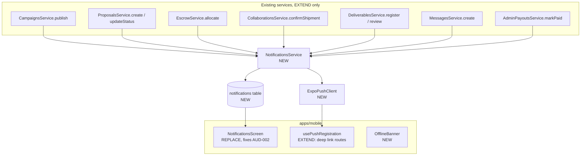
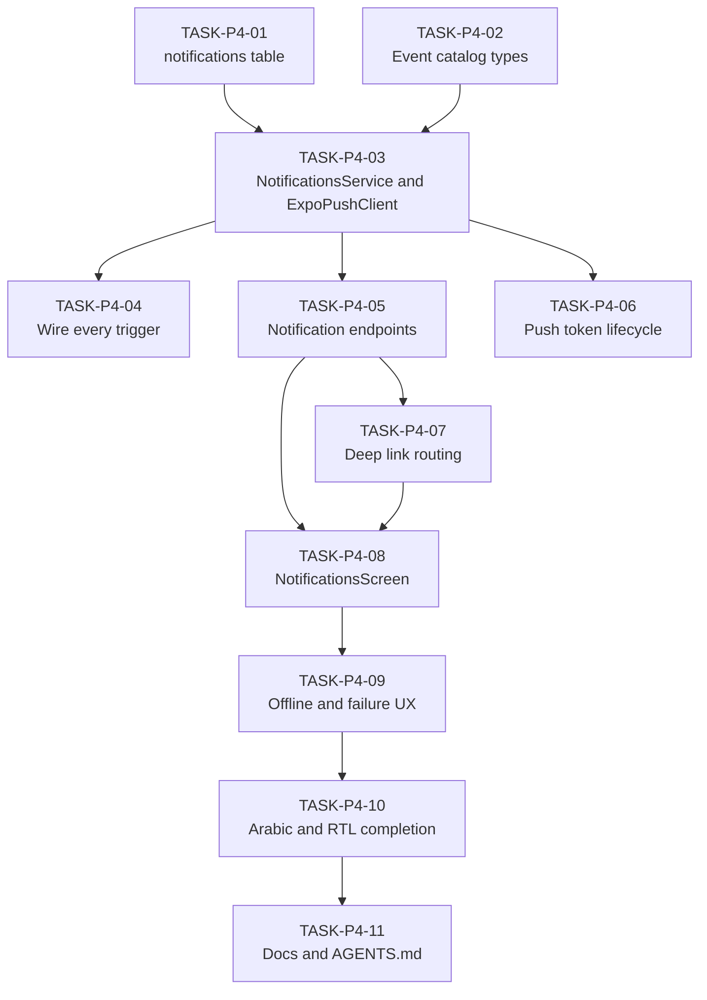
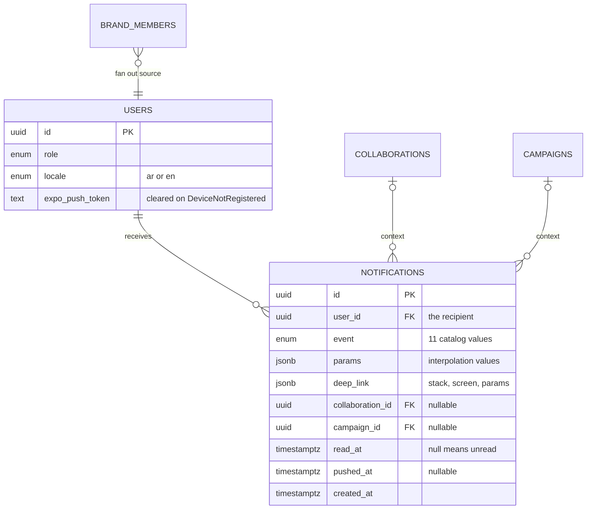
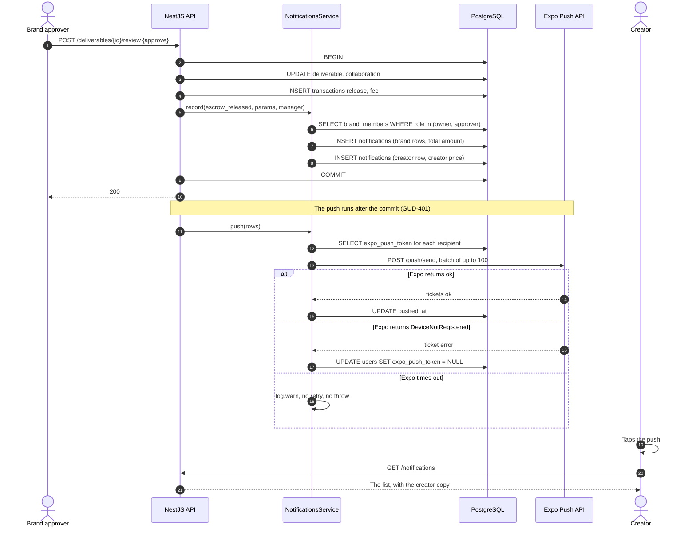
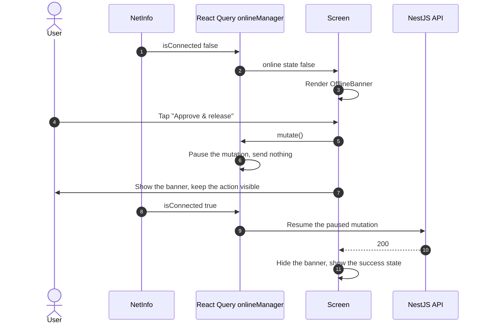

# Phase 4: Notification Event Backbone, Failure UX, and Arabic Completion

# Document Control

- **Version**: 2.0.0
- **Date Created**: 2026-09-18
- **Last Updated**: 2026-09-19
- **Status**: DONE
- **Parent**: `operations/specs/brand_flow_integration/00_overview.md`
- **Depends on**: Phase 1, Phase 2, and Phase 3
- **Artboards**: 4b brand notifications, 4h empty and error states, creator screen 15 notifications, creator screen 18 error states
- **Task count**: 11

---

# Executive Summary

- **Goal**: Define one event catalog, deliver it to both roles through push and an in app list, and finish the failure and Arabic work the earlier phases deferred.
- **Why this ships alone**: Every event this phase delivers already fires in Phase 1 through Phase 3. This phase adds the notification layer over a working product.
- **Entry condition**: Phase 3 shipped. `users.expo_push_token` exists. `usePushRegistration` already stores a token and handles a tapped notification. `NotificationsScreen` renders hard coded rows. AUD-002.
- **Exit condition**: Eleven events write one notification row per recipient, send one Expo push, deep link to the right screen, and render in a grouped list for both roles.
- **Creator sync in this phase**: The catalog is the sync. Artboard 4b and creator screen 15 are two views of the same eleven events, so one trigger serves both.

---

# Requirements

## Functional Requirements

- **REQ-401**: THE SYSTEM SHALL define one event catalog that serves both roles.
- **REQ-402**: WHEN an event fires THE SYSTEM SHALL write one notification row per recipient inside the transaction that caused the event.
- **REQ-403**: THE SYSTEM SHALL send an Expo push for every notification row whose recipient has a stored push token.
- **REQ-404**: THE SYSTEM SHALL never fail a business action because a push send failed.
- **REQ-405**: THE SYSTEM SHALL clear a stored push token when Expo reports `DeviceNotRegistered`.
- **REQ-406**: THE SYSTEM SHALL return a notification list grouped by day, newest first.
- **REQ-407**: THE SYSTEM SHALL return an unread count.
- **REQ-408**: THE SYSTEM SHALL mark one notification read and mark every notification read.
- **REQ-409**: THE SYSTEM SHALL carry a deep link target on every notification.
- **REQ-410**: THE SYSTEM SHALL open the linked screen when a user taps a push notification.
- **REQ-411**: THE SYSTEM SHALL show an offline banner and queue no write while the device has no network.
- **REQ-412**: THE SYSTEM SHALL show a retry action on every failed write.
- **REQ-413**: THE SYSTEM SHALL render every brand screen and every creator screen correctly in Arabic, right to left.

### BDD Scenarios

```gherkin
Feature: Notification event backbone

  Scenario: One event reaches both sides
    Given a brand approves a deliverable for creator Nour H.
    When the approval transaction commits
    Then one notification row exists for the brand with the event "escrow_released"
    And one notification row exists for the creator with the same event
    And the brand copy reads "Escrow of EGP 2,800 released to Nour H."
    And the creator copy reads "EGP 2,800 released — Glow Lab"
    And both rows deep link to the collaboration

  Scenario: Push failure never breaks the business action
    Given the Expo push service returns a 500 error
    When a brand approves a deliverable
    Then the approval still commits
    And the notification row still exists
    And the API logs one push failure at warn level

  Scenario: Expired push token
    Given Expo returns "DeviceNotRegistered" for a stored token
    When the send completes
    Then the API clears users.expo_push_token for that user
    And no retry is attempted

  Scenario: Notification list groups by day
    Given three notifications from today and one from yesterday
    When the brand opens the notifications screen
    Then the screen shows a "TODAY" header over three rows
    And a "YESTERDAY" header over one row
    And each unread row shows a leading dot

  Scenario: Tapping a push opens the right screen
    Given a push notification for the event "proposal_received"
    When the brand taps it from a cold start
    Then the app opens the proposals inbox for that brief

  Scenario: Offline write
    Given the device has no network
    When the brand taps "Approve & release"
    Then the screen shows an offline banner
    And the app sends no request
    And the action stays available once the network returns
```

## Security Requirements

- **SEC-401**: THE SYSTEM SHALL return a notification only to its own recipient.
- **SEC-402**: THE SYSTEM SHALL never place an amount, a name, or a message body inside a push payload beyond the copy the recipient may already read.
- **SEC-403**: THE SYSTEM SHALL never send a creator a notification that names the platform fee.
- **SEC-404**: THE SYSTEM SHALL validate an Expo push token format before it stores it.
- **SEC-405**: THE SYSTEM SHALL rate limit the mark all read endpoint, matching the existing throttler pattern.

## Constraints

- **CON-401**: `NotificationsScreen.tsx` is shared by both roles and renders a hard coded array today.
- **CON-402**: The Expo push API accepts at most 100 messages per request.
- **CON-403**: `expo-notifications` has no web implementation. `usePushRegistration` already branches on `Platform.OS`. Keep that branch.
- **CON-404**: Notification copy must live in the translation files, not in a database row, so a locale change re renders it.

## Guidelines

- **GUD-401**: Write the notification row inside the business transaction. Send the push outside it.
- **GUD-402**: One event name, two copy keys. Never two events for one business fact.
- **GUD-403**: Store interpolation parameters, never a rendered sentence.

## Patterns

- **PAT-401**: Fire and forget outbound call with a timeout and a log, matching `PaymobClient.post`.
- **PAT-402**: Append only row per recipient, matching `transactions`.
- **PAT-403**: Deep link by route name and parameters, matching `navigationRef` and `CommonActions`.

---

# The Event Catalog

This is the single source of truth. Artboard 4b and creator screen 15 both render from it. Define it once in `packages/shared-types/src/notifications.ts` and never duplicate a copy string.

| Event | Trigger | Brand recipient | Brand copy key and text | Creator recipient | Creator copy key and text | Deep link |
|---|---|---|---|---|---|---|
| `brief_published` | `CampaignsService.publish` | every active member | `notif.brand.brief_published` = "Your brief {title} is live" | none | none | `Briefs / MyBriefs` |
| `proposal_received` | `ProposalsService.create` | owner and approver | `notif.brand.proposal_received` = "{count} new proposals on {title}" | none | none | `Briefs / ProposalsInbox {campaignId}` |
| `proposal_shortlisted` | `ProposalsService.updateStatus` to `shortlisted` | none | none | the creator | `notif.creator.proposal_shortlisted` = "{brandName} shortlisted your proposal" | `Profile / MyProposals` |
| `proposal_declined` | `ProposalsService.updateStatus` to `declined`, or a bulk decline | none | none | the creator | `notif.creator.proposal_declined` = "{brandName} declined your proposal" | `Profile / MyProposals` |
| `escrow_funded` | `EscrowService.allocate` at accept | owner and approver | `notif.brand.escrow_funded` = "Escrow of EGP {total} is held for {title}" | the creator | `notif.creator.escrow_funded` = "You got the job — EGP {creatorPrice} in escrow" | `Briefs / CollaborationDetail {id}` and `Work / WorkStatus` |
| `shipment_confirmed` | `CollaborationsService.confirmShipment` | none | none | the creator | `notif.creator.shipment_confirmed` = "{brandName} shipped the product" | `Work / WorkStatus` |
| `deliverable_submitted` | `DeliverablesService.register` | owner and approver | `notif.brand.deliverable_submitted` = "{creatorName} submitted a deliverable for {title}" | none | none | `Briefs / ReviewDeliverable {deliverableId}` |
| `revision_requested` | `DeliverablesService.review`, revision branch | none | none | the creator | `notif.creator.revision_requested` = "{brandName} requested a revision" | `Work / DeliverableUpload {collaborationId}` |
| `escrow_released` | `DeliverablesService.review`, approve branch | owner and approver | `notif.brand.escrow_released` = "Escrow of EGP {total} released to {creatorName}" | the creator | `notif.creator.escrow_released` = "EGP {creatorPrice} released — {brandName}" | `Briefs / CollaborationDetail {id}` and `Earnings / Earnings` |
| `message_received` | `MessagesService.create` | the brand when the creator sent it | `notif.brand.message_received` = "{creatorName} sent a message" | the creator when the brand sent it | `notif.creator.message_received` = "{brandName} sent a message" | `CollaborationChat {collaborationId}` on both sides |
| `payout_sent` | `AdminPayoutsService.markPaid` | none | none | the creator | `notif.creator.payout_sent` = "Your payout was sent — EGP {amount} via {method}" | `Earnings / Earnings` |

Eleven events. Artboard 4b shows four of them: `deliverable_submitted`, `proposal_received`, a revision reply which is `message_received`, and `escrow_released`. Creator screen 15 shows five: `message_received`, `revision_requested`, `escrow_released`, `payout_sent`, and a vetting event. The vetting event already exists in the admin module and is out of this plan's scope. Record it as a gap rather than adding a twelfth event with no brand side.

Note the two amounts in `escrow_released`. The brand sees the total, which includes the platform fee. The creator sees the creator price. SEC-403.

---

# Dependencies

| ID | Name | Type | Version | Purpose | New |
|---|---|---|---|---|---|
| DEP-401 | Expo Push API | external | v2 | Push delivery | no, HTTP only |
| DEP-402 | `expo-notifications` | npm | ~57.0.16 | Token and tap handling, already present | no |
| DEP-403 | `@react-native-community/netinfo` | npm | the version Expo SDK 57 pins | Offline detection for REQ-411 | YES |
| DEP-404 | `expo-linking` | npm | ~57.0.9 | Deep link parsing, already present | no |

`@react-native-community/netinfo` is the only new package. `@tanstack/react-query` has an `onlineManager` that needs a network source, and React Native has no built in one. Add it with `pnpm --filter mobile add @react-native-community/netinfo`.

Do not add an Expo push SDK package to the API. The Expo push endpoint is a plain HTTPS POST to `https://exp.host/--/api/v2/push/send`. Use `fetch` with a timeout, matching `PaymobClient.post`.

---

# Plan Details

## Impact on System Design



## Decisions

| ID | Decision | Rationale | Alternatives considered | Side effect |
|---|---|---|---|---|
| DES-P4-401 | One notification row per recipient, not one row per event with a recipient list. | An unread flag and a read timestamp belong to a person, not to an event. | One event row plus a join table. Rejected because every read would need the join. | A brand with three members produces three rows for one event. That is correct. |
| DES-P4-402 | Store the event name and a parameter object. Render the copy on the client. | CON-404. A brand that switches to Arabic must see the whole history in Arabic. | Store a rendered string. Rejected because the history would freeze in one language. | The translation files own every notification string. |
| DES-P4-403 | Write the row inside the business transaction. Send the push after the commit. | A push for an event that rolled back is a lie. A failed push must not roll back money. GUD-401 and REQ-404. | Send inside the transaction. Rejected on REQ-404. | `NotificationsService` exposes two methods, one transactional and one not. |
| DES-P4-404 | The API sends push in batches of up to 100, with a 10 second timeout. | CON-402 and PAT-401. | One request per token. Rejected on request volume. | A batch failure logs every affected user id. |
| DES-P4-405 | `NotificationsScreen` serves both roles from one component, keyed on the event catalog. | Artboard 4b and creator screen 15 render the same layout. Two components would drift. | Two screens. Rejected on duplication. | The screen reads `user.role` only to pick the copy key prefix. |
| DES-P4-406 | Offline detection uses React Query's `onlineManager` with a NetInfo source. | The app already uses React Query everywhere. `onlineManager` pauses mutations for free. | A custom store. Rejected because React Query already solves it. | One new dependency. DEP-403. |
| DES-P4-407 | A deep link is a route name plus parameters, not a URL string. | PAT-403. `usePushRegistration` already uses `CommonActions` with `navigationRef`. | An `expo-linking` URL scheme. Rejected because the app already navigates by name. | The notification row stores `{ "stack": "Briefs", "screen": "ProposalsInbox", "params": {...} }`. |

## Constraints and Assumptions

| Type | ID | Description | Impact if wrong | Handling |
|---|---|---|---|---|
| Constraint | CON-P4-401 | `usePushRegistration` navigates on `collaborationId` only today. | A tap on a proposal notification would go nowhere. | Extend the handler to read the full deep link object. |
| Assumption | ASM-P4-401 | A brand has few team members, so one event produces few rows. | A large team would fan out widely. | Cap the recipient fan out at 20 members and log a warning above it. |
| Assumption | ASM-P4-402 | Expo delivers within seconds. | A user sees the in app list before the push. | The in app list is the source of truth. The push is an accelerator. |

## Edge Cases

| ID | Scenario | Expected behavior | Handling |
|---|---|---|---|
| EDGE-P4-401 | A user has no stored push token. | The row still writes. No push is sent. | Filter the batch by a non null token. |
| EDGE-P4-402 | Expo returns `DeviceNotRegistered`. | Clear the token. Do not retry. REQ-405. | Read the ticket array and match by index to the user id. |
| EDGE-P4-403 | Expo returns `MessageRateExceeded`. | Log at warn. Do not retry in this phase. | A retry queue is out of scope. State it. |
| EDGE-P4-404 | The whole push request times out. | Log at warn. The business action already committed. | PAT-401 with a 10 second abort. |
| EDGE-P4-405 | A user taps a push for a collaboration they no longer own. | The screen shows a 404 state, not a crash. | `ErrorState` with a "Back to home" action. |
| EDGE-P4-406 | The notification list is empty. | An empty state reads "Nothing new". | `EmptyState` with the icon `bell`. |
| EDGE-P4-407 | The device goes offline mid upload. | The upload screen shows the creator screen 18 failed state with a retry. | Already designed. Wire it to the real failure. |
| EDGE-P4-408 | The device goes offline before an approve. | An offline banner appears. The action sends nothing. REQ-411. | `onlineManager` pauses the mutation. Show the banner from `useIsOnline`. |
| EDGE-P4-409 | A push arrives while the app is in the foreground. | Show an in app banner, not a system alert. | Set a notification handler that suppresses the alert in the foreground. |
| EDGE-P4-410 | An Arabic user reads an amount inside a sentence. | The digits render Latin and left to right inside the Arabic run. | `DESIGN.md` RTL rule 5. The copy key splits the amount into its own interpolation slot. |

---

# Directory Map

```text
apps/
├── api/src/
│   ├── migrations/
│   │   └── 1788600000006-CreateNotifications.ts        NEW
│   └── modules/
│       ├── notifications/                              NEW MODULE
│       │   ├── notifications.module.ts                 NEW
│       │   ├── notifications.controller.ts             NEW
│       │   ├── notifications.service.ts                NEW
│       │   ├── notifications.service.spec.ts           NEW
│       │   ├── expo-push.client.ts                     NEW
│       │   ├── expo-push.client.spec.ts                NEW
│       │   ├── notification-events.ts                  NEW
│       │   ├── dto/list-notifications-query.dto.ts     NEW
│       │   └── entities/notification.entity.ts         NEW
│       ├── campaigns/campaigns.service.ts              EXTEND
│       ├── proposals/proposals.service.ts              EXTEND
│       ├── escrow/escrow.service.ts                    EXTEND
│       ├── collaborations/collaborations.service.ts    EXTEND
│       ├── deliverables/deliverables.service.ts        EXTEND
│       ├── messages/messages.service.ts                EXTEND
│       ├── admin/admin-payouts.service.ts              EXTEND
│       └── users/users.service.ts                      EXTEND
├── mobile/src/
│   ├── components/
│   │   └── OfflineBanner.tsx                           NEW
│   ├── hooks/
│   │   ├── usePushRegistration.ts                      EXTEND
│   │   └── useIsOnline.ts                              NEW
│   ├── hooks/api/
│   │   └── useNotifications.ts                         NEW
│   ├── services/queryClient.ts                         EXTEND
│   ├── i18n/{en,ar}.json                               EXTEND
│   ├── App.tsx                                         EXTEND
│   └── screens/
│       ├── shared/NotificationsScreen.tsx              REPLACE, fixes AUD-002
│       └── creator/UploadFailedStateScreen.tsx         EXTEND
└── packages/shared-types/src/
    ├── notifications.ts                                NEW
    └── index.ts                                        EXTEND
```

---

# Task Sequence



---

# Directory Specifications

## TASK-P4-01: Notifications table

- **Verdict**: NEW. No notification entity exists. Only `users.expo_push_token` and a token endpoint exist.
- **Files**: `apps/api/src/modules/notifications/entities/notification.entity.ts` (NEW), `apps/api/src/migrations/1788600000006-CreateNotifications.ts` (NEW).

### Data model

Table `notifications`:

| Column | Type | Nullable | Default | Notes |
|---|---|---|---|---|
| `id` | uuid | no | `gen_random_uuid()` | primary key |
| `user_id` | uuid | no | none | references `users(id)` on delete cascade. The recipient. DES-P4-401. |
| `event` | `notifications_event_enum` | no | none | one of the eleven catalog names |
| `params` | jsonb | no | `'{}'` | interpolation values. DES-P4-402. |
| `deep_link` | jsonb | yes | null | `{ stack, screen, params }`. DES-P4-407. |
| `collaboration_id` | uuid | yes | null | references `collaborations(id)` on delete cascade |
| `campaign_id` | uuid | yes | null | references `campaigns(id)` on delete cascade |
| `read_at` | timestamptz | yes | null | null means unread |
| `pushed_at` | timestamptz | yes | null | set after a successful Expo ticket |
| `created_at` | timestamptz | no | `now()` | |

Indexes:

| Name | Definition | Purpose |
|---|---|---|
| `idx_notifications_user_created` | `("user_id", "created_at" DESC)` | the list query |
| `idx_notifications_user_unread` | `("user_id") WHERE "read_at" IS NULL` | the unread count |

The enum type `notifications_event_enum` holds the eleven catalog values. Adding a twelfth later is an additive `ALTER TYPE`, which is low risk.

`params` is `jsonb`, not `text`. A future query on a parameter stays possible, and PostgreSQL validates the shape on insert.

### Migration

File `1788600000006-CreateNotifications.ts`, class `CreateNotifications1788600000006`.

1. Create the enum type with the eleven values.
2. Create the table.
3. Create both indexes.
4. In `down`, drop the table, then drop the enum.

No backfill. History starts at the migration.

### Test cases

Covered by `notifications.service.spec.ts` in TASK-P4-03.

### Acceptance criteria

1. `migration:run` and `migration:revert` both succeed with no residue.
2. `SELECT unnest(enum_range(NULL::notifications_event_enum))` returns exactly eleven values.

---

## TASK-P4-02: Event catalog in shared types

- **Verdict**: NEW file. EXTEND `index.ts`.
- **Files**: `packages/shared-types/src/notifications.ts` (NEW), `packages/shared-types/src/index.ts`.

```ts
// packages/shared-types/src/notifications.ts  (NEW)

/** The one catalog. Both roles and both apps read it. DEC-007. */
export type NotificationEvent =
  | 'brief_published'
  | 'proposal_received'
  | 'proposal_shortlisted'
  | 'proposal_declined'
  | 'escrow_funded'
  | 'shipment_confirmed'
  | 'deliverable_submitted'
  | 'revision_requested'
  | 'escrow_released'
  | 'message_received'
  | 'payout_sent';

export interface NotificationDeepLink {
  stack: string;
  screen: string;
  params?: Record<string, string>;
}

export interface AppNotification {
  id: string;
  event: NotificationEvent;
  params: Record<string, string | number>;
  deepLink: NotificationDeepLink | null;
  collaborationId: string | null;
  campaignId: string | null;
  readAt: string | null;
  createdAt: string;
}

/** GET /api/v1/notifications groups on the client, so the API returns a flat list. */
export interface ListNotificationsRequest { page?: number; perPage?: number; unreadOnly?: boolean; }

export interface UnreadCountResponse { unread: number; }
```

The copy string does not live here. It lives in `apps/mobile/src/i18n/{en,ar}.json` under `notif.brand.*` and `notif.creator.*`. DES-P4-402.

### Acceptance criteria

1. `pnpm --filter @ugcx/shared-types build` emits `notifications.d.ts`.
2. The eleven values in the type match the eleven values in the database enum exactly. Add a test in `notifications.service.spec.ts` that asserts the enum arrays are equal.

---

## TASK-P4-03: NotificationsService and ExpoPushClient

- **Verdict**: NEW module and two NEW providers.
- **Files**: `apps/api/src/modules/notifications/notifications.module.ts`, `notifications.service.ts`, `expo-push.client.ts`, `notification-events.ts`, plus the two spec files, all NEW.

### Recipient resolution

`notification-events.ts` holds one table, keyed by event, that answers who receives it.

```ts
export type Audience = 'brand_team' | 'brand_owner_approver' | 'creator';

export const EVENT_AUDIENCE: Record<NotificationEvent, Audience[]> = {
  brief_published:       ['brand_team'],
  proposal_received:     ['brand_owner_approver'],
  proposal_shortlisted:  ['creator'],
  proposal_declined:     ['creator'],
  escrow_funded:         ['brand_owner_approver', 'creator'],
  shipment_confirmed:    ['creator'],
  deliverable_submitted: ['brand_owner_approver'],
  revision_requested:    ['creator'],
  escrow_released:       ['brand_owner_approver', 'creator'],
  message_received:      [],  // resolved per message, the other participant only
  payout_sent:           ['creator'],
};
```

`message_received` is the one exception. Its recipient is the participant who did not send the message, so the caller passes an explicit user id.

### Service surface

```ts
@Injectable()
export class NotificationsService {
  /**
   * REQ-402, GUD-401. Writes one row per recipient inside the caller's
   * transaction. Returns the rows so the caller can hand them to push()
   * after the commit. Never sends a push itself.
   */
  async record(
    input: {
      event: NotificationEvent;
      params: Record<string, string | number>;
      brandId?: string;
      creatorUserId?: string;
      explicitUserIds?: string[];
      collaborationId?: string;
      campaignId?: string;
      deepLinkByRole: { brand?: NotificationDeepLink; creator?: NotificationDeepLink };
    },
    manager: EntityManager,
  ): Promise<Notification[]>;

  /**
   * REQ-403, REQ-404. Sends the Expo pushes for the given rows. Never
   * throws. Every failure logs and returns. Call it after the commit.
   */
  async push(notifications: Notification[]): Promise<void>;

  async list(userId: string, page: number, perPage: number, unreadOnly: boolean);
  async unreadCount(userId: string): Promise<number>;
  async markRead(userId: string, id: string): Promise<void>;
  async markAllRead(userId: string): Promise<number>;
}
```

The two step shape is the whole point. A caller writes inside its transaction, commits, then pushes. Write that rule at the top of the file.

Recipient expansion:

1. `brand_team` reads `brand_members` where the brand matches and the status is `active`.
2. `brand_owner_approver` reads the same table with the role in `('owner','approver')`.
3. `creator` resolves the creator user id from the collaboration or the proposal.
4. Cap the fan out at 20 rows and log a warning above it. ASM-P4-401.

### ExpoPushClient

```ts
@Injectable()
export class ExpoPushClient {
  /**
   * PAT-401. POSTs to https://exp.host/--/api/v2/push/send in batches of
   * 100, with a 10 second abort. Returns the per message ticket status so
   * the caller can clear a dead token. Never throws.
   */
  async send(messages: ExpoPushMessage[]): Promise<ExpoPushTicket[]>;
}

interface ExpoPushMessage {
  to: string;          // the Expo push token
  title: string;
  body: string;
  data: { notificationId: string; deepLink: NotificationDeepLink | null };
  sound?: 'default';
}

interface ExpoPushTicket { status: 'ok' | 'error'; id?: string; details?: { error?: string }; }
```

Copy the shape of `PaymobClient.post`: an `AbortController`, a `clearTimeout` in a `finally`, a status check, and a log that never includes the payload. Reuse the structure, not the file.

The push title and body must come from somewhere. The API has no translation files. Two options:

1. Send a generic title and let the client render the detail from the in app list.
2. Duplicate the copy in the API.

Choose option 1 with one refinement. Send a short English title keyed on the event, plus the deep link in `data`. The client renders the full copy in the list. A user who taps lands on the right screen and reads the localized copy there. This avoids duplicating eleven strings in two languages inside the API, which would drift from the translation files. Record it as a known limitation: the push text is English only in this phase.

Add `apps/api/src/modules/notifications/push-copy.ts` with an eleven entry map of short English titles, for example `proposal_received` to "New proposal". Keep the bodies short and free of amounts and names. SEC-402.

### Test cases

`notifications.service.spec.ts` (NEW):

1. `record` for `escrow_released` writes two rows, one for the brand approver and one for the creator.
2. `record` for a three member brand on `brief_published` writes three rows.
3. `record` writes with the caller's manager. Assert the repository comes from the manager.
4. `record` stores `params` and `deep_link` and never a rendered sentence.
5. `push` skips a user with a null token.
6. `push` never throws when the client rejects.
7. The service enum list equals the database enum list.
8. The fan out caps at 20 and logs a warning.

`expo-push.client.spec.ts` (NEW), with `fetch` mocked:

9. 250 messages produce 3 requests.
10. A timeout logs at warn and returns an empty ticket array.
11. The log never contains a push token.

### Acceptance criteria

1. `pnpm --filter api test` reports 11 passing cases across the two spec files.
2. No test contacts `exp.host`.
3. `grep -n "expo_push_token" apps/api/src/modules/notifications/*.ts` shows the token only inside the send path, never in a log line.

---

## TASK-P4-04: Wire every trigger

- **Verdict**: EXTEND. Seven existing services gain a `record` call and a post commit `push` call.
- **Files**: `campaigns.service.ts`, `proposals.service.ts`, `escrow.service.ts`, `collaborations.service.ts`, `deliverables.service.ts`, `messages.service.ts`, `admin-payouts.service.ts`.

### Wiring table

| Service and method | Event | Inside the transaction | After the commit |
|---|---|---|---|
| `CampaignsService.publish` | `brief_published` | `record` | `push` |
| `ProposalsService.create` | `proposal_received` | `record` | `push` |
| `ProposalsService.updateStatus` | `proposal_shortlisted` or `proposal_declined` | `record` | `push` |
| `ProposalsService.declineAllOpenForCampaign` | `proposal_declined` per creator | `record` | `push` |
| `CollaborationsService.acceptProposal` | `escrow_funded` | `record` | `push` |
| `CollaborationsService.confirmShipment` | `shipment_confirmed` | `record` | `push` |
| `DeliverablesService.register` | `deliverable_submitted` | `record` | `push` |
| `DeliverablesService.review` revision branch | `revision_requested` | `record` | `push` |
| `DeliverablesService.review` approve branch | `escrow_released` | `record` | `push` |
| `MessagesService.create` | `message_received` | `record` with an explicit user id | `push` |
| `AdminPayoutsService.markPaid` | `payout_sent` | `record` | `push` |

Several of these methods do not open a transaction today. `CampaignsService.publish` and `ProposalsService.create` both use a bare `save`. Wrap each in a `dataSource.transaction` so the notification row and the business row commit together. That is a small, contained change in each method.

`CollaborationsService.acceptProposal` already opens a transaction after Phase 2. Add the `record` call inside it and the `push` call after it returns.

`ProposalsService.create` needs a count for the copy "3 new proposals on Baby wash routine". Count the open proposals inside the same transaction and pass it as a parameter.

### Message deduplication

`message_received` fires per message. A chat burst would produce ten pushes. Add one rule: skip the `record` call when an unread `message_received` notification already exists for the same recipient and the same collaboration. That is one indexed read inside the transaction and it removes the burst. State the rule in a comment.

### Test cases

Extend each service spec with one case:

1. `publish` records `brief_published` for every active member.
2. `ProposalsService.create` records `proposal_received` with the open proposal count.
3. `acceptProposal` records `escrow_funded` for both sides.
4. `review` approve records `escrow_released` with the total for the brand and the price for the creator.
5. `review` revision records `revision_requested` for the creator only.
6. `MessagesService.create` records nothing when an unread `message_received` already exists.
7. `markPaid` records `payout_sent` with the method and the amount.
8. A `push` failure never rolls back the business row. Assert the business row still exists after a rejected client.

### Acceptance criteria

1. A full brand loop from publish to payout produces exactly eleven distinct event names in the `notifications` table.
2. Approving a deliverable writes the brand row with the total and the creator row with the price. Prove it with a query on `params`.
3. `pnpm --filter api test` passes with the eight new cases.

---

## TASK-P4-05: Notification endpoints

- **Verdict**: NEW controller.
- **Files**: `apps/api/src/modules/notifications/notifications.controller.ts` (NEW), `apps/api/src/modules/notifications/dto/list-notifications-query.dto.ts` (NEW).

### API contracts

#### GET /api/v1/notifications

- **Auth**: `JwtAuthGuard`. No role restriction. Every role reads its own list.
- **Query DTO**: `ListNotificationsQueryDto extends PaginationQueryDto` with one extra field `unreadOnly`, optional, `@IsBoolean`, `@Type(() => Boolean)`.
- **Success**: 200, the `paginate()` envelope of `AppNotification`, newest first.
- **Errors**: 401 only.
- SEC-401: the query filters on `user_id` from the token. Never accept a user id from the request.

#### GET /api/v1/notifications/unread-count

- **Success**: 200, `{ "data": { "unread": 3 } }`.
- The partial index `idx_notifications_user_unread` serves it.

#### POST /api/v1/notifications/{id}/read

- **Success**: 204.
- **Errors**: 404 `not_found` when the row belongs to another user. Never 403, so a user cannot probe for a row id.
- Idempotent. A second call leaves `read_at` unchanged.

#### POST /api/v1/notifications/read-all

- **Auth**: `JwtAuthGuard` plus `ThrottlerGuard` at 5 requests per 60 seconds. SEC-405. Follow the `StorageController` pattern with `@Throttle`.
- **Success**: 200, `{ "data": { "marked": 12 } }`.

### Grouping

The API returns a flat list. The client groups by day. Artboard 4b headers read "TODAY" and "YESTERDAY" in a monospace overline. That is presentation, and the client owns it. Do not return a grouped structure that pins a time zone in the API.

### Test cases

Extend `notifications.service.spec.ts`:

1. `list` returns only the caller's rows.
2. `list` with `unreadOnly` filters on a null `read_at`.
3. `markRead` on another user's row throws `NotFoundException`.
4. `markRead` twice leaves the first timestamp.
5. `markAllRead` returns the affected count.

### Acceptance criteria

1. A user with 3 unread and 5 read rows receives `{"unread": 3}`.
2. A second user never sees the first user's rows. Prove it with a two user fixture.
3. The sixth `read-all` call in a minute returns 429.

---

## TASK-P4-06: Push token lifecycle

- **Verdict**: EXTEND `users.service.ts` and `update-push-token.dto.ts`. Both exist.
- **Files**: `apps/api/src/modules/users/users.service.ts`, `apps/api/src/modules/users/dto/update-push-token.dto.ts`, `apps/api/src/modules/notifications/notifications.service.ts`.

### Token validation

SEC-404. An Expo token has the shape `ExponentPushToken[xxxxxxxxxxxxxxxxxxxxxx]` or `ExpoPushToken[...]`. Add a `@Matches` rule to the DTO:

```ts
@Matches(/^Expo(nent)?PushToken\[[A-Za-z0-9_-]+\]$/)
expoPushToken: string;
```

Reject anything else with 400 `validation_error`. An unvalidated token would send a request per event to Expo that can never succeed.

### Token cleanup

REQ-405 and EDGE-P4-402. After `ExpoPushClient.send` returns, walk the ticket array by index. When `details.error` equals `DeviceNotRegistered`, call `usersService.clearPushToken(userId)`.

```ts
/** REQ-405: clears a dead Expo token so the next event skips the send. */
async clearPushToken(userId: string): Promise<void>;
```

Add a logout hook. `useLogout` on the client should call `POST /users/me/push-token` with a null token, so a shared device does not keep delivering to the previous account. Widen the DTO to accept null, or add `DELETE /users/me/push-token`. Prefer the delete route. It is clearer and it does not weaken the validation rule above.

#### DELETE /api/v1/users/me/push-token

- **Auth**: `JwtAuthGuard`.
- **Success**: 204.

### Test cases

Extend `users.service.spec.ts`:

1. A malformed token is rejected by the DTO rule.
2. `clearPushToken` sets the column to null.
3. A `DeviceNotRegistered` ticket triggers exactly one `clearPushToken` call for the matching user.
4. An `ok` ticket triggers no clear call.

### Acceptance criteria

1. A token of `"abc"` returns 400.
2. A logout clears the stored token. Prove it with a database read.
3. A dead token is cleared after one failed send, and the next event sends nothing for that user.

---

## TASK-P4-07: Deep link routing

- **Verdict**: EXTEND `usePushRegistration.ts`. The hook already handles `useLastNotificationResponse` and navigates on `collaborationId`. CON-P4-401.
- **Files**: `apps/mobile/src/hooks/usePushRegistration.ts`, `apps/mobile/src/navigation/navigationRef.ts`.

### Current behavior

The hook reads `NotificationData` with an optional `collaborationId` and dispatches a `CommonActions` navigate. That covers one of eleven events.

### New behavior

1. Read `deepLink` from the notification `data` payload.
2. Validate it against a route allow list. A push payload is untrusted input, and a raw route name from the network must never reach `navigate`.
3. Dispatch `CommonActions.navigate({ name: stack, params: { screen, params } })`.
4. Keep the `collaborationId` branch as a fallback, so an old push still works.
5. Wrap every step in the existing try and catch. A bad payload must never crash the app. The hook already fails soft. Keep that.

```ts
const ALLOWED_DEEP_LINKS: Record<string, string[]> = {
  BriefsTab:    ['MyBriefs', 'ProposalsInbox', 'CollaborationDetail', 'ReviewDeliverable', 'CollaborationChat'],
  ProposalsTab: ['ProposalsAcrossBriefs', 'ProposalsInbox', 'CreatorProfilePreview'],
  ChatsTab:     ['BrandChats', 'CollaborationChat'],
  DashboardTab: ['BrandDashboard', 'Notifications'],
  HomeTab:      ['Home', 'Notifications'],
  DiscoverTab:  ['Discover', 'CampaignDetail'],
  WorkTab:      ['WorkStatus', 'DeliverableUpload', 'CollaborationChat'],
  EarningsTab:  ['Earnings'],
  ProfileTab:   ['Profile', 'MyProposals', 'Settings', 'BrandProfile', 'BrandTeam', 'BrandBilling'],
};
```

A stack or screen outside the list logs and drops the navigation.

### Foreground handler

EDGE-P4-409. Set a notification handler in `App.tsx` that returns `shouldShowAlert: false` while the app is in the foreground, and invalidate the `['notifications']` query key instead. The list updates and a small in app banner appears. A system alert over a screen the user is already reading is noise.

### Test cases

`usePushRegistration.test.ts` (NEW):

1. A valid deep link dispatches a navigate with the stack and the screen.
2. A stack outside the allow list dispatches nothing and logs.
3. A payload with only `collaborationId` still navigates, for backward compatibility.
4. A malformed payload never throws.

### Acceptance criteria

1. Tapping a `proposal_received` push from a cold start opens the proposals inbox for the right brief.
2. Tapping a `revision_requested` push opens the creator upload screen for the right collaboration.
3. A crafted payload naming an unknown route changes nothing.

---

## TASK-P4-08: Notifications screen

- **Verdict**: REPLACE. `apps/mobile/src/screens/shared/NotificationsScreen.tsx` renders a hard coded `SECTIONS` array. AUD-002.
- **Files**: `apps/mobile/src/screens/shared/NotificationsScreen.tsx`, `apps/mobile/src/hooks/api/useNotifications.ts` (NEW).

### Artboard 4b and creator screen 15, element by element

Both artboards draw the same layout, with one difference. Artboard 4b wraps each day group in a bordered rounded container. Creator screen 15 uses plain rows with a bottom hairline. Follow artboard 4b, because it is the newer of the two and it reads better with a long list. Record the difference in the review note.

| Element | Copy or values | Component | Token |
|---|---|---|---|
| Header | "Notifications" | Stack header, 48 high, 1px `hairline` bottom border | |
| Day header | "TODAY", "YESTERDAY", or a date | `AppText variant="overline"` | monospace, 12, letter spacing 0.5, `colors.muted` |
| Group container | one bordered container per day | `Card` | 1px `hairline`, `radius.md`, overflow hidden |
| Row | dot, text, meta | a row inside the container | 14 vertical, 16 horizontal padding |
| Unread dot | 8 by 8 circle | `View` | `colors.ink` on the brand side per artboard 4b, `colors.coral` on the creator side per creator screen 15 |
| Row text | the rendered copy | `AppText variant="body"` | `colors.ink` when unread, `colors.body` when read |
| Row meta | a relative time such as "1h ago" | `AppText variant="caption" color="muted"` | |
| Separator | 1px hairline between rows, none after the last | | |

The unread dot color differs by role. Both artboards are explicit. Read `user.role` for that one value only.

### Copy rendering

```tsx
const prefix = user.role === 'brand' ? 'notif.brand.' : 'notif.creator.';
const text = t(prefix + item.event, item.params);
```

Each key takes named interpolation values. Write every amount as its own slot, never concatenated into the sentence. `DESIGN.md` RTL rule 5 and EDGE-P4-410. For example:

```json
"notif.brand.escrow_released": "Escrow of {{currency}} {{total}} released to {{creatorName}}"
```

React i18next renders the interpolation as a separate text node when the value is wrapped with `Trans`, or as a plain substitution otherwise. Use plain substitution and set the amount string with Latin digits from `Intl.NumberFormat('en-US')`. Do not use an Arabic numeral locale for money.

### States

| State | Render |
|---|---|
| Loading | Three grey skeleton rows |
| Error | `ErrorState` with a retry action |
| Empty | `EmptyState` with the icon `bell`, the title `notif.empty.title`, and the message `notif.empty.message`. EDGE-P4-406. |
| Read all | A header action "Mark all read", shown only when the unread count is above zero |

### Behavior

1. Fetch with `useNotifications()`, page size 30.
2. Group by day on the client, using the device time zone.
3. Mark a row read on tap, then navigate with the same allow list TASK-P4-07 defines.
4. Pull to refresh.
5. Invalidate `['notifications']` when a foreground push arrives.

### Badge

Show the unread count on the Dashboard tab for a brand and the Home tab for a creator. `useUnreadCount()` polls every 60 seconds while the app is in the foreground. Creator screen 05 already draws a bell with a dot. Wire that dot to the same hook.

### Hooks

```ts
// apps/mobile/src/hooks/api/useNotifications.ts  (NEW)
export function useNotifications(unreadOnly?: boolean);
export function useUnreadCount();
export function useMarkNotificationRead();
export function useMarkAllNotificationsRead();
```

### Test cases

`NotificationsScreen.test.tsx` (NEW):

1. Rows from today render under a "TODAY" header.
2. An unread row renders the dot at full opacity and a read row hides it.
3. A brand user sees the brand copy for `escrow_released` and a creator user sees the creator copy.
4. The empty state renders for an empty list.
5. Tapping a row calls `markRead` once and navigates once.

### Acceptance criteria

1. `grep -n "const SECTIONS" apps/mobile/src/screens/shared/NotificationsScreen.tsx` returns nothing.
2. A brand and a creator open the same event and read two different sentences.
3. The unread badge clears after "Mark all read" within one refetch.
4. An English and an Arabic screenshot pair exists for both roles.

---

## TASK-P4-09: Offline and failure UX

- **Verdict**: NEW `OfflineBanner` and `useIsOnline`. EXTEND `queryClient.ts`, `App.tsx`, and `UploadFailedStateScreen.tsx`.
- **Files**: `apps/mobile/src/components/OfflineBanner.tsx` (NEW), `apps/mobile/src/hooks/useIsOnline.ts` (NEW), `apps/mobile/src/services/queryClient.ts`, `apps/mobile/src/App.tsx`, `apps/mobile/src/screens/creator/UploadFailedStateScreen.tsx`.

### Online manager

DES-P4-406. Wire React Query's `onlineManager` to NetInfo once, in `queryClient.ts`.

```ts
import NetInfo from '@react-native-community/netinfo';
import { onlineManager } from '@tanstack/react-query';

onlineManager.setEventListener((setOnline) =>
  NetInfo.addEventListener((state) => setOnline(Boolean(state.isConnected))),
);
```

React Query then pauses every mutation while the device is offline. REQ-411 is satisfied for every write in the app with five lines, not with a check in each screen.

### OfflineBanner

| Element | Copy | Component | Token |
|---|---|---|---|
| Banner | "No connection. We will retry when you are back online." | a full width `View` under the header | `colors.dangerSurface` background, `colors.danger` text |

Render it from `App.tsx`, above the navigator, so every screen shows it. Animate nothing. `DESIGN.md` prefers calm over motion.

### Failure states

Artboard 4h shows two brand states. Phase 1 built the empty briefs state. Phase 2 built the charge declined state. This task covers the remaining failure surfaces.

| Surface | State | Copy |
|---|---|---|
| Any list | Fetch failed | `ErrorState` with a retry action |
| Any write | Mutation failed | An inline message from `parseApiError(error).message`, plus a retry action |
| Deliverable upload | Upload failed mid transfer | Creator screen 18's state: a danger banner, the file row with a red progress bar at the failure percent, and "Retry upload" |
| Video playback | Player error | `ErrorState` inside the video surface, with the approve action disabled |

`UploadFailedStateScreen.tsx` exists as a static screen today. Convert it into a state inside `DeliverableUploadScreen`, driven by the real upload progress. A separate route for an error state is the wrong shape, because the user must not lose the form.

`uploadFileToPresignedUrl` gives no progress today. `FileSystem.uploadAsync` supports `createUploadTask` with a progress callback. Switch to `createUploadTask` so the progress bar shows a real percent, and so a failure reports the percent creator screen 18 draws.

### Test cases

1. `OfflineBanner.test.tsx`: the banner renders when `useIsOnline` returns false.
2. `DeliverableUploadScreen.test.tsx`: a failed upload renders the danger banner with the failure percent.
3. `DeliverableUploadScreen.test.tsx`: the retry action restarts the upload from zero and clears the error.
4. `queryClient.test.ts`: `onlineManager` receives a listener on import.

### Acceptance criteria

1. Turning off the network shows the banner within two seconds.
2. An approve tap while offline sends no request and shows the banner.
3. An upload that fails at 42 percent shows "Failed at 42%" and a retry action.
4. Restoring the network resumes a paused mutation with no user action.

---

## TASK-P4-10: Arabic and RTL completion

- **Verdict**: EXTEND every screen this plan created. This is the DEC-012 gate.
- **Files**: `apps/mobile/src/i18n/en.json`, `apps/mobile/src/i18n/ar.json`, `apps/mobile/src/i18n/index.test.ts`, every new screen file.

### Translation completeness

1. Every key added in Phase 1, Phase 2, Phase 3, and Phase 4 exists in both files.
2. No Arabic value equals its English counterpart, except a proper noun and a currency code.
3. Add the eleven `notif.brand.*` keys and the eleven `notif.creator.*` keys, minus the events with no recipient on that side. The exact count is 6 brand keys and 9 creator keys, from the catalog table.
4. Add the five `chat.system.*` keys from Phase 3 if they are not already in both files.

### RTL audit

Run this check across the whole `apps/mobile/src` tree and fix every hit.

```bash
grep -rnE "marginLeft|marginRight|paddingLeft|paddingRight|borderLeftWidth|borderRightWidth|textAlign: *'(left|right)'|flexDirection: *'row-reverse'" apps/mobile/src
```

The command must return nothing. Add it as an npm script `lint:rtl` in `apps/mobile/package.json`, so the check runs in CI rather than by memory.

### Directional icons

`Icon.tsx` already takes a `directional` prop. Audit every usage:

| Icon | Directional |
|---|---|
| `chevron-right`, `chevron-left`, `arrow-left`, `arrow-right`, `send` | yes |
| `search`, `check`, `plus`, `bell`, `user`, `home`, `dollar-sign`, `briefcase`, `file-text`, `message-circle` | no |

### Money and count rendering

`DESIGN.md` RTL rule 5. Every amount and every count renders Latin digits in its own `AppText` node. Add a shared helper.

```ts
// apps/mobile/src/utils/format.ts  (EXTEND, the file exists)
/** Latin digits, grouped, no currency symbol. RTL rule 5. */
export function formatAmount(value: string): string;
/** Latin digits, no grouping. */
export function formatCount(value: number): string;
```

Replace every inline `toLocaleString` call with these two helpers.

### Screenshot pairs

DEC-012. Capture an English and an Arabic screenshot for every screen this plan created or replaced. The list:

`BrandSetupScreen`, `BrandPhoneVerificationScreen`, `PostBriefScreen`, `MyBriefsScreen`, `BrandTeamScreen`, `FundEscrowScreen`, `EditLiveBriefScreen`, `BrandBillingScreen`, `CreatorProfilePreviewScreen`, `ReviewDeliverableScreen`, `BrandDashboardScreen`, `BrandChatsScreen`, `BrandProfileScreen`, `NotificationsScreen` for both roles, and `DeliverableUploadScreen`.

Sixteen screens, thirty two screenshots. Store them under `operations/design_handoff_creator_app/screenshots/brand/`.

### Test cases

Extend `apps/mobile/src/i18n/index.test.ts`:

1. Key parity between `en.json` and `ar.json`, in both directions.
2. No Arabic value equals its English counterpart, with an allow list for `EGP` and proper nouns.
3. Every `NotificationEvent` value has a copy key for at least one role.
4. Every `SystemMessageEvent` value has a `chat.system.*` key.

### Acceptance criteria

1. `pnpm --filter mobile lint:rtl` exits 0.
2. `pnpm --filter mobile test` passes the four i18n cases.
3. Thirty two screenshots exist and each Arabic image mirrors its English pair.
4. No screen shows an untranslated English string in the Arabic build.

---

## TASK-P4-11: Documentation and AGENTS.md

- **Verdict**: EXTEND `AGENTS.md`, `CLAUDE.md`, `DESIGN.md`, and `README.md`.
- **Files**: `AGENTS.md`, `CLAUDE.md`, `DESIGN.md`, `README.md`.

### AGENTS.md and CLAUDE.md

The current `AGENTS.md` points at `operations/specs/brand_flow_integration/plan_phase_1.md` as the active plan. Replace the pointer with the phase set.

Add a short section that records the facts a future agent must not rediscover:

1. Escrow funds at the campaign, not at the collaboration. DEC-001.
2. `transactions` is the only ledger. DEC-002.
3. Brand team roles live in `brand_members` and are enforced by `BrandRoleGuard`, not by the JWT. DEC-005 and DEC-006.
4. The notification event catalog lives in `packages/shared-types/src/notifications.ts`. DEC-007.
5. Money is `numeric(10,2)` strings and integer cents through `common/utils/money.ts`. DEC-003.
6. Every new mobile screen ships an English and an Arabic screenshot. DEC-012.

Keep the existing style rules, the Iron Law, and the STE writing rules unchanged. Do not shorten them.

### DESIGN.md

Add four short subsections under the Mobile and RTL Addendum. Each one records a spec the brand artboards introduce and the current document does not carry.

1. **Brief status pill map**, the five campaign statuses and their tone tokens, from TASK-P1-09.
2. **Escrow and billing surfaces**, the dark `SignatureCard` for a total, and the ledger row with a signed amount in `ink` or `success`.
3. **Team row spec**, the 36 avatar, the three role labels, and the invited suffix.
4. **Notification row spec**, the day group container, the leading dot, and the two dot colors by role.

Keep every value in tokens. Do not add a hex value that is not already in `theme/tokens.ts`.

### README.md

Add two lines to the setup steps. One for `PLATFORM_FEE_RATE` and one for `CAMPAIGN_DEFAULT_OPEN_DAYS` and `REPORTING_TIME_ZONE`. The README already lists the six setup steps. Extend step 1, do not add a seventh step.

### Acceptance criteria

1. `AGENTS.md` names the phase set and the six facts.
2. `DESIGN.md` carries the four new subsections and no new hex value.
3. `grep -n "plan_phase_1.md" AGENTS.md` shows the new pointer, not the old single file reference.

---

# Schemas

## Notification entity

```ts
// apps/api/src/modules/notifications/entities/notification.entity.ts
@Entity('notifications')
export class Notification {
  @PrimaryGeneratedColumn('uuid') id: string;

  @Index() @Column({ name: 'user_id' }) userId: string;
  @ManyToOne(() => User, { onDelete: 'CASCADE' })
  @JoinColumn({ name: 'user_id' }) user: User;

  @Column({ type: 'enum', enum: NotificationEvent, enumName: 'notifications_event_enum' })
  event: NotificationEvent;

  @Column({ type: 'jsonb', default: {} })
  params: Record<string, string | number>;

  @Column({ name: 'deep_link', type: 'jsonb', nullable: true })
  deepLink: NotificationDeepLink | null;

  @Column({ name: 'collaboration_id', type: 'uuid', nullable: true })
  collaborationId: string | null;

  @Column({ name: 'campaign_id', type: 'uuid', nullable: true })
  campaignId: string | null;

  @Column({ name: 'read_at', type: 'timestamptz', nullable: true })
  readAt: Date | null;

  @Column({ name: 'pushed_at', type: 'timestamptz', nullable: true })
  pushedAt: Date | null;

  @CreateDateColumn({ name: 'created_at' }) createdAt: Date;
}
```

## Error codes added by this phase

| Code | Status | Meaning |
|---|---|---|
| `validation_error` | 400 | A malformed Expo push token. Already used. Reuse it. |
| `not_found` | 404 | A notification that belongs to another user. Already used. Reuse it. |

This phase adds no new error code. That is a good sign. A phase that invents five new codes is usually inventing five new concepts.

---

# Data Models



---

# Data Flow

## One event, two recipients



## Offline write



---

# Definition of Done

```bash
# 1. shared types
pnpm --filter @ugcx/shared-types lint
pnpm --filter @ugcx/shared-types typecheck
pnpm --filter @ugcx/shared-types build

# 2. api
pnpm --filter api lint
pnpm --filter api typecheck
pnpm --filter api test
pnpm --filter api build

# 3. migration
docker compose up -d db
pnpm --filter api migration:run
pnpm --filter api migration:revert
pnpm --filter api migration:run

# 4. mobile, including the new dependency and the RTL check
pnpm --filter mobile add @react-native-community/netinfo
pnpm --filter mobile lint
pnpm --filter mobile lint:rtl
pnpm --filter mobile typecheck
pnpm --filter mobile test
pnpm --filter mobile build

# 5. workspace wide
pnpm -r lint
pnpm -r build
```

Catalog check. Run it after a full brand loop. It must return eleven rows.

```sql
SELECT event, count(*) FROM notifications GROUP BY event ORDER BY event;
```

Manual checks:

1. Run a full loop from publish to payout on a device and confirm eleven push notifications arrive.
2. Tap each push and confirm it opens the correct screen.
3. Confirm the brand copy and the creator copy differ for `escrow_released`.
4. Confirm the creator never sees the platform fee in any notification.
5. Turn the network off, tap approve, and confirm no request leaves the device.
6. Switch the app to Arabic and read every screen. No English string remains.
7. Capture the thirty two screenshots.

The phase is done when all five command groups exit 0, the catalog query returns eleven rows, and all seven manual checks pass.

---

# Rollback

1. `pnpm --filter api migration:revert` removes `1788600000006`.
2. The `down` drops the whole `notifications` table. Notification history is not financial data, so no export is required. Export anyway if the product owner wants the history: `COPY notifications TO '/tmp/notifications.csv' CSV HEADER;`
3. `git revert` the phase merge commit. Every `record` and `push` call disappears with it, and no business method depends on a return value from either. That is the reason the two step shape matters.
4. `NotificationsScreen` returns to the hard coded array. AUD-002 reopens. Note it in the revert commit message.
5. `@react-native-community/netinfo` stays installed. Removing it forces a second lockfile change for no gain.
6. Cleared push tokens do not return. Every client re registers on the next app open, because `usePushRegistration` runs on every mount.

No money is at risk in this rollback.

---

# Code Guidelines

- **clean-code**: `NotificationsService.record` must stay under 40 lines. Put the recipient expansion in a private method per audience.
- **security**: A push payload carries no amount and no name beyond the copy the recipient may already read. A deep link from the network is validated against an allow list before it reaches `navigate`.
- **database**: `jsonb`, not `text`, for `params` and `deep_link`. A partial index for the unread count.
- **api-patterns**: The list endpoint returns a flat array. The client groups by day and owns the time zone.
- **frontend-patterns**: One notifications screen for two roles. One online source for the whole app. One amount formatter.
