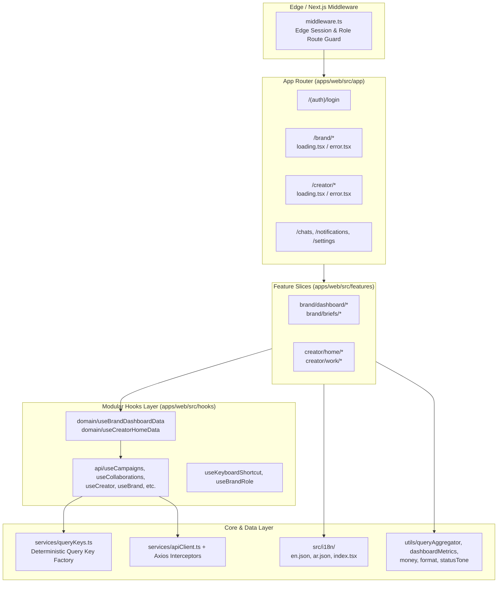
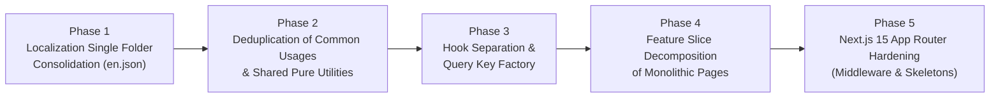

# UGCX Web Application Architecture Refactor: Overview

# Document Control

- **Version**: 1.0.0
- **Date Created**: 2026-11-01
- **Last Updated**: 2026-11-01
- **Status**: READY FOR BUILDER
- **Owner**: Planner agent. Each phase hands to the `builder` agent.

---

# Executive Summary

- **Goal**: Modernize and harden the UGCX Next.js 15 web application (`apps/web`) to eliminate code duplication, isolate domain hooks, consolidate localization into a single dedicated folder, decompose monolithic page components into feature slices, and protect routes at the edge via Next.js Middleware.
- **Scope**: Code refactoring, architecture hardening, and test expansion across `apps/web`.
- **Domains**: Frontend architecture (`apps/web`), i18n localization, TanStack Query data layer, component feature slices, Next.js Edge Middleware.
- **Architecture**: Next.js 15 App Router with Feature-Sliced Design, unified `src/i18n/` localization directory containing `en.json` and `ar.json`, centralized Query Key Factories, reusable pure utility functions for multi-query state aggregation and metric calculations, and Edge Middleware session validation with cookie fallback.
- **Tech Stack**: Next.js 15, React 19, TypeScript 5, Tailwind CSS v4, `@tanstack/react-query` v5, Axios, Zustand, React Hook Form, Zod, Lucide React, `@ugcx/shared-types`.
- **Entry Condition**: `apps/web` builds cleanly, typecheck passes with 0 errors, and all 66 unit tests pass.
- **Exit Condition**: All 5 phases are completed and verified by the `builder` agent with zero typecheck errors, 100% test pass rate, no page exceeding 150 lines, single-folder i18n structure with `en.json`, and Edge route protection.

---

# System Architecture & Layering

---

# Phase Map

| Phase | Title | File | Tasks | Exit Criteria |
|---|---|---|---|---|
| 1 | Localization Single Folder Consolidation (`en.json`, `ar.json`) | `plan_phase_1.md` | 4 (`TASK-WAR1-001` to `004`) | `en.json` and `ar.json` live directly in `src/i18n/`, zero copy drift, 100% dictionary key parity test passes. |
| 2 | Deduplication of Common Usages & Shared Pure Utilities | `plan_phase_2.md` | 5 (`TASK-WAR2-001` to `005`) | `queryAggregator`, `dashboardMetrics`, and `useKeyboardShortcut` eliminate duplicate query states and calculations across screens. |
| 3 | Hook Separation, Domain Isolation & Query Key Factories | `plan_phase_3.md` | 4 (`TASK-WAR3-001` to `004`) | Centralized query key factory governs all TanStack Query operations. Composite domain hooks isolate query orchestration. |
| 4 | Feature Slice Decomposition of Monolithic Pages | `plan_phase_4.md` | 4 (`TASK-WAR4-001` to `004`) | Large pages (`BrandDashboardPage`, `CreatorHomePage`, `BrandBriefsPage`) reduced to clean orchestrators under 120 lines. Feature slices under 150 lines. |
| 5 | Next.js 15 App Router Hardening (Middleware & Skeletons) | `plan_phase_5.md` | 5 (`TASK-WAR5-001` to `005`) | Next.js Edge Middleware protects private routes with cookies. `loading.tsx` skeletons and `error.tsx` boundaries installed. |

---

# Cross-Cutting Architectural Decisions

| ID | Decision | Rationale | Alternatives Considered | Side Effect |
|---|---|---|---|---|
| DEC-WAR01 | Single dedicated folder `apps/web/src/i18n/` containing `en.json`, `ar.json`, `index.tsx`, and `types.ts`. | User requested localization in one folder that has `en.json`. Eliminates confusing nested `locales/` directory. | Separate `packages/i18n`. Rejected as premature monorepo overhead for soft-launch. | Imports updated across all files from `'../i18n'` without relative directory breakage. |
| DEC-WAR02 | Create `combineQueries(...queries)` pure helper in `src/utils/queryAggregator.ts`. | Replaces repetitive `isLoading = q1.isLoading || q2.isLoading ...` and `onRetry` boilerplate found on 15+ pages. | Custom QueryClient wrapper. Rejected because pure function composition is more transparent and testable. | Standardizes query loading and error states across all UI views. |
| DEC-WAR03 | Hierarchical `queryKeys` factory object in `src/services/queryKeys.ts`. | TanStack Query best practice. Eliminates cache collision and enables targeted invalidations (e.g., `queryClient.invalidateQueries({ queryKey: campaignKeys.all })`). | Ad-hoc string keys. Rejected because typo risk causes cache staleness bugs. | All hooks consume `queryKeys.<entity>.<action>`. |
| DEC-WAR04 | Feature-Sliced Design pattern (`src/features/<role>/<feature>/components/`). | Isolates UI concerns into single-responsibility components (< 150 lines). Separates container orchestrators from view components. | Colocating components in `src/components/ui`. Rejected because domain-specific components pollute generic UI primitives. | Clean folder hierarchy separating generic primitives from domain features. |
| DEC-WAR05 | Next.js Edge `middleware.ts` reading session cookie for route protection. | Prevents flash of unauthorized content and unwanted client hydration before redirect. | Client-only `useEffect` redirects in `AppShell`. Rejected because it flickers and leaks initial render state. | `authStore` synchronizes session token to a cookie on login and clears it on logout. |

---

# Global Verification Commands

Every phase must execute and pass these commands prior to declaring completion:

1. **Typecheck**: `npm --prefix apps/web run typecheck`
2. **Unit & Integration Tests**: `npm --prefix apps/web test`
3. **Build Check (Phase 5)**: `npm --prefix apps/web run build`
