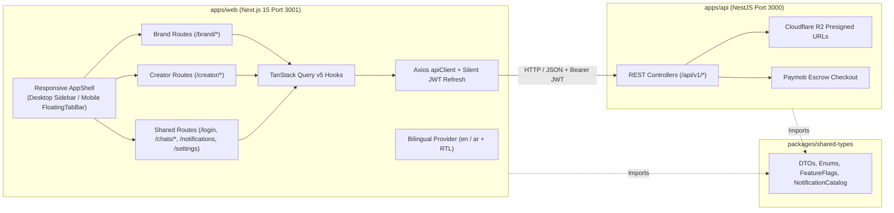
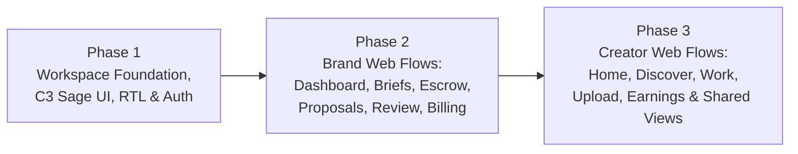

# UGCX Web Application Soft Launch: Overview

# Document Control

- **Version**: 1.0.0
- **Date Created**: 2026-10-29
- **Last Updated**: 2026-10-29
- **Status**: DONE
- **Owner**: Planner agent. Each phase hands to the `builder` agent.

---

# Executive Summary

- **Goal**: Deliver the UGCX Next.js 15 web application (`apps/web`) for the V1 soft launch across Brand and Creator roles.
- **Scope**: Production feature (Web Soft Launch MVP).
- **Domains**: Frontend (`apps/web`), Backend CORS config (`apps/api/src/main.ts`), Shared TypeScript types (`@ugcx/shared-types`).
- **Architecture**: Next.js 15 App Router client-centric web application running on port `3001`. It consumes the existing NestJS REST API (`http://localhost:3000/api/v1`) through an Axios client with silent JWT rotation and TanStack Query v5. It implements the Brand C3 Sage design system with responsive desktop sidebar navigation and mobile floating tab navigation.
- **Tech Stack**: Next.js 15, React 19, TypeScript 5, Tailwind CSS v4 (bound to C3 Sage CSS variables), TanStack Query v5, Axios, Zustand, React Hook Form, Zod, Lucide React, `@ugcx/shared-types`.
- **Entry Condition**: `apps/api` and `packages/shared-types` build and pass all tests. The mobile reference app (`apps/mobile`) defines the canonical C3 Sage tokens, i18n dictionaries (`en.json`, `ar.json`), and API hook contracts.
- **Exit Condition**: Both Brand and Creator users can sign in, switch between English and Arabic (`dir="ltr"` and `dir="rtl"`), and complete the full marketplace loop on desktop and mobile web browsers with zero lint, typecheck, or build errors.

---

# Architecture & System Diagram



---

# Phase Map



| Phase | Title | File | Tasks | Ships on its own because |
|---|---|---|---|---|
| 1 | Web Workspace Foundation, C3 Sage Design System, Bilingual RTL & Auth | `plan_phase_1.md` | 5 (`TASK-W1-001` to `TASK-W1-005`) | Scaffolds `apps/web`, configures API CORS, delivers all C3 Sage UI primitives, bilingual `en`/`ar` RTL switching, responsive `AppShell`, and working Login / Registration / Onboarding. |
| 2 | Brand Web Flows (Dashboard, Briefs, Escrow, Proposals, Deliverables, Chats, Billing, Profile) | `plan_phase_2.md` | 5 (`TASK-W2-001` to `TASK-W2-005`) | A Brand user can manage their profile, post a 1-page brief, fund campaign escrow, review and accept proposals, confirm shipment, review deliverable videos, chat, and view the billing ledger. |
| 3 | Creator Web Flows, Shared Notifications & End-to-End Verification | `plan_phase_3.md` | 5 (`TASK-W3-001` to `TASK-W3-005`) | A Creator user can view their home queue, discover live briefs, submit proposals, upload deliverable videos, track earnings, request payouts, chat, and read notifications. |

Total task count across the 3 phases is 15.

---

# Cross-Cutting Decisions

| ID | Decision | Rationale | Alternatives Considered | Side Effect |
|---|---|---|---|---|
| DEC-W001 | Use Next.js 15 App Router in `apps/web` running on port `3001` with `/api/v1/:path*` rewrites and CORS enabled on `apps/api`. | Keeps `apps/api` on port `3000` without port collisions. Next.js rewrites and CORS support both direct `NEXT_PUBLIC_API_URL` requests and same-origin proxy calls. | Run API on another port. Rejected because mobile and Docker configs expect `3000`. | `apps/api/src/main.ts` adds `http://localhost:3001` and `http://127.0.0.1:3001` to dev origins. |
| DEC-W002 | Use exact Brand C3 Sage tokens in CSS variables and `src/theme/tokens.ts`. | `DESIGN.md` mandates C3 Sage (`#eff2ed` canvas, `#2f5d46` primary, `#ffffff` surface, `Inter` + `IBM Plex Sans Arabic` weights 400 and 500 only, `tabular-nums`) across all surfaces. | Use default Tailwind palette. Rejected because it violates `DESIGN.md`. | Every web component imports C3 Sage tokens and primitives from `src/components/ui/`. |
| DEC-W003 | Responsive layout uses a left sidebar on desktop (`>= 768px`) and a floating dark bottom tab bar (`#17241c`) on mobile viewports (`< 768px`). | Desktop users expect multi-column workspace ergonomics while mobile web users get the canonical `FloatingTabBar` experience from `DESIGN.md`. | Center a narrow 420px phone frame on desktop. Rejected by user in requirements clarification in favor of a full responsive web shell. | `AppShell.tsx` renders both navigation modes responsively. |
| DEC-W004 | Enforce `DEFAULT_FEATURE_FLAGS` from `@ugcx/shared-types`. | Soft-launch scope hides `productCatalog`, `campaignWizard5Step`, `brandTeamManagement`, `automatedPayouts`, and `apnsPush`. | Expose deferred features on web. Rejected because `AGENTS.md` Rule 7 locks soft-launch flags. | Web routes only expose V1 soft-launch workflows. |
| DEC-W005 | Support both Phone OTP (`+20`) and Email/Password login and registration tabs on `/login`. | The backend `AuthController` exposes `/auth/otp/send`, `/auth/otp/verify`, `/auth/login`, and `/auth/register`. Offering both lets QA and local testers sign in either with `+20` OTP (`123456` in dev) or email credentials. | Phone OTP only. Rejected because web users and automated tests benefit from direct email login as well. | `/login` provides tabs for Phone OTP and Email/Password plus role selection (`brand` or `creator`). |
| DEC-W006 | Reuse `en.json` and `ar.json` dictionaries from `apps/mobile/src/i18n/` and toggle `<html lang="..." dir="rtl|ltr">`. | Keeps 100% copy parity between mobile and web and lets native CSS flexbox/grid and logical properties (`ms-*`, `me-*`, `ps-*`, `pe-*`, `text-start`) mirror automatically in Arabic. | Maintain separate web translation keys. Rejected because copy drift violates `AGENTS.md`. | `src/i18n/` loads the shared JSON dictionaries and persists locale in `localStorage`. |

---

# Complete Web Route Map

| Route | Role | Purpose | Mobile Equivalent |
|---|---|---|---|
| `/` | Public / Auth | Redirects to `/brand/dashboard`, `/creator/home`, or `/login` based on auth state | `RootNavigator.tsx` |
| `/login` | Public | Role selector (`brand` / `creator`), Phone OTP (`+20`), Email Login/Register, Creator onboarding sheet | `LoginScreen`, `OtpScreen`, `OnboardingScreen` |
| `/brand/dashboard` | Brand | Hero monthly spend card, 4 quick-action tiles, active briefs list | `BrandDashboardScreen` |
| `/brand/briefs` | Brand | Filterable list of brand briefs (`All`, `Draft`, `Open`, `Completed`) | `MyBriefsScreen` |
| `/brand/briefs/new` | Brand | 1-page step-by-step Post Brief form | `PostBriefScreen` |
| `/brand/briefs/[id]` | Brand | Brief detail, escrow summary counters, edit draft, pause, close early & refund | `BriefDetailScreen`, `CloseBriefSheet` |
| `/brand/briefs/[id]/fund` | Brand | Campaign escrow checkout summary and publish trigger | `FundEscrowScreen` |
| `/brand/briefs/[id]/proposals` | Brand | Proposals inbox for a specific brief with accept, shortlist, decline | `ProposalsInboxScreen`, `AcceptProposalSheet` |
| `/brand/proposals` | Brand | Cross-brief proposals overview across all brand campaigns | `BrandProposalsOverviewScreen` |
| `/brand/collaborations/[id]` | Brand | Collaboration detail, shipment confirmation, deliverable links, chat link | `CollaborationDetailScreen` |
| `/brand/deliverables/[id]/review` | Brand | HTML5 video player via presigned play URL, approve & release escrow, request revision | `DeliverableReviewScreen`, `RevisionRequestSheet` |
| `/brand/chats` | Brand | Active collaboration chat threads list | `BrandChatsScreen` |
| `/brand/billing` | Brand | Escrow held hero card, total spent, refunded, and transaction ledger | `BrandBillingScreen` |
| `/brand/profile` | Brand | Brand identity card, verification fields, settings links | `BrandProfileScreen`, `BrandSetupScreen` |
| `/creator/home` | Creator | Urgent and upcoming action queue, quick links | `CreatorHomeScreen` |
| `/creator/discover` | Creator | Live campaign discovery feed with search and niche filter chips | `CampaignDiscoveryScreen` |
| `/creator/discover/[id]` | Creator | Campaign detail and Submit Proposal modal/form (`pitch`, `price`, `portfolioItemIds`) | `CampaignDetailScreen`, `SubmitProposalScreen` |
| `/creator/work` | Creator | Active collaborations board grouped by status | `ActiveWorkScreen` |
| `/creator/work/[id]` | Creator | Collaboration workspace, shipment status, deliverable video upload to R2, feedback history | `CollaborationStatusScreen`, `DeliverableUploadScreen` |
| `/creator/proposals` | Creator | Submitted proposals list with status badges | `MyProposalsScreen` |
| `/creator/earnings` | Creator | Withdrawable balance hero card, pending earnings, payout request, payout method, ledger | `PayoutsScreen` |
| `/creator/profile` | Creator | Creator identity card, bio/niche/rates editor, portfolio manager | `CreatorProfileScreen` |
| `/chats/[collaborationId]` | Shared | Real-time/polled collaboration chat thread with system event capsules | `CollaborationChatScreen` |
| `/notifications` | Shared | Grouped notifications list (`Today`, `Yesterday`, `Earlier`) with mark-all-read | `NotificationsScreen` |
| `/settings` | Shared | Language toggle (`EN` / `AR`), feature flags status, sign out | `SettingsScreen` |

---

# Verification Commands

Run these commands from the repository root to verify each phase:

```bash
# Shared types
pnpm --filter @ugcx/shared-types build

# API check
pnpm --filter api typecheck
pnpm --filter api test

# Web checks
pnpm --filter web lint
pnpm --filter web typecheck
pnpm --filter web test
pnpm --filter web build

# Workspace wide
pnpm -r lint
pnpm -r build
```
