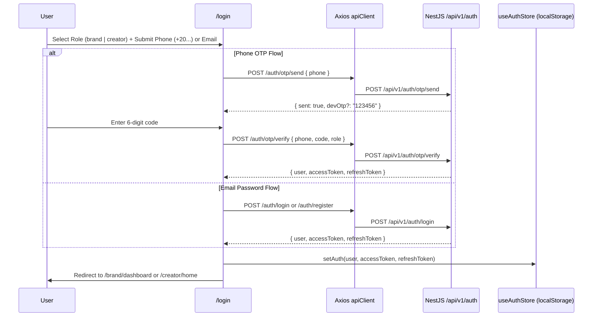

# Phase 1: Web Workspace Foundation, C3 Sage Design System, Bilingual RTL & Auth

# Document Control

- **Version**: 1.0.0
- **Date Created**: 2026-10-29
- **Last Updated**: 2026-10-29
- **Status**: DONE
- **Phase**: 1 of 3
- **Parent Document**: `operations/specs/web_app_soft_launch/00_overview.md`

---

# Executive Summary

- **Goal**: Scaffold the Next.js 15 web application (`apps/web`), implement the Brand C3 Sage design system and reusable UI primitives, wire bilingual English/Arabic localization with automatic RTL layout mirroring, configure Axios JWT authentication with silent refresh, and deliver the responsive `AppShell` and `/login` onboarding flow.
- **Scope**: Production feature (Web Foundation & Auth).
- **Domains**: Frontend (`apps/web`), Backend CORS (`apps/api/src/main.ts`), Root workspace scripts (`package.json`).
- **Architecture**: Next.js 15 App Router with React 19, Tailwind CSS v4 bound to C3 Sage CSS custom properties, Zustand auth and locale stores backed by `localStorage`, and an Axios client targeting `http://localhost:3000/api/v1` with `/auth/refresh` rotation.
- **Tech Stack**: Next.js 15, React 19, TypeScript 5, Tailwind CSS v4, `@tanstack/react-query` v5, `axios`, `zustand`, `zod`, `react-hook-form`, `lucide-react`, `@ugcx/shared-types`.
- **Entry Condition**: `packages/shared-types` builds cleanly and `apps/api` runs on port `3000`.
- **Exit Condition**: `apps/web` builds and passes lint/typecheck, renders the C3 Sage theme in English (`dir="ltr"`) and Arabic (`dir="rtl"`), and allows a Brand or Creator user to authenticate and land on their role shell.

---

# Requirements

## Functional, Security, Constraint & Pattern Requirements

- **REQ-W1-001**: WHEN `apps/api` starts outside production THE SYSTEM SHALL allow CORS requests from `http://localhost:3001` and `http://127.0.0.1:3001`.
- **REQ-W1-002**: THE SYSTEM SHALL render all web surfaces using the Brand C3 Sage color tokens (`#eff2ed` canvas, `#ffffff` surface, `#2f5d46` primary, `#244a37` primary-active, `#e1ebe4` accent-soft, `#17241c` ink/surface-dark) and typography weights `400` and `500` only.
- **REQ-W1-003**: WHEN the user switches the language between English (`en`) and Arabic (`ar`) THE SYSTEM SHALL update `<html lang="..." dir="rtl|ltr">`, multiply Arabic line heights by `1.15`, and mirror directional icons and layouts without page reload.
- **REQ-W1-004**: WHEN an authenticated API request receives HTTP `401 Unauthorized` THE SYSTEM SHALL request a new token pair from `POST /api/v1/auth/refresh` using the stored `refreshToken` and retry the original request once.
- **REQ-W1-005**: WHEN an unauthenticated user visits `/login` THE SYSTEM SHALL allow signing in or registering via Egyptian Phone OTP (`+20` via `/auth/otp/send` and `/auth/otp/verify`) or Email/Password (`/auth/login` and `/auth/register`) with role selection (`brand` or `creator`).
- **SEC-W1-001**: IF token refresh fails with HTTP `401` or `403` THEN THE SYSTEM SHALL clear all auth state from `localStorage` and redirect the user to `/login`.
- **CON-W1-001**: THE SYSTEM SHALL NOT use font weights `600` or `700`, physical directional CSS (`left`, `right`, `ml-*`, `mr-*`, `pl-*`, `pr-*`, `text-left`, `text-right`), or raw hex values outside `src/theme/tokens.ts` and `src/app/globals.css`.
- **PAT-W1-001**: THE SYSTEM SHALL expose the same UI primitive component names as `apps/mobile/src/components/ui/` (`AppText`, `Card`, `PressableCard`, `SignatureCard`, `Button`, `TextInput`, `FilterChip`, `StatusBadge`, `Icon`, `LoadingState`, `ErrorState`, `EmptyState`, `QueryStateView`, `ModalSheet`).

```gherkin
Feature: Bilingual C3 Sage Web Shell and Authentication

  Scenario: User switches language from English to Arabic
    Given the user is on the "/login" page in English ("en")
    When the user clicks the "العربية" language toggle button
    Then the document html element has attribute dir="rtl" and lang="ar"
    And all labels and buttons render Arabic strings from "ar.json"

  Scenario: Brand user authenticates via Phone OTP
    Given the user selects the "Brand" role on "/login"
    When the user enters phone "+201012345678" and submits the OTP form
    And enters the 6-digit verification code "123456"
    Then the client stores accessToken, refreshToken, and user in authStore
    And redirects the browser to "/brand/dashboard"

  Scenario: Responsive AppShell adapts to viewport width
    Given an authenticated Brand user is on "/brand/dashboard"
    When the viewport width is at least 768px
    Then the left sidebar navigation is visible and the mobile bottom tab bar is hidden
    When the viewport width is less than 768px
    Then the floating dark bottom tab bar (#17241c) is visible and the left sidebar is hidden
```

---

# Dependencies

| ID | Name | Type | Version | Purpose |
|---|---|---|---|---|
| DEP-W1-001 | `next` | package | `^15.2.0` | React framework with App Router and API rewrites |
| DEP-W1-002 | `react` / `react-dom` | package | `^19.0.0` | Core UI library |
| DEP-W1-003 | `@tanstack/react-query` | package | `^5.66.0` | Async server state caching and mutations |
| DEP-W1-004 | `axios` | package | `^1.7.9` | HTTP client with request/response interceptors |
| DEP-W1-005 | `zustand` | package | `^5.0.3` | Client auth and locale state store |
| DEP-W1-006 | `zod` / `react-hook-form` / `@hookform/resolvers` | package | `^3.24.2` / `^7.54.2` / `^4.1.0` | Form validation |
| DEP-W1-007 | `lucide-react` | package | `^0.475.0` | Feather-compatible icon set |
| DEP-W1-008 | `@ugcx/shared-types` | workspace | `workspace:*` | Shared DTOs, enums, feature flags, notification catalog |

---

# Plan Details

## Design — *How it should happen*

### Decisions

| ID | Decision | Rationale | Alternatives Considered | Side Effect |
|---|---|---|---|---|
| DES-W1-001 | Map Feather icon names (`home`, `file-text`, `inbox`, `message-circle`, `user`, `arrow-left`, `chevron-right`, etc.) to `lucide-react` icons inside `src/components/ui/Icon.tsx`. | `apps/mobile` passes Feather icon strings (e.g. `name="file-text"`). Supporting the exact string names in `Icon.tsx` lets web screens use identical icon props. | Import individual Lucide components in every screen. Rejected because centralizing in `Icon.tsx` enforces RTL `directional` mirroring (`scaleX(-1)`) in one place. | `Icon.tsx` owns the icon map and RTL flip rule. |
| DES-W1-002 | Store `en.json` and `ar.json` in `apps/web/src/i18n/locales/` copied from `apps/mobile/src/i18n/` and extended with web shell navigation keys. | Preserves every translation key (`brandDashboard.*`, `postBrief.*`, `fundEscrow.*`, `billing.*`, `creator.*`, `status.*`) with zero missing strings. | Fetch translations over HTTP. Rejected because static bundling eliminates loading flicker. | `useTranslation()` resolves nested dot keys (`t('brandDashboard.monthlySpend')`) synchronously. |

### Constraints & Assumptions

| Type | ID | Description | Impact if Wrong | Handling Strategy |
|---|---|---|---|---|
| Constraint | CON-W1-002 | Only font weights `400` and `500` are loaded for `Inter` and `IBM Plex Sans Arabic`. | Browsers synthesize fake bold if `600` or `700` is used. | Configure `next/font/google` with `weight: ['400', '500']` and enforce in `AppText.tsx`. |
| Assumption | ASM-W1-001 | Local dev runs `apps/api` on `http://localhost:3000` and `apps/web` on `http://localhost:3001`. | API calls fail if port differs. | Read `NEXT_PUBLIC_API_URL` with fallback to `http://localhost:3000/api/v1`. |

### Edge Cases

| ID | Scenario | Expected Behavior | Handling Strategy |
|---|---|---|---|
| EDGE-W1-001 | Concurrent requests receive `401` simultaneously when access token expires. | Only one `/auth/refresh` call executes; queued requests wait for the new token. | Use an `isRefreshing` lock and `refreshSubscribers` queue in `apiClient.ts` matching `apps/mobile/src/services/apiClient.ts`. |
| EDGE-W1-002 | Hydration mismatch when reading `localStorage` on initial SSR render. | Client renders cleanly without React hydration warnings. | Hydrate Zustand auth/locale stores inside a mounted effect in `Providers.tsx` and render `<LoadingState>` while `isLoading` is true. |

### Directory Map

```text
UGCX/
├── package.json                                  [MODIFY: add dev:web script]
├── apps/
│   ├── api/
│   │   └── src/
│   │       └── main.ts                           [MODIFY: add localhost:3001 to dev CORS]
│   └── web/
│       ├── package.json                          [CREATE]
│       ├── tsconfig.json                         [CREATE]
│       ├── next.config.mjs                       [CREATE]
│       ├── postcss.config.mjs                    [CREATE]
│       └── src/
│           ├── config/
│           │   └── features.ts                   [CREATE]
│           ├── theme/
│           │   ├── tokens.ts                     [CREATE]
│           │   ├── typography.ts                 [CREATE]
│           │   └── elevation.ts                  [CREATE]
│           ├── i18n/
│           │   ├── index.tsx                     [CREATE]
│           │   └── locales/
│           │       ├── en.json                   [CREATE]
│           │       └── ar.json                   [CREATE]
│           ├── store/
│           │   └── authStore.ts                  [CREATE]
│           ├── services/
│           │   ├── apiClient.ts                  [CREATE]
│           │   └── apiHelpers.ts                 [CREATE]
│           ├── components/
│           │   ├── ui/
│           │   │   ├── AppText.tsx               [CREATE]
│           │   │   ├── Card.tsx                  [CREATE]
│           │   │   ├── SignatureCard.tsx         [CREATE]
│           │   │   ├── Button.tsx                [CREATE]
│           │   │   ├── TextInput.tsx             [CREATE]
│           │   │   ├── FilterChip.tsx            [CREATE]
│           │   │   ├── StatusBadge.tsx           [CREATE]
│           │   │   ├── Icon.tsx                  [CREATE]
│           │   │   ├── AsyncStates.tsx           [CREATE]
│           │   │   ├── ModalSheet.tsx            [CREATE]
│           │   │   └── index.ts                  [CREATE]
│           │   └── layout/
│           │       └── AppShell.tsx              [CREATE]
│           └── app/
│               ├── globals.css                   [CREATE]
│               ├── layout.tsx                    [CREATE]
│               ├── providers.tsx                 [CREATE]
│               ├── page.tsx                      [CREATE]
│               └── (auth)/
│                   └── login/
│                       └── page.tsx              [CREATE]
```

### Directory Specifications

| ID | Task | File(s) | Responsibility or Expected Behaviors | Validations/Error Handling | Key Configurations/Settings |
|---|---|---|---|---|---|
| TASK-W1-001 (DONE) | Configure API CORS & Root Scripts | `apps/api/src/main.ts`, `package.json` | Add `http://localhost:3001` and `http://127.0.0.1:3001` to non-production CORS origins in `main.ts`. Add `"dev:web": "pnpm --filter web dev"` to root `package.json`. | Preserve strict `CORS_ORIGIN` whitelist when `nodeEnv === 'production'`. | `IMPLEMENTS: REQ-W1-001` |
| TASK-W1-002 (DONE) | Scaffold `apps/web` Workspace | `apps/web/package.json`, `apps/web/tsconfig.json`, `apps/web/next.config.mjs`, `apps/web/postcss.config.mjs`, `apps/web/src/config/features.ts`, `apps/web/src/app/globals.css` | Create Next.js 15 package running on port `3001` (`next dev -p 3001`), transpile `@ugcx/shared-types`, configure API rewrite `/api/v1/:path*` to `http://localhost:3000/api/v1/:path*`, and define C3 Sage CSS variables in `globals.css`. | Enforce TypeScript `strict: true` and logical CSS rules. | `IMPLEMENTS: REQ-W1-002, CON-W1-001` |
| TASK-W1-003 (DONE) | Build C3 Sage Theme & UI Primitives | `apps/web/src/theme/tokens.ts`, `typography.ts`, `elevation.ts`, `apps/web/src/components/ui/*` | Implement `colors`, `spacing`, `radius`, `sizes`, `typography`, `elevation`, and all reusable UI primitives (`AppText`, `Card`, `PressableCard`, `SignatureCard`, `Button`, `TextInput`, `FilterChip`, `StatusBadge`, `Icon`, `LoadingState`, `ErrorState`, `EmptyState`, `QueryStateView`, `ModalSheet`). | `AppText` enforces weights `400`/`500`, multiplies Arabic line-height by `1.15`, and applies `tabular-nums` when `tabular` is set. `Icon` mirrors directional icons in RTL. | `IMPLEMENTS: REQ-W1-002, PAT-W1-001, CON-W1-001` |
| TASK-W1-004 (DONE) | Build Bilingual i18n, Auth Store & Axios Client | `apps/web/src/i18n/index.tsx`, `locales/en.json`, `locales/ar.json`, `apps/web/src/store/authStore.ts`, `apps/web/src/services/apiClient.ts`, `apiHelpers.ts` | Implement `I18nProvider` and `useTranslation()` hook updating `<html lang dir>`, `useAuthStore` persisting tokens and user in `localStorage`, and Axios `apiClient` with silent `/auth/refresh` queue and `extractData` / `extractList` helpers. | Clear storage and redirect to `/login` on unrecoverable `401`. Format NestJS validation error arrays cleanly in `extractErrorMessage`. | `IMPLEMENTS: REQ-W1-003, REQ-W1-004, SEC-W1-001` |
| TASK-W1-005 (DONE) | Build Responsive `AppShell`, Root Layout & Auth Page | `apps/web/src/components/layout/AppShell.tsx`, `apps/web/src/app/layout.tsx`, `providers.tsx`, `page.tsx`, `apps/web/src/app/(auth)/login/page.tsx` | Build desktop left sidebar + mobile floating dark tab bar (`#17241c`) for both Brand (5 tabs: Dashboard, Briefs, Proposals, Chats, Profile) and Creator (5 tabs: Home, Discover, Work, Earnings, Profile). Build `/login` supporting Role selector, Phone OTP (`+20`), and Email Login/Register. | Validate `+20` Egyptian phone format (`^\+201[0125]\d{8}$`), 6-digit OTP, and email/password lengths. | `IMPLEMENTS: REQ-W1-005, PAT-W1-001` |

### Schemas & Contracts

```typescript
// Auth Store Contract (apps/web/src/store/authStore.ts)
export interface AuthUser {
  id: string;
  email?: string | null;
  phone?: string | null;
  role: 'creator' | 'brand' | 'admin';
  locale?: string;
}

export interface AuthState {
  user: AuthUser | null;
  accessToken: string | null;
  refreshToken: string | null;
  isAuthenticated: boolean;
  isLoading: boolean;
  setAuth: (user: AuthUser, accessToken: string, refreshToken: string) => void;
  updateUser: (user: Partial<AuthUser>) => void;
  clearAuth: () => void;
  hydrate: () => void;
}
```

### Data Flow



---

# Risks

| ID | Risk | Likelihood | Impact | Mitigation |
|---|---|---|---|---|
| RISK-W1-001 | Browser blocks cross-origin requests from `localhost:3001` to `localhost:3000`. | Low | High | `TASK-W1-001` adds `localhost:3001` to `apps/api/src/main.ts` CORS origins and `TASK-W1-002` adds Next.js `/api/v1` proxy rewrites. |
| RISK-W1-002 | Physical CSS margins or paddings break RTL alignment in Arabic. | Medium | Medium | Use logical Tailwind classes (`ms-*`, `me-*`, `ps-*`, `pe-*`, `start-*`, `end-*`, `text-start`) exclusively across all components. |

---

# Code Guidelines

- **Clean Code (`clean-code`)**: Keep every UI primitive in a single focused file under `src/components/ui/`. Avoid magic numbers by importing spacing, radius, and colors from `src/theme/tokens.ts`.
- **Security (`security`)**: Never log JWT tokens to the console. Validate all form inputs with Zod or explicit regex before sending API requests. Clear tokens immediately on refresh failure.
- **Frontend Patterns (`frontend-patterns`)**: Colocate providers in `src/app/providers.tsx`. Separate layout chrome (`AppShell.tsx`) from route page state. Use `QueryStateView` for consistent loading, error, and empty state rendering.
