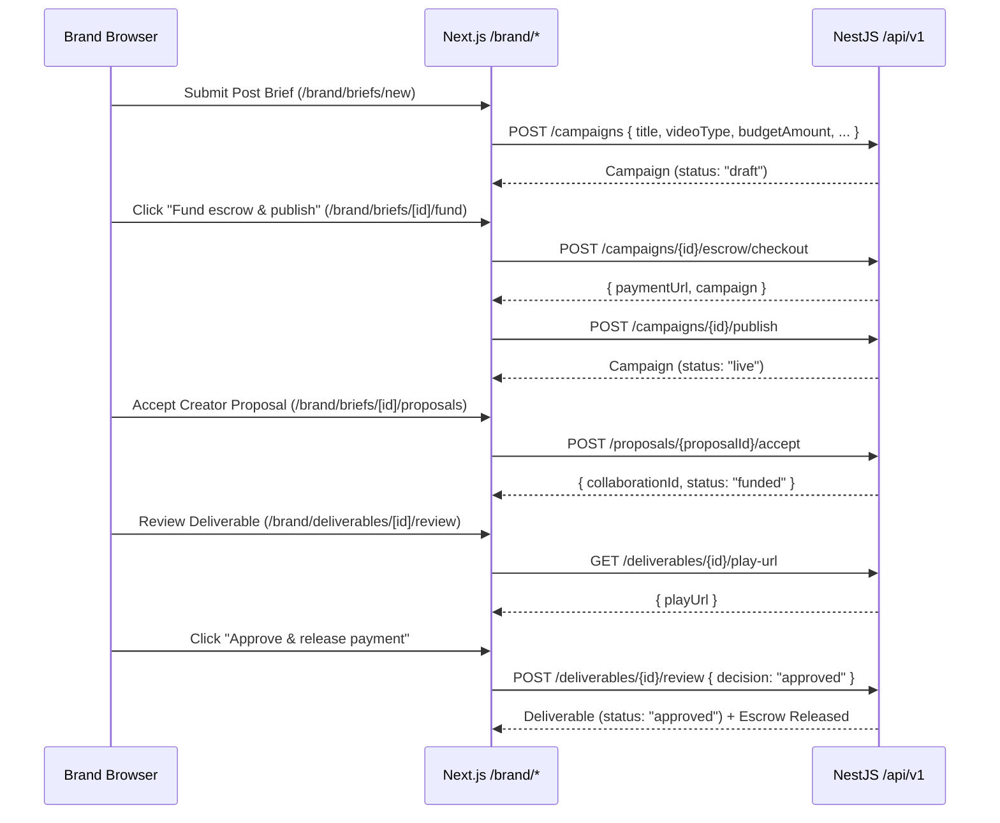

# Phase 2: Brand Web Flows (Dashboard, Briefs, Escrow, Proposals, Deliverables, Chats, Billing, Profile)

# Document Control

- **Version**: 1.0.0
- **Date Created**: 2026-10-29
- **Last Updated**: 2026-10-29
- **Status**: DONE
- **Phase**: 2 of 3
- **Parent Document**: `operations/specs/web_app_soft_launch/00_overview.md`

---

# Executive Summary

- **Goal**: Implement all Brand web screens and TanStack Query API hooks in `apps/web` so a Brand can view its dashboard, author 1-page briefs, fund campaign escrow, review and accept creator proposals, confirm product shipments, review deliverable videos (`<video>` player), approve and release escrow or request revisions, chat with creators, inspect the billing ledger, and manage the brand profile.
- **Scope**: Production feature (Brand Web Experience).
- **Domains**: Frontend (`apps/web/src/hooks/api/*`, `apps/web/src/app/brand/*`).
- **Architecture**: Next.js 15 App Router pages wrapped in `AppShell`, powered by TanStack Query v5 hooks (`useBrand`, `useDashboard`, `useCampaigns`, `useEscrow`, `useProposals`, `useCollaborations`, `useDeliverables`, `useBilling`, `useChats`, `useMessages`, `useNotifications`, `useStorage`) matching the mobile API hook layer.
- **Tech Stack**: Next.js 15, React 19, TanStack Query v5, Axios, C3 Sage UI primitives (`AppText`, `Card`, `PressableCard`, `SignatureCard`, `Button`, `TextInput`, `FilterChip`, `StatusBadge`, `Icon`, `QueryStateView`, `ModalSheet`).
- **Entry Condition**: Phase 1 (`plan_phase_1.md`) is complete and verified.
- **Exit Condition**: Every `/brand/*` route builds, passes typecheck and lint, and executes the complete Brand workflow against `/api/v1/*`.

---

# Requirements

## Functional, Security, Constraint & Pattern Requirements

- **REQ-W2-001**: WHEN an authenticated Brand user opens `/brand/dashboard` THE SYSTEM SHALL display the brand greeting, notification bell with unread badge, monthly spend hero metric card with `tabular-nums`, 4 quick-action tiles (`Post brief`, `Proposals`, `Review`, `Chats`) with attention badges, and the active briefs list.
- **REQ-W2-002**: WHEN a Brand submits the 1-page Post Brief form on `/brand/briefs/new` THE SYSTEM SHALL create a draft campaign via `POST /api/v1/campaigns` with `title`, `videoType` (`talking_head` | `try_on` | `unboxing`), `videoDurationSeconds` (`15` | `30` | `60`), `contentLanguage` (`ar_eg` | `en` | `both`), `budgetAmount`, `requiresShipping`, and `scriptNotes`, and navigate to `/brand/briefs/{id}/fund` when "Continue to escrow" is chosen.
- **REQ-W2-003**: WHEN a Brand confirms escrow funding on `/brand/briefs/{id}/fund` THE SYSTEM SHALL call `POST /api/v1/campaigns/{id}/escrow/checkout` and `POST /api/v1/campaigns/{id}/publish` (or open the Paymob payment URL when returned) and update the brief status to `live`.
- **REQ-W2-004**: WHEN a Brand accepts a proposal on `/brand/briefs/{id}/proposals` THE SYSTEM SHALL call `POST /api/v1/proposals/{id}/accept` to allocate funds from campaign escrow without a second charge (unless `status === 'pending_payment'` top-up is returned) and navigate to `/brand/collaborations/{collaborationId}`.
- **REQ-W2-005**: WHEN a Brand opens `/brand/deliverables/{id}/review` THE SYSTEM SHALL fetch a signed playback URL from `GET /api/v1/deliverables/{id}/play-url`, render an HTML5 `<video controls>` player, and allow the Brand to either approve and release escrow (`POST /api/v1/deliverables/{id}/review` with `decision: 'approved'`) or request a revision with structured reason chips and notes (`decision: 'revision_requested'`).
- **REQ-W2-006**: WHEN a Brand closes a brief early on `/brand/briefs/{id}` THE SYSTEM SHALL call `POST /api/v1/campaigns/{id}/close`, refund any unallocated escrow, and show the updated ledger on `/brand/billing`.
- **SEC-W2-001**: THE SYSTEM SHALL restrict `/brand/*` views to authenticated users with `user.role === 'brand'` and redirect unauthorized users to `/login` or `/creator/home`.
- **CON-W2-001**: THE SYSTEM SHALL format all money values in `EGP` with `tabular-nums` and never use floating-point arithmetic for ledger calculations.

```gherkin
Feature: Brand Campaign Escrow, Proposal Acceptance, and Deliverable Review on Web

  Scenario: Brand posts a brief and funds campaign escrow
    Given an authenticated Brand user is on "/brand/briefs/new"
    When the user enters title "Summer Skincare Launch", selects "talking_head", "30s", "ar_eg", and budget "3500"
    And clicks "Continue to escrow"
    Then the system creates the campaign draft and navigates to "/brand/briefs/{id}/fund"
    When the user clicks "Fund escrow & publish"
    Then the system calls POST "/campaigns/{id}/escrow/checkout" and publishes the brief

  Scenario: Brand reviews and approves a creator deliverable video
    Given a collaboration has a submitted deliverable on "/brand/deliverables/{id}/review"
    When the page loads
    Then the system fetches GET "/deliverables/{id}/play-url" and renders the video player
    When the Brand clicks "Approve & release payment"
    Then the system sends POST "/deliverables/{id}/review" with decision "approved"
    And invalidates collaboration, billing, and dashboard queries
```

---

# Dependencies

| ID | Name | Type | Version | Purpose |
|---|---|---|---|---|
| DEP-W2-001 | `@ugcx/shared-types` | workspace | `workspace:*` | `CampaignStatus`, `ProposalStatus`, `CollaborationStatus`, `DeliverableStatus`, `VideoType`, `ContentLanguage` |
| DEP-W2-002 | `@tanstack/react-query` | package | `^5.66.0` | Data fetching, cache invalidation, and 5s chat polling |

---

# Plan Details

## Design — *How it should happen*

### Decisions

| ID | Decision | Rationale | Alternatives Considered | Side Effect |
|---|---|---|---|---|
| DES-W2-001 | Mirror the exact hook signatures and query keys from `apps/mobile/src/hooks/api/` inside `apps/web/src/hooks/api/`. | Ensures identical cache invalidation behavior when mutations (`useFundCampaignEscrow`, `useAcceptProposal`, `useReviewDeliverable`, `useCloseCampaign`) complete. | Create custom REST calls inside page components. Rejected because shared hooks keep pages declarative and testable. | `apps/web/src/hooks/api/` provides 12 domain hook modules. |
| DES-W2-002 | Render an inline checkout simulation fallback on `/brand/briefs/[id]/fund` when Paymob sandbox returns a mock or local URL, plus a direct "Publish Funded Brief" action when `escrowFundedAmount` covers `budgetAmount`. | Local dev environments often run without live Paymob iframe credentials (`RISK-003`). | Require external Paymob redirect only. Rejected because local E2E testing must work without external gateway keys. | Supports both real Paymob `paymentUrl` redirection and local dev instant funding. |

### Constraints & Assumptions

| Type | ID | Description | Impact if Wrong | Handling Strategy |
|---|---|---|---|---|
| Constraint | CON-W2-002 | Escrow funds at the campaign level (`POST /campaigns/{id}/escrow/checkout`), never per collaboration accept unless a top-up is required. | Violates `AGENTS.md` Decision 1. | `AcceptProposalModal` checks `result.status === 'pending_payment'` vs `'funded'` and allocates directly from campaign balance. |

### Edge Cases

| ID | Scenario | Expected Behavior | Handling Strategy |
|---|---|---|---|
| EDGE-W2-001 | Accepted proposal price exceeds available campaign escrow. | Backend returns `status: 'pending_payment'` with `paymentUrl` for the top-up difference. | Show a top-up notice in the accept modal and open `paymentUrl` when present. |
| EDGE-W2-002 | Brand attempts to close a brief that still has active unapproved collaborations. | Backend returns HTTP `400` or `409` with an explanation message. | Display the error banner inside the Close Brief modal using `extractErrorMessage(error)`. |

### Directory Map

```text
apps/web/src/
├── hooks/
│   └── api/
│       ├── useBrand.ts                           [CREATE]
│       ├── useDashboard.ts                       [CREATE]
│       ├── useCampaigns.ts                       [CREATE]
│       ├── useEscrow.ts                          [CREATE]
│       ├── useProposals.ts                       [CREATE]
│       ├── useCollaborations.ts                  [CREATE]
│       ├── useDeliverables.ts                    [CREATE]
│       ├── useBilling.ts                         [CREATE]
│       ├── useChats.ts                           [CREATE]
│       ├── useMessages.ts                        [CREATE]
│       ├── useNotifications.ts                   [CREATE]
│       └── useStorage.ts                         [CREATE]
└── app/
    └── brand/
        ├── dashboard/
        │   └── page.tsx                          [CREATE]
        ├── briefs/
        │   ├── page.tsx                          [CREATE]
        │   ├── new/
        │   │   └── page.tsx                      [CREATE]
        │   └── [id]/
        │       ├── page.tsx                      [CREATE]
        │       ├── fund/
        │       │   └── page.tsx                  [CREATE]
        │       └── proposals/
        │           └── page.tsx                  [CREATE]
        ├── proposals/
        │   └── page.tsx                          [CREATE]
        ├── collaborations/
        │   └── [id]/
        │       └── page.tsx                      [CREATE]
        ├── deliverables/
        │   └── [id]/
        │       └── review/
        │           └── page.tsx                  [CREATE]
        ├── chats/
        │   └── page.tsx                          [CREATE]
        ├── billing/
        │   └── page.tsx                          [CREATE]
        └── profile/
            └── page.tsx                          [CREATE]
```

### Directory Specifications

| ID | Task | File(s) | Responsibility or Expected Behaviors | Validations/Error Handling | Key Configurations/Settings |
|---|---|---|---|---|---|
| TASK-W2-001 (DONE) | Create Brand & Shared API Hooks | `apps/web/src/hooks/api/useBrand.ts`, `useDashboard.ts`, `useCampaigns.ts`, `useEscrow.ts`, `useProposals.ts`, `useCollaborations.ts`, `useDeliverables.ts`, `useBilling.ts`, `useChats.ts`, `useMessages.ts`, `useNotifications.ts`, `useStorage.ts` | Implement typed TanStack Query hooks and mutations for all Brand and Shared API endpoints (`GET/PATCH /brands/me`, `GET /brands/me/dashboard`, `GET/POST/PATCH /campaigns`, `POST /campaigns/{id}/escrow/checkout`, `POST /campaigns/{id}/publish`, `POST /campaigns/{id}/pause`, `POST /campaigns/{id}/close`, `GET /campaigns/{id}/proposals`, `POST /proposals/{id}/accept|shortlist|decline`, `GET /collaborations/{id}`, `POST /collaborations/{id}/shipment`, `GET /deliverables/{id}/play-url`, `POST /deliverables/{id}/review`, `GET /brands/me/billing`, `GET/POST /collaborations/{id}/messages`, `GET /notifications`, `POST /storage/upload-url`). | Use `extractData` and `extractList` from `apiHelpers.ts`. Invalidate dependent query keys on every mutation. | `IMPLEMENTS: REQ-W2-001, REQ-W2-002, REQ-W2-003, REQ-W2-004, REQ-W2-005, REQ-W2-006` |
| TASK-W2-002 (DONE) | Build Brand Dashboard Page | `apps/web/src/app/brand/dashboard/page.tsx` | Render C3 Sage Brand Dashboard: header with brand initials tile, greeting/location, notification bell with unread count badge, hero monthly spend card (`variant="metric" tabular`), 4 quick-action tiles (`Post brief`, `Proposals`, `Review`, `Chats`) with attention badges, and active briefs list card with `StatusBadge` and proposal counts. | Wrap in `QueryStateView` with retry support. Format currency with `tabular-nums`. | `IMPLEMENTS: REQ-W2-001, CON-W2-001` |
| TASK-W2-003 (DONE) | Build Briefs List, Post Brief, Brief Detail & Fund Escrow Pages | `apps/web/src/app/brand/briefs/page.tsx`, `new/page.tsx`, `[id]/page.tsx`, `[id]/fund/page.tsx` | Implement filterable My Briefs list (`All`, `Draft`, `Open`, `Completed`), 1-page Post Brief form (title, deliverable type chips, duration chips, language chips, budget EGP, shipping toggle, script notes), Brief Detail with escrow counters (`funded`, `allocated`, `available`), Pause/Close early modal with refund calculation, and Fund Escrow checkout page. | Require positive integer/decimal budget `> 0` and non-empty title. Confirm close-brief action in a `ModalSheet`. | `IMPLEMENTS: REQ-W2-002, REQ-W2-003, REQ-W2-006` |
| TASK-W2-004 (DONE) | Build Proposals Overview, Campaign Proposals Inbox & Creator Preview | `apps/web/src/app/brand/proposals/page.tsx`, `apps/web/src/app/brand/briefs/[id]/proposals/page.tsx` | Implement cross-brief Proposals Overview and per-brief Proposals Inbox with filter chips (`All`, `New`, `Shortlisted`, `Accepted`, `Declined`), Creator trust metrics (`rating`, `completedCount`, `onTimePct`, `city`, `niches`), Creator Profile preview modal with portfolio links, and Accept Proposal confirmation modal showing campaign escrow allocation breakdown. | Disable accept button while `useAcceptProposal` is pending to prevent double submission. | `IMPLEMENTS: REQ-W2-004, CON-W2-002` |
| TASK-W2-005 (DONE) | Build Collaboration Detail, Deliverable Video Review, Chats, Billing & Profile Pages | `apps/web/src/app/brand/collaborations/[id]/page.tsx`, `deliverables/[id]/review/page.tsx`, `chats/page.tsx`, `billing/page.tsx`, `profile/page.tsx` | Implement Collaboration Detail with shipment tracking confirmation (`POST /collaborations/{id}/shipment`), Deliverable Review with HTML5 `<video>` player (`GET /deliverables/{id}/play-url`), Approve & release escrow button, Request Revision modal with structured reason chips (`Lighting`, `Audio`, `Script`, `Hook`, `Framing`), Brand Chats list, Brand Billing ledger (`escrowHeldCents`, `totalSpentCents`, `refundedCents`, ledger rows), and Brand Profile & Setup editor (`name`, `industry`, `website`, `city`, `taxId`). | Require at least one reason or feedback text before submitting a revision request. | `IMPLEMENTS: REQ-W2-005, REQ-W2-006, SEC-W2-001, CON-W2-001` |

### Data Flow



---

# Risks

| ID | Risk | Likelihood | Impact | Mitigation |
|---|---|---|---|---|
| RISK-W2-001 | Presigned R2 video playback URL expires while the Brand is on the review page. | Low | Medium | Set `staleTime: 60_000` on `useDeliverablePlayUrl` and provide a reload button if the `<video>` element emits an error. |
| RISK-W2-002 | Double-clicking "Accept Proposal" or "Approve & release payment" triggers duplicate requests. | Medium | High | Bind button `loading` and `disabled` props to `mutation.isPending` on all financial mutations. |

---

# Code Guidelines

- **Clean Code (`clean-code`)**: Keep page components focused on layout and user interaction; delegate all HTTP serialization and cache invalidation to `src/hooks/api/*`.
- **Security (`security`)**: Never trust client-calculated fees; display `platformFee` and `escrowAvailable` values returned by the API.
- **Frontend Patterns (`frontend-patterns`)**: Use responsive 2-column CSS grids (`grid-cols-1 lg:grid-cols-12`) on desktop for detail and review pages while stacking cleanly into 1 column on mobile viewports.
