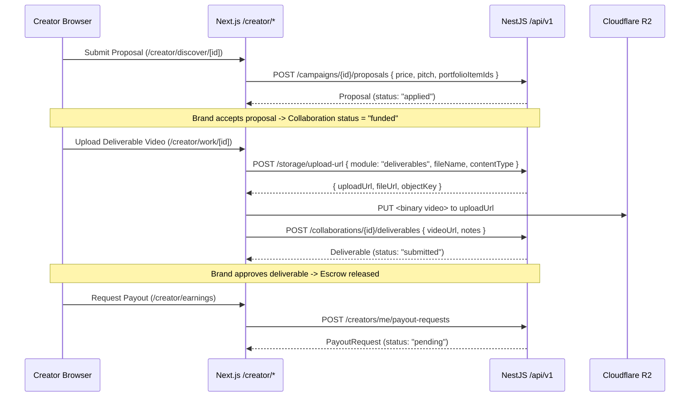

# Phase 3: Creator Web Flows, Shared Notifications & End-to-End Verification

# Document Control

- **Version**: 1.0.0
- **Date Created**: 2026-10-29
- **Last Updated**: 2026-10-29
- **Status**: DONE
- **Phase**: 3 of 3
- **Parent Document**: `operations/specs/web_app_soft_launch/00_overview.md`

---

# Executive Summary

- **Goal**: Implement all Creator web flows (`Home Queue`, `Campaign Discovery`, `Campaign Detail & Submit Proposal`, `Active Work Board`, `Collaboration Workspace & Deliverable Video Upload`, `My Proposals`, `Earnings & Payout Request`, `Creator Profile & Portfolio`), shared views (`Collaboration Chat`, `Notifications`, `Settings`), and end-to-end verification tests.
- **Scope**: Production feature (Creator Web Experience, Shared Flows & Verification).
- **Domains**: Frontend (`apps/web/src/hooks/api/*`, `apps/web/src/app/creator/*`, `apps/web/src/app/chats/*`, `apps/web/src/app/notifications/*`, `apps/web/src/app/settings/*`).
- **Architecture**: Next.js 15 App Router pages using C3 Sage primitives and TanStack Query v5 hooks (`useCreator`, `useHomeQueue`, `useCampaigns`, `useProposals`, `useCollaborations`, `useDeliverables`, `useStorage`, `useMessages`, `useNotifications`).
- **Tech Stack**: Next.js 15, React 19, TanStack Query v5, Axios, Vitest / Testing Library (or Node test runner), TypeScript 5.
- **Entry Condition**: Phase 1 (`plan_phase_1.md`) and Phase 2 (`plan_phase_2.md`) are complete.
- **Exit Condition**: Creator and Shared routes build, pass lint, typecheck, and automated tests, completing the two-sided marketplace loop on web.

---

# Requirements

## Functional, Security, Constraint & Pattern Requirements

- **REQ-W3-001**: WHEN an authenticated Creator user opens `/creator/home` THE SYSTEM SHALL display the creator greeting, vetting status banner (if `vettingStatus !== 'approved'`), urgent and upcoming action queue items from `GET /api/v1/creators/me/home-queue`, and quick navigation tiles.
- **REQ-W3-002**: WHEN a Creator browses `/creator/discover` THE SYSTEM SHALL fetch live campaigns from `GET /api/v1/campaigns`, support filtering by search query and video type / niche chips, and allow submitting a proposal (`price`, `pitch`, `portfolioItemIds`) on `/creator/discover/{id}` via `POST /api/v1/campaigns/{id}/proposals`.
- **REQ-W3-003**: WHEN a Creator opens an active collaboration on `/creator/work/{id}` THE SYSTEM SHALL display collaboration status, brand feedback (when `status === 'revision_requested'`), and allow uploading an MP4/MOV video file via `POST /api/v1/storage/upload-url` (or `POST /api/v1/collaborations/{id}/deliverables/upload-url`) followed by `POST /api/v1/collaborations/{id}/deliverables`.
- **REQ-W3-004**: WHEN a Creator opens `/creator/earnings` THE SYSTEM SHALL display withdrawable balance (`availableForPayout`), pending escrow (`pendingApproval`), total earned (`totalEarned`), payout method settings (`PATCH /api/v1/creators/me/payout-details`), payout request action (`POST /api/v1/creators/me/payout-requests`), and the creator ledger (`GET /api/v1/creators/me/ledger`).
- **REQ-W3-005**: WHEN a Brand or Creator opens `/chats/{collaborationId}` THE SYSTEM SHALL poll `GET /api/v1/collaborations/{id}/messages` every 5 seconds, render system event capsules (`escrow_funded`, `shipment_confirmed`, `deliverable_submitted`, `deliverable_approved`, `revision_requested`) and user messages, and send new messages via `POST /api/v1/collaborations/{id}/messages`.
- **REQ-W3-006**: WHEN a Brand or Creator opens `/notifications` THE SYSTEM SHALL group notifications into `Today`, `Yesterday`, and `Earlier`, allow marking all as read (`POST /api/v1/notifications/read-all`), and navigate to the target collaboration, campaign, or deliverable on click.
- **SEC-W3-001**: THE SYSTEM SHALL validate video file MIME types (`video/mp4`, `video/quicktime`, `video/webm`) and file size (`<= 250 MB`) on the client before requesting a presigned upload URL.

```gherkin
Feature: Creator Discovery, Proposal Submission, Deliverable Upload, and Earnings

  Scenario: Creator discovers a live brief and submits a proposal
    Given an authenticated Creator is on "/creator/discover"
    When the Creator clicks on a live brief card
    Then the browser navigates to "/creator/discover/{id}"
    When the Creator enters price "1500" EGP and pitch "I create skincare try-on videos" and submits
    Then the system calls POST "/campaigns/{id}/proposals"
    And the proposal appears in "/creator/proposals" with status "applied"

  Scenario: Creator uploads a deliverable video for a funded collaboration
    Given a Creator has a funded collaboration on "/creator/work/{id}"
    When the Creator selects a valid ".mp4" video file and clicks "Submit deliverable"
    Then the system obtains a presigned URL from "/storage/upload-url", uploads the file, and calls POST "/collaborations/{id}/deliverables"
    And the collaboration status updates to "delivered"
```

---

# Dependencies

| ID | Name | Type | Version | Purpose |
|---|---|---|---|---|
| DEP-W3-001 | `@ugcx/shared-types` | workspace | `workspace:*` | Shared notification catalog, collaboration/deliverable statuses, payout types |
| DEP-W3-002 | `@tanstack/react-query` | package | `^5.66.0` | Query caching, mutations, and 5-second message polling |

---

# Plan Details

## Design — *How it should happen*

### Decisions

| ID | Decision | Rationale | Alternatives Considered | Side Effect |
|---|---|---|---|---|
| DES-W3-001 | Use `POST /api/v1/storage/upload-url` with `module: 'deliverables'` for deliverable video uploads, and gracefully fall back to a mock object key when running against a local test R2 URL (`local-test-r2-account`) or dev environment without R2 credentials. | Matches `AUD-001` and `AUD-003` from the Brand Flow audit while keeping local development functional out of the box. | Hardcode `/collaborations/{id}/deliverables/upload-url` only. Rejected because `StorageController` owns `/storage/upload-url`. | `useStorage.ts` handles both real presigned PUT uploads and local dev fallback cleanly. |
| DES-W3-002 | Map creator ledger status colors to C3 Sage semantic tokens (`colors.success`, `colors.primary`, `colors.muted`) instead of raw hex strings returned by older backend rows. | Enforces `DESIGN.md` and `AUD-004`. | Render backend hex color strings directly. Rejected because it violates C3 Sage token rules. | `/creator/earnings` renders consistent C3 Sage ledger rows. |

### Constraints & Assumptions

| Type | ID | Description | Impact if Wrong | Handling Strategy |
|---|---|---|---|---|
| Constraint | CON-W3-001 | Automated bank payouts remain behind `FEATURE_FLAGS.automatedPayouts` (`false`); payout requests enter the manual admin queue via `POST /creators/me/payout-requests`. | Users might expect instant bank transfer. | Display clear manual payout processing copy (1-3 business days via InstaPay / Bank Transfer / Vodafone Cash). |

### Edge Cases

| ID | Scenario | Expected Behavior | Handling Strategy |
|---|---|---|---|
| EDGE-W3-001 | `campaign.product` is `null` on a V1 brief (`DEC-009` made `product_id` nullable). | Creator discovery, home queue, and work cards display `campaign.title` without throwing a null pointer error. | Always resolve `campaign.title || campaign.product?.name || t('common.untitled')`. |
| EDGE-W3-002 | Creator with `availableForPayout <= 0` clicks "Request payout". | Button is disabled when withdrawable balance is `0`. | Disable the CTA when `Number(earnings?.availableForPayout ?? 0) <= 0`. |

### Directory Map

```text
apps/web/src/
├── hooks/
│   └── api/
│       ├── useCreator.ts                         [CREATE]
│       └── useHomeQueue.ts                       [CREATE]
├── app/
│   ├── creator/
│   │   ├── home/
│   │   │   └── page.tsx                          [CREATE]
│   │   ├── discover/
│   │   │   ├── page.tsx                          [CREATE]
│   │   │   └── [id]/
│   │   │       └── page.tsx                      [CREATE]
│   │   ├── work/
│   │   │   ├── page.tsx                          [CREATE]
│   │   │   └── [id]/
│   │   │       └── page.tsx                      [CREATE]
│   │   ├── proposals/
│   │   │   └── page.tsx                          [CREATE]
│   │   ├── earnings/
│   │   │   └── page.tsx                          [CREATE]
│   │   └── profile/
│   │       └── page.tsx                          [CREATE]
│   ├── chats/
│   │   └── [collaborationId]/
│   │       └── page.tsx                          [CREATE]
│   ├── notifications/
│   │   └── page.tsx                              [CREATE]
│   └── settings/
│       └── page.tsx                              [CREATE]
└── __tests__/
    └── smoke.test.ts                             [CREATE]
```

### Directory Specifications

| ID | Task | File(s) | Responsibility or Expected Behaviors | Validations/Error Handling | Key Configurations/Settings |
|---|---|---|---|---|---|
| TASK-W3-001 (DONE) | Create Creator Hooks & Home Queue Page | `apps/web/src/hooks/api/useCreator.ts`, `useHomeQueue.ts`, `apps/web/src/app/creator/home/page.tsx` | Implement `useCreatorProfile`, `useUpdateCreatorProfile`, `useCreatorPortfolio`, `useAddPortfolioItem`, `useDeletePortfolioItem`, `useCreatorEarnings`, `useCreatorLedger`, `useUpdatePayoutDetails`, `useRequestPayout`, and `useHomeQueue`. Build `/creator/home` with greeting header, vetting status card, urgent and upcoming queue items, and quick actions (`Discover`, `Work`, `Proposals`, `Earnings`). | Safely handle nullable `campaign.product` on queue items (`EDGE-W3-001`). | `IMPLEMENTS: REQ-W3-001` |
| TASK-W3-002 (DONE) | Build Creator Campaign Discovery & Submit Proposal Pages | `apps/web/src/app/creator/discover/page.tsx`, `apps/web/src/app/creator/discover/[id]/page.tsx` | Build `/creator/discover` with search bar, deliverable type filter chips (`All`, `Talking head`, `Try-on`, `Unboxing`), and live campaign cards showing budget EGP, duration, language, and shipping badge. Build `/creator/discover/[id]` showing full brief details, script notes, and Submit Proposal form (`price`, `pitch`, optional portfolio item checkboxes). | Validate `price > 0` and non-empty `pitch` before calling `POST /campaigns/{id}/proposals`. | `IMPLEMENTS: REQ-W3-002` |
| TASK-W3-003 (DONE) | Build Creator Work Board, Deliverable Upload & My Proposals Pages | `apps/web/src/app/creator/work/page.tsx`, `apps/web/src/app/creator/work/[id]/page.tsx`, `apps/web/src/app/creator/proposals/page.tsx` | Build `/creator/work` filtering collaborations (`Active`, `Needs Action`, `Completed`), `/creator/work/[id]` showing milestone timeline, brand revision feedback alert card, HTML5 video file picker + presigned upload (`useStorage` + `useCreateDeliverable`) or direct video URL input for quick dev testing, and `/creator/proposals` listing submitted proposals with status badges. | Validate video MIME type and size (`SEC-W3-001`). Show upload progress indicator. | `IMPLEMENTS: REQ-W3-003, SEC-W3-001` |
| TASK-W3-004 (DONE) | Build Creator Earnings & Profile/Portfolio Pages | `apps/web/src/app/creator/earnings/page.tsx`, `apps/web/src/app/creator/profile/page.tsx` | Build `/creator/earnings` with withdrawable balance hero card (`tabular-nums`), pending and lifetime stats strip, Request Payout modal, Payout Method sheet (`bank_transfer` / `instapay` / `vodafone_cash`), and ledger rows. Build `/creator/profile` with identity card, profile editor (`displayName`, `bio`, `city`, `niches`, `rateCard`), and portfolio item manager. | Disable payout request when `availableForPayout <= 0` (`EDGE-W3-002`). | `IMPLEMENTS: REQ-W3-004, CON-W3-001` |
| TASK-W3-005 (DONE) | Build Shared Chat, Notifications, Settings & Verification Suite | `apps/web/src/app/chats/[collaborationId]/page.tsx`, `apps/web/src/app/notifications/page.tsx`, `apps/web/src/app/settings/page.tsx`, `apps/web/src/__tests__/smoke.test.ts` | Build `/chats/[collaborationId]` with 5s message polling, system event capsules, and message composer; `/notifications` with `Today` / `Yesterday` / `Earlier` sections and `Mark all read`; `/settings` with `EN`/`AR` toggle, role switcher helper for dev QA, and Sign Out. Add unit/smoke tests and run full lint, typecheck, test, and production build. | Prevent empty chat message submission. Auto-scroll chat thread on new messages. | `IMPLEMENTS: REQ-W3-005, REQ-W3-006` |

### Data Flow



---

# Risks

| ID | Risk | Likelihood | Impact | Mitigation |
|---|---|---|---|---|
| RISK-W3-001 | Large video file upload fails on local dev when Cloudflare R2 credentials are dummy values. | High | Medium | `useStorage.ts` detects `local-test-r2-account` or network CORS error on dummy R2 hosts and resolves with the generated `fileUrl` so local E2E testing of deliverable registration succeeds (`DES-W3-001`). |
| RISK-W3-002 | 5-second chat polling continues after user leaves `/chats/[collaborationId]`. | Low | Low | TanStack Query automatically stops `refetchInterval` when the component unmounts. |

---

# Code Guidelines

- **Clean Code (`clean-code`)**: Reuse `StatusBadge`, `Card`, `AppText`, and `QueryStateView` across all Creator and Shared screens so Brand and Creator views share 100% visual parity.
- **Security (`security`)**: Sanitize and validate all user-supplied URLs and file types before upload or playback.
- **Frontend Patterns (`frontend-patterns`)**: Keep chat message input controlled with optimistic or immediate `invalidateQueries({ queryKey: ['messages', collaborationId] })` on send.
