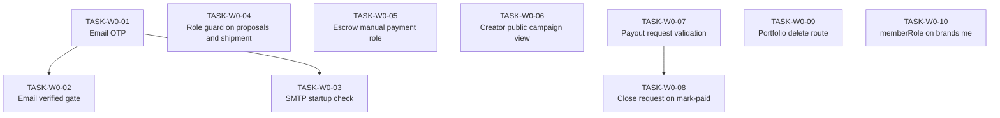

# Phase W0: API Safety Fixes

# Document Control

- **Version**: 1.0.0
- **Date Created**: 2026-10-30
- **Last Updated**: 2026-10-30
- **Status**: DONE
- **Parent**: `operations/specs/web_ledger_mono/01_overview.md`
- **Backend items**: BG-01, BG-02, BG-03, BG-04, BG-05, BG-06, BG-07, BG-11. Two extra tasks support BG-01 and BG-06.
- **Task count**: 10
- **Screens**: None directly. The phase unblocks screens 3, 16, 23 and every role aware screen.

---

# Executive Summary

- **Goal**: Close the seven P0 security and defect items before any redesigned screen reaches a shared environment. Add the brand role to `GET /brands/me` for the web.
- **Why it ships first**: The API accepts the login code `0000` for every account in every environment. A `viewer` can change proposal status and confirm shipment. A creator can read campaign escrow counters. A creator can request any payout amount.
- **Entry condition**: `AuthService`, `MailerService`, `BrandRoleGuard`, `CreatorsService`, and `CampaignsService` ship today. The latest migration is `1788600000007-CreatePayoutRequests`.
- **Exit condition**: Email login works with a random code. The fixed code works only when `NODE_ENV` is `development` or `test`. A `viewer` gets 403 on every write route in this phase. A creator never receives escrow counters. A payout request is validated and checked against the balance. The portfolio delete route exists. `GET /brands/me` returns `memberRole`.

---

# Requirements

## Functional Requirements

- **REQ-W001**: THE SYSTEM SHALL email a random numeric login code to the address in a send request, and store only a keyed hash of the code.
- **REQ-W002**: THE SYSTEM SHALL reject a login code after 10 minutes, after 5 wrong attempts, or after one successful use.
- **REQ-W003**: THE SYSTEM SHALL accept the fixed code `0000` only when `NODE_ENV` is `development` or `test`.
- **REQ-W004**: THE SYSTEM SHALL mark `email_verified_at` on a user after a successful email code check.
- **REQ-W005**: THE SYSTEM SHALL let a brand user with `email_verified_at` or `phone_verified_at` create a brief.
- **REQ-W006**: THE SYSTEM SHALL refuse proposal status changes and shipment confirmation to a brand member whose role is `viewer`.
- **REQ-W007**: THE SYSTEM SHALL allow only the brand role `owner` to submit a manual escrow payment.
- **REQ-W008**: THE SYSTEM SHALL return only public campaign fields to a creator.
- **REQ-W009**: THE SYSTEM SHALL validate a payout request amount and method, and refuse an amount above the available balance.
- **REQ-W010**: THE SYSTEM SHALL refuse a second payout request while one request is open.
- **REQ-W011**: THE SYSTEM SHALL let a creator delete a portfolio item that the creator owns.
- **REQ-W012**: THE SYSTEM SHALL return the caller brand role as `memberRole` on `GET /brands/me`.

## Security Requirements

- **SEC-W001**: The system never logs a login code in production. It logs the code only in development and test, as `MailerService` does today.
- **SEC-W002**: The system compares code hashes with `timingSafeEqual`.
- **SEC-W003**: A send request for an unknown address and for a known address returns the same response. The response does not reveal if the user exists.
- **SEC-W004**: Every route in this phase keeps `JwtAuthGuard` and `RolesGuard`. The auth routes keep `ThrottlerGuard`.
- **SEC-W005**: In production, the API refuses to start when `SMTP_USER` or `SMTP_PASS` is empty.

## Constraints

- Follow decisions 1 to 6 in `01_overview.md`. This phase uses decision 3 (brand roles) and decision 5 (money in cents).
- Keep the mobile app working in development and test. Mobile uses `phone` login. See DEC-W001.
- Font weights in the OTP email change from 700 and 800 to 500.

## Decisions

| ID | Decision | Reason | Impact |
|---|---|---|---|
| DEC-W001 | In production, `POST /auth/otp/send` and `POST /auth/otp/verify` with `phone` return 400 `phone_otp_unavailable`. Development and test keep the fixed code for `phone`. | No SMS provider exists (decision Q14). The fixed code on a phone number is the same hole as before. | The mobile app cannot sign in by phone in production until an SMS provider ships. Mobile keeps working in development. Confirm with the user before W0 closes. |
| DEC-W002 | Add `users.email_verified_at`. A brand user passes the brief gate with either verification. | A web brand signs in by email. It never gets `phone_verified_at`, so `CampaignsService.create` would return `phone_not_verified` for every web brand. | One new column. The gate error code stays `phone_not_verified` so the mobile client keeps working. |
| DEC-W003 | A payout request stays `PENDING` until an admin marks a payout as paid. `AdminPayoutsService.markPaid` then moves the oldest `PENDING` request of that creator to `PAID`. | Today nothing moves a request out of `PENDING`. The admin pays by collaboration and never touches `payout_requests`. A rule of "one open request" would block a creator forever. | `markPaid` gains a small write in its existing transaction. |
| DEC-W004 | The login code has 6 digits. One constant `OTP_CODE_LENGTH` in `packages/shared-types/src/auth.ts` holds the length. | A 4 digit code has 10,000 values. A 6 digit code has 1,000,000. The 5 attempt limit makes both safe online, but 6 digits resists a database leak better. | The layout studio shows 4 boxes. W2 task TASK-W2-01 uses the constant and shows 6 boxes. The email text changes. |

---

# Task Dependency Graph



Tasks 04, 05, 06, 09, and 10 are independent. Run them in any order.

---

# Tasks

## TASK-W0-01: Email OTP with a random code (BG-01)

- **Verdict**: EXTEND. `AuthService.sendOtp` always emails `0000`. `AuthService.verifyOtp` accepts `0000` or `000000` for every identifier. `MailerService.sendOtpEmail` exists and sends over SMTP.
- **Files**:

| File | Change |
|---|---|
| `apps/api/src/modules/auth/entities/auth-otp-code.entity.ts` | NEW |
| `apps/api/src/migrations/1788600000008-CreateAuthOtpCodes.ts` | NEW |
| `apps/api/src/modules/auth/auth.module.ts` | Register `AuthOtpCode` in `TypeOrmModule.forFeature` |
| `apps/api/src/modules/auth/auth.service.ts` | Rewrite `sendOtp` and `verifyOtp` (lines 172 to 198) |
| `apps/api/src/config/configuration.ts` | Add `otp` block |
| `apps/api/.env.example` | Add `OTP_TTL_SECONDS`, `OTP_MAX_ATTEMPTS`, and the SMTP keys with comments |
| `apps/api/src/modules/mailer/mailer.service.ts` | Weights 700 and 800 become 500. Text says "6-digit". Subject keeps the code. |
| `packages/shared-types/src/auth.ts` | Add `export const OTP_CODE_LENGTH = 6;` |
| `apps/api/src/modules/auth/auth.service.spec.ts` | Replace the two fixed code tests. Add the cases below. |

### Data model

Table `auth_otp_codes`:

| Column | Type | Nullable | Default | Index |
|---|---|---|---|---|
| `id` | uuid | no | `gen_random_uuid()` | PK |
| `email` | varchar | no | none | `idx_auth_otp_codes_email` |
| `code_hash` | char(64) | no | none | none |
| `attempts` | smallint | no | `0` | none |
| `expires_at` | timestamptz | no | none | none |
| `consumed_at` | timestamptz | yes | null | none |
| `created_at` | timestamptz | no | `now()` | none |

The `email` column holds the lowercase trimmed address. The `code_hash` column holds `HMAC-SHA256(key = jwt.secret, message = email + ':' + code)` as hex.

### Config

```ts
otp: {
  ttlSeconds: parseInt(process.env.OTP_TTL_SECONDS ?? '600', 10),
  maxAttempts: parseInt(process.env.OTP_MAX_ATTEMPTS ?? '5', 10),
},
```

### Behavior

`sendOtp(dto)`:

1. If `dto.phone` is set and `nodeEnv` is `production`, throw `BadRequestException` with code `phone_otp_unavailable` (DEC-W001).
2. If `dto.phone` is set outside production, keep today's behavior (log only).
3. For `dto.email`: lowercase and trim. Mark every unconsumed row for that email as consumed. Generate the code with `crypto.randomInt(0, 10 ** OTP_CODE_LENGTH)` and left pad with zeros. Save a row with `expires_at = now + ttlSeconds`. Call `mailerService.sendOtpEmail(email, code)`.
4. Return the same response whether the user exists or not (SEC-W003).
5. Do not log the code when `nodeEnv` is `production` (SEC-W001).

`verifyOtp(dto)`:

1. For `dto.phone`: in production throw `phone_otp_unavailable`. Otherwise accept only `0000` or `000000`, as today.
2. For `dto.email`: if `nodeEnv` is `development` or `test` and `dto.otp` is `0000`, skip to step 5. Never allow this in any other `nodeEnv` (REQ-W003). A missing or unknown `nodeEnv` counts as production.
3. Load the newest row for the email where `consumed_at IS NULL`. If none or `expires_at` is past, throw `UnauthorizedException('Invalid OTP')`.
4. If `attempts >= maxAttempts`, throw `UnauthorizedException('Invalid OTP')`. Increment `attempts`. Compare hashes with `timingSafeEqual`. On a mismatch throw the same error. On a match set `consumed_at = now`.
5. Continue with the existing user lookup and registration code. After the user is found or created, set `email_verified_at` (TASK-W0-02).

The error message is the same for unknown, expired, used, and wrong codes. This hides which case failed.

### Test cases

`apps/api/src/modules/auth/auth.service.spec.ts`:

1. `sendOtp` stores a hash, not the code, and calls `sendOtpEmail` with a code of the right length.
2. `sendOtp` marks the earlier unconsumed code as consumed.
3. `sendOtp` rejects `phone` when `nodeEnv` is `production`.
4. `verifyOtp` accepts the right code once and sets `consumed_at`.
5. `verifyOtp` rejects the same code a second time.
6. `verifyOtp` rejects an expired code.
7. `verifyOtp` rejects a wrong code and increments `attempts`.
8. `verifyOtp` rejects after `maxAttempts`, even with the right code.
9. `verifyOtp` accepts `0000` when `nodeEnv` is `test` and rejects it when `nodeEnv` is `production` or unset.
10. The error message is identical for the unknown, expired, used, and wrong cases.

### Acceptance criteria

1. `pnpm --filter api migration:run` applies the migration on a fresh database. `migration:revert` drops the table.
2. With `NODE_ENV=production`, `POST /api/v1/auth/otp/verify` with `{ email, otp: "0000" }` returns 401.
3. With real SMTP settings, a send request delivers an email with a 6 digit code, and verify with that code returns tokens.
4. A sixth wrong attempt returns 401 even when the code is right.
5. The OTP email HTML contains no `font-weight: 700` or `800`.

---

## TASK-W0-02: Email verified gate (DEC-W002)

- **Verdict**: EXTEND. `users.phone_verified_at` exists. `CampaignsService.create` (line 84 to 92) checks only that column.
- **Files**:

| File | Change |
|---|---|
| `apps/api/src/modules/users/entities/user.entity.ts` | Add `emailVerifiedAt` after `phoneVerifiedAt` (line 66) |
| `apps/api/src/migrations/1788600000009-AddUserEmailVerifiedAt.ts` | NEW |
| `apps/api/src/modules/auth/auth.service.ts` | Set `emailVerifiedAt` in `verifyOtp` for email logins |
| `apps/api/src/modules/campaigns/campaigns.service.ts` | Change the gate to `!user || (!user.phoneVerifiedAt && !user.emailVerifiedAt)` |
| `apps/api/src/modules/campaigns/campaigns.service.spec.ts` | Add cases |

### Data model

Table `users`: add `email_verified_at` timestamptz, nullable, default null. No index.

### Behavior

1. After a successful email code check, set `email_verified_at = now` if it is null. Do this for a new user and for an existing user.
2. The gate error keeps the code `phone_not_verified` so the mobile client keeps working. Change only the message to "Verify your phone or email before creating a campaign".

### Test cases

1. A user with only `emailVerifiedAt` creates a campaign.
2. A user with only `phoneVerifiedAt` creates a campaign.
3. A user with neither gets 422 `phone_not_verified`.
4. `verifyOtp` by email sets `emailVerifiedAt`.

### Acceptance criteria

1. Migration runs and reverts.
2. A web brand that signed in by email can create a draft brief.

---

## TASK-W0-03: SMTP startup check (SEC-W005)

- **Verdict**: EXTEND. `MailerService` logs a warning and goes silent when `SMTP_USER` or `SMTP_PASS` is empty. In production that makes login impossible without an error.
- **Files**: `apps/api/src/modules/mailer/mailer.service.ts`, `apps/api/.env.example`, `apps/api/src/modules/mailer/mailer.service.spec.ts` (NEW).

### Behavior

1. In the constructor, when `NODE_ENV` is `production` and the SMTP user or password is empty, throw `Error('SMTP credentials are required in production')`.
2. In development and test keep the current local log path.
3. Document `SMTP_HOST`, `SMTP_PORT`, `SMTP_USER`, `SMTP_PASS`, and `EMAIL_FROM` in `.env.example`.
4. Remove `tls: { rejectUnauthorized: false }` only if the user confirms. It disables certificate checks. List it in the open items. Do not change it silently.

### Test cases

1. Production with empty credentials throws.
2. Production with credentials builds a transporter.
3. Development with empty credentials does not throw and logs locally.

### Acceptance criteria

1. `NODE_ENV=production` with empty SMTP settings stops the API at start with the message above.

---

## TASK-W0-04: Role guard on proposal status and shipment (BG-02, BG-03)

- **Verdict**: EXTEND. Both routes carry `@Roles(UserRole.BRAND)` only. The accept route at `proposals.controller.ts` lines 108 to 110 already shows the pattern.
- **Files**:

| File | Change |
|---|---|
| `apps/api/src/modules/proposals/proposals.controller.ts` | Add `@UseGuards(BrandRoleGuard)` and `@BrandRoles(BrandMemberRole.OWNER, BrandMemberRole.APPROVER)` to `updateStatus` (line 91) |
| `apps/api/src/modules/collaborations/collaborations.controller.ts` | Same on `confirmShipment` (line 96) |
| `apps/api/src/modules/proposals/proposals.controller.spec.ts` | NEW or extend |
| `apps/api/src/modules/collaborations/collaborations.controller.spec.ts` | NEW or extend |

### Behavior

A `viewer` gets 403 `brand_role_forbidden`. An `owner` or `approver` keeps working. Import `BrandMemberRole` in both files if missing. Confirm that each module imports `BrandsModule` so the guard can resolve `BrandsService`. The accept route in the same controllers already needs it, so no module change is expected.

### Test cases

1. `viewer` gets 403 on `PATCH /proposals/:id/status`.
2. `approver` gets 200 on the same route.
3. `viewer` gets 403 on `POST /collaborations/:id/confirm-shipment`.
4. `owner` gets 200 on the same route.

### Acceptance criteria

1. The four cases above pass in the Jest suite.

---

## TASK-W0-05: Manual payment role (BG-04)

- **Verdict**: EXTEND. `escrow/checkout` allows `owner`. `escrow/manual-payment` allows `owner` and `approver`. SEC-202 in `plan_phase_2.md` limits funding to `owner`.
- **Files**: `apps/api/src/modules/campaigns/campaigns.controller.ts` (line 148 to 150), `apps/api/src/modules/campaigns/campaigns.controller.spec.ts` (NEW or extend).

### Behavior

Change `@BrandRoles(BrandMemberRole.OWNER, BrandMemberRole.APPROVER)` to `@BrandRoles(BrandMemberRole.OWNER)` on `submitManualPayment`.

### Test cases

1. `approver` gets 403 on `POST /campaigns/:id/escrow/manual-payment`.
2. `owner` gets 200.

### Acceptance criteria

1. Both cases pass. The mobile app does not call this route for an approver. Confirm with a search of `apps/mobile/src` for `manual-payment` before merge.

---

## TASK-W0-06: Creator public campaign view (BG-05)

- **Verdict**: EXTEND. `CampaignsService.listLive` (line 268) and the creator branch of `findOne` (line 320 to 332) return the full `Campaign` entity. The entity holds `escrowFundedAmount`, `escrowAllocatedAmount`, `escrowRefundedAmount`, `fundingPaymobOrderId`, and `fundingRequestedAmount`. The brand view of `GET /campaigns/:id` must keep these fields. The web brand page `app/brand/briefs/[id]/page.tsx` reads them.
- **Files**:

| File | Change |
|---|---|
| `apps/api/src/modules/campaigns/campaigns.service.ts` | Add `toCreatorView(campaign)` and apply it in `listLive` and the creator branch of `findOne` |
| `apps/api/src/modules/campaigns/campaigns.controller.ts` | No route change |
| `apps/api/src/modules/campaigns/campaigns.service.spec.ts` | Add cases |

### Behavior

`toCreatorView` returns the campaign without these keys: `escrowFundedAmount`, `escrowAllocatedAmount`, `escrowRefundedAmount`, `fundingPaymobOrderId`, `fundingRequestedAmount`, and any `availableEscrow` getter value. Use an explicit allow list of keys instead of a deny list, so a future column is private by default. The allow list holds the fields the creator pages use today. Read `apps/web/src/app/creator/discover` and `apps/mobile/src` creator screens to build the list, and keep `brand` and `product` public columns.

`listLive` returns `[views, total]`. Keep the paging shape.

### Test cases

1. `listLive` result rows contain none of the five escrow keys.
2. `findOne` for a creator contains none of the five keys.
3. `findOne` for the owning brand still contains `escrowFundedAmount`.
4. `listLive` rows still contain `title`, `budgetMin`, `budgetMax`, `brand.companyName`, and the other fields on the allow list.

### Acceptance criteria

1. The four cases pass.
2. The web creator discover page and the mobile discover screen still render. Run both manually and note the result in the phase report.

---

## TASK-W0-07: Payout request validation and balance check (BG-06)

- **Verdict**: EXTEND. `CreatorsController.requestPayout` (line 103) takes an inline `{ amount: string; method: string }` type. `CreatorsService.requestPayout` (line 402) saves the request with no checks. `CreatorsService.getEarnings` (line 281) already computes `pendingBalance`.
- **Files**:

| File | Change |
|---|---|
| `apps/api/src/modules/creators/dto/request-payout.dto.ts` | NEW |
| `apps/api/src/modules/creators/creators.controller.ts` | Use the DTO. Add `GET me/payout-requests` |
| `apps/api/src/modules/creators/creators.service.ts` | Validate in `requestPayout`. Add `listPayoutRequests` |
| `apps/api/src/modules/creators/creators.service.spec.ts` | Add cases |
| `packages/shared-types/src/creators.ts` | Add `PayoutRequestSummary` type |

### DTO

```ts
export class RequestPayoutDto {
  @Matches(/^\d{1,8}(\.\d{1,2})?$/, { message: 'amount must be a money string' })
  amount: string;

  @IsEnum(PayoutMethod)
  method: PayoutMethod;
}
```

`PayoutMethod` comes from `creator-payout-detail.entity.ts` (`bank_transfer`, `instapay`, `mobile_wallet`).

### Behavior

`requestPayout(userId, dto)`:

1. Load the creator. Load payout details. If none exist, throw 422 `payout_details_missing`.
2. Convert `dto.amount` with `toCents`. If the result is 0 or less, throw 422 `invalid_amount`.
3. Call `getEarnings`. If the amount in cents is above `toCents(pendingBalance)`, throw 422 `insufficient_balance`.
4. If a request with status `PENDING` exists for the creator, throw 409 `payout_request_open` (REQ-W010).
5. Reject with 422 `method_mismatch` when `dto.method` differs from the saved payout detail method. The web page sends the saved method today.
6. Save the request and return the request id, amount, method, status, and `createdAt`.

`listPayoutRequests(userId)` returns the creator requests newest first with `id`, `amount`, `method`, `status`, `createdAt`.

### Test cases

1. A non-money amount such as `"abc"` or `"10.999"` fails DTO validation.
2. A method outside the enum fails DTO validation.
3. An amount above `pendingBalance` returns 422 `insufficient_balance`.
4. An amount of `"0.00"` returns 422 `invalid_amount`.
5. A second request while one is `PENDING` returns 409.
6. A valid request saves a row with status `PENDING`.
7. No payout details returns 422 `payout_details_missing`.
8. `listPayoutRequests` returns only the caller requests.

### Acceptance criteria

1. The eight cases pass.
2. The web earnings page still submits `{ amount, method }` and now shows the error message for each failure.

---

## TASK-W0-08: Close a payout request on mark-paid (DEC-W003)

- **Verdict**: EXTEND. `AdminPayoutsService.markPaid` (line 44) writes a `payout` transaction inside `dataSource.transaction`. It never touches `payout_requests`.
- **Files**: `apps/api/src/modules/admin/admin-payouts.service.ts`, `apps/api/src/modules/admin/admin-payouts.service.spec.ts`.

### Behavior

Inside the existing transaction, after the payout transaction row saves:

1. Find the oldest `PayoutRequest` with `creatorId = collaboration.creatorId` and status `PENDING`.
2. If one exists, set its status to `PAID`.
3. If none exists, do nothing. Admin can pay with no request.

Register `PayoutRequest` with the admin module repository access if it is not there. Use `manager.getRepository(PayoutRequest)` inside the transaction, which needs no module change.

### Test cases

1. `markPaid` moves the oldest `PENDING` request to `PAID`.
2. `markPaid` with no open request still succeeds.
3. `markPaid` that fails rolls back the request change.

### Acceptance criteria

1. The three cases pass.
2. After an admin marks a payout, the creator can send a new request.

---

## TASK-W0-09: Portfolio delete route (BG-07)

- **Verdict**: EXTEND. `useDeletePortfolioItem` in `apps/web/src/hooks/api/useCreator.ts` (line 58) calls `DELETE /creators/me/portfolio-items/:id`. `CreatorsController` has only `GET` and `POST` for `me/portfolio-items`.
- **Files**: `apps/api/src/modules/creators/creators.controller.ts`, `apps/api/src/modules/creators/creators.service.ts`, `apps/api/src/modules/creators/creators.service.spec.ts`.

### Behavior

1. Add `@Delete('me/portfolio-items/:id')` with `@Roles(UserRole.CREATOR)` and `ParseUUIDPipe` on `id`. Return `204 No Content`.
2. `deletePortfolioItem(userId, id)` loads the creator, finds the item where `id` and `creatorId` both match, and removes it.
3. If no item matches, throw `NotFoundException`. Do not reveal if the item belongs to another creator.
4. Do not delete the stored media file in this task. Record that as a follow up. The file stays in storage.

### Test cases

1. The owner deletes the item and gets 204.
2. A different creator gets 404 and the item stays.
3. An unknown id gets 404.
4. A non-UUID id gets 400.

### Acceptance criteria

1. The four cases pass.
2. The web profile page delete button removes the item.

---

## TASK-W0-10: `memberRole` on `GET /brands/me` (BG-11)

- **Verdict**: EXTEND. `BrandsController.getMe` (line 46) returns the `Brand` entity. `BrandsService.resolveActingBrand` already returns `{ brand, memberRole }`.
- **Files**:

| File | Change |
|---|---|
| `apps/api/src/modules/brands/brands.controller.ts` | Return `{ ...brand, memberRole }` |
| `apps/api/src/modules/brands/brands.service.ts` | Add `getMeWithRole(userId)` that calls `resolveActingBrand` |
| `apps/api/src/modules/brands/brands.service.spec.ts` | Add cases |
| `packages/shared-types/src/brands.ts` | Add `memberRole: BrandMemberRole` to a new `BrandMe` type that extends `Brand` |
| `apps/mobile/src` | No change. The extra field is additive. |

### Behavior

`GET /brands/me` returns every current `Brand` field plus `memberRole` with the value `owner`, `approver`, or `viewer`. Other routes that return `Brand` do not change.

### Test cases

1. An owner gets `memberRole: "owner"`.
2. An invited approver gets `memberRole: "approver"`.
3. A viewer gets `memberRole: "viewer"`.

### Acceptance criteria

1. The three cases pass.
2. `pnpm --filter @ugcx/shared-types build` passes and `apps/web` and `apps/mobile` typecheck.

---

# Phase Verification

Run all commands from the repository root. Read the full output. Count failures and warnings.

```bash
pnpm --filter @ugcx/shared-types build
pnpm --filter api lint
pnpm --filter api typecheck
pnpm --filter api test
pnpm --filter api build
pnpm --filter api migration:run
pnpm --filter api migration:revert
pnpm --filter api migration:run
pnpm --filter web typecheck
```

Manual checks:

1. Start the API with `NODE_ENV=production` and no SMTP settings. The API must stop at start.
2. Start the API with `NODE_ENV=production` and SMTP settings. Send a code to a real address and sign in with it.
3. With `NODE_ENV=production`, verify with `0000`. The API must return 401.
4. Sign in as a `viewer`. Call the two guarded routes. Both must return 403.

# Risks

| ID | Risk | Mitigation |
|---|---|---|
| RISK-W0-01 | Production phone login stops for the mobile app (DEC-W001). | Confirm with the user. Mobile phone login already has no real SMS code. |
| RISK-W0-02 | The allow list in TASK-W0-06 misses a field the mobile app reads. | Search `apps/mobile/src` for each campaign field. Run the mobile discover screen. |
| RISK-W0-03 | SMTP rate limits on a shared Gmail account block codes. | `ThrottlerGuard` limits sends to 10 per minute per IP. Use a transactional mail provider before launch. |
| RISK-W0-04 | TASK-W0-08 pays the wrong request when a creator has many. | The v1 rule allows one open request. Add a request id to `markPaid` in a later phase. |

# Open Items for the User

1. Confirm DEC-W001. Phone login stops working in production.
2. Confirm that `tls: { rejectUnauthorized: false }` in `MailerService` can go (TASK-W0-03).
3. Add real SMTP credentials to the API environment.
