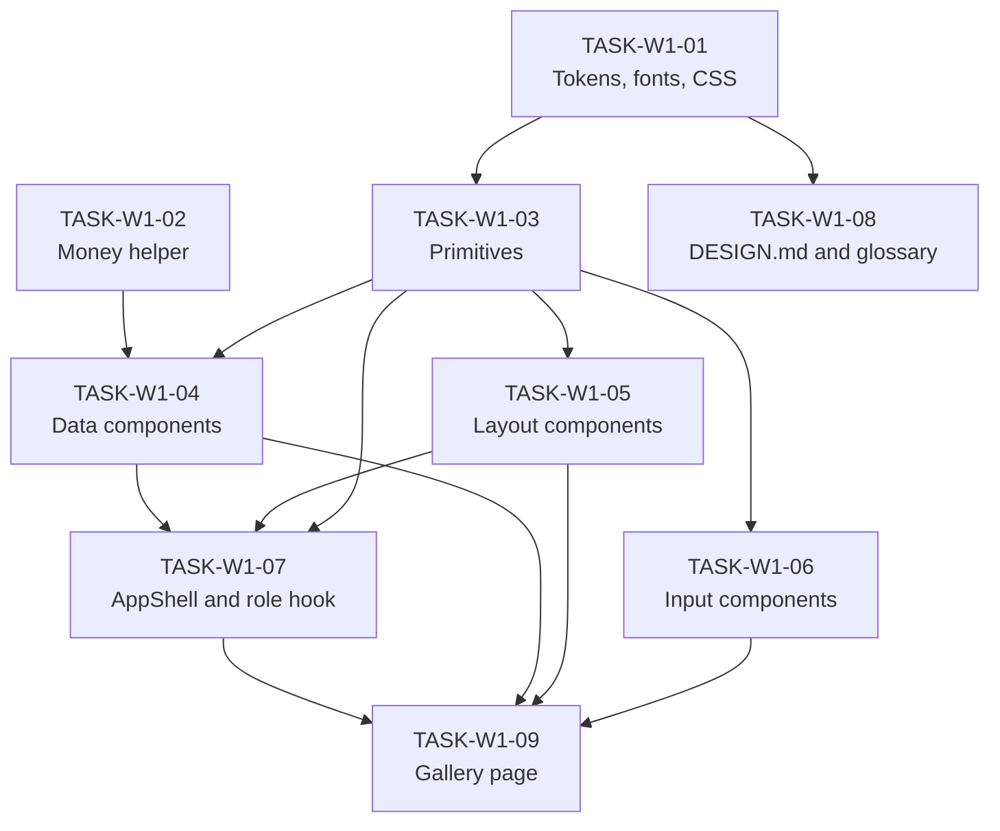

# Phase W1: Ledger Mono Tokens, Primitives, and Shell

# Document Control

- **Version**: 1.0.0
- **Date Created**: 2026-10-30
- **Last Updated**: 2026-10-30
- **Status**: DONE
- **Parent**: `operations/specs/web_ledger_mono/01_overview.md`
- **Backend items**: None. W1 depends on BG-11 (W0, TASK-W0-10) only for `useBrandRole`. Build the hook against the type first and wire it after W0.
- **Task count**: 9
- **Screens**: Shell only. Every page that uses `components/ui` picks up the new finish.

---

# Executive Summary

- **Goal**: Change the shared design layer of `apps/web` once, so the 23 screens in W2 to W4 only compose components.
- **Method**: Extend tokens and primitives with backward compatible props. Add the new shared components named in the assessment. Restyle `AppShell`. Add the money helper and the role hook. Write the Ledger Mono section of `DESIGN.md`.
- **Entry condition**: `apps/web/src/theme/*`, `components/ui/*`, `components/layout/AppShell.tsx`, and `utils/format.ts` ship today. The smoke test asserts `radius.xl` equals 18 and `formatMoney('2400')` equals `EGP 2,400`.
- **Exit condition**: A dev only gallery page shows every component in English and Arabic. All existing pages still compile and render. The smoke suite passes with the new money format. `DESIGN.md` has a Ledger Mono web subsection.

---

# Requirements

## Functional Requirements

- **REQ-W101**: THE SYSTEM SHALL load JetBrains Mono at weights 400 and 500 and use it for numbers, references, overlines, badges, and table headers.
- **REQ-W102**: THE SYSTEM SHALL draw cards at radius 14, hero cards at radius 16, buttons at radius 10, chips at radius 8, and badges at radius 4.
- **REQ-W103**: THE SYSTEM SHALL print every money value with two decimals, in the form `EGP 3,200.00`.
- **REQ-W104**: THE SYSTEM SHALL compute every sum or difference of money values in integer cents.
- **REQ-W105**: THE SYSTEM SHALL map every status value to one badge tone from one table.
- **REQ-W106**: THE SYSTEM SHALL show a table as a card list below 768 px width.
- **REQ-W107**: THE SYSTEM SHALL tell each brand screen what the caller may do, from the role in `GET /brands/me`.
- **REQ-W108**: THE SYSTEM SHALL keep letters joined in Arabic. It sets `letter-spacing: 0` and `text-transform: none` under `:lang(ar)` for mono uppercase text.

## Constraints

- **CON-W101**: Font weights are 400 and 500 only.
- **CON-W102**: Use logical CSS only. Do not use `left`, `right`, `margin-left`, `padding-right`, or `text-align: left`.
- **CON-W103**: Import every color, radius, and size from `apps/web/src/theme/*`. Do not hardcode hex values in a component.
- **CON-W104**: Keep every existing prop of every existing component. Add props only. Existing pages must compile with no change.
- **CON-W105**: Do not change `apps/mobile`. Ledger Mono is for the web (decision Q1).
- **CON-W106**: Do not add `radius.xl` changes. Keep `radius.xl` at 18 for token parity with `DESIGN.md`. Add new radius keys.

## Decisions

| ID | Decision | Reason | Impact |
|---|---|---|---|
| DEC-W101 | Load JetBrains Mono in the existing Google Fonts link in `app/layout.tsx`. | The app loads Inter and IBM Plex Sans Arabic this way today. One method keeps one place to change. | A network font request. `font-display: swap` stays. |
| DEC-W102 | Build the table, chart, and stepper components in-house. Add no UI or chart library. | The package list has no UI library. The shapes are simple. A library adds weight and RTL risk. | More code in `components/ui`. |
| DEC-W103 | Keep the old `Card` look available through `tone`. Change only the default look. | Pages that W2 has not rebuilt must not break. | The default `Card` changes everywhere at once. |
| DEC-W104 | Add a dev only page at `/dev/components`. | Reviewers need to see every component in both directions and take the screenshot pair. | The page returns `notFound()` when `NODE_ENV` is `production`. |

---

# Task Dependency Graph



---

# Tasks

## TASK-W1-01: Tokens, fonts, and global CSS

- **Verdict**: EXTEND. `theme/tokens.ts`, `theme/typography.ts`, `theme/elevation.ts`, and `app/globals.css` ship. `app/layout.tsx` loads Inter and IBM Plex Sans Arabic.
- **Files**:

| File | Change |
|---|---|
| `apps/web/src/app/layout.tsx` | Add `family=JetBrains+Mono:wght@400;500` to the Google Fonts link |
| `apps/web/src/app/globals.css` | Add `--font-mono`, `--dash-line`, `--paper`, and the `:lang(ar)` rules |
| `apps/web/src/theme/tokens.ts` | Add keys below |
| `apps/web/src/theme/typography.ts` | Add mono roles below |
| `apps/web/src/theme/elevation.ts` | Add `card` |
| `apps/web/src/__tests__/smoke.test.ts` | Add token cases |

### Token additions

```ts
// colors
dashLine: '#b9c4bc',
infoSurface: '#e3ebfb',
// radius (keep xl 18)
card: 14, hero: 16, button: 10, chip: 8, badge: 4,
```

```ts
// elevation
card: '0 1px 3px rgba(23, 36, 28, 0.06)',
```

```ts
// typography, weights 400 and 500 only
metricMono: { fontSize: 38, lineHeight: 46, letterSpacing: -2, weight: 500, mono: true },
metricMd:   { fontSize: 28, lineHeight: 34, letterSpacing: -1.2, weight: 500, mono: true },
metricSm:   { fontSize: 22, lineHeight: 28, letterSpacing: -0.8, weight: 500, mono: true },
overlineMono: { fontSize: 11, lineHeight: 14, letterSpacing: 0.8, weight: 500, mono: true },
badgeMono:  { fontSize: 10, lineHeight: 14, letterSpacing: 0.6, weight: 500, mono: true },
tableHead:  { fontSize: 10.5, lineHeight: 14, letterSpacing: 0.7, weight: 500, mono: true },
numeric:    { fontSize: 15, lineHeight: 22, letterSpacing: 0, weight: 400, mono: true },
```

The `Typography` type gains an optional `mono` flag. Existing roles do not set it.

### CSS additions

```css
:root {
  --font-mono: 'JetBrains Mono', ui-monospace, 'Cascadia Mono', monospace;
  --dash-line: 1px dashed #b9c4bc;
  --paper:
    linear-gradient(rgba(168, 216, 196, 0.07) 1px, transparent 1px) 0 0 / 22px 22px,
    linear-gradient(90deg, rgba(168, 216, 196, 0.07) 1px, transparent 1px) 0 0 / 22px 22px,
    var(--color-surface-dark);
}
:lang(ar) .mono-caps,
:lang(ar) [data-mono-caps] { letter-spacing: 0; text-transform: none; }
```

Use the `data-mono-caps` attribute on every element that uses `overlineMono`, `badgeMono`, or `tableHead`. The `AppText` change in TASK-W1-03 sets it.

### Test cases

1. `radius.xl` is 18. `radius.card` is 14. `radius.hero` is 16.
2. Every typography role has weight 400 or 500, including the new roles.
3. `colors.dashLine` is `#b9c4bc`.

### Acceptance criteria

1. `pnpm --filter web typecheck` and the smoke suite pass.
2. The page source shows the JetBrains Mono link.
3. In the browser, `getComputedStyle(document.documentElement).getPropertyValue('--font-mono')` returns the stack.

---

## TASK-W1-02: Web money helper

- **Verdict**: NEW for `utils/money.ts`. EXTEND for `utils/format.ts`. Pages call `Number()` on amounts today (`app/brand/briefs/new/page.tsx`, `app/brand/briefs/[id]/fund/page.tsx`, `app/creator/earnings/page.tsx`). `formatAmount` drops `.00`.
- **Files**:

| File | Change |
|---|---|
| `apps/web/src/utils/money.ts` | NEW |
| `apps/web/src/utils/format.ts` | Change `formatAmount` and `formatMoney`. Add `formatRef`. |
| `apps/web/src/__tests__/money.test.ts` | NEW |
| `apps/web/src/__tests__/smoke.test.ts` | Update the two money assertions |
| `apps/web/package.json` | Change the `test` script to `npx tsx --test src/__tests__/*.test.ts` |

### Contract

```ts
// utils/money.ts. Mirror apps/api/src/common/utils/money.ts.
export function toCents(amount: string | number | null | undefined): number;
export function centsToAmount(cents: number): string;      // '3200.00'
export function sumCents(values: Array<string | number | null | undefined>): number;
export function subCents(a: string, b: string): number;
```

`toCents('3200.50')` returns `320050`. It parses the string by splitting on the dot. It never calls `parseFloat`. It throws on a string that does not match `^-?\d+(\.\d{1,2})?$`, as `apps/api/src/common/utils/money.ts` does. A `number` input converts through `toFixed(2)` first. Read the API helper before writing and copy its rules.

```ts
// utils/format.ts
formatAmount('3500')    // '3,500.00'
formatMoney('2400')     // 'EGP 2,400.00'
formatMoney('-5000')    // 'EGP -5,000.00'
formatRef('9f3c2a1b-...') // 'BR-9F3C2A'  (first 6 hex chars, upper case, prefix argument)
```

`formatRef(id, prefix = 'BR')` supports decision Q7.

### Test cases

1. `toCents('3200.50')` is `320050`. `toCents('0.1') + toCents('0.2')` equals `toCents('0.3')`.
2. `centsToAmount(320050)` is `'3200.50'`. `centsToAmount(5)` is `'0.05'`.
3. `sumCents(['0.10', '0.20'])` is `30`. `toCents('abc')` and `toCents('1.234')` throw.
4. `formatMoney('2400')` is `'EGP 2,400.00'`. `formatMoney(null)` is `'EGP 0.00'`.
5. `formatRef` returns the same value for the same id and starts with the prefix.
6. Parity: run the same 8 sample amounts through the API helper and the web helper in a test. The cents must match. Import the API file by relative path in the test, or copy the 8 expected values from the API spec.

### Acceptance criteria

1. `pnpm --filter web test` runs both test files and passes.
2. A search of `apps/web/src` for `parseFloat` returns no money use. Replace each `Number(` money use found in the three pages above with `toCents`. List any use left, with the reason.

---

## TASK-W1-03: Primitive restyle

- **Verdict**: EXTEND for `Card`, `PressableCard`, `SignatureCard`, `Button`, `FilterChip`, `AppText`, `TextInput`, `Icon`, `AsyncStates`, `ModalSheet`. REPLACE for `StatusBadge` (same props, new body). NEW for `Tag`.
- **Files**: `apps/web/src/components/ui/{Card,SignatureCard,StatusBadge,Button,FilterChip,AppText,TextInput,Icon,AsyncStates,ModalSheet}.tsx`, `Tag.tsx` (NEW), `index.ts`, `apps/web/src/utils/statusTone.ts` (NEW), `apps/web/src/__tests__/statusTone.test.ts` (NEW).

### Changes

| Component | Change |
|---|---|
| `Card`, `PressableCard` | Radius `radius.card`. Border `hairline`. Shadow `elevation.card`. New optional `header` prop (node) renders a header row with a dashed bottom border. New `bleed` prop removes padding for tables. Keep `tone` and `padding`. |
| `SignatureCard` | New variant `hero`: `background: var(--paper)`, radius `radius.hero`, color on dark. Existing variants stay. |
| `StatusBadge` | Mono, uppercase, radius `radius.badge`, padding 3px 8px. Tones `ok`, `pend`, `bad`, `neu`, `info`. The tone comes from `statusTone(domain, status)`. Keep the props `status`, `domain`, `label`. Add `tone` prop to override. |
| `Tag` | Dashed 1px outline in `primary`, radius 4, mono 9.5px uppercase. |
| `Button` | Radius `radius.button`. Variants add `mint` (for dark hero) and `danger-outline`. Add `count` prop (small pill). Keep `sm`, `md`, `lg`. |
| `FilterChip` | Radius `radius.chip`. Count uses mono. |
| `AppText` | Roles with `mono: true` set `font-family: var(--font-mono)` and `data-mono-caps` for the three caps roles. |
| `TextInput` | New `mono` prop for money and email values. |
| `Icon` | Add `arrow-in`, `arrow-up`, `bank`, `star`, `pin`, `clock`, `lock` (exists), `list`, `search`, `filter`, `kbd`. Directional set: `arrow-left`, `arrow-right`, `chevron-*`. Do not mirror `arrow-in`, `arrow-up`. |
| `AsyncStates`, `ModalSheet` | Restyle only. Behavior is the same. |

### Status tone table (`utils/statusTone.ts`)

One function `statusTone(domain, value)` returns a tone. The table covers every value of campaign, proposal, collaboration, and deliverable status. Use the labels from `01_overview.md`.

| Tone | Values |
|---|---|
| `ok` | `live`, `open`, `approved`, `accepted`, `funded`, `paid`, `verified`, `cleared`, `completed` |
| `pend` | `submitted`, `delivered`, `shortlisted`, `shipped`, `applied`, `pending`, `paused` |
| `info` | `in_progress`, `in_production`, `released` |
| `bad` | `declined`, `cancelled`, `payment_failed`, `rejected`, `revision_requested` |
| `neu` | `draft`, anything else |

The current `StatusBadge` maps `in_progress` to the cream tone. Ledger Mono uses `info` for work in production. Record this change in the test.

### Test cases

`statusTone.test.ts`:

1. Every value in the table returns its tone.
2. An unknown value returns `neu`.
3. The function is case insensitive.

### Acceptance criteria

1. All existing pages compile with no edit (CON-W104). Run `pnpm --filter web typecheck` and `pnpm --filter web build`.
2. The gallery (TASK-W1-09) shows each primitive.

---

## TASK-W1-04: Data components

- **Verdict**: NEW. No table, list row, meter, or key value component exists.
- **Files** (all NEW under `apps/web/src/components/ui/`): `DataTable.tsx`, `LedgerTable.tsx`, `ListRow.tsx`, `KpiCells.tsx`, `Equation.tsx`, `Meter.tsx`, `KeyValueList.tsx`, `GroupHeader.tsx`, `AvatarStack.tsx`, `DueChip.tsx`, `Kbd.tsx`, `hooks/useKeyboardShortcut.ts`. Update `index.ts`.

### Component contracts

```ts
interface Column<T> { key: string; header: string; align?: 'start'|'end'; render: (row: T) => ReactNode; mobileLabel?: string; hideOnMobile?: boolean }
DataTable<T>({ columns, rows, rowKey, onRowClick?, emptyState?, minWidth? })
// Above 768 px: table with mono headers and dashed row borders, numbers end aligned.
// Below 768 px: a card list. Each row becomes a card of mobileLabel + value pairs.

LedgerTable({ rows: LedgerRow[], showBalance? })
// LedgerRow = { id, date, title, subtitle?, ref?, status?, amountCents, direction: 'in'|'out'|'hold', balanceCents? }
// Renders the in/out icon cell, signed mono amount (green for in), running balance.
// Signs use the escrow view (decision Q11).

ListRow({ title, subtitle?, leading?, trailing?, onClick? })
KpiCells({ items: Array<{ label, value, hint?, tone? }> })      // dashed cell grid, 2 columns below 760 px
Equation({ parts: Array<{ label, valueCents } | { op: '-'|'+'|'=' }> })  // 'funded - released = available'
Meter({ segments: Array<{ cents, tone }> , total })              // multi segment bar
MiniBar({ value, max })
KeyValueList({ items: Array<[label, ReactNode]> })
GroupHeader({ label, count })
AvatarStack({ people: Array<{ initials, tone? }>, max? })
DueChip({ dueAt, now? })                                         // 'hot' under 48 hours, 'warm' under 7 days, else neutral
Kbd({ children }) and useKeyboardShortcut(key, handler)
```

All amounts enter as integer cents or money strings and pass through `utils/money.ts`. No component calls `Number()` on a money string.

### Test cases

Add `apps/web/src/__tests__/dataHelpers.test.ts` for the pure helpers only (`dueTone`, `meterWidths`, `signedAmount`):

1. `dueTone` returns `hot` for 36 hours and `warm` for 5 days.
2. `meterWidths` returns widths that sum to 100 within 0.1 and never exceed 100.
3. `signedAmount(320000, 'in')` returns `+EGP 3,200.00`. `signedAmount(500000, 'out')` returns `−EGP 5,000.00` with the minus sign `−` (U+2212).

### Acceptance criteria

1. The gallery shows each component with sample data in both directions.
2. In Arabic, amounts keep the order `EGP 3,200.00` (wrapped in `dir="ltr"`).
3. Below 768 px, `DataTable` shows cards with no horizontal scroll.

---

## TASK-W1-05: Layout components

- **Verdict**: NEW.
- **Files** (NEW under `apps/web/src/components/ui/`): `BarChart.tsx`, `Pipeline.tsx`, `HStepper.tsx`, `VerticalTimeline.tsx`, `SplitPane.tsx`, `Receipt.tsx`, `Tabs.tsx`. Update `index.ts`.

### Component contracts

```ts
BarChart({ data: Array<{ label, valueCents }>, max?, highlightLast? })
// SVG or flex bars. Axis labels at 0, half, max. Last bar uses the primary color.
// Chart text uses theme tokens. Bar height = value / max. No library.

Pipeline({ stages: Array<{ key, label, items: Array<{ id, label, hot? }> }> })
// Count per stage in mono. Arrow between stages. The arrow mirrors in RTL.

HStepper({ steps: Array<{ label, date?, state: 'done'|'current'|'todo' }> })
// Dashed line for todo, solid for done. Works on light and on the dark hero (prop tone).

VerticalTimeline({ steps: Array<{ icon, title, detail?, date?, state, action? }> })
SplitPane({ list, detail, selectedId, onSelect, backLabel })
// Two columns above 1080 px. One pane below, with a back button.
Receipt({ header, lines: Array<[label, value]>, total, footer })
Tabs({ items: Array<{ key, label, count? }>, active, onChange })
```

### Test cases

Add pure helper tests in `dataHelpers.test.ts`:

1. `barHeights([2100, 3400, 10700], max = 12000)` returns heights in percent. The largest bar is under 100.
2. `barAxis(12000)` returns `[0, 6000, 12000]` as formatted labels (`0`, `6K`, `12K`).

### Acceptance criteria

1. The gallery shows each component with sample data.
2. `SplitPane` keeps the selected id in the URL query (`?id=`) so a refresh keeps the selection.
3. `HStepper` and `Pipeline` mirror in Arabic. Check by screenshot.

---

## TASK-W1-06: Input components

- **Verdict**: NEW. The login page has inline code boxes today. The new brief page has a plain budget input. There is no upload component with progress.
- **Files** (NEW under `apps/web/src/components/ui/`): `SegmentedControl.tsx`, `RadioCard.tsx`, `Toggle.tsx`, `Checklist.tsx`, `RangeSlider.tsx`, `OtpInput.tsx`, `Dropzone.tsx`, `VideoPlayer.tsx`. Update `index.ts`.

### Component contracts

```ts
SegmentedControl({ options: Array<{ value, label }>, value, onChange, fullWidth? })
RadioCard({ selected, title, description?, icon?, onSelect })
Toggle({ checked, onChange, label })               // role="switch"
Checklist({ items: Array<{ id, label, state: 'met'|'missing'|'unchecked', hint? }>, onToggle? })
RangeSlider({ min, max, step, valueLow, valueHigh, onChange, band?: { low, high } })
// Two handles. Keyboard: arrow keys move a handle by step. Values are integers (whole EGP).
OtpInput({ length = OTP_CODE_LENGTH, value, onChange, onComplete, autoFocus })
// Paste fills all boxes. Backspace moves back. Boxes stay LTR in RTL.
Dropzone({ accept, maxBytes, onFile, progress?, fileName?, onCancel? })
// States: idle, dragging, uploading (percent, MB, time left), done, error.
VideoPlayer({ src, versions?, activeVersion?, onVersionChange?, expiresInSeconds?, onRefresh? })
// Wraps the native video element. Version switch. Shows the signed URL expiry.
```

`OTP_CODE_LENGTH` comes from `@ugcx/shared-types` (set in TASK-W0-01).

### Test cases

Add `apps/web/src/__tests__/inputHelpers.test.ts`:

1. `splitPaste('123456', 6)` returns six digits. `splitPaste('12 34', 6)` returns `['1','2','3','4']`.
2. `clampRange(low, high, min, max)` keeps `low <= high` and both inside the bounds.
3. `validateFile({ size, type }, { maxBytes: 250 * 1024 * 1024, accept: ['video/mp4','video/quicktime','video/webm'] })` rejects a 251 MB file and an `image/png` file with the messages the upload page uses today (`This file is larger than 250 MB`, `This file type is not supported`).

### Acceptance criteria

1. Each component works with the keyboard alone. Tab, Enter, Space, and arrow keys do the expected action.
2. Every control has a visible focus ring.
3. The gallery shows each control in all states.

---

## TASK-W1-07: AppShell restyle and role hook

- **Verdict**: EXTEND for `AppShell.tsx` (388 lines, `BRAND_NAV`, `CREATOR_NAV`). NEW for `hooks/useBrandRole.ts`. EXTEND for `hooks/api/useBrand.ts`.
- **Files**:

| File | Change |
|---|---|
| `apps/web/src/components/layout/AppShell.tsx` | Restyle. Add counts and role aware items. |
| `apps/web/src/hooks/useBrandRole.ts` | NEW |
| `apps/web/src/hooks/api/useBrand.ts` | Type the response as `BrandMe` |
| `apps/web/src/utils/permissions.ts` | NEW |
| `apps/web/src/__tests__/permissions.test.ts` | NEW |

### Shell changes

1. Sidebar: mono role label (`BRAND`, `CREATOR`), mono count pills on `Proposals` and `Notifications`, dashed rule above the footer, footer items Notifications, Settings, Log out.
2. Brand nav keeps Dashboard, Briefs, Proposals, Chats, Profile, Billing. Hide `Billing` for a `viewer`, because `GET /brands/me/billing` allows only `owner` and `approver`.
3. Creator nav keeps Home, Discover, Work, Earnings, Profile, My Proposals. Add `Chats` at `/creator/chats` after TASK-W2-12 ships the route. Do not add the link before then.
4. Mobile tab bar: restyle only. Keep the five items.
5. Counts come from `useUnreadCount` (notifications) and a proposals count that W2 wires. In W1 show the notifications count only.

### Permissions (`utils/permissions.ts`)

The matrix comes from the `@BrandRoles` decorators in the API controllers on 2026-10-30, with the W0 changes applied.

| Action | owner | approver | viewer |
|---|---|---|---|
| `viewDashboard`, `viewBrief`, `viewProposals`, `viewEscrow` | yes | yes | yes |
| `viewBilling` | yes | yes | no |
| `createBrief`, `editBrief`, `publishBrief`, `pauseBrief`, `resumeBrief` | yes | yes | no |
| `shortlistProposal`, `declineProposal`, `acceptProposal`, `confirmShipment`, `reviewDeliverable` | yes | yes | no |
| `fundEscrow`, `topUpEscrow`, `closeBrief`, `editBrand`, `manageTeam` | yes | no | no |

```ts
export type BrandAction = /* the 21 action names above */;
export function can(role: BrandMemberRole | undefined, action: BrandAction): boolean;
```

`can(undefined, …)` returns `false` for every action except the three `view*` actions that a loading state may show. Define this in the file and test it.

`useBrandRole()` returns `{ role, can: (action) => boolean, isLoading }`. It reads `memberRole` from `useBrandProfile`. The API stays the source of truth. A hidden button is a convenience, not security.

### Test cases

`permissions.test.ts`:

1. `can('viewer', 'acceptProposal')` is `false`. `can('approver', 'acceptProposal')` is `true`.
2. `can('approver', 'fundEscrow')` is `false`. `can('owner', 'fundEscrow')` is `true`.
3. `can('viewer', 'viewBilling')` is `false`.
4. `can(undefined, 'fundEscrow')` is `false`.
5. Every action has an entry for all three roles (no missing key).

### Acceptance criteria

1. Sign in as a brand `viewer` (seed or invite one). Billing is not in the nav. Run the check after W0 TASK-W0-10.
2. The shell renders in English and Arabic with the sidebar on the correct side.
3. A search of `components/layout` for `left`, `right`, `margin-left`, `padding-right` returns no layout use.

---

## TASK-W1-08: `DESIGN.md` web section and glossary

- **Verdict**: EXTEND. `DESIGN.md` section 7 is "Web Responsive Shell & C3 Sage CSS Mapping (`apps/web`)". `brand_flow_integration/00_overview.md` holds the status glossary.
- **Files**: `DESIGN.md`, `operations/specs/brand_flow_integration/00_overview.md`.

### Changes

1. In `DESIGN.md` add `### 7.x Ledger Mono web finish` under section 7. Content: the radius table (card 14, hero 16, button 10, chip 8, badge 4), the mono font roles, the dashed rule, the grid paper hero, the rule "web only, mobile keeps C3 Sage radii", the Arabic rules, and a pointer to this spec folder.
2. In the glossary, change the proposal creator label `Pending` to `Applied` for `applied` and `shortlisted` shows `Shortlisted` (decision Q6). Keep the brand labels. Add a line that says the change comes from `web_ledger_mono/01_overview.md`.
3. Do not edit `CLAUDE.md` in this task. If a CLAUDE.md change is needed, list it for the user.

### Acceptance criteria

1. `DESIGN.md` has the new subsection and no value that conflicts with `theme/tokens.ts`.
2. The glossary and `StatusBadge` use the same words.

---

## TASK-W1-09: Component gallery page

- **Verdict**: NEW. No gallery exists.
- **Files**: `apps/web/src/app/dev/components/page.tsx` (NEW).

### Behavior

1. The page renders every component from TASK-W1-03 to TASK-W1-07 with sample data. Sections by group. A toggle switches `en` and `ar`, using the existing `toggleLocale`.
2. The page calls `notFound()` when `process.env.NODE_ENV === 'production'`.
3. The page needs no sign in and no API call. All data is static.
4. The page does not use `AppShell` for auth. It renders the shell visual only through a `ShellPreview` with a static user.

### Acceptance criteria

1. `GET /dev/components` returns 404 in a production build and renders in development.
2. Each component appears in English and Arabic. Take the screenshot pair for `dev-components` and save it to `screenshots/dev-components/`.

---

# Phase Verification

```bash
pnpm --filter @ugcx/shared-types build
pnpm --filter web lint
pnpm --filter web typecheck
pnpm --filter web test
pnpm --filter web build
```

Manual checks:

1. Open `/dev/components` in English and Arabic. Check the screenshots for mirrored arrows, joined Arabic letters, and unchanged amount order.
2. Open five existing pages (dashboard, briefs, earnings, discover, chats). Each page renders with the new finish and no layout break.
3. Run a search for hardcoded hex colors in `components/ui` and `components/layout`. The result must be empty.

# Risks

| ID | Risk | Mitigation |
|---|---|---|
| RISK-W1-01 | Changing `formatMoney` breaks tests or copy that expect no decimals. | Update the smoke assertions in TASK-W1-02. Search the repo for `formatMoney(` and check each use. |
| RISK-W1-02 | The default `Card` change makes unrebuilt pages look mixed. | Accept it. W2 rebuilds the pages. Keep `tone` for opt-out. |
| RISK-W1-03 | Mono uppercase badges break Arabic. | The `:lang(ar)` rule and the screenshot pair. |
| RISK-W1-04 | `useBrandRole` shows no role until W0 ships `memberRole`. | `can(undefined, …)` is safe. Hide nothing until the role loads. |

# Open Items for the User

1. Confirm the dev only gallery page (DEC-W104).
2. Confirm that the Billing nav item hides for a `viewer`.
