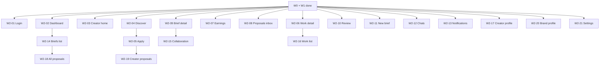

# Phase W2: Screens on Existing Data

# Document Control

- **Version**: 1.0.0
- **Date Created**: 2026-10-30
- **Last Updated**: 2026-10-30
- **Status**: DRAFT
- **Parent**: `operations/specs/web_ledger_mono/01_overview.md`
- **Depends on**: W0 (security fixes and `memberRole`) and W1 (tokens, components, `AppShell`, `useBrandRole`, `money.ts`).
- **Backend items**: None. Hidden parts return in W3 and W4.
- **Task count**: 21
- **Screens**: 21 of 23. Screens 9 (Fund escrow) and 10 (Billing) wait for W3.

---

# Executive Summary

- **Goal**: Rebuild 21 screens with the picked layout, Ledger Mono components, and the data the API gives today.
- **Method**: Each task replaces the JSX and styles of one page. Hooks stay unless a task says EXTEND or NEW. A "Hide" is a part of the picked layout that the builder does not render. Each task names its hides.
- **Entry condition**: W0 and W1 are done. The gallery page at `/dev/components` renders.
- **Exit condition**: All 21 pages render the picked layout in English and Arabic. Every task has its screenshot pair. `pnpm --filter web lint`, `typecheck`, `test`, and `build` pass.

---

# Requirements

- **REQ-W201**: THE SYSTEM SHALL render each screen with the layout the user picked, using only components from `components/ui`.
- **REQ-W202**: THE SYSTEM SHALL show a loading, an empty, and an error state on every screen that fetches data.
- **REQ-W203**: THE SYSTEM SHALL hide or disable an action that the brand role of the caller cannot do (`useBrandRole().can`).
- **REQ-W204**: THE SYSTEM SHALL show no part that needs a backend item that has not shipped.
- **REQ-W205**: THE SYSTEM SHALL keep Arabic and English copy in `locales/en.json` and `locales/ar.json`. A new string has both versions.
- **REQ-W206**: THE SYSTEM SHALL compute every derived money value with `utils/money.ts`.

## Rules for every task

1. **Pages stay at their route.** Change the content of the existing `page.tsx`. Do not move a route, except where a task says so.
2. **Compose, do not style.** Use components from `components/ui`. If a page needs a style that a component lacks, extend the component in W1 files and note it in the phase report.
3. **Hooks.** Reuse the hooks named in the task. A new hook goes in `apps/web/src/hooks/api/` and returns the same shape style as its neighbors.
4. **States.** Use `QueryStateView` for loading, error, and empty. Do not hand-write a spinner.
5. **Role gating.** Brand screens read `useBrandRole()`. A `viewer` sees a read-only page. A hidden button never replaces the API check.
6. **Derive helpers are pure and tested.** Put them in `apps/web/src/utils/` and test them in `apps/web/src/__tests__/`.
7. **Money.** Use `toCents`, `sumCents`, and `formatMoney`. Never `Number()` or `parseFloat` on an amount.
8. **Screenshots.** Take the pair described in `01_overview.md` and save it to `operations/specs/web_ledger_mono/screenshots/<screen-id>/`.
9. **Reference.** The picked render function in `layout-studio.html` shows the target. The studio uses example data. Do not copy its numbers into code.
10. **Status words.** Use the labels in `01_overview.md`. Add no new status word.

## Shared helpers this phase adds

| File | Used by | Contract |
|---|---|---|
| `utils/briefStage.ts` | 2, 14, 18 | `deriveStage(brief): 'draft'|'live'|'in_production'|'in_review'|'completed'` from `status` and `collaborationStatus` |
| `utils/collabStage.ts` | 3, 6, 15, 16 | Display stage and next step label for a collaboration status. One map. |
| `utils/taskRoute.ts` | 3 | `taskToWebRoute(task)` maps a home queue task to a web route by id prefix |
| `utils/ledger.ts` | 7 | `runningBalance(rows)` in cents. Hold rows do not change the balance. |
| `utils/proposalTags.ts` | 8 | `compareTags(proposals)` returns lowest price and fastest delivery per id |
| `utils/briefLifecycle.ts` | 9 | `lifecycleSteps(campaign, collaborations)` returns six steps with state |
| `utils/notificationView.ts` | 13 | Category, amount, and action label for a notification |

`packages/shared-types/src/notifications.ts` gains `NOTIFICATION_CATEGORY` (a map from each `NotificationEvent` to a category). This follows decision 4. Add no second catalog.

---

# Task Dependency Graph



Order of work, from the assessment: 23, 1, 4, 13, 14, 15, 3, 2, 5, 6, 7, then 12, 17, 8, 11, 19, 16, then 18, 20, 21, 22. The task numbers below follow this order. Screen numbers in brackets are the assessment screen numbers.

---

# Tasks

## TASK-W2-01: Login [screen 23, layout B Centered card]

- **Verdict**: REPLACE. The page `app/(auth)/login/page.tsx` (461 lines) has role, method, OTP, email, and password state and a demo login.
- **Studio function**: `logB`.
- **Page**: `apps/web/src/app/(auth)/login/page.tsx`.
- **Components**: `Card`, `Button`, `TextInput` (mono), `SegmentedControl`, `OtpInput`, `HStepper` (two steps), `Tag`.
- **Hooks**: The auth store calls the page uses today (`/auth/otp/send`, `/auth/otp/verify`, `/auth/login`, `/auth/register`). Keep them.

### Layout

1. Logo. A card with a two step indicator (Email, Code). A role segment (brand or creator). The email field. The code boxes. The verify button. A link "Use password instead". A link "Create account". A demo box under the card.
2. Step 1 sends `POST /auth/otp/send` with `{ email, role }`. Step 2 sends `POST /auth/otp/verify` with `{ email, otp, role }`.
3. The resend timer counts 60 seconds, then enables Resend.
4. The code length comes from `OTP_CODE_LENGTH`. Show that many boxes.

### Hide

| Part | Reason |
|---|---|
| Phone field and phone tab | Decision Q14 |
| Demo box when `process.env.NODE_ENV === 'production'` | The demo box must not render in production |

### Notes

- The demo logins use the fixed code, which the API accepts only in development and test (W0 TASK-W0-01). Keep the demo box behind the same env check.
- The language toggle sits on this page, because the user has no settings before sign in.
- The email field and the code boxes stay LTR in Arabic.
- Show the API error for a wrong, expired, or used code as one message: "The code is wrong or expired. Request a new one."

### Test cases

Pure helper `formatResend(secondsLeft)` in `utils/format.ts`: `0:42` for 42, `0:00` for 0.

### Acceptance criteria

1. A brand signs in with a code sent to a real inbox and lands on `/brand/dashboard`. A creator lands on `/creator/home`.
2. A wrong code shows the error and keeps the user on step 2.
3. After 60 seconds the Resend action works and the old code stops working.
4. The demo box shows in `next dev` and does not show in `next build` plus `next start`.
5. Screenshot pair: `login`.

---

## TASK-W2-02: Brand dashboard [screen 1, layout C Pipeline]

- **Verdict**: REPLACE. The page uses `useBrandDashboard` and `useUnreadCount` (279 lines).
- **Studio function**: `dashC`.
- **Page**: `apps/web/src/app/brand/dashboard/page.tsx`.
- **Components**: `SignatureCard` (hero), `Pipeline`, `ListRow`, `Button`, `Kbd`, `Card`, `AvatarStack`.
- **Hooks**: `useBrandDashboard`, `useUnreadCount`, `useMyBriefs` (with `perPage=100`), `useBrandRole`.
- **Helpers**: `utils/briefStage.ts`.

### Layout and data

| Part | Data |
|---|---|
| Greeting, brand name, initials | `useBrandDashboard` `brandName`, `logoUrl` |
| Hero amount | `month.spend`. Label "Funded this month" (decision Q3). |
| Hero sub line | `month.deliverableCount` with the label "approved deliverables" |
| Hero line "still in escrow" | Sum over `useMyBriefs` items: funded minus allocated minus refunded, in cents |
| Pipeline | `deriveStage` over `useMyBriefs` items. Five stages. Draft, Live, In production, In review, Completed. |
| Needs your action | `attention.briefsNeedingProposalReview`, `attention.deliverablesAwaitingReview`, and draft briefs with `escrowFundedAmount` of `0.00` |
| Shortcut tiles | New brief (N), Proposals (P), Review (R), Wallet (W) with counts |

### Hide

| Part | Reveal |
|---|---|
| 6 month bar chart | BG-08 (W3) |
| "Add funds" button. Use "Fund a brief" and link to `/brand/briefs`. | None |
| Released totals | BG-08 (W3) |

### Notes

- A `viewer` does not see "New brief" and "Fund a brief".
- The pipeline uses the latest collaboration only (a known limit, shown in a tooltip text).
- The "Wallet" tile links to `/brand/billing` only when `can('viewBilling')`.
- Keyboard shortcuts N, P, R, W work when no input has focus.

### Test cases

`briefStage.test.ts`:

1. `draft` maps to `draft`.
2. `live` with no collaboration maps to `live`. `paused` with no collaboration maps to `live`.
3. A collaboration `funded`, `shipped`, or `revision_requested` maps to `in_production`.
4. A collaboration `delivered` maps to `in_review`.
5. `completed` or `cancelled` maps to `completed`.

### Acceptance criteria

1. The five stages show the right counts for a seeded brand with one brief in each stage.
2. A `viewer` sees no write button.
3. Screenshot pair: `dashboard`.

---

## TASK-W2-03: Creator home [screen 4, layout A Task queue]

- **Verdict**: REPLACE. The page uses `useHomeQueue`, `useCreatorEarnings`, `useCreatorProfile`, `useUnreadCount` (235 lines).
- **Studio function**: `homeA`.
- **Page**: `apps/web/src/app/creator/home/page.tsx`.
- **Components**: `Card`, `ListRow`, `KpiCells`, `Button`, `Tag`, `GroupHeader`.
- **Hooks**: `useHomeQueue`, `useCreatorEarnings`, `useCreatorProfile`, `useUnreadCount`. NEW: `useLiveCampaigns` (exists in `useCampaigns.ts`, reuse), `useMyProposals` (exists in `useProposals.ts`, reuse).
- **Helpers**: `utils/taskRoute.ts`, `utils/collabStage.ts`.

### Layout and data

| Part | Data |
|---|---|
| Header | `displayName`, date, bell count |
| Do now | `urgentTasks` |
| Coming up | `upcomingTasks` plus "Waiting for brand reply" rows from `useMyProposals` with `applied` or `shortlisted` |
| Briefs for you | `useLiveCampaigns` filtered on the client by `creator.niches`. Show 3 rows. |
| Money card | `useCreatorEarnings`: Available (API `pendingBalance`), In escrow |
| Proposal cells | `useMyProposals`: Applied, Shortlisted, Won |

### Hide

| Part | Reveal |
|---|---|
| Due chip and "Sorted by deadline" | BG-28 and BG-30 (W4) |
| Match percent tag | Later (BG-20) |
| "Confirm product received" action. Route to the work detail page with a note. | BG-29 (W4) |
| Studio "Pending" money cell | Later (Q15) |

### Notes

- `actionUrl` holds mobile paths. Map by the task `id` prefix: `msg-`, `rev-`, `deliv-`, `ship-`, `await-ship-`. Do not match English text. Read `CreatorsService.getHomeQueue` to confirm the prefixes before coding.
- Show an empty state when both lists are empty: "Nothing to do now. Browse briefs."

### Test cases

`taskRoute.test.ts`:

1. `msg-<id>` maps to `/chats/<id>`.
2. `rev-<id>` and `deliv-<id>` map to `/creator/work/<id>`.
3. `ship-<id>` and `await-ship-<id>` map to `/creator/work/<id>`.
4. An unknown prefix maps to `/creator/work`.

### Acceptance criteria

1. Each task row opens the right web page.
2. The money numbers match the earnings page.
3. Screenshot pair: `home`.

---

## TASK-W2-04: Creator discover [screen 13, layout A Filters + list]

- **Verdict**: REPLACE. The page uses `useLiveCampaigns` (145 lines).
- **Studio function**: `discA`.
- **Page**: `apps/web/src/app/creator/discover/page.tsx`.
- **Components**: `Card`, `ListRow`, `SegmentedControl`, `RangeSlider`, `FilterChip`, `Tag`, `Button`.
- **Hooks**: `useLiveCampaigns`, `useCreatorProfile`.
- **Depends on**: W0 TASK-W0-06 (public campaign view). Do not ship this page before it.

### Layout and data

| Part | Data |
|---|---|
| Result count | `meta.total` |
| Niche filter (single select) | `niche` query parameter. Seven rows: All plus the 6 values. Arabic labels in `ar.json`. |
| Language filter | `language` |
| Minimum budget | `minBudget` with a numeric field. Use the slider only for the low handle. |
| Rows | brand, niche, title, length, language, ships product, days left from `closesAt`, budget range |
| Clear filters | Reset the URL query |

State lives in the URL query (`?niche=&language=&minBudget=`). A refresh keeps the filters.

### Hide

| Part | Reveal |
|---|---|
| Search box | BG-16 (W4) |
| Niche multi select and counts | BG-16 (W4) |
| Maximum budget, length, ships product filters | BG-16 (W4) |
| Sort chips | BG-16 (W4) |
| Proposals count and "Few proposals" tag | BG-16 (W4) |
| Match percent | Later (BG-20) |

### Acceptance criteria

1. Each filter changes the list and the URL.
2. The filter panel sits at the inline start (left in English, right in Arabic).
3. The network response for the list contains no escrow counters (check in the Network panel).
4. Screenshot pair: `discover`.

---

## TASK-W2-05: Creator brief and apply [screen 14, layout B Form + brand preview]

- **Verdict**: REPLACE. The page `app/creator/discover/[id]/page.tsx` uses `useCampaign` and `useCreateProposal` (201 lines).
- **Studio function**: `applyB`.
- **Page**: `apps/web/src/app/creator/discover/[id]/page.tsx`.
- **Components**: `KpiCells` (fact strip), `Card`, `SegmentedControl`, `TextInput` (mono), `Button`, `Tag`, `ModalSheet` (full brief), `StatusBadge`.
- **Hooks**: `useCampaign`, `useCreateProposal`, `useCreatorProfile`, `useMyProposals`.
- **Form**: React Hook Form with a Zod schema: `price` (money string inside the budget range), `deliveryDays` (1 to 90), `pitch` (1 to 600).

### Layout and data

| Part | Data |
|---|---|
| Fact strip | `videoType`, `durationSeconds`, `language`, shipping with creator `city`, `budgetMin` to `budgetMax`, `closesAt` |
| Read full brief | `brief`, `talkingPoints`, `doNotSay` in a `ModalSheet` |
| Form | price, delivery days segment (3, 5, 7, 10), pitch with a live `n / 600` counter |
| Preview | name, city, days, price, status badge "Applied", pitch excerpt |
| Already applied | If `useMyProposals` has a proposal for this campaign, show it read-only with its status and hide the form |

### Hide

| Part | Reveal |
|---|---|
| Preview stats row (jobs, approval, revisions) | BG-25 (W4) |

### Notes

- The pitch limit is 600 on the client now. BG-24 adds it on the server in W4.
- The price field stays LTR in Arabic.

### Acceptance criteria

1. A price outside the brand range shows the inline error and disables Submit.
2. A valid submit creates the proposal and shows the "already applied" state.
3. Screenshot pair: `apply`.

---

## TASK-W2-06: Creator work detail [screen 15, layout A Job sheet]

- **Verdict**: REPLACE. The page `app/creator/work/[id]/page.tsx` (330 lines) uses `useCollaboration`, `useCollaborationDeliverables`, and the upload hooks.
- **Studio function**: `workA`.
- **Page**: `apps/web/src/app/creator/work/[id]/page.tsx`.
- **Components**: `HStepper`, `Card`, `Checklist`, `Dropzone`, `TextInput`, `Button`, `StatusBadge`, `KeyValueList`.
- **Hooks**: `useCollaboration`, `useCollaborationDeliverables`, `useRequestDeliverableUploadUrl`, `useRegisterDeliverable`, `useCampaign`.
- **Helpers**: `utils/collabStage.ts`.

### Layout and data

| Part | Data |
|---|---|
| Header | `campaign.title`, `brand.companyName`, `creatorPrice`, `status` |
| Stepper | Accepted (`createdAt`), Shipped (`shipmentConfirmedAt`), V1 sent, Revision, V2 sent, Paid (status) |
| Feedback card | Newest `feedback[]` on the latest deliverable |
| Brief checklist | `talkingPoints` as an unchecked list. The creator may tick items. The page does not save the ticks. |
| Upload | Dropzone: type and size rules from the API (`MAX_UPLOAD_SIZE_MB`, default 500). Do not write "250 MB" in the copy. |
| Notes | `RegisterDeliverableDto.note` |
| Money list | In escrow (`creatorPrice`), "Paid to you when the brand approves" |

### Hide

| Part | Reveal |
|---|---|
| Due chip | BG-30 (W4) |
| "Revision N of 2" limit. Show "Revision N". | BG-31 (W4) |
| Checklist "Done in V1" and "Fix in V2" | Later (BG-37) |
| "Product received" step. Show "Shipped". | BG-29 (W4) |
| Dates on Approved and Paid | BG-33 (W4) |
| Auto-approve line | Later (BG-32) |

### Notes

- The API refuses an upload before shipment when the brief ships a product. Show that state with the reason, and disable the dropzone.
- Check that the web upload does not copy the mobile local test shortcut (AUD-003). Report the result.

### Acceptance criteria

1. A full upload (URL, PUT, register) shows progress, then the new version in the list.
2. A file over the limit and a wrong type show the existing error messages.
3. Screenshot pair: `work-detail`.

---

## TASK-W2-07: Creator earnings [screen 3, layout A Bank statement]

- **Verdict**: REPLACE. The page `app/creator/earnings/page.tsx` (316 lines).
- **Studio function**: `earnA`.
- **Page**: `apps/web/src/app/creator/earnings/page.tsx`.
- **Components**: `SignatureCard` (hero), `KpiCells`, `Equation`, `LedgerTable`, `FilterChip`, `ModalSheet`, `TextInput`, `Button`, `KeyValueList`.
- **Hooks**: `useCreatorEarnings`, `useCreatorLedger`, `useCreatorProfile`, `usePayoutDetails`, `useUpsertPayoutDetails`, `useRequestPayout`. NEW: `usePayoutRequests` for `GET /creators/me/payout-requests` (W0 TASK-W0-07).
- **Helpers**: `utils/ledger.ts` (`runningBalance`).
- **Depends on**: W0 TASK-W0-07.

### Layout and data

| Part | Data |
|---|---|
| Hero "Available" | API `pendingBalance` |
| Hero "In escrow" with job count | `escrowBalance`. Job count from `useMyCollaborations`. |
| Equation | (`pendingBalance` + `clearedBalance`) minus `clearedBalance` equals `pendingBalance`. Label them "Cleared", "Paid out", "Available". |
| Payout method card | `usePayoutDetails` |
| Statement | `useCreatorLedger` rows. Columns: Date, Description, Reference (short ledger id), Status, In, Out, Balance. |
| Filter chips | All, Earnings, Payouts by `sign` |
| Request payout | `ModalSheet` with the amount (default the available amount) and the saved method. Shows the API error text. |
| Open request | If `usePayoutRequests` has a `PENDING` row, disable the button and show "Request sent on <date>" |

### Hide

| Part | Reveal |
|---|---|
| "Pending, clears Nov 01" cell | Later (decision Q15) |
| Brief title and ISO date columns. Parse the date from `meta`. | BG-26 (W3) |

### Test cases

`ledger.test.ts`:

1. A hold row does not change the balance.
2. A release row adds its amount in cents.
3. A payout row subtracts its amount.
4. A mixed list (hold, release, hold, release, payout) gives the expected balance at each row.
5. Rounding: `0.10 + 0.20` gives `0.30`.

### Acceptance criteria

1. The last running balance equals the hero "Available".
2. A request above the balance shows the API message and creates no row.
3. Screenshot pair: `earnings`.

---

## TASK-W2-08: Proposals inbox for a brief [screen 2, layout A Split inbox]

- **Verdict**: REPLACE. The page `app/brand/briefs/[id]/proposals/page.tsx` (374 lines) uses a card list, a profile modal, and an accept modal.
- **Studio function**: `propA`.
- **Page**: `apps/web/src/app/brand/briefs/[id]/proposals/page.tsx`.
- **Components**: `SplitPane`, `ListRow`, `Meter`, `KpiCells`, `StatusBadge`, `Tag`, `Equation`, `Button`, `ModalSheet` (accept confirm), `FilterChip`, `Kbd`.
- **Hooks**: `useCampaign`, `useCampaignProposals` (`perPage=100`), `useCreatorProfilePreview`, `useEscrowBalance`, `useUpdateProposalStatus`, `useAcceptProposal`, `useBrandRole`.
- **Helpers**: `utils/proposalTags.ts`.
- **Depends on**: W0 TASK-W0-04 (role guard).

### Layout and data

| Part | Data |
|---|---|
| Header, escrow box | `useCampaign`, `useEscrowBalance`: available, used of funded, meter |
| Filter chips with counts | Status over the loaded list |
| List | initials, name, city, delivery days, price, status badge |
| Detail | `useCreatorProfilePreview` for the selected proposal: jobs done, approval, average revisions, portfolio (up to 4 items) |
| Tags | Lowest price, Fastest (from `compareTags`) |
| If you accept | "Escrow now" = `available`, "This proposal" = `price`. See Hide. |
| Actions | Decline, Shortlist, Accept. Accept opens the confirm `ModalSheet`. |
| Keys | J and K move the selection. The selection is kept in `?id=`. |

### Hide

| Part | Reveal |
|---|---|
| Approval percent in list rows and the "Top approval" tag | BG-21 (W4) |
| "Left after accept" and the equation result. A price only subtraction would understate the hold by the platform fee. | BG-22 (W3) |
| Portfolio total ("3 of 12") and clip durations | BG-21, BG-36 (W4) |
| Message button before accept | Show it only for `accepted` |

### Notes

- Keep the insufficient escrow path: when accept fails for low escrow, offer top up through `POST /campaigns/:id/escrow/top-up` (owner only).
- Accept raises no second charge (decision 1). The confirm text says "No new charge. The amount moves from campaign escrow."
- Hide the action bar for a `viewer`.

### Test cases

`proposalTags.test.ts`:

1. The lowest price among open proposals gets the tag. A declined proposal never gets a tag.
2. The fastest delivery gets the tag. A tie gives both the tag.
3. With one open proposal, it gets both tags.

### Acceptance criteria

1. J and K move the selection. A refresh keeps it.
2. A `viewer` cannot see Accept, Shortlist, or Decline.
3. Accept creates a collaboration and routes to it.
4. Screenshot pair: `proposals`.

---

## TASK-W2-09: Brief detail [screen 5, layout B Brief document]

- **Verdict**: REPLACE. The page `app/brand/briefs/[id]/page.tsx` (299 lines).
- **Studio function**: `briefB`.
- **Page**: `apps/web/src/app/brand/briefs/[id]/page.tsx`.
- **Components**: `HStepper`, `Card` (document), `KeyValueList`, `Meter`, `KpiCells`, `Button`, `ModalSheet`, `StatusBadge`.
- **Hooks**: `useCampaign`, `useCampaignProposals`, `useEscrowBalance`, `usePauseBrief`, `useResumeBrief`, `useCloseBrief`, `useTopUpEscrow` (all in `useEscrow.ts` and `useCampaigns.ts`), `useBrandRole`. Reuse `useMyCollaborations` and `useBrandProfile`.
- **Helpers**: `utils/briefLifecycle.ts`, `formatRef`.

### Layout and data

| Part | Data |
|---|---|
| Header | title, `formatRef(id)`, status badge ("Open" for `live`), `closesAt` with days left |
| Lifecycle bar | Created (`createdAt`), Funded, Live (`publishedAt`), Creators hired ("N of `slots`" from `useMyCollaborations`), Delivered, Closed |
| Document | company name, `brief`, format list, talking points, "Do not" list |
| Escrow card | `useEscrowBalance` with `Meter`: allocated and available |
| Cells | Proposals (count of `applied`), Hired |
| Actions | Pause, Resume, Fund more (owner), Close and refund (owner) |

### Hide

| Part | Reveal |
|---|---|
| Funded date. Mark the step done with no date when funded is above zero. | BG-15 (W4) |
| Edit button, unless the edit mode in TASK-W2-11 is ready | TASK-W2-11 |

### Notes

- Close shows the refund amount from `available`, in cents, and asks for the reason (existing field).
- Pause needs `owner` or `approver`. Fund more and Close need `owner`. A `viewer` sees no button.
- The lifecycle bar runs right to left in Arabic.

### Test cases

`briefLifecycle.test.ts`:

1. A draft brief has Created done and every other step todo.
2. A funded and published brief has Created, Funded, and Live done.
3. With 1 of 3 slots hired, the hired step is current and shows `1 / 3`.
4. A `completed` brief has every step done.
5. A `cancelled` brief marks Closed done and skips Delivered.

### Acceptance criteria

1. Each state in the tests renders the right bar.
2. Close shows the real refund amount and calls the existing close route.
3. Screenshot pair: `brief-detail`.

---

## TASK-W2-10: Deliverable review [screen 6, layout A Player + decision]

- **Verdict**: REPLACE. The page `app/brand/deliverables/[id]/review/page.tsx` (269 lines).
- **Studio function**: `revA`.
- **Page**: `apps/web/src/app/brand/deliverables/[id]/review/page.tsx`.
- **Components**: `VideoPlayer`, `Checklist`, `Card`, `FilterChip` (reason chips), `TextInput`, `Button`, `Equation` or release row, `ModalSheet`, `StatusBadge`.
- **Hooks**: `useDeliverablePlayUrl`, `useReviewDeliverable`, `useCollaboration`, `useCollaborationDeliverables`, `useCampaign`, `useBrandRole`.

### Layout and data

| Part | Data |
|---|---|
| Header | brief title, creator name, "Version N" (decision Q8: version number, no "of 3") |
| Player | `useDeliverablePlayUrl`, with a signed URL refresh |
| Version switch | `useCollaborationDeliverables` `version` and `createdAt` |
| Checklist | `talkingPoints`. A review aid. The page does not save it and shows no "Met" count. |
| Revisions used | Count of deliverables with `revision_requested` feedback. Show "Revision N used". |
| Release row | `creatorPrice` to the creator. Text: "No new charge. From campaign escrow." |
| Reason chips | Audio, Lighting, Missing talking point, Wrong length, Branding, Captions. Add the chosen chips as a text prefix in `feedback`, as the page does today. |
| Revision text | `feedback` is required for a revision |
| Approve | `action: approve` |
| Overflow menu | Decline (`action: decline`) with a confirm step (decision Q9) |

### Hide

| Part | Reveal |
|---|---|
| "Auto-approves in N days" chip | Later (BG-32) |
| "of 2" revision limit | BG-31 (W4) |
| Checklist "Met" and "Missing" states and count | Later (BG-37) |
| Approve note field | BG-34 (W4) |

### Notes

- Approve and Request revision need `owner` or `approver`. Hide the decision card for a `viewer`.
- Keep the success state after approve ("Deliverable approved. Escrow released.").
- The video controls do not mirror in RTL.

### Acceptance criteria

1. Approve releases escrow and shows the success state. A revision request routes to the collaboration.
2. A revision request with no text shows the existing error.
3. A `viewer` sees the player and no decision card.
4. Screenshot pair: `review`.

---

## TASK-W2-11: New brief [screen 7, layout B One page]

- **Verdict**: REPLACE. The page `app/brand/briefs/new/page.tsx` (504 lines) is a four step wizard.
- **Studio function**: `newB`.
- **Page**: `apps/web/src/app/brand/briefs/new/page.tsx`. Add edit mode at `apps/web/src/app/brand/briefs/[id]/edit/page.tsx` (NEW) that reuses the same form component.
- **Components**: `Card` (section), `SegmentedControl`, `RadioCard`, `RangeSlider`, `TextInput`, `Button`, `KeyValueList`, `Checklist` (summary), `Tag`.
- **Hooks**: `useCreateCampaign`, `useUpdateCampaign`, `useBrandRole`.
- **Form**: React Hook Form with a Zod schema that mirrors `CreateCampaignDto` and `UpdateCampaignDto` limits.

### Layout and data

| Section | Fields |
|---|---|
| Basics | title (3 to 140), category (`niche`, 6 values), ships product (`needsShipping`) |
| Video | format tiles mapped to `videoType` (decision Q5), length (`durationSeconds`: 15, 30, 45, 60), language (`ar`, `en`), brief text, talking points (one per line), "Do not say" lines (`doNotSay`) |
| Budget | `budgetMin` and `budgetMax` with the range slider, `slots` (1 to 50), `closesAt` (date) |
| Sticky summary | Each field with a value, the sections left, and "Review and fund escrow" |
| Preview | How the brief shows in Discover |

The API stores `slots`, `closesAt`, and `doNotSay` on the campaign. They are in `UpdateCampaignDto`. If `CreateCampaignDto` does not accept them, send `POST /campaigns` first and then `PATCH /campaigns/:id` with the three fields before routing to `/brand/briefs/:id/fund`. Read both DTOs before coding.

### Hide

| Part | Reveal |
|---|---|
| "Typical for 30s Arabic reels" benchmark | Later (BG-19) |
| Studio niche labels Fitness, Tech, Kids, Lifestyle | Later (BG-18) |
| Platform tiles (Reel, TikTok, Story) | Later (BG-17, decision Q5) |

### Notes

- Create needs `owner` or `approver`. A `viewer` sees a message and no form.
- Range slider handles follow the reading direction. Budget numbers stay LTR.
- Format tiles use `videoType` values: `unboxing`, `testimonial`, `demo`, `tutorial`, `talking_head`, `try_on`, `other`. Use the labels from the existing locale strings.
- Add an `Edit` route so the Edit button on brief detail can return in a later step (TASK-W2-09 hides it until this task ships).

### Acceptance criteria

1. A valid form creates a draft and routes to the fund page.
2. Each section shows a complete mark when valid. The summary lists what is missing.
3. Edit mode loads an existing draft and saves with `PATCH`.
4. Screenshot pair: `new-brief`.

---

## TASK-W2-12: Chats [screen 12, layout B Two panes]

- **Verdict**: REPLACE for `app/brand/chats/page.tsx` (130 lines) and `app/chats/[collaborationId]/page.tsx` (185 lines). NEW: `app/creator/chats/page.tsx` (decision Q12).
- **Studio function**: `chatB`.
- **Components**: `SplitPane`, `ListRow`, `FilterChip`, `StatusBadge`, `TextInput`, `Button`.
- **Hooks**: `useChats`, `useMarkChatRead`, `useMessages`, `useSendMessage`, `useCollaboration`.

### Layout and data

1. One shared component `ChatWorkspace` holds both panes. `/brand/chats` and `/creator/chats` render it inside their shells. `/chats/[collaborationId]` renders it with that thread selected.
2. List: search (client filter), Active and Closed chips (`approved`, `paid`, `cancelled` count as closed), avatar, name, brief, preview, time, unread.
3. Thread: header with name, brief, status badge, and `creatorPrice`. Messages and system lines from `useMessages`. Composer.
4. Mark the thread read when it opens.
5. Add `Chats` to the creator nav in `AppShell` once this route ships (see W1 TASK-W1-07).

### Hide

None. Money, shipment, and version events are system messages the API already sends.

### Notes

- `ablyWebsockets` is off. Keep the current polling.
- Below 768 px show one pane at a time with a back button.
- Own bubbles sit at the inline end. Times stay in mono LTR.

### Acceptance criteria

1. Sending a message shows it in the thread and in the list preview.
2. The unread count clears when the thread opens.
3. A creator reaches the same screen at `/creator/chats`.
4. Screenshot pair: `chats`.

---

## TASK-W2-13: Notifications [screen 17, layout C Activity ledger]

- **Verdict**: REPLACE. The page `app/notifications/page.tsx` (122 lines).
- **Studio function**: `notC`.
- **Page**: `apps/web/src/app/notifications/page.tsx`.
- **Components**: `DataTable`, `StatusBadge`, `Button`, `Tag`.
- **Hooks**: `useNotifications`, `useMarkNotificationRead`, `useMarkAllNotificationsRead`, `useUnreadCount`.
- **Helpers**: `utils/notificationView.ts`. `NOTIFICATION_CATEGORY` in `packages/shared-types/src/notifications.ts`.

### Layout and data

| Column | Data |
|---|---|
| When | `createdAt`, unread dot from `readAt` |
| Type | Category badge from `NOTIFICATION_CATEGORY[event]`: Money, Proposals, Work, Messages, Briefs |
| Event | Text from the existing `notif.{role}.{event}` strings in the locale files |
| Amount | `params.total`, `params.creatorPrice`, or `params.amount` |
| Action | Route by `collaborationId` or `campaignId` (the page maps both today). Ignore `deepLink`. |

### Hide

| Part | Reveal |
|---|---|
| "New brief for you" rows | Later (BG-38) |

### Test cases

1. A test in `apps/web/src/__tests__/notifications.test.ts` checks that every `NotificationEvent` value has an entry in `NOTIFICATION_CATEGORY`.
2. The amount helper returns the right param per event and an empty value when none exists.

### Acceptance criteria

1. Clicking a row marks it read and opens its route.
2. "Mark all read" clears the unread count.
3. Below 768 px the table shows as cards.
4. Screenshot pair: `notifications`.

---

## TASK-W2-14: Briefs list [screen 8, layout A Table]

- **Verdict**: REPLACE. The page `app/brand/briefs/page.tsx` (127 lines).
- **Studio function**: `listA`.
- **Page**: `apps/web/src/app/brand/briefs/page.tsx`.
- **Components**: `DataTable`, `MiniBar`, `AvatarStack`, `StatusBadge`, `FilterChip`, `Tag`, `Button`, `Kbd`.
- **Hooks**: `useMyBriefs`, `useBrandRole`.
- **Helpers**: `utils/briefStage.ts`.

### Layout and data

| Column | Data |
|---|---|
| Brief | `title` and the next step text derived from the stage |
| Status | Display stage badge |
| Proposals | `proposalCount` |
| Hired | One avatar from `acceptedCreatorName` |
| Escrow used | `escrowAllocatedAmount` over `escrowFundedAmount` in cents, with `MiniBar` |
| Ends | `closesAt` |

Chips use `counts.all`, `counts.open`, `counts.draft`, `counts.completed`. The "/" key focuses the search box. Search filters the loaded page only.

### Hide

| Part | Reveal |
|---|---|
| "+N new" tag | BG-15 (W4) |
| Full hired avatar stack and count | BG-15 (W4) |
| Server search | BG-15 (W4) |

### Acceptance criteria

1. Each chip filters the table and its count matches.
2. A row opens the brief detail.
3. Below 768 px the table shows as cards.
4. Screenshot pair: `briefs`.

---

## TASK-W2-15: Brand collaboration [screen 11, layout A Timeline]

- **Verdict**: REPLACE. The page `app/brand/collaborations/[id]/page.tsx` (224 lines).
- **Studio function**: `collabA`.
- **Page**: `apps/web/src/app/brand/collaborations/[id]/page.tsx`.
- **Components**: `VerticalTimeline`, `Card`, `KeyValueList`, `KpiCells`, `Button`, `StatusBadge`, `TextInput` (shipment form).
- **Hooks**: `useCollaboration`, `useCollaborationDeliverables`, `useConfirmShipment`, `useCreatorProfilePreview`, `useBrandRole`.
- **Helpers**: `utils/collabStage.ts`.
- **Depends on**: W0 TASK-W0-04.

### Layout and data

| Part | Data |
|---|---|
| Header | creator, brief, status badge from the latest deliverable version |
| Timeline | Accepted (`createdAt`, `creatorPrice`), Shipped (`shipmentConfirmedAt`, carrier, tracking), Version N submitted (`createdAt`, `durationSeconds`), Revision requested (feedback text), Approved, Paid |
| Current step action | Review (latest `submitted` deliverable id), or the shipment form when `funded` and the brief ships a product |
| Money card | In escrow (`creatorPrice`) and "Revision N used" |
| Shipment card | Carrier, tracking, shipped date |
| Creator stats | `useCreatorProfilePreview` with `collaboration.proposalId` |

### Hide

| Part | Reveal |
|---|---|
| "Product received" step and "Delivered" badge | BG-29 (W4) |
| Revision limit | BG-31 (W4) |
| Dates on Approved and Paid | BG-33 (W4) |
| File size in the version step | Later (BG-36) |

### Notes

- Confirm shipment needs `owner` or `approver` (W0). Hide the form for a `viewer`.
- Do not add status words. The timeline is a view of the existing collaboration statuses.
- The timeline rail sits at the inline start.

### Acceptance criteria

1. Each status renders the right current step.
2. Confirm shipment saves carrier and tracking and moves the timeline.
3. Screenshot pair: `collaboration`.

---

## TASK-W2-16: Creator work list [screen 19, layout A Table]

- **Verdict**: REPLACE. The page `app/creator/work/page.tsx` (104 lines).
- **Studio function**: `wlA`.
- **Page**: `apps/web/src/app/creator/work/page.tsx`.
- **Components**: `DataTable`, `StatusBadge`, `FilterChip`, `Button`.
- **Hooks**: `useMyCollaborations`, `useCreatorEarnings`.
- **Helpers**: `utils/collabStage.ts`.

### Layout and data

| Column | Data |
|---|---|
| Job | `campaign.title` and `brand.companyName` |
| Status | Display stage badge |
| In escrow | `creatorPrice` while held, else "-" |
| Next step | Text and button from `collabStage` |

Header: "N active" and `escrowBalance`. Chips: Active, Completed, All.

### Hide

| Part | Reveal |
|---|---|
| Due column | BG-30 (W4) |
| Revisions column | BG-31 (W4) |

### Acceptance criteria

1. Each chip filters the table.
2. The next step button opens the right work detail.
3. Screenshot pair: `work-list`.

---

## TASK-W2-17: Creator profile [screen 16, layout A Editor + preview]

- **Verdict**: REPLACE. The page `app/creator/profile/page.tsx` (304 lines).
- **Studio function**: `profA`.
- **Page**: `apps/web/src/app/creator/profile/page.tsx`.
- **Components**: `Card`, `TextInput`, `FilterChip` (niches), `Dropzone`, `Button`, `StatusBadge` (vetting), `Tag`.
- **Hooks**: `useCreatorProfile`, `useUpdateCreatorProfile`, `usePortfolioItems`, `useAddPortfolioItem`, `useDeletePortfolioItem`. NEW: `useRequestUploadUrl` if the profile page does not use one today. Check `useStorage.ts` first.
- **Depends on**: W0 TASK-W0-09.

### Layout and data

| Part | Data |
|---|---|
| Form | `displayName`, `city`, `basePrice` (built from cents on the client), `niches` (6 values) |
| Portfolio | Grid with an add tile. Upload through `POST /storage/upload-url` module `portfolio`, then `POST /creators/me/portfolio-items`. Delete through the new route. |
| Preview | Sticky "What brands see": name, city, "from" price, niches, 3 thumbnails |
| Status badge | `vettingStatus` in the header (decision Q13) |

### Hide

| Part | Reveal |
|---|---|
| Preview stats row | BG-25 (W4) |
| Portfolio limit "6 of 12" | None (no limit exists) |
| Clip durations | Later (BG-36) |
| Studio niche labels Fitness, Tech, Kids, Lifestyle | Later (BG-18) |

### Acceptance criteria

1. Save updates the profile and the preview.
2. Delete removes an item (needs W0 TASK-W0-09).
3. Screenshot pair: `creator-profile`.

---

## TASK-W2-18: Brand all proposals [screen 18, layout C Brief cards]

- **Verdict**: REPLACE. The page `app/brand/proposals/page.tsx` (121 lines).
- **Studio function**: `hubC`.
- **Page**: `apps/web/src/app/brand/proposals/page.tsx`.
- **Components**: `Card`, `AvatarStack`, `Tag`, `StatusBadge`, `GroupHeader`, `ListRow`, `Button`.
- **Hooks**: `useMyBriefs`, `useMyCollaborations`, `useCampaignProposals` (one call per `live` or `paused` brief, `perPage=100`), `useBrandRole`.
- **Helpers**: `utils/briefStage.ts`.

### Layout and data

| Part | Data |
|---|---|
| Header | "N new since yesterday" from proposal `createdAt` and `status` |
| Brief cards | status badge, title, "+N new", total, shortlisted, lowest price, applicant avatars |
| Actions | "Open inbox" for briefs with proposals. "Fund" for `draft` briefs (owner only). |
| Collaborations | `useMyCollaborations`: creator, brief, status, amount |

Run the per-brief calls only for open briefs. Draft briefs make no call.

### Hide

None. RISK-W-04 applies above about 20 open briefs. BG-15 replaces the N calls in W4.

### Acceptance criteria

1. Each card opens the split inbox of its brief.
2. A `viewer` sees no "Fund" and no "New brief".
3. Screenshot pair: `all-proposals`.

---

## TASK-W2-19: Creator proposals [screen 20, layout B Funnel + groups]

- **Verdict**: REPLACE. The page `app/creator/proposals/page.tsx` (66 lines).
- **Studio function**: `mpB`.
- **Page**: `apps/web/src/app/creator/proposals/page.tsx`.
- **Components**: `KpiCells` (funnel with bars), `GroupHeader`, `ListRow`, `StatusBadge`, `Button`.
- **Hooks**: `useMyProposals`.

### Layout and data

| Part | Data |
|---|---|
| Funnel | Sent (all), Shortlisted (status now), Won (`accepted`), Declined (`declined`) |
| Win rate | Won over sent, as a whole percent |
| Groups | Waiting (`applied`, `shortlisted`), Won, Declined. Each row: title, brand, sent date, status, price. |

### Hide

| Part | Reveal |
|---|---|
| "Closes in N days" | BG-23 (W4) |

### Notes

- A proposal that moved from shortlisted to accepted counts as won only.
- Funnel bars grow from the inline start.
- Use the creator labels "Applied" and "Shortlisted" (decision Q6).

### Acceptance criteria

1. The funnel numbers match the group counts.
2. A won row opens the work page.
3. Screenshot pair: `my-proposals`.

---

## TASK-W2-20: Brand profile [screen 21, layout A Editor + preview]

- **Verdict**: REPLACE. The page `app/brand/profile/page.tsx` (206 lines).
- **Studio function**: `bpA`.
- **Page**: `apps/web/src/app/brand/profile/page.tsx`.
- **Components**: `Card`, `TextInput`, `ListRow`, `StatusBadge`, `Button`, `Dropzone`, `Tag`.
- **Hooks**: `useBrandProfile`, `useUpdateBrandProfile`, `useBrandRole`. NEW: `useBrandMembers`, `useInviteMember`, `useUpdateMemberRole`, `useRemoveMember` (routes under `/brands/me/members`). Reuse `useMyBriefs` and `useMyCollaborations` for the preview counts.

### Layout and data

| Part | Data |
|---|---|
| Company form | `companyName`, `category`, `country`, logo upload (`brand_logo`, 5 MB) |
| Team | `GET /brands/me/members`: name, role badge, status. Invite, change role, remove. Pending invite row. |
| Preview | name, category, country, briefs count (`counts.all`), hired count (`meta.total`) |
| Status badge | `verificationStatus` (decision Q13) |

### Hide

| Part | Reveal |
|---|---|
| The whole Team card when `FEATURE_FLAGS.brandTeamManagement` is off (default) | Flag on |
| "Pays in 1.4d" | BG-12 (W4) |
| Resend invite | BG-13 (W4) |

### Notes

- Only `owner` can save and manage the team. An `approver` or `viewer` sees a read-only form.
- Roles come from `brand_members`. Never read them from the JWT (decision 3).

### Acceptance criteria

1. An owner saves the profile and sees the preview update.
2. An approver sees the form with disabled fields and no Save.
3. With the flag on, an owner invites a member and sees the pending row.
4. Screenshot pair: `brand-profile`.

---

## TASK-W2-21: Settings [screen 22, layout C Compact list]

- **Verdict**: REPLACE. The page `app/settings/page.tsx` (94 lines).
- **Studio function**: `setC`.
- **Page**: `apps/web/src/app/settings/page.tsx`.
- **Components**: `Card`, `SettingsRow` (built from `ListRow`), `SegmentedControl`, `Button`.
- **Hooks**: `useAuthStore`, `useTranslation`, `useBrandProfile` or `useCreatorProfile` for the name, `useBrandMembers` for the caller role (flag on only).

### Layout and data

| Part | Data |
|---|---|
| Identity card | Brand `companyName` or creator `displayName`, else email. Role line for a brand. Link to the profile. |
| Language | EN and AR segment with `setLocale` |
| Direction | "Follows language" (static text) |
| Links | Team (brand, flag on), Security ("Email code" and the user email), Billing (brand `owner` or `approver`) |
| Log out | Call `POST /auth/logout` with the refresh token, then clear local state, then route to `/login` |

### Hide

| Part | Reveal |
|---|---|
| Email, in-app, and sound toggles | Later (BG-40) |
| "Card •• 4471" label | Later (BG-41) |
| Saved language on the server | BG-39 (W4) |

### Acceptance criteria

1. Log out ends the refresh token (a refresh call with the old token returns 401).
2. A creator sees no Team and no Billing row.
3. Screenshot pair: `settings`.

---

# Phase Verification

```bash
pnpm --filter @ugcx/shared-types build
pnpm --filter web lint
pnpm --filter web typecheck
pnpm --filter web test
pnpm --filter web build
```

Manual checks, one per task: open the page in English and Arabic, sign in as each role named in the task, take the screenshot pair, and list any hide that the builder added or removed.

# Risks

| ID | Risk | Mitigation |
|---|---|---|
| RISK-W2-01 | A hidden part is forgotten. | Each task lists its hides. The reveal table in `01_overview.md` closes in W4. |
| RISK-W2-02 | A page keeps a hardcoded color or `Number()` money call. | Search the page file for `#` colors, `Number(`, and `parseFloat` before closing the task. |
| RISK-W2-03 | The per-brief calls on screen 18 are slow. | Limit to open briefs. BG-15 replaces them. |
| RISK-W2-04 | A task needs a component change in W1 files. | Allowed. Record each change in the phase report. |

# Open Items for the User

1. Confirm that screen 3 (Creator earnings) is part of W2 (TASK-W2-07).
2. Confirm that `Edit` for a brief (TASK-W2-11) belongs in W2.
3. Decide whether the team section on the brand profile ships behind the flag only.
