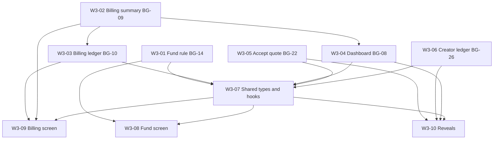

# Phase W3: Money Backend and Money Screens

# Document Control

- **Version**: 1.0.0
- **Date Created**: 2026-10-30
- **Last Updated**: 2026-10-30
- **Status**: DRAFT
- **Parent**: `operations/specs/web_ledger_mono/01_overview.md`
- **Depends on**: W0 (role fixes) and W1 (components, money helper). W2 pages for screens 1, 2, and 3 already ship with their hides.
- **Backend items**: BG-14, BG-09, BG-10, BG-08, BG-22, BG-26.
- **Task count**: 10
- **Screens**: 9 (Fund escrow) and 10 (Billing) are built here. Reveals land on screens 1, 2, and 3.

---

# Executive Summary

- **Goal**: Make the money numbers on the web true and complete. Build the two screens that W2 could not build, then reveal the money parts hidden in W2.
- **Method**: Backend first, one task per item, each with a ledger test. Frontend after. Every new total comes from the `transactions` table (decision 2).
- **Entry condition**: `FundEscrowDto.amount` must sit inside `budgetMin` to `budgetMax`. `BillingService.list` returns `charge` and `refund` rows and one `lifetimeSpend`. The dashboard `month.spend` means funded money. There is no accept quote.
- **Exit condition**: A brand funds `price × slots` in one payment. The billing hero reconciles to the cent. The proposals inbox shows the real hold before accept. The dashboard shows a 6 month chart. The creator statement shows type and reference.

---

# Requirements

## Functional Requirements

- **REQ-W301**: THE SYSTEM SHALL accept a funding amount from `budgetMin` up to `budgetMax × slots`, and default to the midpoint `× slots`.
- **REQ-W302**: THE SYSTEM SHALL return funded, refunded, released, allocated (held and not released), and available totals for a brand, computed from `transactions`.
- **REQ-W303**: THE SYSTEM SHALL list `charge`, `hold`, `release`, and `refund` rows in the brand billing ledger, with the creator name on `hold` and `release` rows.
- **REQ-W304**: THE SYSTEM SHALL never show a `fee` or `payout` row to a brand.
- **REQ-W305**: THE SYSTEM SHALL return a 6 month series of funded and released amounts and the brand totals on the dashboard.
- **REQ-W306**: THE SYSTEM SHALL return a quote for a proposal accept that shows the creator price, platform fee, total hold, and the available escrow after the hold.
- **REQ-W307**: THE SYSTEM SHALL return an ISO date, a type, a brief title, and a reference on each creator ledger row.

## Constraints

- **CON-W301**: Add no ledger table (decision 2). Every total is a query over `transactions` or the campaign counters.
- **CON-W302**: Use integer cents for every sum (decision 5). Do not call `Number()` or `parseFloat` on a money value. Existing uses in the files this phase edits are fixed in the same task.
- **CON-W303**: Do not change the meaning or sign of any field the mobile app reads today. Add fields instead. See DEC-W301.
- **CON-W304**: Escrow stays at the campaign. An accept raises no second charge (decision 1).
- **CON-W305**: Keep the six ledger invariants in `brand_flow_integration/00_overview.md`. Each backend task proves the ones it touches with a test.

## Decisions

| ID | Decision | Reason | Impact |
|---|---|---|---|
| DEC-W301 | Add `escrowAmount` and `direction` to each billing ledger row. Keep `amount` and its sign (charge negative, refund positive) as they are. | Decision Q11 says to change the billing API signs to the escrow view. `apps/mobile` `BrandBillingScreen` reads `amount` today. A sign change would break the mobile screen. CON-W105 forbids mobile changes in this project. | The web reads the new fields. Mobile is untouched. **Flag for the user**: this keeps the intent of Q11 on the web and differs from "change the signs". |
| DEC-W302 | The billing equation has four terms: `funded − refunded − released − allocated = available`. `allocated` means held and not yet released. | Holds stay after a release (invariants 1 and 3). The studio equation leaves out refunded. With a refund, the studio equation fails to add up. | The hero shows a "Refunded" cell. Show it even when it is `EGP 0.00`. |
| DEC-W303 | "Released" in the brand view is the sum of `release` rows. It includes the platform fee, because a release records `totalAmount`. | `release` records what leaves escrow custody. | The released total is larger than the sum of creator prices. The ledger row text says "Released to <creator> (incl. fee)". |
| DEC-W304 | Month buckets use the reporting time zone (`reportingTimeZone`, default `Africa/Cairo`), as `DashboardService.getMonthBoundsInTimezone` does. | The month spend card uses the same zone. | The series and the card agree at month edges. |
| DEC-W305 | Fund amounts above `budgetMax × slots` are refused. Amounts below `budgetMin` are refused. | Keeps the old lower bound so the mobile fund flow still works (RISK-W-06). | A brief with `slots = 3` may fund one creator minimum. Documented, not blocked. |
| DEC-W306 | The accept quote route is open to all three brand roles. | The inbox shows the quote to a `viewer` too. The quote moves no money. | One more read route. |

---

# Task Dependency Graph



Tasks 01, 02, 05, and 06 are independent. Task 03 and task 04 need task 02.

---

# Tasks

## TASK-W3-01: Fund amount rule, price times slots (BG-14)

- **Verdict**: EXTEND. `CampaignsService.fundEscrow` (line 623) accepts `dto.amount` only between `budgetMin` and `budgetMax`. The default is the midpoint. The campaign already has `slots` (1 to 50).
- **Files**:

| File | Change |
|---|---|
| `apps/api/src/modules/campaigns/campaigns.service.ts` | Change the bounds and the default in `fundEscrow` (lines 655 to 677) |
| `apps/api/src/modules/campaigns/dto/fund-escrow.dto.ts` | Keep `amount` as a number. Keep `method`. |
| `apps/api/src/modules/campaigns/campaigns.service.spec.ts` | Add cases |
| `apps/api/test/escrow.e2e-spec.ts` | Add one case |

### Behavior

1. `slots = campaign.slots` (default 1).
2. Lower bound: `budgetMin` in cents (kept, DEC-W305). Upper bound: `budgetMax × slots` in cents.
3. When `dto.amount` is set, convert it with `toCents(dto.amount.toFixed(2))`. The DTO already enforces `maxDecimalPlaces: 2`. This replaces `Math.round(dto.amount * 100)`, which is a float step (decision 5).
4. When `dto.amount` is not set, the default is `round((minCents + maxCents) / 2 / 100) × 100 × slots`. Use integer math: `Math.round((minCents + maxCents) / 2 / 100) * 100 * slots`. This is the current midpoint rule times `slots`.
5. The error message for an out of range amount names the range: "Funding amount must be between X and Y".
6. The `publish` rule stays: available escrow must be at least `budget_min`.
7. `FundEscrowResponse` keeps its shape.

### Test cases

`campaigns.service.spec.ts`:

1. `slots = 1`: the old range still applies. An amount of `budgetMax` passes. `budgetMax + 0.01` fails.
2. `slots = 3`, range 2,000 to 3,000: `7500.00` passes. `9000.01` fails.
3. `slots = 3`, range 2,000 to 3,000: an amount of `1999.99` fails (lower bound).
4. `slots = 3`, no amount: the default is `2,500 × 3 = 7,500.00`.
5. `slots = 1`, no amount: the default is the old midpoint (mobile behavior).
6. `19.99` as a JS number converts to `1999` cents, not `1998`. (Proves no float step.)

`escrow.e2e-spec.ts`: fund `7500.00` on a 3 slot brief and check that `escrow_funded_amount` grows by `7500.00` after the webhook. Invariant 1 holds.

### Acceptance criteria

1. The six cases pass. The existing fund tests still pass.
2. `pnpm --filter api test:e2e` passes for the escrow suite, or the builder reports that the suite needs a database it lacks.
3. A search of `fundEscrow` for `* 100` returns no float step.

---

## TASK-W3-02: Brand money totals (BG-09)

- **Verdict**: EXTEND. `BillingService.list` returns `summary.lifetimeSpend` (charges minus refunds). No funded, released, allocated, or available totals exist for a brand.
- **Files**:

| File | Change |
|---|---|
| `apps/api/src/modules/brands/billing.service.ts` | Add `getTotals(brandId)` and use it in `list` |
| `apps/api/src/modules/brands/billing.service.spec.ts` | Add cases |
| `packages/shared-types/src/billing.ts` | Extend `BillingSummary` (find the file that defines it) |

### Contract

```ts
export interface BrandMoneyTotals {
  funded: string;      // sum of completed charge rows
  refunded: string;    // sum of completed refund rows
  released: string;    // sum of completed release rows (includes platform fee, DEC-W303)
  allocated: string;   // sum of completed hold rows minus released
  available: string;   // funded - refunded - (all holds)
  currency: string;
}
// BillingSummary gains the same fields next to lifetimeSpend.
```

### Behavior

1. One query groups completed rows by `type` for all campaigns of the brand (`campaign.brand_id = :brandId`), for `charge`, `hold`, `release`, and `refund`. Sum with `SUM(CAST(tx.amount AS numeric))` and convert the string to cents with `toCents`. Do not use `Number()`.
2. `holdCents` is the sum of `hold`. `allocated = holdCents − releasedCents`. If the result is negative, clamp at 0 and log a warning (an invariant break).
3. `available = funded − refunded − holdCents`. Check it against the sum of `campaign.availableEscrowCents()` over the brand campaigns in a test.
4. `lifetimeSpend` and `currency` stay.

### Test cases

1. A brand with one charge of 15,000, one hold of 3,520, one release of 3,520, and no refund: funded 15,000, released 3,520, allocated 0, available 11,480.
2. The same brand with a hold of 3,520 and no release: allocated 3,520.
3. With a refund of 300: `funded − refunded − released − allocated` equals `available`.
4. The equation holds for 5 random mixes (loop with fixed seeds).
5. A pending or failed row (status not completed) is ignored.
6. A brand with no rows returns six `0.00` values.

### Acceptance criteria

1. The six cases pass.
2. `GET /brands/me/billing` returns the new summary fields. Mobile still reads `lifetimeSpend`.
3. Ledger invariant 1 is proven in the spec for each case.

---

## TASK-W3-03: Brand billing ledger rows (BG-10)

- **Verdict**: EXTEND. `BillingService.list` filters to `charge` and `refund` rows (line 62 to 64) and labels them "Escrow" and "Refund".
- **Files**:

| File | Change |
|---|---|
| `apps/api/src/modules/brands/billing.service.ts` | Include `hold` and `release`. Add `type` filter. Add `direction` and `escrowAmount`. |
| `apps/api/src/modules/brands/brands.controller.ts` | Accept `type` in the query (find the billing route near line 120) |
| `apps/api/src/modules/brands/dto/billing-query.dto.ts` | NEW or extend the existing query DTO |
| `apps/api/src/modules/brands/billing.service.spec.ts` | Add cases |
| `packages/shared-types/src/billing.ts` | Extend `BillingEntry` |

### Contract

```ts
export interface BillingLedgerItem {
  // existing fields stay
  id: string;
  type: 'charge' | 'refund' | 'hold' | 'release';
  label: string;
  campaignId: string | null;
  campaignTitle: string | null;
  method: string;
  amount: string;             // unchanged sign rule for charge and refund (DEC-W301)
  currency: string;
  createdAt: Date;
  // new
  direction: 'in' | 'out' | 'hold';  // escrow view
  escrowAmount: string;              // always positive, two decimals
  counterpartName: string | null;    // creator display name on hold and release rows
  reference: string;                 // 'TX-' + first 8 hex of id, upper case
}
```

### Behavior

1. Query `tx.type IN (charge, hold, release, refund)` with `tx.status = completed`. Join `collaboration` and `collaboration.creator` for `hold` and `release` rows. Keep `innerJoin` on campaign for `charge` and `refund`. Use a `leftJoin` on collaboration. Apply the brand filter through `campaign.brand_id` (hold and release rows carry `campaign_id` after the Phase 2 migration). Verify with a test on a `hold` row.
2. Direction in the escrow view (decision Q11): `charge` is `in`. `refund` is `out`. `release` is `out`. `hold` is `hold`.
3. Labels: charge "Escrow funded", refund "Refund to payment method", hold "Allocated to <creator>", release "Released to <creator> (incl. fee)".
4. Add the `type` query parameter. When set, filter by that type. Reject unknown values with 400.
5. Never return `fee` or `payout` rows (REQ-W304).
6. Keep the page and `perPage` rules.
7. The old `amount` field keeps today's value and sign for `charge` and `refund`. For `hold` and `release`, set `amount` to the positive amount.

### Test cases

1. A hold row appears with `direction: 'hold'` and the creator name.
2. A release row appears with `direction: 'out'`.
3. `type=release` returns only release rows.
4. `type=foo` returns 400.
5. A `fee` row and a `payout` row never appear.
6. The old `amount` for a charge is still negative and for a refund still positive.
7. Another brand's rows never appear.

### Acceptance criteria

1. The seven cases pass.
2. The mobile billing screen still renders (it ignores the new fields). Run its screen test if one exists, and report it.

---

## TASK-W3-04: Dashboard series and totals (BG-08)

- **Verdict**: EXTEND. `DashboardService.getDashboard` returns `month.spend`, `month.deliverableCount`, `attention`, `activeBriefs`, and `activeBriefCount`. It sums with `Number(row.sum || 0).toFixed(2)`, a float step.
- **Files**:

| File | Change |
|---|---|
| `apps/api/src/modules/brands/dashboard.service.ts` | Add `series`, `totals`, and `month.released`. Fix the float step. |
| `apps/api/src/modules/brands/billing.service.ts` | Reuse `getTotals` (TASK-W3-02) |
| `apps/api/src/modules/brands/dashboard.service.spec.ts` | Add cases |
| `packages/shared-types/src` | Extend the dashboard type (find it with a search for `activeBriefCount`) |

### Contract

```ts
interface DashboardSeriesPoint {
  month: string;      // 'YYYY-MM' in the reporting time zone
  funded: string;     // sum of charge rows (not net of refunds)
  released: string;   // sum of release rows
}
// BrandDashboardData gains:
series: DashboardSeriesPoint[];   // 6 points, oldest first, current month last, missing months are 0.00
totals: BrandMoneyTotals;         // from BillingService.getTotals
// month gains:
released: string;                 // release rows in the current month
```

`month.spend` keeps its meaning (charges minus refunds). The web labels it "Funded this month" (decision Q3).

### Behavior

1. One query groups completed `charge` and `release` rows by `date_trunc('month', tx.created_at AT TIME ZONE :tz)` for the last 6 months, for the brand campaigns. Use the same zone setting as `getMonthBoundsInTimezone`.
2. Fill missing months with `0.00`.
3. Replace `Number(row.sum || 0).toFixed(2)` with a string safe conversion: `toCents` on the raw numeric string from Postgres (`SUM(CAST(tx.amount AS numeric))` returns a string such as `"15000.00"`; pass it through a small `normalizeSum(raw)` helper that pads to two decimals).
4. `totals` calls the TASK-W3-02 method so the dashboard and billing never differ.

### Test cases

1. Six points are returned in order, and the last is the current month.
2. A month with no rows is `0.00` for both fields.
3. A release in the last minute of a month in `Africa/Cairo` falls in that month, not the next.
4. `totals` equals the billing summary for the same data.
5. `month.spend` is unchanged for the existing test data.
6. `normalizeSum('15000')` returns `15000.00`.

### Acceptance criteria

1. The six cases pass.
2. A search of `dashboard.service.ts` for `Number(` returns no money use.

---

## TASK-W3-05: Accept quote (BG-22)

- **Verdict**: NEW route. `EscrowService.quote(creatorPrice)` returns `priceCents`, `feeCents`, and `totalCents`. `EscrowService.getBalance` returns the available escrow. `CollaborationsService.acceptProposal` allocates the total. No read route exposes the numbers before accept.
- **Files**:

| File | Change |
|---|---|
| `apps/api/src/modules/proposals/proposals.controller.ts` | Add `GET proposals/:id/quote` |
| `apps/api/src/modules/proposals/proposals.service.ts` | Add `getAcceptQuote(userId, proposalId)` |
| `apps/api/src/modules/proposals/proposals.module.ts` | Import `EscrowModule` (check for a circular import with `CampaignsModule` and use `forwardRef` only if needed) |
| `apps/api/src/modules/proposals/proposals.service.spec.ts` | Add cases |
| `packages/shared-types/src/proposals.ts` | Add `ProposalQuote` |

### Contract

```ts
export interface ProposalQuote {
  proposalId: string;
  creatorPrice: string;
  platformFee: string;
  totalAmount: string;       // price + fee, what the hold takes
  available: string;         // campaign available escrow now
  availableAfter: string;    // available - totalAmount, can be negative
  sufficient: boolean;
  shortfall: string;         // '0.00' when sufficient
  currency: string;
}
```

### Behavior

1. Load the proposal and its campaign. Check that the caller brand owns the campaign. Return 404 otherwise (same as the other proposal reads).
2. Call `EscrowService.quote(proposal.price)` and `campaign.availableEscrowCents()`.
3. Return the contract. No row is written. No money moves.
4. Roles: `owner`, `approver`, `viewer` (DEC-W306), with `@UseGuards(BrandRoleGuard)`.
5. Only proposals in `applied` or `shortlisted` return a quote. Others return 422 `proposal_not_open`.

### Test cases

1. A 3,200.00 price with a 10 percent fee returns fee `320.00` and total `3520.00`.
2. `availableAfter` is `available − total`. A short balance gives `sufficient: false` and the shortfall.
3. A proposal of another brand returns 404.
4. A `viewer` gets 200.
5. An `accepted` proposal returns 422.
6. The quote total equals the hold that `acceptProposal` records (compare with the allocate path for the same price).

### Acceptance criteria

1. The six cases pass.
2. No database write happens on the route (assert no `save` call in the spec).

---

## TASK-W3-06: Creator ledger fields (BG-26)

- **Verdict**: EXTEND. `CreatorsService.getLedger` (line 335) returns `id`, `title`, `meta`, `amount`, `sign`, `status`, and `statusToken`. `meta` holds the date and collaboration id as text.
- **Files**: `apps/api/src/modules/creators/creators.service.ts`, `apps/api/src/modules/creators/creators.service.spec.ts`, `packages/shared-types/src/creators.ts` (the ledger row type).

### Contract

Each row gains:

```ts
createdAt: string;        // ISO 8601
type: 'hold' | 'release' | 'payout';
campaignTitle: string | null;
reference: string;        // 'TX-' + first 8 hex of id, upper case
```

The existing fields stay. The ledger never returns `fee` rows to a creator (keep).

### Behavior

1. Join `collab.campaign` and select the title.
2. Set `createdAt` from `tx.createdAt.toISOString()`.
3. Set `type` from `tx.type`.
4. Set `reference` as above.

### Test cases

1. A release row has an ISO `createdAt`, `type: 'release'`, the campaign title, and a reference of the form `TX-XXXXXXXX`.
2. A payout row has `type: 'payout'`.
3. No `fee` row appears.
4. The existing fields keep their values (`sign`, `amount`, `status`).

### Acceptance criteria

1. The four cases pass.
2. The mobile payouts screen still renders (extra fields only).

---

## TASK-W3-07: Shared types and web hooks

- **Verdict**: EXTEND for types and `useBilling`, `useBrandDashboard`, `useCreatorLedger`. NEW for `useProposalQuote`, `useManualEscrowPayment`.
- **Files**:

| File | Change |
|---|---|
| `packages/shared-types/src/*` | Types from tasks 02, 03, 04, 05, 06 |
| `apps/web/src/hooks/api/useBilling.ts` | Add the `type` filter argument |
| `apps/web/src/hooks/api/useDashboard.ts` | Type the new fields |
| `apps/web/src/hooks/api/useProposals.ts` | NEW `useProposalQuote(proposalId)` for `GET /proposals/:id/quote` |
| `apps/web/src/hooks/api/useEscrow.ts` | NEW `useManualEscrowPayment(campaignId)` for `POST /campaigns/:id/escrow/manual-payment` |
| `apps/web/src/hooks/api/useCreator.ts` | Type the new ledger fields |

### Contract

```ts
useBilling({ page, perPage, type? })
useProposalQuote(proposalId | undefined)          // enabled when id is set
useManualEscrowPayment(campaignId)                // mutation: { method: 'instapay'|'vodafone_cash', transactionReference, senderAccount?, amount }
```

`ManualEscrowPaymentDto.amount` is a number. The hook accepts a money string and converts it with `Number(centsToAmount(toCents(x)))` only at the request edge. Add a comment that names the API DTO as the reason.

### Acceptance criteria

1. `pnpm --filter @ugcx/shared-types build` and `pnpm --filter web typecheck` pass.
2. Existing pages compile.

---

## TASK-W3-08: Fund escrow screen [screen 9, layout B Receipt]

- **Verdict**: REPLACE. The page `app/brand/briefs/[id]/fund/page.tsx` (265 lines) funds a midpoint and opens Paymob.
- **Studio function**: `fundB`.
- **Page**: `apps/web/src/app/brand/briefs/[id]/fund/page.tsx`.
- **Components**: `Receipt`, `RadioCard`, `SegmentedControl` (slot stepper), `TextInput` (manual payment), `Button`, `ModalSheet`, `StatusBadge`.
- **Hooks**: `useCampaign`, `useEscrowBalance`, `useFundEscrow`, `usePublishCampaign`, `useManualEscrowPayment`, `useBrandRole`, `useBrandProfile`.
- **Depends on**: TASK-W3-01, TASK-W3-07.

### Layout and data

| Part | Data |
|---|---|
| Receipt header | total to fund (`price × slots`), brief title, brand name |
| Lines | Format (`videoType`, `durationSeconds`, `language`), budget range, price used (midpoint), videos (`slots`) |
| Total | `sumCents`: price used in cents times `slots` |
| Pay with | Two `RadioCard`s: "Card (Paymob)" and "InstaPay or Vodafone Cash" (manual). No saved card label. |
| Card path | `useFundEscrow` with the total as an amount, open `checkoutUrl`, poll the balance, then publish (as the page does today) |
| Manual path | Form: method, transaction reference, sender account. `useManualEscrowPayment`. Text: "Goes live after we check the transfer." |
| Declined | The existing `Charge declined` alert with Try again |
| Note | "Held in escrow. Released only when you approve a video." |

The `slots` count comes from the brief. The receipt does not edit it. Editing `slots` belongs to the brief form (TASK-W2-11).

### Hide

| Part | Reveal |
|---|---|
| Saved card "Corporate card •• 4471" | Later (BG-41) |
| "Bank transfer" method name | Replace with InstaPay or Vodafone Cash |

### Notes

- Only `owner` can fund. Show a read-only receipt with a note for `approver` and `viewer`.
- The total must equal the sum of `price used × slots` in cents. The amount sent is the same value.
- On the manual path the brief stays `draft` until an admin verifies (`POST /admin/campaigns/:id/verify-escrow`). Show the status "Waiting for transfer check".
- RISK-W-06: after this task, run the mobile fund flow once and report the result.

### Test cases

`utils/fundTotal.test.ts` (pure helper `fundTotalCents(budgetMin, budgetMax, slots)`):

1. Range 2,000 to 3,000 with 3 slots gives 750,000 cents.
2. Range 2,000 to 3,001 gives a midpoint of 2,500.50 rounded as the API does (`Math.round((min+max)/2/100)*100`), times slots. The helper matches the API rule.
3. `slots = 1` gives the old midpoint.

### Acceptance criteria

1. The receipt total equals `escrow_funded_amount` growth after a card payment in the test environment.
2. A manual payment creates the pending state and does not publish the brief.
3. A decline shows the alert and allows a retry.
4. Screenshot pair: `fund-escrow`.

---

## TASK-W3-09: Billing screen [screen 10, layout A Escrow statement]

- **Verdict**: REPLACE. The page `app/brand/billing/page.tsx` (105 lines).
- **Studio function**: `billA`.
- **Page**: `apps/web/src/app/brand/billing/page.tsx`.
- **Components**: `SignatureCard` (hero), `KpiCells`, `Equation`, `LedgerTable`, `FilterChip`, `StatusBadge`, `Button`.
- **Hooks**: `useBilling({ type })`, `useBrandProfile`, `useBrandRole`.
- **Depends on**: TASK-W3-02, TASK-W3-03, TASK-W3-07.

### Layout and data

| Part | Data |
|---|---|
| Header | company name overline, "Fund a brief" button (owner, links to `/brand/briefs`) |
| Hero cells | Funded, Refunded, Released, Allocated, Available from `summary` |
| Equation | `funded − refunded − released − allocated = available` (DEC-W302) |
| Chips | All, Funded, Released, Allocated, Refunds with counts from the loaded page. The chip sets the `type` query. |
| Ledger | `LedgerTable`: Date, Description, Brief, Reference, Type badge, Amount. Use `escrowAmount` and `direction` for the sign and the icon. |

### Hide

| Part | Reveal |
|---|---|
| "Payment methods" button | Later (BG-41) |

### Notes

- Only `owner` and `approver` can open billing. A `viewer` gets 403 from the API. The nav item is hidden for a `viewer` (W1).
- The equation uses `sumCents` and `subCents`. The test below proves it adds up.

### Test cases

`utils/billingEquation.test.ts`:

1. For the TASK-W3-02 sample data the four terms equal the available value in cents.
2. With a refund the equation still holds.
3. A mismatch of one cent makes the helper return `reconciles: false` (the page shows a small "check" tag in development only).

### Acceptance criteria

1. The hero numbers equal the API summary. The equation reconciles for the seeded brand.
2. Each chip filters the ledger from the API, not only from the loaded page.
3. Screenshot pair: `billing`.

---

## TASK-W3-10: Reveals on screens 1, 2, and 3

- **Verdict**: EXTEND the W2 pages for screens 1, 2, and 3.
- **Files**: `app/brand/dashboard/page.tsx`, `app/brand/briefs/[id]/proposals/page.tsx`, `app/creator/earnings/page.tsx`.

### Reveals

| Screen | Reveal | Source |
|---|---|---|
| 1 Dashboard | 6 month bar chart (`BarChart`, funded and released) | `series` |
| 1 Dashboard | Hero shows "Funded this month" and "Released this month" | `month.spend`, `month.released` |
| 1 Dashboard | "Still in escrow" now uses `totals.available` | `totals` |
| 2 Proposals inbox | "If you accept": this proposal (price + fee), left after accept, "short by X" with a Top up button | `useProposalQuote` |
| 3 Earnings | Reference column and Type badge. Parse nothing from `meta`. | BG-26 fields |

### Acceptance criteria

1. The chart bars match the series values for the seeded brand.
2. The "left after accept" number equals the escrow available after a real accept in the test environment.
3. The statement shows the reference and a type badge on every row.
4. Screenshot pairs for `dashboard`, `proposals`, and `earnings` are taken again.

---

# Phase Verification

```bash
pnpm --filter @ugcx/shared-types build
pnpm --filter api lint
pnpm --filter api typecheck
pnpm --filter api test
pnpm --filter api build
pnpm --filter api test:e2e
pnpm --filter web lint
pnpm --filter web typecheck
pnpm --filter web test
pnpm --filter web build
```

Manual checks:

1. Run the ledger invariants 1, 2, and 3 as SQL queries on the test database after a full fund, accept, release flow. Report the results.
2. Run the mobile fund flow and the mobile billing screen once.
3. Compare the billing hero and the dashboard totals for the same brand. They must match to the cent.

# Risks

| ID | Risk | Mitigation |
|---|---|---|
| RISK-W3-01 | A hold row has no `campaign_id` on older data, so the billing join misses it. | Check the Phase 2 backfill. Add a fallback join through `collaboration.campaign_id`. Test with an old row. |
| RISK-W3-02 | `allocated` goes negative if a release has no matching hold. | Clamp at 0 and log. The invariant test finds the cause. |
| RISK-W3-03 | The fund rule change raises the default amount for mobile briefs with `slots > 1`. | Document it. Mobile sends an amount in most flows. Check the mobile fund call. |
| RISK-W3-04 | Dashboard queries slow down with the series. | One grouped query. Add an index on `transactions (campaign_id, type, created_at)` only if the plan shows a scan. |
| RISK-W3-05 | `EscrowModule` import creates a circular dependency with `ProposalsModule`. | Use `forwardRef` only when Nest reports the cycle. |

# Open Items for the User

1. Confirm DEC-W301. The billing API keeps its old signs and adds `direction` and `escrowAmount`, so mobile does not break. Q11 asked to change the signs.
2. Confirm DEC-W302. The billing equation has a "Refunded" term.
3. Confirm DEC-W305. A multi-slot brief may fund as little as one creator minimum.
