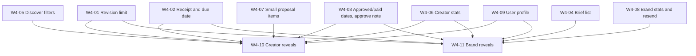

# Phase W4: Workflow Backend and Reveals

# Document Control

- **Version**: 1.0.0
- **Date Created**: 2026-10-30
- **Last Updated**: 2026-10-30
- **Status**: DRAFT
- **Parent**: `operations/specs/web_ledger_mono/01_overview.md`
- **Depends on**: W0, W1, W2. W3 is not required, but run it first so the money screens are stable.
- **Backend items**: BG-31, BG-29, BG-30, BG-33, BG-34, BG-15, BG-16, BG-21, BG-25, BG-23, BG-24, BG-28, BG-12, BG-13, BG-39.
- **Task count**: 11
- **Screens**: No new screen. Reveals land on 2, 4, 5, 6, 8, 11, 13, 14, 15, 16, 18, 19, 20, 21, 22.

---

# Executive Summary

- **Goal**: Give the API the data that W2 hid, then show it. Each backend task ends with a small, tested response change. Two reveal tasks switch the hidden parts on.
- **Method**: Backend tasks are independent unless the graph says otherwise. Every new response field is additive. No field changes meaning.
- **Entry condition**: The W2 pages ship with their hides. The reveal table in `01_overview.md` lists 15 rows to close.
- **Exit condition**: Every row in the reveal table is done or recorded in `plan_later.md`. All new fields have tests. The Arabic and English screenshot pairs for the changed screens are taken again.

---

# Requirements

- **REQ-W401**: THE SYSTEM SHALL store a revision limit per brief (default 2) and refuse a revision request past it.
- **REQ-W402**: THE SYSTEM SHALL let a creator confirm that a shipped product arrived, and tell the brand.
- **REQ-W403**: THE SYSTEM SHALL return a due date for each collaboration, started at product received when the brief ships a product, else at accept (decision Q16).
- **REQ-W404**: THE SYSTEM SHALL return approved and paid dates for a collaboration, read from `transactions`.
- **REQ-W405**: THE SYSTEM SHALL keep the optional note a brand adds on approve.
- **REQ-W406**: THE SYSTEM SHALL return proposal counts, lowest price, hired creators, and the funded date on the brand brief list, without one query per brief.
- **REQ-W407**: THE SYSTEM SHALL filter and sort the creator discover list by search text, niches, budget, length, shipping, and sort key, and return a proposal count per row.
- **REQ-W408**: THE SYSTEM SHALL return creator stats (jobs done, approval rate, average revisions) for each proposal row and for the creator own profile.
- **REQ-W409**: THE SYSTEM SHALL return the brief close date and budget range with each creator proposal.
- **REQ-W410**: THE SYSTEM SHALL limit a proposal pitch to 600 characters.
- **REQ-W411**: THE SYSTEM SHALL return public brand stats and let an owner resend an invite.
- **REQ-W412**: THE SYSTEM SHALL let a user read and save a display name and a language.

## Constraints

- **CON-W401**: One event, two copy strings, two recipients, one catalog (decision 4). A new event goes in `packages/shared-types/src/notifications.ts` and in the notification events map.
- **CON-W402**: Money reads come from `transactions` and the campaign counters (decision 2). Use integer cents (decision 5).
- **CON-W403**: Add no collaboration status word. The new receipt fact is a timestamp.
- **CON-W404**: Use grouped queries. A list route must not run one query per row.
- **CON-W405**: Role checks use `BrandRoleGuard` (decision 3).

## Decisions

| ID | Decision | Reason | Impact |
|---|---|---|---|
| DEC-W401 | Receipt is a column `collaborations.received_at`. The status stays `shipped`. | CON-W403. | One migration. The timeline reads the timestamp. |
| DEC-W402 | `dueAt` is derived, not stored. It is `null` until the clock starts. | A stored value goes stale when the receipt date arrives. | A shipped brief shows no due date until the creator confirms receipt. |
| DEC-W403 | The new event is `shipment_received`. Recipients: `brand_owner_approver`. | Mirrors `shipment_confirmed`. | A Postgres enum change and copy in four locale files, including two mobile files. **Flag for the user**: the mobile app reads the same catalog and needs copy for the new event. This is a locale only change in `apps/mobile`. |
| DEC-W404 | The revision limit lives on the campaign as `revision_limit` (smallint, default 2, 0 to 5). | Decision Q17: per brief. | Brief form gets a field. Old rows get 2. |
| DEC-W405 | The approve note is stored as a `deliverable_feedback` row from the brand user. | The table has `body`, `sender_user_id`, and `created_at` and no kind column. Reusing it keeps one thread. | The creator sees the note in the feedback thread. A revision and an approval note look alike by status. The web shows the note under an approved deliverable as "Approval note". |
| DEC-W406 | Niche facet counts come in `meta.facets.niches` on the discover list. | One request gives the list and the counts. | Counts follow the other active filters. |
| DEC-W407 | `GET /creators/me/stats` and the proposal list stats share one query helper. | CON-W404 and one definition of approval rate. | One new provider, `CreatorStatsService`. |

---

# Task Dependency Graph



All backend tasks (01 to 09) are independent of each other. Task 02 and task 07 both touch the home queue, so run them in order 02 then 07.

---

# Backend Tasks

## TASK-W4-01: Revision limit (BG-31)

- **Verdict**: NEW column and EXTEND. `DeliverablesService.review` (line 244) accepts `request_revision` with no limit. `DeliverableStatus.REVISION_REQUESTED` exists. The campaign has no limit field.
- **Files**:

| File | Change |
|---|---|
| `apps/api/src/modules/campaigns/entities/campaign.entity.ts` | Add `revisionLimit` |
| `apps/api/src/migrations/<next timestamp>-AddCampaignRevisionLimit.ts` | NEW |
| `apps/api/src/modules/campaigns/dto/create-campaign.dto.ts`, `update-campaign.dto.ts` | Add `revisionLimit` (int, 0 to 5, optional) |
| `apps/api/src/modules/deliverables/deliverables.service.ts` | Enforce the limit in `review` |
| `apps/api/src/modules/collaborations/collaborations.service.ts` | Return `revisionsUsed` and `revisionLimit` on detail and list |
| `apps/api/src/modules/deliverables/deliverables.service.spec.ts`, `collaborations.service.spec.ts` | Add cases |
| `packages/shared-types/src` | Extend `Campaign`, `Collaboration` types |

### Data model

Table `campaigns`: add `revision_limit` smallint, not null, default `2`. No index.

### Behavior

1. `revisionsUsed` = count of deliverables of the collaboration with status `revision_requested`.
2. In `review`, when the action is `request_revision` and `revisionsUsed >= campaign.revisionLimit`, throw 422 `revision_limit_reached` with the message "No revisions left. Approve or decline."
3. A limit of 0 means no revisions. The brand can still approve or decline.
4. The collaboration detail and list return `revisionsUsed` and `revisionLimit`.

### Test cases

1. With limit 2 and 1 used, a revision request passes.
2. With limit 2 and 2 used, a revision request returns 422 `revision_limit_reached`.
3. With limit 0, a revision request returns 422. Approve still passes.
4. `revisionsUsed` counts only `revision_requested` deliverables.
5. Old rows read `revisionLimit: 2`.

### Acceptance criteria

1. The five cases pass. The migration runs and reverts.

---

## TASK-W4-02: Product receipt and due date (BG-29, BG-30)

- **Verdict**: NEW route, column, event. EXTEND for detail, list, and home queue. `CollaborationsService.confirmShipment` (line 364) shows the pattern. `CreatorsService.getHomeQueue` already emits a "confirm receipt" task.
- **Files**:

| File | Change |
|---|---|
| `apps/api/src/modules/collaborations/entities/collaboration.entity.ts` | Add `receivedAt` |
| `apps/api/src/migrations/<next>-AddCollaborationReceivedAt.ts` | NEW: column |
| `apps/api/src/migrations/<next+1>-AddShipmentReceivedNotificationEvent.ts` | NEW: `ALTER TYPE "notifications_event_enum" ADD VALUE 'shipment_received'` |
| `apps/api/src/modules/collaborations/collaborations.controller.ts` | Add `POST collaborations/:id/confirm-receipt` |
| `apps/api/src/modules/collaborations/collaborations.service.ts` | Add `confirmReceipt`. Add `dueAt` to detail and list. |
| `apps/api/src/modules/messages/system-message.ts` and `packages/shared-types/src/messages.ts` | Add system event `shipment_received` |
| `packages/shared-types/src/notifications.ts` | Add `shipment_received` to the union |
| `apps/api/src/modules/notifications/notification-events.ts`, `push-copy.ts` | Recipients and push copy |
| `apps/web/src/i18n/locales/en.json`, `ar.json` | Brand and creator copy |
| `apps/mobile/src/i18n/en.json`, `ar.json`, `index.test.ts` | Copy only (DEC-W403) |
| `apps/api/src/modules/creators/creators.service.ts` | Home queue task gets `kind` and `dueAt` (BG-28, see TASK-W4-07) |
| Specs | Add cases |

### Behavior

`POST /collaborations/:id/confirm-receipt`:

1. `@Roles(UserRole.CREATOR)`. The creator must own the collaboration, else 404.
2. The status must be `shipped`, else 422 `invalid_state_transition`.
3. Set `received_at = now`. Keep the status `shipped` (DEC-W401).
4. In one transaction write the system message `shipment_received`, and record the notification to the brand owners and approvers.
5. Return the collaboration.

`dueAt` (DEC-W402), added to the detail and list payloads:

1. Start = `receivedAt` when the campaign `needsShipping` is true, else `createdAt` of the collaboration.
2. `dueAt = start + proposal.deliveryDays days`, or `null` when the start is unknown.
3. Compute with a pure function `computeDueAt(collaboration, campaign, proposal)` in `collaborations/due-at.ts`.

### Test cases

1. The creator confirms receipt on a `shipped` collaboration. `receivedAt` is set and a system message and a notification are written.
2. A second confirm returns 422 (already received) or the same state with no second message. Choose the 422 and test it.
3. A creator who does not own the collaboration gets 404.
4. A brand user gets 403.
5. `computeDueAt` with `needsShipping` false uses `createdAt`.
6. `computeDueAt` with `needsShipping` true and no receipt returns `null`.
7. `computeDueAt` with a receipt adds `deliveryDays` days.
8. The mobile i18n test passes with the new key.

### Acceptance criteria

1. The eight cases pass. Both migrations run and revert. On Postgres 12 or later `ADD VALUE` runs in the migration transaction. The builder reports the version used.
2. The brand sees the system message in the chat.

---

## TASK-W4-03: Approved and paid dates, approve note (BG-33, BG-34)

- **Verdict**: EXTEND. `DeliverablesService.review` (line 244) records `release` and `fee` rows on approve and ignores `feedback`. The collaboration detail has no dates.
- **Files**: `apps/api/src/modules/collaborations/collaborations.service.ts`, `apps/api/src/modules/deliverables/deliverables.service.ts`, `apps/api/src/modules/deliverables/dto/review-deliverable.dto.ts`, specs, `packages/shared-types/src`.

### Behavior

BG-33: The collaboration detail returns `approvedAt` and `paidAt`.

1. `approvedAt` = `createdAt` of the completed `release` transaction of the collaboration, else `null`.
2. `paidAt` = `createdAt` of the completed `payout` transaction, else `null`.
3. Read from `transactions` only (decision 2). Add no column.

BG-34: In `review`, when the action is `approve` and `dto.feedback` is a non-empty string, insert one `deliverable_feedback` row (`senderUserId` = the brand user, `body` = the trimmed text, max 1000 characters) inside the same transaction. Add `@IsOptional() @MaxLength(1000)` for approve (DEC-W405).

### Test cases

1. After approve, `approvedAt` equals the release row time. Before approve it is `null`.
2. After an admin payout, `paidAt` is set.
3. Approve with a note writes one feedback row. Approve with no note writes none.
4. A note over 1000 characters returns 400.
5. A failed approve writes no feedback row (transaction rollback).

### Acceptance criteria

1. The five cases pass.

---

## TASK-W4-04: Brief list enrichment (BG-15)

- **Verdict**: EXTEND. `CampaignsService.listMine` (line 153) runs one query for counts, one for proposals, and one for collaborations. It keeps only the latest collaboration per brief. There is no search, no split of applied and shortlisted, no hired list, and no funded date.
- **Files**: `apps/api/src/modules/campaigns/campaigns.service.ts`, `apps/api/src/modules/campaigns/dto/list-brief-query.dto.ts`, `campaigns.service.spec.ts`, `packages/shared-types/src` (`BriefListItem`).

### Contract (additive)

```ts
// BriefListItem gains:
appliedCount: number;        // proposals with status 'applied'
shortlistedCount: number;    // status 'shortlisted'
totalProposals: number;      // all statuses
lowestPrice: string | null;  // min price among applied and shortlisted, two decimals
hiredCount: number;          // collaborations not cancelled, not payment_failed
hired: Array<{ creatorId: string; displayName: string | null; initials: string }>; // up to 4
fundedAt: string | null;     // createdAt of the first completed charge, ISO
// ListBriefQueryDto gains: q?: string (title search, max 80 chars)
```

`GET /campaigns/:id` also returns `fundedAt`.

### Behavior

1. Add the grouped proposal query: `COUNT(*) FILTER (WHERE status = 'applied')`, the same for `shortlisted`, total, and `MIN(price)` where status is applied or shortlisted, grouped by `campaign_id` for the page of campaign ids.
2. Add one grouped query for hired creators (all collaborations on the page, newest first, cap 4 per campaign in code).
3. Add one grouped query for `fundedAt`: `MIN(created_at)` of completed `charge` rows grouped by `campaign_id`.
4. `q` adds `campaign.title ILIKE :q` with `%` and `_` escaped. Trim the text.
5. `proposalCount` keeps its meaning (applied plus shortlisted). The latest collaboration fields keep working.
6. The route still runs a fixed number of queries per page. Assert that in a test.

### Test cases

1. Counts split correctly for a brief with 2 applied, 1 shortlisted, and 1 declined proposal.
2. `lowestPrice` ignores declined proposals.
3. `hired` caps at 4 and `hiredCount` shows the real number.
4. `fundedAt` is the first charge date and `null` for an unfunded brief.
5. `q` finds a title with different case. A `%` in `q` does not match everything.
6. The query count does not grow with the page size.

### Acceptance criteria

1. The six cases pass. The mobile briefs list still renders (additive fields).

---

## TASK-W4-05: Discover filters (BG-16)

- **Verdict**: EXTEND. `QueryCampaignDto` (niche, language, country, minBudget) and `CampaignsService.listLive` (line 268) sort by `createdAt` descending.
- **Files**: `apps/api/src/modules/campaigns/dto/query-campaign.dto.ts`, `campaigns.service.ts`, `campaigns.service.spec.ts`, `packages/shared-types/src`, `apps/web/src/hooks/api/useCampaigns.ts` (`useLiveCampaigns`).

### Contract

New query parameters (all optional):

| Parameter | Type | Rule |
|---|---|---|
| `q` | string | Search in campaign title and brand company name. 2 to 80 chars. Escape `%` and `_`. |
| `niche` | one value or comma list | Keep single values working. Allow up to 6. |
| `maxBudget` | number | `campaign.budget_min <= :maxBudget` |
| `minDuration`, `maxDuration` | int | On `duration_seconds` |
| `needsShipping` | boolean | |
| `sort` | `newest` (default), `budget`, `closing` | `budget` = `budget_max DESC`. `closing` = `closes_at ASC NULLS LAST`. |

Each row gains `proposalCount` (all non-declined proposals). The response `meta` gains `facets: { niches: Array<{ value, count }> }` computed with the other filters applied but not the niche filter (DEC-W406).

### Behavior

1. Keep the public column rule from W0 TASK-W0-06. New fields pass through `toCreatorView`.
2. The proposal count comes from one grouped query for the page ids.
3. The facet query is one `GROUP BY niche` query.
4. `sort=match` is not supported (BG-20 is deferred). Reject with 400.

### Test cases

1. `q` matches a title and a brand name, and does not match with a `%` wildcard.
2. A comma list in `niche` returns the union.
3. `maxBudget`, duration, and `needsShipping` each filter as stated.
4. `sort=closing` puts a null `closesAt` last.
5. Facet counts ignore the niche filter and respect the others.
6. `sort=match` returns 400.
7. No row contains escrow counters.

### Acceptance criteria

1. The seven cases pass. The mobile discover list still works with its current query.

---

## TASK-W4-06: Creator stats (BG-21, BG-25)

- **Verdict**: NEW provider. `ProposalsService.getCreatorProfilePreview` (line 341) computes `jobsDone`, `approvalRate`, and `averageRevisions` for one proposal. The list route does not return them. A creator cannot read their own stats.
- **Files**:

| File | Change |
|---|---|
| `apps/api/src/modules/creators/creator-stats.service.ts` | NEW |
| `apps/api/src/modules/creators/creators.module.ts` | Provide and export it |
| `apps/api/src/modules/proposals/proposals.service.ts` | Use it in `getCreatorProfilePreview`. Add stats and `portfolioCount` to the list route. |
| `apps/api/src/modules/creators/creators.controller.ts` | Add `GET creators/me/stats` |
| Specs and `packages/shared-types/src` | Types and cases |

### Contract

```ts
interface CreatorStats { jobsDone: number; approvalRate: number; averageRevisions: number }
CreatorStatsService.forCreators(creatorIds: string[]): Promise<Map<string, CreatorStats>>   // one grouped query
```

Read the current formulas in `getCreatorProfilePreview` and copy them exactly. Do not change the numbers the brand sees today.

`GET /campaigns/:campaignId/proposals` rows gain `creatorStats` and `portfolioCount`. `GET /creators/me/stats` returns `CreatorStats` for the caller.

### Test cases

1. `forCreators` returns the same numbers as the old preview code for the same data (parity test).
2. A creator with no jobs returns zeros, not `NaN`.
3. The list route runs one stats query for the whole page.
4. `GET /creators/me/stats` returns only the caller data.
5. `portfolioCount` counts all portfolio items, not only the newest four.

### Acceptance criteria

1. The five cases pass. `getCreatorProfilePreview` output is unchanged.

---

## TASK-W4-07: Small proposal and queue items (BG-23, BG-24, BG-28)

- **Verdict**: EXTEND three small places.
- **Files**: `apps/api/src/modules/proposals/proposals.service.ts` (`listMine`, line 146), `apps/api/src/modules/proposals/dto/create-proposal.dto.ts`, `apps/api/src/modules/creators/creators.service.ts` (`getHomeQueue`), specs, `packages/shared-types/src`.

### Behavior

1. BG-23: In `listMine`, add `campaign.closesAt`, `campaign.budgetMin`, `campaign.budgetMax`, and `campaign.status` to the `addSelect` list. Do not add any escrow column.
2. BG-24: Add `@MaxLength(600)` to `CreateProposalDto.pitch`. A longer pitch returns 400.
3. BG-28: Each home queue task gains `kind` (`message`, `revision`, `delivery`, `shipment`, `awaiting_shipment`) and `dueAt` (from TASK-W4-02, or `null`). Keep `id`, `actionUrl`, and `theme`. Map `kind` from the id prefix in one place.

### Test cases

1. `listMine` rows contain `campaign.closesAt` and no escrow fields.
2. A 601 character pitch returns 400. A 600 character pitch passes.
3. Each task kind matches its id prefix.
4. A task with a known due date returns `dueAt`.

### Acceptance criteria

1. The four cases pass. Mobile ignores the new fields.

---

## TASK-W4-08: Brand stats and invite resend (BG-12, BG-13)

- **Verdict**: NEW. No brand stats route exists. `BrandMembersService.invite` creates invites with no resend.
- **Files**: `apps/api/src/modules/brands/brands.service.ts`, `brands.controller.ts`, `brand-members.service.ts`, `brand-members.controller.ts`, specs, `packages/shared-types/src`.

### Behavior

BG-12: `GET /brands/me/stats` (roles `owner`, `approver`, `viewer`) returns `{ briefsPosted, creatorsHired, avgApprovalDays }`.

1. `briefsPosted` = campaigns of the brand with status other than `draft`.
2. `creatorsHired` = distinct creators with a collaboration on the brand, status not `cancelled` and not `payment_failed`.
3. `avgApprovalDays` = average days from the deliverable `createdAt` to the release `createdAt`, for approved collaborations, rounded to one decimal, or `null` with no data. Use SQL for the average. Round with integer math.

BG-13: `POST /brands/me/members/:id/resend` (`owner` only). The invite must be `pending`. It re-sends the invite email and sets a `last_invited_at` timestamp. Limit to once per 10 minutes (422 `resend_too_soon`). If the members table has no such column, add `invited_at` handling in a migration and report it.

### Test cases

1. Stats on a brand with 2 posted and 1 draft brief return `briefsPosted: 2`.
2. `avgApprovalDays` is `null` with no approvals.
3. A cancelled collaboration does not count as hired.
4. Resend works for an owner, returns 403 for an approver, and 404 for an active member.
5. A second resend within 10 minutes returns 422.

### Acceptance criteria

1. The five cases pass.

---

## TASK-W4-09: User display name and language (BG-39)

- **Verdict**: NEW. `users.locale` exists (enum `users_locale_enum`). No name column. No `/users/me` route.
- **Files**: `apps/api/src/modules/users/entities/user.entity.ts`, a migration for `display_name`, `apps/api/src/modules/users/users.controller.ts` (NEW if missing), `users.service.ts`, `dto/update-me.dto.ts` (NEW), specs, `packages/shared-types/src`.

### Behavior

1. Migration: add `users.display_name` varchar(80), nullable.
2. `GET /users/me` returns `{ id, email, role, displayName, locale }`.
3. `PATCH /users/me` accepts `displayName` (1 to 80 chars, trimmed) and `locale` (enum `UserLocale`). Both optional.
4. Any signed in role can call both routes. A user can only touch their own row.
5. Team list display names use `displayName` first, then the email name part.

### Test cases

1. `GET` returns the caller row only.
2. `PATCH` saves the name and the locale.
3. A locale outside the enum returns 400.
4. A name of 81 characters returns 400.
5. The team list prefers `displayName`.

### Acceptance criteria

1. The five cases pass. The migration runs and reverts.

---

# Reveal Tasks

## TASK-W4-10: Creator side reveals

- **Verdict**: EXTEND the W2 pages named below.
- **Depends on**: TASK-W4-01, 02, 03, 05, 06, 07, 09.

| Screen and page | Reveal |
|---|---|
| 4 Creator home | Due chip and "Sorted by deadline" (`dueAt`, `kind`). Real "Confirm product received" action (calls `confirm-receipt`). |
| 15 Work detail | Due chip. "Product received" step. "Revision N of M". Dates on Approved and Paid. Approval note under an approved deliverable. |
| 19 Work list | Due and Revisions columns |
| 13 Discover | Search box, niche multi select with counts, maximum budget, length, ships product, sort chips, proposals count, "Few proposals" tag (a client rule: 4 or fewer) |
| 14 Apply | Preview stats row (`GET /creators/me/stats`). Pitch limit now enforced by the API. |
| 16 Creator profile | Preview stats row |
| 20 Creator proposals | "Closes in N days" |
| 22 Settings | Name from `GET /users/me`. Language saved with `PATCH /users/me`. |

New hooks: `useConfirmReceipt` (mutation), `useCreatorStats`, `useMe`, `useUpdateMe`. Extend `useLiveCampaigns` with the filter parameters. Remove each hide note from the page. Update the locale files with the new strings in English and Arabic.

### Acceptance criteria

1. Each row in the table shows on its page with real data.
2. A creator confirms receipt and the brand sees the system message.
3. Screenshot pairs for the eight screens are taken again.

---

## TASK-W4-11: Brand side reveals

- **Verdict**: EXTEND the W2 pages named below.
- **Depends on**: TASK-W4-01, 02, 03, 04, 06, 08, 09.

| Screen and page | Reveal |
|---|---|
| 2 Proposals inbox | Approval percent in list rows. "Top approval" tag. Portfolio total ("3 of 12"). |
| 5 Brief detail | Funded date in the lifecycle bar. Edit button (edit route from TASK-W2-11). |
| 6 Review | Revision limit "N of M". Approve note field. |
| 8 Briefs list | "+N new" tag. Hired avatar stack and count. Server search (`q`). |
| 11 Collaboration | "Product received" step. Revision limit. Dates on Approved and Paid. |
| 18 All proposals | Replace the per-brief calls with the new list fields |
| 21 Brand profile | "Pays in N days" stat. Resend invite action. |
| 7 New brief | `revisionLimit` field in the Video section (0 to 5, default 2) |
| 22 Settings | Name from `GET /users/me`. Team row uses display names. |

New hooks: `useBrandStats`, `useResendInvite`, `useMe`. Remove each hide note from the page. Add English and Arabic strings.

### Acceptance criteria

1. Each row shows with real data. Screen 18 makes one call for briefs and one for collaborations.
2. A brand sets a revision limit of 1 and the second revision request is refused with the message.
3. Screenshot pairs for the changed screens are taken again.

---

# Phase Verification

```bash
pnpm --filter @ugcx/shared-types build
pnpm --filter api lint
pnpm --filter api typecheck
pnpm --filter api test
pnpm --filter api build
pnpm --filter api migration:run
pnpm --filter api migration:revert
pnpm --filter api migration:run
pnpm --filter web lint
pnpm --filter web typecheck
pnpm --filter web test
pnpm --filter web build
pnpm --filter mobile typecheck
```

Manual checks:

1. Walk one job end to end: accept, ship, confirm receipt, submit, request a revision, approve, mark paid. At each step the web screens show the right step and date.
2. Open the mobile app and check that the briefs list, discover list, billing, and chat still render.

# Risks

| ID | Risk | Mitigation |
|---|---|---|
| RISK-W4-01 | `ALTER TYPE ADD VALUE` fails inside a migration transaction on old Postgres. | Report the Postgres version. Use a separate migration with `transaction = false` if needed. |
| RISK-W4-02 | The new event has no mobile copy and shows a raw key. | Add copy to the mobile locale files in TASK-W4-02 and run the mobile i18n test. |
| RISK-W4-03 | The grouped queries in TASK-W4-04 and TASK-W4-05 are slow on a large table. | Check the query plan. Add an index on `proposals (campaign_id, status)` if it scans. |
| RISK-W4-04 | Stats formulas drift between the preview and the list. | TASK-W4-06 has a parity test and one shared provider. |
| RISK-W4-05 | Search text with `%` or `_` matches every row. | Escape in both search routes. Test it. |

# Open Items for the User

1. Confirm DEC-W403. A new notification event needs copy in the mobile locale files.
2. Confirm DEC-W405. The approve note reuses the feedback table.
3. Confirm that `revisionLimit` is a brief form field (Q17).
